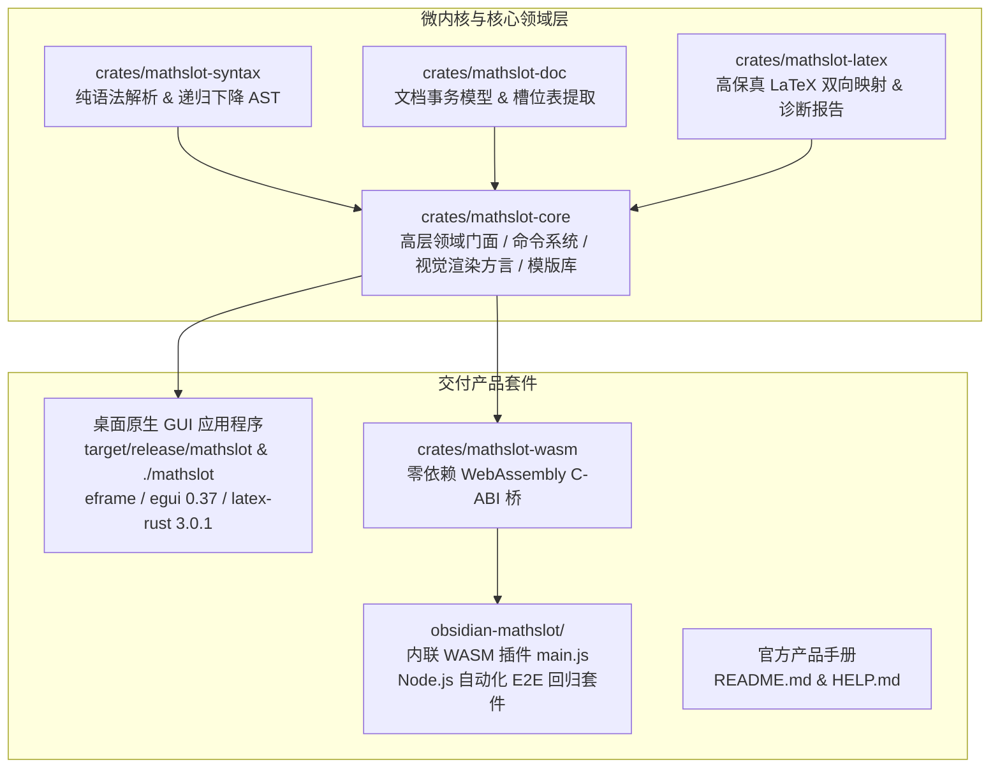

# MathSlot · 超轻量流式简码公式编辑器（原生桌面端 + Obsidian 插件同源）

[](https://www.rust-lang.org/)
[](LICENSE)
[]()
[](obsidian-mathslot/)

**MathSlot** 是一款面向学者、算法工程师与重度数学公式输入者的**书写流优先、零语法死记、免鼠标点选**下一代公式编辑器。项目采用**纯 Rust 微内核 + 同源双端架构**：
- **原生极简桌面端 (`mathslot`)**：基于 `eframe` (egui 0.37) 与纯 Rust 数学排版引擎 `latex-rust` 3.0.1，内嵌 STIX Two Math 字体，零系统 WebKit 依赖、零 Typst 巨型编译器依赖，毫秒级冷启动；
- **Obsidian 插件端 (`obsidian-mathslot/`)**：将同一套核心编译为零依赖、极小体积的 WebAssembly 二进制内联进插件，直接复用 Obsidian 内置 MathJax 渲染，支持 `Ctrl+Enter` 一键插入当前笔记光标处（桌面端与移动端 Obsidian 通用）。

---

## 核心特性

1. **高频单字母直达 + 二级菜单默认项**：
   - **12 个高频结构单字母直达**：按 `Tab` 插入前导符 `▸` 后，仅需 **1 个字母**即可生成常用结构：
     - `▸f` 分数（Fraction）
     - `▸r` 根号（Square Root）
     - `▸i` 定积分（Definite Integral）
     - `▸s` 求和（Summation）
     - `▸l` 极限（Limit）
     - `▸u` 上标（Superscript）
     - `▸d` 下标（Subscript）
     - `▸b` 上下标（Sub-superscript）
     - `▸p` 括号包裹（Parentheses）
     - `▸v` 绝对值（Absolute Value / Norm）
     - `▸n` N 次根（N-th Root）
     - `▸e` 二项式系数（Binomial `\binom`）
   - **极限趋向箭头零记忆输入**：`▸l`（极限）原生设为三槽位 **`趋近变量 ; 趋近目标 ; 主体`**，自动生成 `\to`（`→`），例如输入 `▸lx;0;▸fsin x;x;` 直接输出标准 `\lim_{x \to 0} \frac{\sin x}{x}`；单独输入趋向箭头可直接敲自然 ASCII 简写 **`->`** 或按 `Tab o b`（`▸ob`）。
   - **7 组二级子菜单均带 ★默认项**：低频或成组条目归入 `c`（微积分/连乘）、`m`（矩阵/分段）、`a`（标注/向量/定界）、`g`（希腊字母）、`o`（常用算子/常数）、`x`（关系符/箭头）、`q`（集合/逻辑），展开子菜单后按 `Enter` 或 `Space` 一键选用默认项。

2. **标准 LaTeX 语法对齐与扩展宏库**：
   - **原生 `{...}` 大括号分组保留**：文本中直接键入 `{...}` 作为标准 LaTeX 语法分组原生保留，绝不转义为 `\{...\}`，输入未闭合时自动平衡防崩；
   - **高阶数学结构全覆盖**：偏导分式 `▸cg` (`\frac{\partial}{\partial}`)、全导分式 `▸ch` (`\frac{\mathrm{d}}{\mathrm{d}}`)、三重积分 `▸ce` (`\iiint`)、3×3 方阵 `▸mg`、3×3 行列式 `▸mh`、二阶导双点 `▸ah` (`\ddot`)、下划线 `▸ai`、上下大括号 `▸ci/▸cj`、取整/角括号/中括号/大括号定界符；
   - **丰富符号与自然简写直输**：普朗克常数 `\hbar` (`▸ol`)、垂直 `\perp` (`▸oq`)、平行 `\parallel` (`▸op` 或 `||`)、同余 `\cong` (`▸or` 或 `~=`)、远大于/小于 `<<` `>>`、复数集 `\mathbb{C}` (`▸qm`)；常用算子 `*` 转 `\cdot`，`xx` 转 `\times`，`<=>` 转 `\Leftrightarrow`，`-+' 转 `\mp`。

3. **公认学术规范排版 (ISO 80000-2 / AMS 规范)**：
   - **直立微分算子与薄间距**：严格对齐学术规范，微分算子采用标准直立体 `\mathrm{d}t`、`\mathrm{d}x`（非斜体 $dt$），积分中微分项前自动添加薄间距 `\,`（如 `\int f(x) \,\mathrm{d}x`）；留空分子自动成为微分算子 `\frac{\mathrm{d}}{\mathrm{d}x}` 与 `\frac{\partial}{\partial x}`；
   - **规范数学常数与算子**：支持标准自然常数 `\mathrm{e}`、虚数单位 `\mathrm{i}`、定义符号 `\coloneqq`（`:=`）及 `\operatorname` 宏。

4. **⇄ LaTeX 逆向导入与双向互转**：
   - 顶部提供 **「⇄」** 导入窗口，可直接粘贴来自论文、网页、AI 助手或他人笔记中的任意标准 LaTeX 公式（支持 `$..$`、`$$..$$` 或纯代码）；
   - 内置智能反编译引擎秒级将公式反推解析为 MathSlot 极速流式简码，提供双向闭环校验与一键替换/追加到当前编辑器。

5. **嵌套根号/分式精确层级框 + 实时绿色光标 `∣`**：
   - 实时预览会将光标当前所处的**最内层活跃槽位**整体包裹在柔和绿色作用域框内，并在精确字符处显示绿色光标竖线 `∣`：
     - `▸r1+▸rx`（光标在内层根号）$\to$ 仅内层 `x ∣` 绿框高亮；
     - `▸r1+▸rx;`（按一次 `Enter` 退出内层根号）$\to$ 外层根号 `1 + √x ∣` 整体绿框高亮；
     - `▸r1+▸rx;;`（再按一次 `Enter` 退出全部根号）$\to$ 绿框消失，光标 `∣` 明确落于所有根号之外。

6. **前置智能主体包裹 (Smart Prepend)**：
   - 先写好主体（如 `▸fsin x;x; = 1`），再按 `Tab j` 进导航后按 `a` 跳到最前面插入 `Tab l`（极限）：**自动将已有式子作为极限主体**，等号右侧保留在外，光标留在条件槽填 `x` 与 `0`；`Ctrl+Z` 可随时退回未包裹状态。积分 `Tab i`、求和 `Tab s`、分数 `Tab f` 同样适用。

7. **增强导航与 2D 直觉穿梭**：
   - **行首 `[a]` / 行尾 `[;]`**：`Tab j` 进入导航后按 `a` 跳到行首，按 `;` (或 `.`) 跳到行尾；
   - **返回上一个跳转位置 `[-]`**：导航中按 `-`（或 `Alt+←`）在刚才位置与当前位置间乒乓对调，编辑位移自动跟踪；
   - **2D 方向键穿槽**：`↑`/`↓` 在分子↔分母、上下限、上下标、极限条件↔主体、矩阵行间穿梭；`←`/`→` 原子跳过结构指令前缀。
   - **括号自动配对与括号导航**：键入 `(` / `[` / `{` 自动补右半并停在括号内；输入配对右括号直接跳过；空配对 `Backspace` 一次删除两边；导航中按 `(` / `)` 跳到当前括号的内侧/外侧。

8. **零改源码扩展新格式 (`[k▸]`) 与公式模版复用 (`[t▸]`)**：
   - **自定义数学格式**：用 `$1`, `$2`… 模板语法定义任意 LaTeX 宏，永久保存在 `~/.config/mathslot/library.json`；
   - **一键存模版**：点击「+」(`Ctrl+Shift+S`) 一键保存光标处子结构或整行公式，填空模版调用时自动落位空槽。

9. **现代双栏工作台 UI 架构与全宽结构提示主体面板**：
   - **48px 顶部功能导航栏**：集成 `∑ MathSlot` 品牌标识、状态胶囊、`⚡ 导航 [Tab j / Alt j]`、LaTeX 逆向导入、扩展管理、跳转历史、撤销/重做、清空、示例及帮助；
   - **左栏三框常驻极简工作台**（460px 固定宽，无冗余标题，零跳变）：
     1. **纯白公式预览框**（100px）：预览真实 LaTeX 排版效果，与导航彻底解耦，导航时不丢弃公式真实内容；
     2. **AST 导航结构框**（96px）：常驻预览下方，高度恒定；普通态展示槽位分层图与导航按钮，导航态展示跳转徽章；
     3. **输入与输出框**：流式高亮输入栏、定界符切换（`LaTeX`、`$…$`、`$$…$$`、```` ``` ````）、高反差一键复制按钮与点击即拷代码框；
   - **右侧全宽结构提示主体面板 (CentralPanel)**：专为不熟悉 LaTeX 的用户设计；首屏呈现 12 大常用结构与 12 大高频符号大卡片网格，大号直观符号 + 中文名称 + 键位徽章，鼠标点击直接插入，无需死记语法；
   - **Obsidian 插件一键直插笔记**：去除复制粘贴步骤，模态弹窗中一键或 `Ctrl+Enter` 直接写入当前笔记光标处；
   - **26px 极简底部状态栏**：左侧实时呈现操作提示，右侧常驻核心操作键位提示（`Tab j / Alt j` 导航等）。

---

## 工程架构与微内核切片

MathSlot 采用现代 Rust 分层微内核设计，实现了语法解析、事务编辑与渲染层的高内聚、低耦合：



### Workspace 模块分工

| 模块 / 路径 | 角色与类型 | 核心职责 |
| :--- | :--- | :--- |
| `crates/mathslot-syntax` | 纯语法库 | 手写递归下降解析器、AST、词法分析器、格式化输出 |
| `crates/mathslot-doc` | 文档事务库 | 槽位表提取、原子编辑操作、输入合并优化、Undo/Redo 事务 |
| `crates/mathslot-latex` | 转换与验证库 | LaTeX AST 映射、高保真无损导入导出、诊断报告生成 |
| `crates/mathslot-core` | 领域门面与兼容桥接 | 统一导出 Session 门面；承载 `command`, `visual`, `library`, `scheme_a`, `editor` 等核心交互运行时 |
| `src/` (root package) | 桌面端二进制 crate | 原生 GUI 交互界面、后台多线程 `latex-rust` 公式渲染、调色板卡片、模态弹窗 |
| `crates/mathslot-wasm` | WebAssembly C ABI | 针对 `wasm32-unknown-unknown` 编译，提供极低内存占用的双端通用二进制桥 |
| `obsidian-mathslot/` | 笔记软件插件套件 | 提供内嵌式公式编辑器、内联 Base64 WASM 二进制打包脚本与端到端 Node.js 回归套件 |
| `README.md` & `HELP.md` | 产品官方文档 | 完整的开发者指南、产品蓝图、用户手册与键位速查表 |

---

## 编译与使用快速开始

### 1. 原生超轻量桌面端

```bash
# 全套件单元与集成测试（100% 绿灯保证）
cargo test --workspace

# 编译并运行桌面端
cargo run --release

# 或者编译生成二进制并在根目录下直接执行软链接
cargo build --release
./mathslot
```

### 2. 构建与安装 Obsidian 插件

```bash
# 进入插件工程目录
cd obsidian-mathslot

# 重新编译 WASM 并打包自包含插件（内置 8 项端到端自动化 smoke test）
node scripts/build.mjs

# 安装到你的 Obsidian 知识库（替换 /path/to/your/vault）
mkdir -p "/path/to/your/vault/.obsidian/plugins/mathslot"
cp manifest.json styles.css main.js "/path/to/your/vault/.obsidian/plugins/mathslot/"
```

然后在 Obsidian **设置 → 第三方插件** 中刷新并启用 **MathSlot Formula Editor**：
- 点击左侧工具栏 **$\Sigma$ 图标**，或按 `Ctrl/Cmd+P` 搜索 **`MathSlot`** 打开流式公式编辑器（亦可为其绑定全局快捷键如 `Alt+M`）；
- 输入完成后按 **`Ctrl+Enter`（macOS `Cmd+Enter`）** 直接将公式插入当前笔记光标处；
- `Tab j` 进入槽位导航，`Esc` 退出导航，`Shift+Esc` 关闭弹窗。

---

## 更多参考

- 完整操作教程、所有快捷键映射及配置示例请参阅 **[使用手册 HELP.md](./HELP.md)**。
- 架构设计方案与演进请参阅 **[docs/DECISION_ROUND_6_FULL_PRODUCT.md](./docs/DECISION_ROUND_6_FULL_PRODUCT.md)**。
