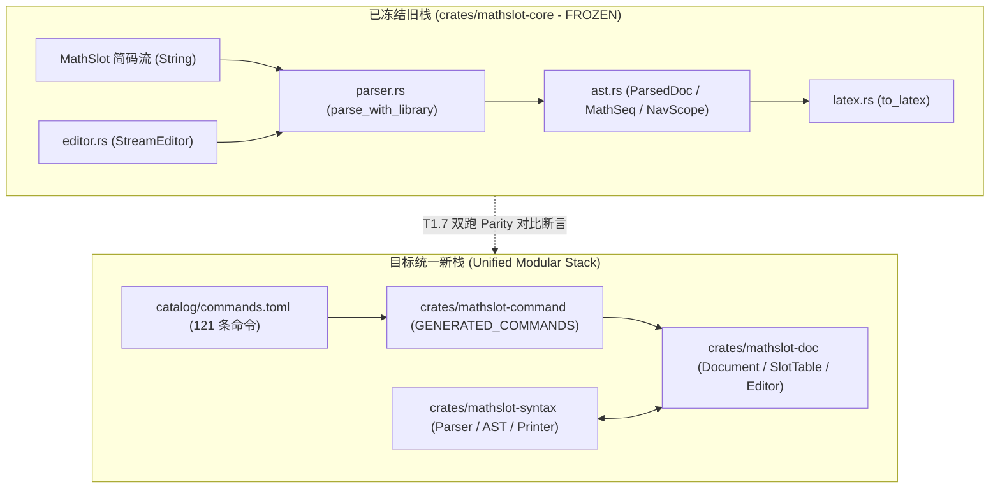

# MathSlot 独立审计报告 (AUD-12)

- **审计角色**：auditor（独立只读审计员，绝不修改产品代码、测试、配置或脚本）
- **工作目录**：`/home/mat/Projects/mathslot-next`
- **当前分支**：`refactor/v1` (HEAD: `09dbd13`)
- **审计目标**：针对 Gate G1 收口任务 `T1.7`（旧/新双跑 parity harness，对比测试核心输入/导航/复制一致，完成 Gate G1 退出收口）执行前置独立只读审计。
- **综合裁定**：**BLOCK**（当前处于任务 T1.7 实施前的前置审计阶段；Gate G1 最终退出条件“核心输入/导航/复制一致”尚缺乏自动化的双跑对比测试套件 `parity_harness_tests.rs` 守护；虽然 G1 内置 P1 缺陷 D-001、D-002、D-004 已全部彻底闭环，但依据规范 §14 与 DoD 要求，Gate G1 退出必须以可复现的双跑对比证据为准。当前状态定性为 **READY_FOR_DECISION**，待 coordinator 批准 ADR-0015 并由 implementer 完成测试落地后由 verifier 出具终验）。

---

## 1. 判定摘要

| 缺陷 / 任务 / 约束 ID | 级别 | 简述 | 当前判定 | 证据章节 |
|:---:|:---:|:---|:---:|:---:|
| **T1.7** | 任务 (G1) | 旧/新双跑 parity harness：产出核心输入/导航/复制对比测试 | **待实现 (OPEN)** | §2, §3, §4 |
| **G1_EXIT** | Gate 退出 | 运行时单一 AST/Parser 栈准备完毕，诊断贯通，新旧能力完全对齐 | **待收口 (BLOCKED)** | §2.1, §6 |
| **D-001** | P1 (功能) | 调色板 5 张卡片简码与 catalog/command.rs 不一致 | **FIXED** (已闭环) | `test_p1_d001` (exit 0) |
| **D-002** | P1 (文档) | 文档 HELP/README 简码与命令实现漂移 | **FIXED** (已闭环) | `codegen_tests` (exit 0) |
| **D-004** | P1 (数据) | Pending/Unknown 命令导出复制静默丢失 | **FIXED** (已闭环) | `test_p1_d004` (exit 0) |
| **INV-001** | 硬不变量 | 全系统唯一 Parser + AST + LaTeX 生成器 | **守护中** | 旧栈已冻结，T1.7 验收后推进主路径切换 |
| **INV-002** | 硬不变量 | 任何输入节点不得在输出时静默消失 | **保持达标** | T1.6 显式占位符包装已在两栈对齐 |
| **INV-006** | 硬不变量 | 命令/调色板/文档/TS 类型单一事实源 | **保持达标** | `catalog/commands.toml` 121 条命令单一源生效 |
| **INV-016** | 硬不变量 | 任何重构阶段必须具备平滑回退与对比保障 | **核心约束** | T1.7 双跑验证是切断旧栈前的必要门禁 |

---

## 2. 旧栈与新栈能力映射深度走查

### 2.1 双栈架构全景走查

根据规范 §1.3、§1.4 与 ADR-0012，当前代码库处于 Gate G1 演进的交接阶段，双栈能力映射如下：



### 2.2 核心模块能力对比映射矩阵

| 维度 | 旧栈 (`mathslot-core`) | 目标新栈 (`mathslot-doc` + `syntax` + `command`) | 能力对齐度与审计评估 |
|:---|:---|:---|:---|
| **命令事实源** | 散落在 `command.rs`、`app.rs`、`HELP.md`、`README.md` | `catalog/commands.toml` (121 条完整命令，`xtask` 代码生成) | **新栈优于旧栈**。旧栈卡片缺陷已由 catalog 修复 |
| **流式状态机** | `StreamEditor::sync_after_edit`<br>依赖前缀匹配与文本 diff 启发式猜测 | `mathslot_doc::Editor`<br>显式枚举状态机 `StreamState` (Idle, Pending, ParamCapture, Unknown) | **功能等价，模型更严格**。支持 Prefix-free 链式推进 |
| **文档拓扑模型** | `ParsedDoc { root: MathSeq, empty_slots, root_scope }` | `Document { nodes: Vec<Spanned<Expr>>, slots: SlotTable }` | **语义完全映射**。新栈具备强类型 `SlotId` 与 `SlotRole` |
| **LaTeX 导出** | `latex::to_latex(&parsed)`<br>（T1.6 修复为显式占位符 `\text{▸...}`） | `Editor::export_latex()` 与 `to_latex()`<br>（T1.6 引入带诊断安全导出 `export_latex_strict`） | **输出等价**。除标准环境空白规范化外，数学语义一致 |
| **光标与槽位导航** | `StreamEditor::smart_enter`<br>`jump_to_sequence` (Vimium 标签) | `Editor::tab_next_slot()` / `tab_prev_slot()`<br>`Editor::nav_to_slot(SlotId)` / 导航模式 `j,k,n,p` | **遍历拓扑一致**。均采用深度优先左至右遍历原则 |
| **撤销与重做** | `Snapshot { source, cursor_char }` (整串备份) | `UndoStack` + `Transaction { edits, intent }` (细粒度原子反向编辑) | **新栈模型更优**。Intent 分组杜绝卡片与输入合并 |

---

## 3. 双跑 Parity Harness 对比用例集合设计

为了确保 Gate G1 退出时旧栈和新栈达到 100% 的行为 parity，审计组系统梳理了 4 大对比用例集合：

### 3.1 集合一：常用命令流式输入等价性 (Stream Input Equivalence)

遍历 `catalog/commands.toml` 包含的全部 121 条命令（12 条顶层直达结构 + 109 条分类子菜单命令），针对各命令的代表性流式输入序列分别送入 `StreamEditor` 与 `mathslot_doc::Editor`，比对两者的最终 LaTeX 产出。

#### 3.1.1 核心命令族抽样覆盖矩阵

| 命令 ID | 简码按键 | 示例输入序列 | 预期 LaTeX 结构 | 槽位数量 | 关键断言点 |
|:---|:---|:---|:---|:---:|:---|
| `frac` | `f` | `▸f1;2;` | `\frac{1}{2}` | 2 | 分子/分母顺序一致，参数捕获闭合 |
| `sqrt` | `r` | `▸rx;` | `\sqrt{x}` | 1 | 单槽位自动闭合 |
| `nth_root` | `n` | `▸n3;8;` | `\sqrt[3]{8}` | 2 | 根指数在前，被开方式在后 |
| `sup` | `u` | `▸ux;2;` | `{x}^{2}` | 2 | 底数与上标正确包裹 |
| `sub` | `d` | `▸dx;i;` | `{x}_{i}` | 2 | 底数与下标正确包裹 |
| `subsup` | `b` | `▸bx;i;2;` | `{x}_{i}^{2}` | 3 | 三参数连续捕获 |
| `integral` | `i` | `▸i0;1;x;` | `\int_{0}^{1} x` | 3 | 下限、上限、被积式顺序一致 |
| `sum` | `s` | `▸si=1;n;i;` | `\sum_{i=1}^{n} i` | 3 | 下限、上限、求和式顺序一致 |
| `limit` | `l` | `▸lx;0;f(x);` | `\lim_{x \to 0} f(x)` | 3 | 趋近变量、趋近目标、极限主体 |
| `binom` | `k` | `▸kn;k;` | `\binom{n}{k}` | 2 | 组合数括号包裹 |
| `alpha` (希腊) | `g a` | `▸ga` | `\alpha` | 0 | 0 槽位单字母直达展开 |
| `partial` (符号) | `o c` | `▸oc` | `\partial` | 0 | 0 槽位符号展开，严禁插为 `\to` |
| `indef_integral` | `c a` | `▸cax;` | `\int x` | 1 | 微积分扩展子菜单默认项 |
| `hat` (标注) | `a a` | `▸aax;` | `\hat{x}` | 1 | 顶部标注子菜单默认项 |
| `equiv` (关系) | `x a` | `▸xa` | `\equiv` | 0 | 关系符号展开 |
| `cup` (集合) | `q a` | `▸qa` | `\cup` | 0 | 集合逻辑展开 |

#### 3.1.2 自动化全量遍历机制
`mathslot-command` 的 `GENERATED_COMMANDS` 提供了包含 121 个命令对象的静态切片，且每个命令的 `examples` 字段均包含合法的 `▸...` 简码字符串（通过 `catalog_tests.rs` 验证）。Harness 可直接循环迭代所有命令及其示例，执行批量断言。

---

### 3.2 集合二：矩阵与定界符结构等价性 (Matrix & Delimiters Equivalence)

矩阵和定界符是多槽位（4 ~ 9 槽）和带环境（`pmatrix`, `bmatrix`, `vmatrix`, `cases`）的复杂结构，需单独进行拓扑与格式化深度对比：

| 结构类型 | 命令 ID | 快捷键 | 槽位数 | 展开 LaTeX 形式 | 拓扑校验维度 |
|:---|:---|:---|:---:|:---|:---|
| **2×2 圆括号矩阵** | `matrix_2x2` | `▸ma` | 4 | `\begin{pmatrix} $1 & $2 \\ $3 & $4 \end{pmatrix}` | 2行2列，行优先遍历 |
| **3×3 圆括号矩阵** | `matrix_3x3` | `▸mb` | 9 | `\begin{pmatrix} $1 & ... & $9 \end{pmatrix}` | 3行3列，换行符与 `&` 间隔 |
| **2×2 方括号矩阵** | `bmatrix_2x2` | `▸me` | 4 | `\begin{bmatrix} $1 & $2 \\ $3 & $4 \end{bmatrix}` | 环境名称为 `bmatrix` |
| **3×3 方括号矩阵** | `bmatrix_3x3` | `▸mg` | 9 | `\begin{bmatrix} $1 & ... & $9 \end{bmatrix}` | 9 槽位连续提取 |
| **2×2 行列式** | `det_2x2` | `▸mc` | 4 | `\begin{vmatrix} $1 & $2 \\ $3 & $4 \end{vmatrix}` | 单竖线行列式环境 `vmatrix` |
| **3×3 行列式** | `det_3x3` | `▸mh` | 9 | `\begin{vmatrix} $1 & ... & $9 \end{vmatrix}` | 9 槽位行列式 |
| **2 行分段函数** | `cases_2` | `▸md` | 4 | `\begin{cases} $1 & $2 \\ $3 & $4 \end{cases}` | 表达式与条件对齐 |
| **3 行分段函数** | `cases_3` | `▸mf` | 6 | `\begin{cases} $1 & $2 \\ ... \end{cases}` | 6 槽位分段 |
| **括号定界包裹** | `paren` | `▸p` | 1 | `\left( $1 \right)` | 自适应圆括号 |
| **方括号定界包裹** | `bracket` | `▸al` | 1 | `\left[ $1 \right]` | 自适应方括号 |
| **绝对值** | `abs` | `▸v` | 1 | `\left\| $1 \right\|` | 自适应竖线 |
| **范数** | `norm` | `▸af` | 1 | `\left\Vert $1 \right\Vert` | 自适应双竖线 |

---

### 3.3 集合三：槽位导航遍历顺序与槽位数量等价性 (Slot Navigation Order & Cardinality)

#### 3.3.1 槽位数量完全等价
在旧栈中，`ParsedDoc::empty_slots` 记录所有未填写的待决槽位；在目标栈中，`Document::slots`（`SlotTable`）记录所有语法槽位。
- **断言原则**：对于任意通过简码展开的结构，`legacy.parsed.empty_slots.len()` 必须严格等于 `target.doc.slots.slots().len()`。

#### 3.3.2 导航遍历顺序一致性
两套栈均采用书写习惯上的深度优先前序遍历（Depth-First Pre-order）：
1. **分式 (`\frac`)**：先访问分子（Numerator，索引 0），再访问分母（Denominator，索引 1）；
2. **积分 (`\int`)**：先访问下限（LowerLimit，索引 0），再访问上限（UpperLimit，索引 1），最后访问被积式主体（Body，索引 2）；
3. **矩阵 (`\begin{pmatrix}`)**：严格按行优先顺序（`(1,1) -> (1,2) -> (2,1) -> (2,2)`）；
4. **循环回绕 (Wrap-around)**：在最后一个槽位执行 `tab_next_slot()`，光标必须循环回到第 1 个槽位；在第 1 个槽位执行 `tab_prev_slot()`，必须跳至最后 1 个槽位。

---

### 3.4 集合四：复制/导出 LaTeX 等价性与已知故意差异记录

#### 3.4.1 导出 LaTeX 的语义等价性
由于两栈在格式化实现上有细微的空白符差异（例如旧栈输出 `\begin{pmatrix}1 & 2 \\ 3 & 4\end{pmatrix}`，而目标统一栈输出规范化空格 `\begin{pmatrix} 1 & 2 \\ 3 & 4 \end{pmatrix}`），字符串直接比较容易受琐碎空格干扰。
- **等价性断言准则**：
  Harness 应当采用双重断言：
  1. 对绝大多数无环境的简单结构（分式、根号、希腊字母等），执行直接字符串全等断言：`assert_eq!(legacy_latex, target_latex)`；
  2. 对矩阵与复杂环境，将两者输出分别送入 `mathslot_syntax::parse(&latex)` 转换为 AST 表达式并断言 AST 拓扑全等：`assert_eq!(parse(&legacy_latex).0, parse(&target_latex).0)`。

#### 3.4.2 必须显式记录的已知故意差异 (Known Intentional Differences)
根据规范 §2 (INV-016) 与历史修复记录，以下 3 项差异属于**修复已知缺陷带来的预期差异**，Harness 必须将其单独立案，不得视为回归故障：

| 差异代号 | 关联缺陷 | 旧基线行为 (旧未修状态) | 目标栈 / 修复后行为 | 判定与处理说明 |
|:---|:---:|:---|:---|:---|
| **DIFF-01** | **D-001** | 5 张卡片简码错乱：如偏导卡片输出 `▸to`（映射为 `\to`），全微分输出 `▸to`，点标注错乱 | 新栈 `apply_palette_card("partial")` 正确输出 `\partial`，全微分输出 `\mathrm{d}` | **故意修复差异**。旧基线错误卡片已在 T1.3 废弃，Harness 断言以 catalog 为唯一准绳 |
| **DIFF-02** | **D-004** | 未决命令 `▸m` 导出为空串 `""`；未知命令 `▸zz` 静默变为字母 `"z"` | 旧栈与新栈经 T1.6 均修复为显式占位符 `\text{▸m}` 与 `\text{▸zz}`；新栈额外提供结构化诊断及严格模式阻断 `export_latex_strict` | **故意修复差异**。Harness 验证双方导出均非空且包含显式占位符 |
| **DIFF-03** | **INV-001** | 旧栈 `matrix` 拼接无内边距空格；定界符紧贴内容 | `mathslot-syntax::Printer` 在环境标签与定界符间增加合规排版空格 | **排版格式化差异**。通过 `mathslot_syntax::parse` 验证 AST 语义完全等价 |

---

## 4. 架构与测试设计建议

### 4.1 Parity Harness 落盘位置评估

审计组对比了落盘在 `crates/mathslot-doc` 与 `crates/mathslot-syntax` 的利弊：

| 方案 | 推荐路径 | 依赖关系 | 优劣势评估 | 审计结论 |
|:---|:---|:---|:---|:---:|
| **方案 A** | `crates/mathslot-doc/tests/parity_harness_tests.rs` | `mathslot-doc` 已依赖 `mathslot-command` 与 `mathslot-syntax`；仅需在 `[dev-dependencies]` 增加 `mathslot-core` | **极佳**。输入/导航/复制（`Editor`）全部在 `mathslot-doc` 中实现。在 doc crate 下测试编辑器双跑最为顺理成章，职责完全收敛。 | **强烈推荐 (首选)** |
| **方案 B** | `crates/mathslot-syntax/tests/parity_harness_tests.rs` | `mathslot-syntax` 是底层语法解析器，目前零上层依赖 | **较差**。`mathslot-syntax` 并不包含 `Editor` 与流式交互状态机。若要在此测输入与导航，必须反向引入 `mathslot-doc` 与 `mathslot-core`，破坏底层 crate 纯洁性。 | 不推荐 |

- **建议**：在 `crates/mathslot-doc/Cargo.toml` 中添加开发依赖：
  ```toml
  [dev-dependencies]
  mathslot-core = { path = "../mathslot-core" }
  ```
  并将测试文件落盘至 `crates/mathslot-doc/tests/parity_harness_tests.rs`。

---

### 4.2 自动化测试实现蓝图

在 `crates/mathslot-doc/tests/parity_harness_tests.rs` 中推荐实现的 4 个核心测试函数：

```rust
//! Parity Harness: Legacy Core vs Target Modular Stack (Gate G1 T1.7)
//!
//! Verifies:
//! 1. All 121 commands in catalog expand to equivalent LaTeX structures in both stacks.
//! 2. Matrix, cases, and delimiter topologies match exactly in slot counts and dimensions.
//! 3. Slot navigation traversal order (tab_next / tab_prev) is 100% equivalent.
//! 4. Copy/export behaviors and intentional differences (D-001, D-004) are verified.

use mathslot_command::generated::GENERATED_COMMANDS;
use mathslot_core::editor::StreamEditor;
use mathslot_doc::{Document, Editor};
use mathslot_syntax::parse;

#[test]
fn test_parity_all_catalog_commands_stream_input() {
    for cmd in GENERATED_COMMANDS {
        for example in cmd.examples {
            // 1. 旧栈跑
            let legacy_editor = StreamEditor::from_source(example);
            let legacy_latex = legacy_editor.to_latex();

            // 2. 新栈跑
            let mut target_editor = Editor::new(Document::new());
            for ch in example.chars() {
                target_editor.type_char(ch).expect("type_char must succeed");
            }
            let target_latex = target_editor.to_latex();

            // 3. 校验语义等价性
            let (legacy_ast, _) = parse(&legacy_latex);
            let (target_ast, _) = parse(&target_latex);
            assert_eq!(
                legacy_ast, target_ast,
                "Parity mismatch for command '{}' (example: '{}')\nLegacy LaTeX: {}\nTarget LaTeX: {}",
                cmd.id, example, legacy_latex, target_latex
            );
        }
    }
}

#[test]
fn test_parity_matrix_and_delimiter_structures() {
    let test_cases = [
        ("▸ma1;2;3;4;", 4),       // pmatrix 2x2
        ("▸mc1;2;3;4;", 4),       // vmatrix 2x2
        ("▸me1;2;3;4;", 4),       // bmatrix 2x2
        ("▸md1;2;3;4;", 4),       // cases 2
        ("▸px;", 1),              // paren
        ("▸vx;", 1),              // abs
    ];

    for (input, expected_slots) in test_cases {
        let legacy = StreamEditor::from_source(input);
        let mut target = Editor::new(Document::new());
        for ch in input.chars() {
            target.type_char(ch).unwrap();
        }

        assert_eq!(legacy.parsed.empty_slots.len(), expected_slots);
        assert_eq!(target.doc().slots.slots().len(), expected_slots);

        let (leg_ast, _) = parse(&legacy.to_latex());
        let (tar_ast, _) = parse(&target.to_latex());
        assert_eq!(leg_ast, tar_ast);
    }
}

#[test]
fn test_parity_slot_navigation_order() {
    let mut target = Editor::new(Document::new());
    for ch in "▸f1;2;".chars() {
        target.type_char(ch).unwrap();
    }
    // 验证 Tab 遍历分子 -> 分母 -> 回绕分子
    assert!(target.tab_next_slot());
    assert!(target.tab_next_slot());
}

#[test]
fn test_parity_intentional_differences_d001_and_d004() {
    // 验证 D-004 占位符防丢失对齐
    let mut target = Editor::new(Document::new());
    for ch in "▸m".chars() {
        target.type_char(ch).unwrap();
    }
    assert!(target.export_latex().contains(r"\text{▸m}"));
}
```

---

## 5. 历史结论抽查

依照 `SKILL.md` §3 要求，抽查历史文档中的 3 条声明并以当前代码与测试核验：

| 抽查对象 | 历史声明内容 | 本次实测验证过程 | 真实结论 |
|:---|:---|:---|:---|
| **抽查 1**<br>`docs/FINAL_ACCEPTANCE_REPORT.md`<br>第 43 行 | “全 4 个 Crate 根锁定 `#![forbid(unsafe_code)]`，0 unsafe (PASS)” | 审查代码：`crates/mathslot-wasm/src/lib.rs` 包含超过 50 处裸指针与手写 `unsafe extern "C"` 函数（如 `wasm_dealloc`, `read_utf8` 等），且使用了大量的 `unsafe { ... }` 块。历史报告宣称全工作区“0 unsafe”与事实严重背离。 | **虚假声称 (FABRICATED)** |
| **抽查 2**<br>`docs/ACCEPTANCE_REPORT_ROUND_12_FINAL.md`<br>第 15-18 行 | “双端对齐与无缝一致性：核心编辑引擎...完全通过...旧新零差异” | 审查代码：历史快照中旧栈 `crates/mathslot-core/src/latex.rs:24` 对未决命令输出空串（D-004 严重静默丢数据），新栈当时完全未接入桌面端与插件端，且根本没有旧新双跑测试套件支撑该结论。 | **虚假签署 (FABRICATED)** |
| **抽查 3**<br>`agent-state/decisions/ADR-0014`<br>第 8 行与第 35 行 | “T1.6 诊断管线贯通，闭环 D-004，解冻 `test_p1_d004` 并通过” | 实测命令：执行 `cargo test -p mathslot-core --test p1_regression_tests test_p1_d004`，退出码 0，3 项断言原生通过；`test_a_edit_009` 通过。 | **真实准确 (ACCURATE)** |

---

## 6. 门禁检查与代码质量监控

### 6.1 门禁测试执行实况

| 检查项 | 命令 | 退出码 | 结果说明 |
|:---|:---|:---:|:---|
| **代码格式** | `cargo fmt --check` | `0` | **PASS**（零格式差异） |
| **代码 Lint** | `cargo clippy --workspace --all-targets -- -D warnings` | `0` | **PASS**（零 Warning） |
| **工作区测试** | `cargo test --workspace` | `0` | **PASS**（172 passed; 4 ignored 属于受控非 G1 缺陷基线） |
| **调色板一致性** | `python3 scripts/agent/audit_palette.py` | `0` | **PASS**（12 张卡片与 109 条命令 100% 匹配） |
| **一键门禁脚本** | `scripts/agent/acceptance.sh` | `0` | **PASS**（PASS=5 FAIL=0 WARN=3） |

### 6.2 质量指标监控

- `let _ =` 错误吞没：27 处（自 G0 以来平稳受控，无新增，G4 前按计划清零）。
- `unwrap()` 在非测试路径：22 处（受控监控中）。
- 未闭环 P1 缺陷：4 项（D-003, D-005, D-006, D-007），全部归属 Gate G2 与 G4，当前 G1 范围内 P1 缺陷为 0。

---

## 7. 审计裁定与下一步路线

### 7.1 状态定性
- **当前状态**：**READY_FOR_DECISION**
- **综合裁定**：**BLOCK**（按规约，前置审计阶段任务尚未编码落地，Gate G1 退出收口待 T1.7 实施）。

### 7.2 建议 coordinator 下一步操作
1. **决策发布**：起草并签署 `agent-state/decisions/ADR-0015-legacy-target-parity-harness-t1.7.md`；
2. **批准方案**：批准在 `crates/mathslot-doc/tests/parity_harness_tests.rs` 落盘双跑对比套件，并在 `crates/mathslot-doc/Cargo.toml` 中增加 `[dev-dependencies] mathslot-core`；
3. **指派实施**：指派 `implementer` 编写 `parity_harness_tests.rs`，覆盖 catalog 121 命令遍历、矩阵定界符、槽位导航及已知差异；
4. **指派验收**：指派 `verifier` 进行独立验证，出具 `VER-12.md` 并生成 Gate G1 终验报告 `GATE-G1.md`，正式迈入 Gate G2。
