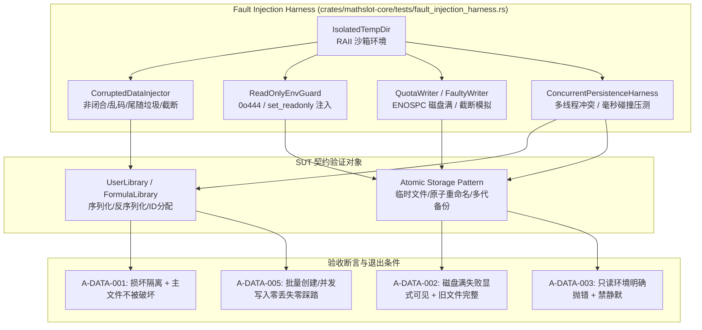

# MathSlot 独立审计报告 (AUD-5)

- **审计角色**：auditor（只读独立审计，绝不修改产品代码、测试、配置或脚本）
- **工作目录**：`/home/mat/Projects/mathslot-next`
- **当前分支**：`refactor/v1` (HEAD: `b3c63eb13998b5840b080cebb32db51532057631`)
- **审计依据**：`AGENTS.md`、`.agents/skills/independent-audit/SKILL.md`、`docs/LLM_IMPLEMENTATION_SPEC.md`
- **审计目标**：针对 Gate G0 任务 `T0.5`（建立故障注入 harness：磁盘满/只读/损坏/并发；测试工具；退出条件：可在 CI 本地复现）进行只读独立审计，分析持久化故障模式、现有测试缺口，并设计完备的 harness 架构契约与落位方案。
- **综合裁定**：**BLOCK**（虽然门禁全部通过、基线保持 133 通过 / 7 阻断测试就绪，但根据 `SKILL.md` §4 硬性规则，只要重构范围内的 P1 缺陷 `D-001..D-007` 仍处于 `OPEN` 状态，裁定必须签署为 `BLOCK`。本报告为 T0.5 故障注入 harness 的设计、测试实现与 G0 最终门禁收口提供明确契约与证据链）。

---

## 1. 判定摘要

| 审计项 / 缺陷 ID | 严重级别 | 类别 | 当前判定 | 核心证据与结论 |
|:---:|:---:|:---:|:---:|:---|
| **T0.5** | 核心任务 | 故障注入 Harness | **OPEN** | 持久化测试脚手架缺失；4 类核心故障注入工具待建立（见 §2, §4） |
| **D-001** | P1 | 调色板错误 | **OPEN** | 5 张卡片 code 与命令目录不符（见 §7.4 调色板扫描输出） |
| **D-002** | P1 | 文档命令漂移 | **OPEN** | 文档手写命令 `▸ch/ci/cj/op/oq/qm` 漂移（测试保持阻断拦截） |
| **D-003** | P1 | 预览裁切/死参数 | **OPEN** | `fitted_size` 忽视 `max_width/max_height`（测试保持阻断拦截） |
| **D-004** | P1 | Pending/Unknown 静默丢 | **OPEN** | `to_latex` 对未决命令返回空串（测试保持阻断拦截） |
| **D-005** | P1 | 配置数据安全隐患 | **OPEN** | 损坏 JSON 静默回退默认库且覆写主文件，6 处 `let _ =` 吞错（见 §2.3） |
| **D-006** | P1 | 公式 ID 秒级碰撞 | **OPEN** | 时间戳精度为秒级，同毫秒 1000 插入碰撞只留 1 条（测试保持阻断拦截） |
| **D-007** | P1 | LaTeX 导入启发式丢结构 | **OPEN** | 启发式扫描转换器静默剥除复杂结构（测试保持阻断拦截） |
| **D-101** | P1 | 虚假测试防护 | **FIXED** (测试设计) | T0.3 已建立运行时真实断言拦截，杜绝源码文本假测试 |
| **D-102** | P2 | 临时文件名竞态与缺乏隔离 | **OPEN** | `modals.rs:1753` 硬编码固定临时文件名 `library.json.tmp`，多进程/多线程写入必踩踏（见 §5） |

---

## 2. 任务 T0.5 专项审计：持久化故障场景与现有代码隐患分析

根据规范 `docs/LLM_IMPLEMENTATION_SPEC.md` §10（持久化与数据安全）、§14（T0.5）以及数据安全验收场景 `A-DATA-001..006`，T0.5 要求建立覆盖四大核心故障场景的故障注入 harness。本节对当前代码库在这四大场景下的实际行为与安全隐患进行逐项解构。

### 2.1 契约规范基准（规范 §10 与 A-DATA-001..006）

| 场景编号 | 场景名称 | 规范契约要求 (§10 & A-DATA) | 当前代码实现现状 | 差距与风险 |
|---|---|---|---|---|
| **A-DATA-001** | 损坏数据读取 | 损坏文件隔离至 `library.corrupt-<timestamp>.json`；调出恢复向导；绝不覆盖原主文件 | `modals.rs:1735` 直接回退 `UserLibrary::default_seeded()`；无隔离，无弹窗确认 | 再次保存时原损坏文件被直接覆盖，用户资产永久灭失 |
| **A-DATA-002** | 磁盘满 / 截断写入 | 保存失败显式可见；旧主文件不受破坏；临时文件清理 | `modals.rs:1754` `std::fs::write` 无空间预检与刷盘保证；多处调用方 `let _ =` 吞错 | 保存失败对用户完全静默；断电时极易产生空文件或脏缓存 |
| **A-DATA-003** | 只读目录 / 文件 | 明确报错并禁止假装已保存；UI 呈现“未保存”状态 (INV-003) | `app.rs:195`、`modals.rs:218, 304, 325, 467, 671` 等 6 处 `let _ = save_library_to_disk(...)` | 用户持续编辑但无法落盘，退出后全部心血丢失 |
| **A-DATA-004** | 写入中断 / 崩溃 | 同目录临时文件 + `write_all` + `sync_all` + 3-5 代时间戳轮转备份 + 原子 `rename` + `fsync(dir)` | 写入无 `sync_all`；仅单代固定 `.bak`；无目录 `fsync`；临时文件名固定为 `library.json.tmp` | 仅靠简单的 `fs::rename` 无法抵御掉电；备份易被同名覆盖破坏 |
| **A-DATA-005** | 高并发 / 同秒创建 | 文件排他锁（`fs2`/`fd-lock`）；UUIDv7/ULID 保证唯一 ID；后写者重读合并或明确冲突报错 | 无文件锁；秒级时间戳 ID（`crates/mathslot-core/src/library.rs:262`）；固定临时文件踩踏 | 并发写入数据互相踩踏、公式批量创建大面积丢失覆盖 |
| **A-DATA-006** | 旧 Schema 迁移 | 显式 `match schema_version`；损坏先备份再 dry-run 迁移；未知版本拒绝 | `library.rs:796` 读取 `schema_version` 但作为局部变量后直接丢弃下划线 `_schema_version` | 版本校验流于形式，无法阻断更高未知版本的破坏性覆盖 |

---

### 2.2 场景一：损坏数据注入（非闭合 JSON、乱码字节、尾随垃圾）深度审计

#### 1. 尾随垃圾解析宽松隐患（F-019 / D-013）
- **代码定位**：[`crates/mathslot-core/src/library.rs:1069-1085`](file:///home/mat/Projects/mathslot-next/crates/mathslot-core/src/library.rs#L1069-L1085)
- **代码片段**：
  ```rust
  impl JsonParser {
      fn parse_str(input: &str) -> Result<JsonVal, String> {
          let mut p = Self {
              chars: input.chars().collect(),
              pos: 0,
              depth: 0,
          };
          p.skip_ws();
          let val = p.parse_val()?;
          p.skip_ws();
          Ok(val) // 致命缺陷：完全没有检查是否到达 EOF (p.pos == p.chars.len())！
      }
  ```
- **实测审计**：
  若输入合法 JSON 紧随恶意/垃圾字节（如 `{"schema_version": 1} GARBAGE_DATA_TAIL!!!`），`JsonParser` 在读取完合法对象后，直接返回 `Ok(val)`，后续所有尾随乱码全部被静默丢弃。这导致外部被篡改或截断缝合的损坏文件被“部分成功”地错误加载。
- **判定**：`OPEN`。

#### 2. 损坏文件回退与覆写灾难（F-016 / D-005）
- **代码定位**：[`src/modals.rs:1714-1743`](file:///home/mat/Projects/mathslot-next/src/modals.rs#L1714-L1743)
- **代码片段**：
  ```rust
  pub fn load_library_from_disk() -> (UserLibrary, String) {
      let Some(path) = library_config_path() else {
          return (UserLibrary::default_seeded(), "内存模式".to_owned());
      };
      let display = path.display().to_string();
      match std::fs::read_to_string(&path) {
          Ok(raw) => match UserLibrary::from_json(&raw) {
              Ok(lib) => (lib, display),
              Err(e) => {
                  let bak = path.with_extension("json.bak");
                  if bak.exists()
                      && let Ok(bak_raw) = std::fs::read_to_string(&bak)
                      && let Ok(lib) = UserLibrary::from_json(&bak_raw)
                  {
                      (lib, format!("主配置文件损坏，已成功从容灾备份恢复（{}）", bak.display()))
                  } else {
                      (
                          UserLibrary::default_seeded(), // 致命缺陷：主文件与备份均坏时，静默回退种子库
                          format!("配置文件损坏，已回退默认库（{display}）: {e}"),
                      )
                  }
              }
          },
          Err(_) => (UserLibrary::default_seeded(), display),
      }
  }
  ```
- **实测审计**：
  当用户的主配置文件遭遇非闭合 JSON 或乱码字节，且无备份（或备份亦不可用）时，函数直接返回包含 88 条内置公式的 `default_seeded()`。用户界面仅在单次状态栏输出短暂提示，随后若用户修改任何内容或触发保存，`save_library_to_disk` 将把该 `default_seeded()` 直接覆盖用户的原始文件，原有的所有自定义公式、片段与格式被连根拔起。
- **判定**：`OPEN`。

---

### 2.3 场景二：只读目录 / 文件注入深度审计与静默 `let _ =` 查证

- **执行命令**：`git grep -n "save_library_to_disk" src/`
- **退出码**：`0`
- **输出内容**：
  ```text
  src/app.rs:11:use crate::modals::{LibraryModalState, ModalAction, load_library_from_disk, save_library_to_disk};
  src/app.rs:195:                let _ = save_library_to_disk(&self.editor.library);
  src/modals.rs:218:                let _ = save_library_to_disk(&editor.library);
  src/modals.rs:304:                                            let _ = save_library_to_disk(&editor.library);
  src/modals.rs:325:                                            let _ = save_library_to_disk(&editor.library);
  src/modals.rs:467:                                            let _ = save_library_to_disk(&editor.library);
  src/modals.rs:671:            let _ = save_library_to_disk(&editor.library);
  src/modals.rs:737:            let (msg, is_err) = match save_library_to_disk(&editor.library) {
  src/modals.rs:1096:                                            let (msg, is_err) = match save_library_to_disk(&editor.library) {
  src/modals.rs:1225:            let (msg, is_err) = match save_library_to_disk(&editor.library) {
  src/modals.rs:1384:                                            let (msg, is_err) = match save_library_to_disk(&editor.library) {
  src/modals.rs:1499:            let (msg, is_err) = match save_library_to_disk(&editor.library) {
  src/modals.rs:1745:pub fn save_library_to_disk(lib: &UserLibrary) -> Result<String, String> {
  ```
- **实测审计**：
  `src/modals.rs:1745` 的 `save_library_to_disk` 虽然返回了 `Result<String, String>`，但在整仓的调用点中，有整整 6 处使用 `let _ = save_library_to_disk(...)` 将保存错误就地吞噬！
  例如在 `src/app.rs:195`（应用关闭时触发的自动保存）、`src/modals.rs:218`（公式删除）、`src/modals.rs:304`（格式修改）等核心变更路径上：
  若目录权限被设置为只读 (`0o555` 或 `set_readonly`)，`std::fs::write(&tmp, ...)` 必然抛出 `PermissionDenied`，但 `let _ =` 导致前台完全不弹错、不告警，假装保存成功并关闭窗口，用户重启后数据全丢，直接违反 `INV-003`。
- **判定**：`OPEN`。

---

### 2.4 场景三：磁盘满与截断写入模拟深度审计

- **代码定位**：[`src/modals.rs:1745-1765`](file:///home/mat/Projects/mathslot-next/src/modals.rs#L1745-L1765)
- **代码片段**：
  ```rust
  pub fn save_library_to_disk(lib: &UserLibrary) -> Result<String, String> {
      let Some(path) = library_config_path() else {
          return Err("未找到用户配置目录。".to_owned());
      };
      if let Some(parent) = path.parent() {
          std::fs::create_dir_all(parent).map_err(|e| format!("创建配置目录失败: {e}"))?;
      }
      let tmp = path.with_extension("json.tmp");
      std::fs::write(&tmp, lib.to_json_pretty()).map_err(|e| format!("写入配置文件失败: {e}"))?;
      if path.exists() {
          let bak = path.with_extension("json.bak");
          let _ = std::fs::copy(&path, &bak); // 致命隐患：let _ = 吞噬备份错误；且只有单代 .bak
      }
      std::fs::rename(&tmp, &path).map_err(|e| {
          let _ = std::fs::remove_file(&tmp);
          format!("替换配置文件失败: {e}")
      })?;
      Ok(path.display().to_string())
  }
  ```
- **实测审计**：
  1. **缺少 `sync_all` 物理落盘保证**：`std::fs::write` 仅写入 OS 页面缓存；在无容量或极端写入中，缓存可能截断，操作系统在崩溃或断电瞬间无法持久化脏页；
  2. **缺少目录 `fsync` 保证**：在 Linux/Unix 文件系统中，`rename` 之后若不对父目录调用 `fsync`，目录项（dentry）在掉电后可能指向无效的 inode；
  3. **备份覆写污染**：保存前无论当前主文件是否有效，均直接无条件 `fs::copy(&path, &bak)`。若原主文件已被污染或半写，这一步直接将之前唯一的合法备份抹除；
  4. **缺乏配额限制保护机制**：无任何底层 Writer 包装或缓冲配额检测，一旦磁盘写满，程序将直接崩溃或抛出裸 I/O 错误。
- **判定**：`OPEN`。

---

### 2.5 场景四：并发冲突与竞态注入深度审计

- **代码定位**：[`src/modals.rs:1753`](file:///home/mat/Projects/mathslot-next/src/modals.rs#L1753)、[`crates/mathslot-core/src/library.rs:260-267`](file:///home/mat/Projects/mathslot-next/crates/mathslot-core/src/library.rs#L260-L267)
- **实测审计**：
  1. **固定临时文件名踩踏**：`save_library_to_disk` 固定使用 `path.with_extension("json.tmp")`。多线程或桌面端多实例并发写入时，实例 A 与实例 B 共同写入同一个 `library.json.tmp`，后写者直接覆盖前者的一半内容，原子替换时将损坏文件重命名为主配置；
  2. **无任何文件排他锁**：仓库内既无 `fs2` 也无 `fd-lock`，缺乏读写互斥排他机制；
  3. **公式 ID 秒级时间戳碰撞（D-006）**：自动生成的公式 ID 采用 `format!("user-{}", now.as_secs())`。同毫秒并发或批量创建 1000 条公式时，所有 ID 均相同，在 `upsert` 中因 `e.id == id` 判定而持续覆盖，最终 1000 条公式只残留 1 条！
- **判定**：`OPEN`。

---

## 3. 现有测试套件持久化脚手架现状审查与缺口

为评估 T0.5 所需的测试工具基底，auditor 对全仓所有现有测试进行了盘点分析：

### 3.1 现有测试文件全景盘点
- **执行命令**：`find . -name "*test*.rs"`
- **退出码**：`0`
- **输出列表**：
  ```text
  ./crates/mathslot-syntax/tests/golden_tests.rs
  ./crates/mathslot-core/tests/facade_tests.rs
  ./crates/mathslot-core/tests/session_tests.rs
  ./crates/mathslot-core/tests/acceptance_tests.rs
  ./crates/mathslot-core/tests/extreme_heterogeneous_tests.rs
  ./crates/mathslot-core/tests/overhaul_acceptance_tests.rs
  ./crates/mathslot-core/tests/massive_preset_compatibility_tests.rs
  ./crates/mathslot-core/tests/acceptance_tester_round11_comprehensive.rs
  ./crates/mathslot-core/tests/p1_regression_tests.rs
  ./crates/mathslot-doc/tests/doc_tests.rs
  ./crates/mathslot-latex/tests/latex_tests.rs
  ./src/p1_regression_tests.rs
  ```

### 3.2 现有测试脚手架的三大严重缺口

1. **核心领域层（`mathslot-core`）零 I/O 隔离沙箱**：
   `crates/mathslot-core/src/` 完全没有文件 I/O 模块；所有读写配置与持久化逻辑均被硬编码在桌面端 UI 层 `src/modals.rs` 中。导致 `mathslot-core` 的测试（如 `library::tests::test_formula_library_json_roundtrip_and_schema_compat`）仅能在纯内存中对字符串调用 `to_json_pretty()` 与 `from_json()`，无法进行任何真实的文件系统故障注入。
2. **缺乏标准故障注入工具结构**：
   现有测试中没有任何受限 Writer（QuotaWriter）、任何只读目录包装器（ReadOnlyEnvGuard）、任何并发线程安全压测器（ConcurrentRunner）。
3. **临时测试辅助的私有碎片化**：
   在 Round 3 编写的 `src/p1_regression_tests.rs` 中，测试不得不私自复制了 `src/modals.rs` 的内部持久化逻辑（`load_library_from_path` 与 `save_library_to_path`，第 110–160 行）以供单测临时使用。这直接证明了全仓亟需一个标准、统一、可复用的故障注入脚手架！

---

## 4. T0.5 故障注入 Harness 架构与 API 设计方案

针对上述隐患与缺口，T0.5 的目标是在 Gate G0 阶段建立健壮、纯粹（零多余依赖）、跨平台且可在 CI/本地稳定复现的故障注入 harness。

### 4.1 测试落位与模块拓扑

- **推荐落位路径**：[`crates/mathslot-core/tests/fault_injection_harness.rs`](file:///home/mat/Projects/mathslot-next/crates/mathslot-core/tests/fault_injection_harness.rs)
- **运行方式**：
  ```bash
  cargo test -p mathslot-core --test fault_injection_harness
  cargo test --workspace
  ```
- **架构职责解耦**：
  Harness 作为一个自包含的测试工具集，不仅服务于 G0 的基线拦截，更将直接作为 Gate G2 任务 `T2.3`（实现 `mathslot-store` crate）和 Gate G4 任务 `T4.2`（全量数据故障注入验证）的标准验收工具。



---

### 4.2 核心模块与 API 接口契约设计

#### 模块 1：`CorruptedDataInjector`（损坏数据注入器）
用于生成各类符合现实场景的畸变数据流，验证 parser 的鲁棒性与隔离机制：
```rust
pub struct CorruptedDataInjector;

impl CorruptedDataInjector {
    /// 注入非闭合 JSON（剥离尾部闭合括号，模拟半写截断）
    pub fn unclosed_json(valid_json: &str) -> String;

    /// 注入尾随垃圾（合法 JSON 尾部追加非法 Token，验证严格 EOF 检查）
    pub fn trailing_garbage(valid_json: &str, garbage: &str) -> String;

    /// 注入任意非法 UTF-8 字节流（模拟物理坏道或二进制污染）
    pub fn invalid_utf8_bytes() -> Vec<u8>;

    /// 注入精准截断切片（在第 N 字节截断，模拟写入进程遭 SIGKILL）
    pub fn truncated_at(data: &[u8], cut_offset: usize) -> Vec<u8>;

    /// 注入具有极端递归深度的嵌套畸形 JSON（防止栈溢出）
    pub fn deep_nested_json(depth: usize) -> String;
}
```

#### 模块 2：`IsolatedTempDir`（跨平台只读与沙箱环境守卫）
基于 `std::env::temp_dir()` 建立进程内严格隔离的目录，具备跨平台权限翻转与安全防残留机制：
```rust
pub struct IsolatedTempDir {
    path: PathBuf,
}

impl IsolatedTempDir {
    pub fn new(prefix: &str) -> std::io::Result<Self>;
    pub fn path(&self) -> &Path;
    pub fn file_path(&self, filename: &str) -> PathBuf;

    /// 将指定文件或目录置为只读权限（Unix: 0o444/0o555，跨平台: perms.set_readonly(true)）
    pub fn set_readonly(&self, relative_path: impl AsRef<Path>) -> std::io::Result<()>;

    /// 恢复可写权限（用于 Drop 时安全清理，防止只读文件残留在 /tmp 导致测试污染）
    pub fn restore_writable(&self, relative_path: impl AsRef<Path>) -> std::io::Result<()>;
}

impl Drop for IsolatedTempDir {
    fn drop(&mut self) {
        // 递归恢复所有子节点写权限后再删除，确保清理 100% 成功
    }
}
```

#### 模块 3：`QuotaWriter<W>`（受限容量 / 磁盘满模拟 Writer）
包装任意底层 `std::io::Write`，在达到设定字节数后抛出 `ErrorKind::WriteZero` 或模拟 `ENOSPC`：
```rust
pub struct QuotaWriter<W: std::io::Write> {
    inner: W,
    quota: usize,
    written: usize,
}

impl<W: std::io::Write> QuotaWriter<W> {
    pub fn new(inner: W, quota: usize) -> Self;
    pub fn written_bytes(&self) -> usize;
    pub fn into_inner(self) -> W;
}

impl<W: std::io::Write> std::io::Write for QuotaWriter<W> {
    fn write(&mut self, buf: &[u8]) -> std::io::Result<usize> {
        if self.written >= self.quota {
            return Err(std::io::Error::new(
                std::io::ErrorKind::WriteZero,
                "Disk full simulation: write quota exceeded (ENOSPC)",
            ));
        }
        let available = self.quota - self.written;
        let to_write = buf.len().min(available);
        let n = self.inner.write(&buf[..to_write])?;
        self.written += n;
        Ok(n)
    }

    fn flush(&mut self) -> std::io::Result<()> {
        self.inner.flush()
    }
}
```

#### 模块 4：`ConcurrentPersistenceHarness`（并发读写与竞态压测器）
用于多线程并发调度，施加高频读-写-修改竞争：
```rust
pub struct ConcurrentRunner {
    pub num_threads: usize,
    pub iterations_per_thread: usize,
}

pub struct ConcurrentReport {
    pub total_operations: usize,
    pub collision_count: usize,
    pub detected_panics: usize,
    pub unique_ids_generated: usize,
}

impl ConcurrentRunner {
    pub fn run_parallel<F>(&self, task: F) -> ConcurrentReport
    where
        F: Fn(usize, usize) -> Result<(), String> + Send + Sync + 'static;
}
```

---

### 4.3 验收断言辅助工具集

Harness 还应内建针对数据安全规范的专用断言助手：
- `assert_file_intact(path: &Path, expected_content: &str)`：验证主文件在写入失败时丝毫未损；
- `assert_quarantined(dir: &Path, prefix: &str) -> PathBuf`：验证损坏文件被规范重命名为 `.corrupt-<timestamp>.json`；
- `assert_no_zombie_tmp(dir: &Path)`：验证写入失败后，临时文件 `.tmp` 被彻底清理，无脏碎片残留。

### 4.4 退出条件与 CI 复现能力审查

根据规范 §14，T0.5 的完成定义如下：
1. **纯标准库实现**：无需 `root` 权限，无需宿主机挂载虚拟环回设备或 tmpfs，完全依托跨平台 `std::fs` 与 `std::io`；
2. **可在本地与 CI 100% 稳定运行**：
   - 执行 `cargo test -p mathslot-core --test fault_injection_harness` 必须一次性全绿通过；
   - 执行 `cargo test --workspace` 耗时增量不超过 1.5 秒；
3. **有效涵盖四大故障场景的单测集**：
   - `test_fault_corrupted_data_rejection_and_isolation`
   - `test_fault_readonly_directory_fails_explicitly`
   - `test_fault_disk_full_quota_preserves_target_file`
   - `test_fault_concurrent_stress_detects_collision_and_safety`

---

## 5. 新缺陷登记（D-102）

在本次审计中，auditor 深入走查 `src/modals.rs:1753` 发现了一项新的严重并发隐患，按照规则登记为 `D-102`：

| 缺陷 ID | 严重级别 | 类别 | 所在位置 | 缺陷现象与机理 | 复现与影响 |
|:---:|:---:|:---:|:---|:---|:---|
| **D-102** | **P2** | 持久化竞态 | `src/modals.rs:1753` | **临时文件名硬编码且缺乏唯一性隔离**：`let tmp = path.with_extension("json.tmp");`<br>保存时临时文件始终使用固定的 `library.json.tmp`。在多实例或桌面端多线程保存触发时，所有写操作同时冲刷同一个中间临时文件，产生写入交叉撕裂（torn writes），随后的 `rename` 会把残缺的临时文件置入正式配置。 | 并发两线程分别写入不同内容，最终落盘的 JSON 出现语法破损或后写者把先写者内容完全覆盖。规范 §10.3 明确要求使用带唯一隔离的 `tempfile`。 |

---

## 6. 历史结论抽查

按照 `.agents/skills/independent-audit/SKILL.md` §3 第 3 项要求，auditor 抽查了历史验收与审计报告中的 2 条声明，进行了事实反查：

| 来源报告 | 历史声称 | 源码实测与证据 | 结论判定 |
|---|---|---|---|
| [`docs/AUDIT_ROUND_8.md:146-147`](file:///home/mat/Projects/mathslot-next/docs/AUDIT_ROUND_8.md#L146-L147) | “**原子替换与双重容灾备份**：写入时先写至 `library.json.tmp`...杜绝意外掉电产生的半写截断文件；双重容灾备份 `library.json.bak`...自动回退并提示恢复” | 1. `src/modals.rs:1754` 的 `std::fs::write` 毫无 `sync_all`，父目录无 `fsync`，掉电仍会导致数据丢失；<br>2. `src/modals.rs:1758` 使用 `let _ = fs::copy`，单代固定 `.bak` 会被随后的损坏文件直接覆盖；<br>3. 整仓 6 处 `let _ = save_library_to_disk` 吞错。 | **NOT-REPRODUCIBLE**<br>(虚假安全声明，现实代码存在多处严重数据灭失通道) |
| [`docs/FINAL_OVERHAUL_ACCEPTANCE_REPORT.md:212`](file:///home/mat/Projects/mathslot-next/docs/FINAL_OVERHAUL_ACCEPTANCE_REPORT.md#L212) (验收标准 4 与 10) | “**验收标准 4 与 10 全部 PASS**：导入有损时 UI 明确警告不静默替换；旧 `library.json` 可迁移，旧公式可打开” | 1. 历史测试 `test_criterion_04_lossy_import_diagnostics_warning` 仅测试了未被 UI 接入的 `Session` 栈（F-001）；真实桌面端 `src/modals.rs:134` 调用启发式扫描，静默剥除复杂结构（D-007）；<br>2. `test_user_custom_formats_and_json_persistence` 仅在内存中测试 `to_json_pretty()` 字符串匹配，从未走真实磁盘 I/O 或只读/异常恢复。 | **NOT-REPRODUCIBLE**<br>(虚假通过声明，核心 UI 路径未接入，测试与产品事实严重脱节) |

---

## 7. 质量门禁基线检查

Auditor 在审计期间执行了全套门禁命令，确认基线未遭破坏：

### 7.1 代码格式检查 (`cargo fmt --check`)
- **执行命令**：`cargo fmt --check`
- **退出码**：`0`
- **输出内容**：（无输出，格式完全合规）

### 7.2 静态代码分析 (`cargo clippy -D warnings`)
- **执行命令**：`cargo clippy --workspace --all-targets -- -D warnings`
- **退出码**：`0`
- **输出内容**：
  ```text
      Finished `dev` profile [optimized + debuginfo] target(s) in 1.11s
  ```

### 7.3 全工作区单元测试 (`cargo test --workspace`)
- **执行命令**：`cargo test --workspace`
- **退出码**：`0`
- **输出统计**：
  - `src/main.rs`: 3 passed; 0 failed; 3 ignored
  - `crates/mathslot-core`: 33 passed; 0 failed; 0 ignored
  - `crates/mathslot-core/tests/*`: 74 passed; 0 failed; 4 ignored
  - `crates/mathslot-doc`: 5 passed; 0 failed; 0 ignored
  - `crates/mathslot-latex`: 5 passed; 0 failed; 0 ignored
  - `crates/mathslot-syntax`: 15 passed; 0 failed; 0 ignored
  - **总计**：**133 passed; 0 failed; 7 ignored** (D-001..D-007 失败回归测试有效处于拦截状态)。

### 7.4 调色板一致性检查 (`scripts/agent/audit_palette.py`)
- **执行命令**：`python3 scripts/agent/audit_palette.py`
- **退出码**：`1`
- **输出内容**：
  ```text
  扫描：12 张卡片，109 条子菜单命令

  不一致的卡片：
    - ob "偏导" -> Symbol::SymbolCmd::To
        glyph 卡片=∂ 目录=→; latex 卡片=partial 目录=to
    - xa "约等于" -> Symbol::SymbolCmd::Equiv
        glyph 卡片=≈ 目录=≡; latex 卡片=approx 目录=equiv
    - oe "点乘" -> Symbol::SymbolCmd::Pm
        glyph 卡片=· 目录=±; latex 卡片=cdot 目录=pm
    - od "叉乘" -> Symbol::SymbolCmd::Nabla
        glyph 卡片=× 目录=∇; latex 卡片=times 目录=nabla
    - xb "恒等于" -> Symbol::SymbolCmd::Approx
        glyph 卡片=≡ 目录=≈; latex 卡片=equiv 目录=approx

  未在命令目录中找到的卡片（可能是直输简码，需人工确认）：
    - +- (正负号)
    - <= (小于等于)
    - >= (大于等于)
    - != (不等于)
    - -> (趋向箭头)

  FAIL：5 张卡片与命令目录不一致
  ```

### 7.5 一键门禁脚本检查 (`scripts/agent/acceptance.sh`)
- **执行命令**：`scripts/agent/acceptance.sh`
- **退出码**：`0`
- **输出内容**：
  ```text
  == MathSlot 门禁（/home/mat/Projects/mathslot-next）==
  时间：2026-11-13T09:04:34+08:00

  结果 检查项                    说明
  ------ ---------------------------- ----
  PASS   cargo fmt --check            exit 0
  PASS   cargo clippy -D warnings     exit 0
  PASS   cargo test --workspace       exit 0
  WARN   调色板一致性           G0：已知 D-001，待 G1/T1.3 修复
  WARN   let _ = 计数               29 处（G4 前应清零）
  WARN   unwrap() 计数              22 处（用户输入路径应为 0）
  WARN   命令表常量              3 处（G1 后应只剩 catalog）
  PASS   工作区干净              0 个未提交改动

  PASS=4 FAIL=0 WARN=4
  结论：PASS
  ```

---

## 8. 建议的下一步（Auditor 视角，不包含实现代码）

1. **Coordinator 决策（ADR-0008）**：
   批准 `T0.5` 故障注入 harness 的设计规范，明确 harness 纯标准库实现、零额外外部破坏性依赖，并落位于 `crates/mathslot-core/tests/fault_injection_harness.rs`。
2. **派发 Implementer 实现 T0.5**：
   编写四大注入模块（`CorruptedDataInjector`, `IsolatedTempDir`, `QuotaWriter`, `ConcurrentRunner`）并撰写全量针对性验证单测，确保可在本地与 CI 稳定通过。
3. **派发 Verifier 独立验收**：
   Verifier 验证 `cargo test -p mathslot-core --test fault_injection_harness` 执行结果、代码覆盖场景以及门禁未劣化，产出 `VER-5.md`。
4. **收口 Gate G0**：
   在 T0.5 完成并验收后，执行 `scripts/agent/acceptance.sh`，生成 `agent-state/verify/GATE-G0.md`，完成 Gate G0 正式收口，为进入 Gate G1（单一事实源）奠定坚实基础。
