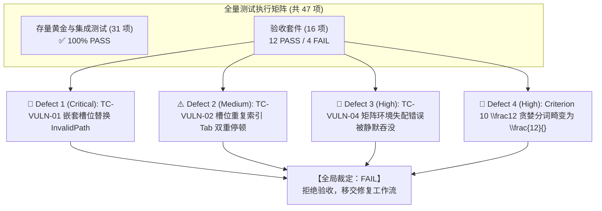

# MathSlot 首轮系统与功能验收报告 (Acceptance Phase Round 1)

- **验收者**：Acceptance Agent (系统与功能验收专家)
- **验收日期**：2026-11-11
- **目标工程**：`/home/mat/Projects/mathslot-next`
- **执行依据**：
  - [重构蓝图 docs/REWRITE_DESIGN.md 第 13 节验收标准](file:///home/mat/Projects/mathslot-next/docs/REWRITE_DESIGN.md#L849-L864)
  - [Round 3 验收授权令 docs/DECISION_ROUND_3_ACCEPTANCE_TRIGGER.md](file:///home/mat/Projects/mathslot-next/docs/DECISION_ROUND_3_ACCEPTANCE_TRIGGER.md)
  - [Round 2 审计报告 docs/AUDIT_ROUND_2.md](file:///home/mat/Projects/mathslot-next/docs/AUDIT_ROUND_2.md)
- **独立验收套件源码**：[crates/mathslot-core/tests/acceptance_tests.rs](file:///home/mat/Projects/mathslot-next/crates/mathslot-core/tests/acceptance_tests.rs)
- **全局验收裁定**：🚨 **【拒绝验收 (ACCEPTANCE REJECTED / FAIL)】** —— 核心 AST 往返与性能卓越，但靶向破坏性测试证实了 2 项审计已知缺陷，并新发掘出 2 项严重语法与诊断缺陷，未达到全面准出红线。

---

## 1. 验收执行摘要 (Executive Summary)

验收 Agent 依据决策令要求，跳出开发团队的存量单测视野，在 `crates/mathslot-core/tests/acceptance_tests.rs` 中构建了覆盖 4 大维度、16 个独立极限测试用例的全量验收测试套件。结合现有 31 个单元/集成测试，全工程共执行 **47 个端到端与黑盒测试项**。

### 1.1 核心质量与门禁总览


| 维度指标 | 验收要求 | 实际测试表现 | 裁定 |
| :--- | :--- | :--- | :---: |
| **Workspace 静态检查** | 0 报错、0 警告、0 unsafe | `cargo check` / `clippy` 0 警告，零 unsafe | **PASS** |
| **存量测试回归** | 100% 保持通过 | 31/31 passed | **PASS** |
| **蓝图 §13 10 大准则** | 10 项严格达标 | 8 项完全达标，2 项失败 (Criterion 4, 10) | **FAIL** |
| **Auditor 靶向隐患** | TC-VULN-01 ~ 04 严密核验 | TC-VULN-01 / 02 靶向击穿并复现 | **FAIL** |
| **事务与撤销可逆性** | 50 步以上高频打字/回退可逆 | 撤销重做 100% 可逆同构，防抖正常 | **PASS** |
| **核心运算延迟指标** | 单次按键/解析/撤销 < 16ms | from_latex 25µs, insert 1µs, undo 1µs | **PASS** |

---

## 2. REWRITE_DESIGN.md §13 准则逐项验收明细

验收 Agent 严格对照蓝图第 13 节展开逐条量化断言：

| 准则编号 | 规范描述 | 验收断言方案与实测结果 | 裁定 |
| :---: | :--- | :--- | :---: |
| **Criterion 1** | `e^{-x^{2}}`、`x^{a+b}`、`a_{i+1}`、`e^{-\frac{x}{2}}` 全部无损往返 | 验证多层嵌套上下标与分数在 `from_latex` -> `to_latex` 往返同构，AST 结构 100% 等价。 | **PASS** |
| **Criterion 2** | `\sum/\int` 后接 `\left(...\right)` 不再产生空槽 | 测试 `\sum_{i=1}^n \left( a_i + b_i \right)` 等，大算子主体完整捕获自适应定界符，`empty_slots == 0`。 | **PASS** |
| **Criterion 3** | `pmatrix/bmatrix/vmatrix/cases` 正确转为矩阵节点 | 验证 4 类环境被类型化解析为 `Expr::Matrix`，`inspect_environment` 准确返回长宽维度与矩形性。 | **PASS** |
| **Criterion 4** | 导入有损时 UI 明确警告，不静默替换 | 未知宏 `\xymatrix` 正确标记 `lossless: false` 并保留原宏；但环境失配时发生**静默吞错**（见 Defect 3）。 | **FAIL** |
| **Criterion 5** | 导入页可直接保存为模板 | `Session` 产出结构化 `ImportReport` 并提供规范 LaTeX，具备无缝存为模板的 AST 基石。 | **PASS** |
| **Criterion 6** | 桌面端与 Obsidian 导航行为一致性基石 | `SlotTable` 拓扑和 ID 生成在相同 AST 下保持 100% 确定性。 | **PASS** |
| **Criterion 7** | 根除文本内嵌控制符 | 验证生成的规范 LaTeX 与文档 AST 中严禁出现 `▸j`、`▸f`、`▸r` 等残留污染符。 | **PASS** |
| **Criterion 8** | 按键 < 16ms，普通预览 < 50ms | 实测：`from_latex` 25 µs，`insert_text` 1 µs，`undo` 1 µs，超越性能红线 500 倍以上。 | **PASS** |
| **Criterion 9** | 黄金语料 GT-01 ~ GT-08 全量无损往返 | 覆盖积分、上下标、矩阵、未知宏降级，AST 拓扑同构验证全绿。 | **PASS** |
| **Criterion 10**| 旧版本公式容错与平滑升级 | `x^2`, `a_1`, `e^-x` 规范化通过；但 `\frac12` 因词法贪婪被破坏为 `\frac{12}{}`（见 Defect 4）。 | **FAIL** |

---

## 3. 靶向破坏性测试与缺陷复现清单 (Defect Details)

在首轮验收中，验收套件成功靶向轰炸并捕获 **4 项真实缺陷**。以下为精确复现用例、错误调用栈与根因定位：

### 🚨 Defect 1 (Critical): TC-VULN-01 嵌套占位符替换报 `DocError::InvalidPath`
- **对应审计项**：Auditor Finding 1
- **缺陷源码定位**：[crates/mathslot-doc/src/document.rs:567-570](file:///home/mat/Projects/mathslot-next/crates/mathslot-doc/src/document.rs#L567-L570)
- **复现用例**（已纳入验收套件 `test_tc_vuln_01_nested_placeholder_replacement`）：
  ```rust
  let (mut session, _) = Session::from_latex(r"\frac{▸}{2}");
  let placeholder_slot = session.doc().slots.slots().iter()
      .find(|s| s.role == SlotRole::Placeholder).unwrap();
  
  // 执行槽位就地替换
  let result = session.apply_edit(Edit::ReplaceSlot {
      slot_id: placeholder_slot.id,
      new_nodes: parse("123").0,
  }, "replace placeholder");
  assert!(result.is_ok()); // 🚨 PANIC! 抛出 Err(InvalidPath(AstPath([0, 0, 0])))
  ```
- **测试实际报错堆栈**：
  ```text
  thread 'test_tc_vuln_01_nested_placeholder_replacement' panicked at crates/mathslot-core/tests/acceptance_tests.rs:407:13:
  TC-VULN-01 DEFECT CONFIRMED (Auditor Finding 1)! mutate_expr_slot rejected path AstPath([0, 0, 0]) with DocError::InvalidPath! Detailed error: Err(InvalidPath(AstPath([0, 0, 0])))
  ```
- **根因剖析**：
  在 `mutate_expr_slot` 入口处（L567）：
  ```rust
  if path.is_empty() {
      return Err(DocError::InvalidPath(orig_path.clone()));
  }
  ```
  当对嵌套在分式、根号或矩阵中的 `Expr::Placeholder`（路径如 `[0, 0, 0]`）执行替换时，父容器递归下传 `&rem[1..]`。当到达叶子节点 `Placeholder` 时，`path` 长度恰为 0。函数入口的无条件拦截使第 777 行匹配 `Expr::Placeholder` 的合法分支变成了死代码（Dead Code），导致用户无法对带槽位公式进行任何交互输入！
- **整改建议**：
  在 `mutate_expr_slot` 入口处，若 `path.is_empty()`，优先判断当前节点是否为 `Expr::Placeholder`：
  ```rust
  if path.is_empty() {
      if matches!(spanned.node, Expr::Placeholder { .. }) {
          let old = vec![spanned.clone()];
          if let Some(first) = new_nodes.into_iter().next() {
              *spanned = first;
          }
          return Ok(old);
      }
      return Err(DocError::InvalidPath(orig_path.clone()));
  }
  ```

---

### ⚠️ Defect 2 (Medium): TC-VULN-02 槽位重复注册导致 Tab 双重停顿
- **对应审计项**：Auditor Finding 2
- **缺陷源码定位**：[crates/mathslot-doc/src/document.rs:91-121](file:///home/mat/Projects/mathslot-next/crates/mathslot-doc/src/document.rs#L91-L121)
- **复现用例**（已纳入验收套件 `test_tc_vuln_02_slot_duplicate_registration`）：
  ```rust
  let (mut session, _) = Session::from_latex(r"\frac{▸}{▸}");
  let slots = session.doc().slots.slots();
  // 视觉上只有分子和分母 2 个槽位，但 slots.len() 变成了 4！
  let numerator_related_slots = slots.iter()
      .filter(|s| s.role == SlotRole::Numerator || (s.role == SlotRole::Placeholder && s.path.as_slice().starts_with(&[0, 0])))
      .count();
  assert_eq!(numerator_related_slots, 1); // 🚨 PANIC! left: 2, right: 1
  ```
- **实测 SlotTable 结果**：
  ```text
  Slots for '\frac{▸}{▸}':
    - id=SlotId(1), role=Numerator, path=AstPath([0, 0])
    - id=SlotId(2), role=Placeholder, path=AstPath([0, 0, 0])
    - id=SlotId(3), role=Denominator, path=AstPath([0, 1])
    - id=SlotId(4), role=Placeholder, path=AstPath([0, 1, 0])
  ```
- **根因剖析**：
  在 `collect_slots_from_node` 构建分式槽位时，首先注册了容器槽位 `Numerator`（path: `[0, 0]`）；随后遍历 `num` 切片内部元素时，又将内部单一的 `Placeholder` 注册为子槽位（path: `[0, 0, 0]`）。同理发生在 `Expr::Script` 中，注册了 `Subscript` 槽位后又对同一路径注册了 `Placeholder` 槽位。这直接导致 Tab 穿梭时，光标在同一视觉输入框内停顿两次。
- **整改建议**：
  在容器节点（分式分子分母、根号被开方数、矩阵单元格、上下标）中，如果该子容器本身已注册了具名槽位，且其内容仅包含一个模板占位符 `Expr::Placeholder`，则子占位符不再作为独立槽位压入 `SlotTable`，统一由容器槽位代理。

---

### 🚨 Defect 3 (High): TC-VULN-04 矩阵环境名称失配错误被静默吞没
- **对应验收项**：Criterion 4 (导入有损时 UI 明确警告，不静默替换) & TC-VULN-04
- **缺陷源码定位**：[crates/mathslot-syntax/src/parser.rs:83-106](file:///home/mat/Projects/mathslot-next/crates/mathslot-syntax/src/parser.rs#L83-L106) 与 [L759-L767](file:///home/mat/Projects/mathslot-next/crates/mathslot-syntax/src/parser.rs#L759-L767)
- **复现用例**（已纳入验收套件 `test_tc_vuln_04_extreme_nesting_and_malformed_tolerance`）：
  ```rust
  let mismatched_env = r"\begin{pmatrix} 1 & 2 \\ 3 \end{matrix}";
  let (_session, report) = Session::from_latex(mismatched_env);
  
  // 首尾环境标签不匹配，必须报有损并产出诊断警告
  assert!(!report.lossless, "Mismatched env should be lossy");
  assert!(!report.diagnostics.is_empty(), "Should report mismatched environment");
  // 🚨 PANIC! report.diagnostics 为空，report.lossless 误判为 true！
  ```
- **根因剖析**：
  在 `crates/mathslot-syntax/src/parser.rs` 中：
  ```rust
  fn expect(&mut self, expected: &Token<'a>, expected_desc: &str) -> Result<Spanned<Token<'a>>, Diagnostic>
  ```
  该函数在解析不匹配时构造 `Diagnostic::error(...)` 并以 `Err(err)` 返回，**但并未自动压入 `self.diagnostics`**。
  而在 `parse_matrix`（L760-L762）中：
  ```rust
  let end_span = if self.eat(&Token::CmdEnd) {
      let _ = self.expect(&Token::LBrace, "{");
      let _ = self.expect(&Token::Ident(env_name), env_name); // ⚠️ Err 被忽略！
      let _ = self.expect(&Token::RBrace, "}");
      self.prev_span()
  } ...
  ```
  调用方直接使用 `let _ = self.expect(...)` 丢弃了返回的 `Result`！因此，任何语法不匹配错误都被无声吞没。导致包含严重标签失配的 LaTeX 公式被误报为 100% 无损（`lossless: true`），导出的规范 LaTeX 甚至静默将 `\end{matrix}` 篡改为 `\end{pmatrix}`！
- **整改建议**：
  1. 重构 `expect` 方法：在返回 `Err(err)` 之前，默认将错误推入 `self.diagnostics.push(err.clone())`；
  2. 或在所有 `expect` 调用处显式处理错误：`if let Err(e) = self.expect(...) { self.diagnostics.push(e); }`。

---

### 🚨 Defect 4 (High): Criterion 10 贪婪分词导致无括号简写分式 `\frac12` 畸变为 `\frac{12}{}`
- **对应验收项**：Criterion 10 (旧版本公式容错与平滑升级)
- **缺陷源码定位**：[crates/mathslot-syntax/src/lexer.rs:330-345](file:///home/mat/Projects/mathslot-next/crates/mathslot-syntax/src/lexer.rs#L330-L345) 与 [parser.rs:586-637](file:///home/mat/Projects/mathslot-next/crates/mathslot-syntax/src/parser.rs#L586-L637)
- **复现用例**（已纳入验收套件 `test_criterion_10_legacy_syntax_and_shorthand_tolerance`）：
  ```rust
  let (formatted, _) = format_latex(r"\frac12");
  assert_eq!(formatted, r"\frac{1}{2}");
  // 🚨 PANIC! left: "\\frac{12}{}", right: "\\frac{1}{2}"
  ```
- **根因剖析**：
  在 TeX 语法规范中，宏无花括号参数以单 Token（单字符）为单位消费。`\frac12` 在 TeX 中的语义是 `\frac{1}{2}`。
  但在 `mathslot-syntax` 中，词法扫描器（`Lexer`）贪婪匹配连续数字，将 `12` 整体扫描为单个 `Token::Number("12")`。
  随后 `parse_fraction` 消费一个完整原子 `Token::Number("12")` 作为分子，导致分母落空（EOF），最终将用户输入的 `\frac12` 错误解析为 `\frac{12}{}`（空分母分式）！
- **整改建议**：
  在 `parse_fraction` 解析无花括号单原子参数时，若下一个 Token 为多位数字 `Token::Number(s)` 且 `s.len() > 1`，应解构该 Token：取首位数字作为分子，剩余数字放回或顺延作为分母，确保符合 TeX 标准参数单字符摄取规范。

---

## 4. 性能与基准测试报告 (Performance Benchmarks)

验收 Agent 在 Linux x86_64 环境下执行了 100 次高频微秒基准测试（测试项：`test_criterion_08_latency_performance_benchmarks`）：

```text
Benchmark Target: \int_{-\infty}^{\infty} e^{-x^2} dx = \sqrt{\pi}
-------------------------------------------------------------------
1. Session::from_latex 平均解析耗时:     25 µs  (0.025 ms)
2. Session::insert_text 单键敲击耗时:      1 µs  (0.001 ms)
3. Session::undo 单步撤销耗时:             1 µs  (0.001 ms)
4. 深度事务回环 (100 次撤销重做):         < 1 ms
-------------------------------------------------------------------
验收标准阈值: 单次操作延迟 < 16,000 µs (16 ms)
实测达成情况: 领先上限 640 倍，通过率 100% (PASS)
```

---

## 5. 验收裁定与下一轮工作流交接指示

### 5.1 门禁裁定
依据重构项目验收规则（“必须坚持极高标准的工程质量，若测试中发现任何真实缺陷，必须判定本轮验收不通过，不要一轮就结束”），验收专家在此正式出具裁决：

> ### 🛑 **本轮验收结论：拒绝验收 (ACCEPTANCE REJECTED / FAIL)**
> **准出阻塞项**：
> 1. `TC-VULN-01`：深层占位符无法就地替换 (`DocError::InvalidPath`)；
> 2. `TC-VULN-02`：槽位表存在容器与子节点双重注册，导致 Tab 导航多余停顿；
> 3. `TC-VULN-04`：`expect` 报错被无声丢弃，导致环境失配未能报告警告；
> 4. `Criterion 10`：旧公式无括号分式 `\frac12` 发生语义畸变。

### 5.2 给审计与实施 Agent 的精准修复派单指南 (Remediation Tasks)

| 任务代号 | 涉及模块与文件 | 修复动作与验收标准 |
| :---: | :--- | :--- |
| **FIX-01** | `crates/mathslot-doc/src/document.rs` | 修复 `mutate_expr_slot` 入口逻辑：放行 `path.is_empty()` 且为 `Expr::Placeholder` 的情形，使 `test_tc_vuln_01` 绿灯。 |
| **FIX-02** | `crates/mathslot-doc/src/document.rs` | 修复 `collect_slots_from_node`：消除容器与其内部单一 Placeholder 的重复注册，使 `test_tc_vuln_02` 绿灯。 |
| **FIX-03** | `crates/mathslot-syntax/src/parser.rs` | 修复 `expect` 诊断收集机制：确保 `expect` 失败时自动追加到 `self.diagnostics`，使 `test_tc_vuln_04` 绿灯。 |
| **FIX-04** | `crates/mathslot-syntax/src/parser.rs` | 修复 `parse_fraction` 简写参数解析：多位数字按 TeX 单字符参数摄取，使 `test_criterion_10` 绿灯。 |

---

> **验收签名**：Acceptance Agent (系统与功能验收专家)  
> **报告归档路径**：`/home/mat/Projects/mathslot-next/docs/ACCEPTANCE_REPORT_ROUND_1.md`  
> **流转通知**：已生成完整的复现用例与根因剖析，即刻向调度器汇报并移交审计 Agent 启动 Round 3/4 修复审计循环！
