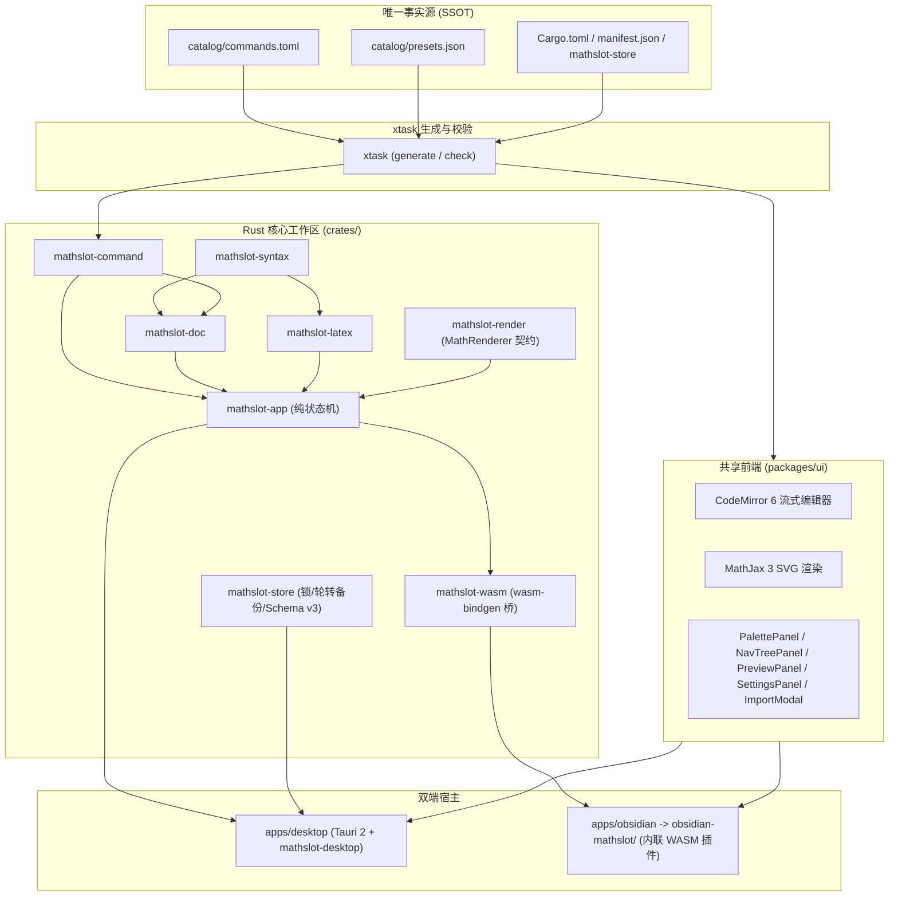

# MathSlot 工程架构与唯一事实源说明 (`docs/ARCHITECTURE.md`)

本文档描述 MathSlot 当前真实的多端共享微内核架构、唯一事实源（SSOT）代码生成流水线，以及 Rust 核心、共享 UI 与双端宿主之间的边界约束。

---

## 1. 权威指标与工作区清单

<!-- BEGIN GENERATED: metadata -->
| 指标 | 当前权威值 | 唯一事实源 (SSOT) |
| :--- | :--- | :--- |
| **工作区 / 桌面端版本** | `0.7.0` | `Cargo.toml` (`[workspace.package].version`) |
| **Obsidian 插件版本** | `0.7.0` (Obsidian ≥ `1.4.0`) | `obsidian-mathslot/manifest.json` |
| **开源协议** | `MIT OR Apache-2.0` | `Cargo.toml` (`[workspace.package].license`) |
| **流式命令总数** | `121` 条 / `8` 大分类 | `catalog/commands.toml` |
| **内置预置公式** | `88` 条 / `9` 大分类 | `catalog/presets.json` |
| **配置库 Schema 版本** | `schema_version = 3` | `crates/mathslot-store/src/lib.rs` |

- **Workspace 成员包（12 个）**：`.`、`crates/mathslot-syntax`、`crates/mathslot-doc`、`crates/mathslot-latex`、`crates/mathslot-core`、`crates/mathslot-wasm`、`crates/mathslot-command`、`crates/mathslot-app`、`crates/mathslot-render`、`crates/mathslot-store`、`apps/desktop/src-tauri`、`xtask`
- **`xtask` 生成产物（6 份代码/数据 + 4 份文档注入块）**：`crates/mathslot-command/src/generated.rs`、`catalog/catalog.json`、`docs/commands.md`、`packages/ui/src/generated/catalog.ts`、`packages/ui/src/generated/presets.ts`、`schemas/commands.schema.json`，以及 `README.md`、`HELP.md`、`obsidian-mathslot/README.md`、`docs/ARCHITECTURE.md` 中的 `BEGIN/END GENERATED` 锚点块。
<!-- END GENERATED: metadata -->

---

## 2. 总体分层架构

---

## 3. 核心模块职责划分

### 3.1 Rust 核心工作区（`crates/`）

| Crate | 核心职责 | 关键不变量 |
| :--- | :--- | :--- |
| `crates/mathslot-syntax` | 零拷贝词法分析器、手写递归下降解析器、带精确 Span 的 AST 与标准 LaTeX / MathSlot 打印器 | 单一语法事实源（`INV-001`），`#![forbid(unsafe_code)]` |
| `crates/mathslot-doc` | 文档槽位表提取、原子编辑事务、光标位置映射与 Undo/Redo 历史栈 | 仅通过事务原子修改文档与光标 |
| `crates/mathslot-latex` | 高保真 LaTeX 导入解析、环境规范化与往返校验 `ImportReport` | 存在 Error 级语法诊断时阻断覆盖 |
| `crates/mathslot-command` | 命令目录 schema 加载、键序列唯一性/前缀无冲突校验与 `xtask` 生成静态表 | 121 条命令与 8 大分类唯一静态表 |
| `crates/mathslot-app` | 无头纯状态机（`AppEvent` -> `AppCommand` -> `Effect` + `EngineSnapshot`） | 双端共用同一套交互状态机与快捷键/导航语义 |
| `crates/mathslot-store` | `library.json` 持久化、`fd-lock` 文件锁、原子重命名、3–5 代轮转备份、损坏隔离与三平台路径解析 | `CURRENT_LIBRARY_SCHEMA_VERSION = 3` |
| `crates/mathslot-render` | `MathRenderer` 抽象契约、确定性缓存、代际取消与显式降级诊断 | 渲染不丢失诊断与错误摘要 |
| `crates/mathslot-core` | 领域门面层，整合库类型、校验逻辑与核心兼容接口 | 禁止双轨实现 |
| `crates/mathslot-wasm` | 基于 `wasm-bindgen` 的单引擎 WASM 桥接层 | 仅暴露序列化边界与精简二进制输出 |

### 3.2 共享前端（`packages/ui`）

- **`editor/`**：CodeMirror 6 集成（`MathSlotEditor.svelte`、`keymap.ts`），负责 `▸` 流式触发、IME 组合态保护、可配置快捷键响应及 `Tab`/`Shift+Tab` 无障碍焦点逃逸；
- **`palette/`**：`PalettePanel.svelte` 与 `paletteModel.ts`，直接消费 `generated/catalog.ts`（`COMMANDS`）与 `generated/presets.ts`（`PRESETS`），动态渲染数量与分类，禁止硬编码计数；
- **`nav/`**：`NavTreePanel.svelte`，消费 `EngineSnapshot` 槽位树实现可视化跳转；
- **`preview/`**：`PreviewPanel.svelte`，内置 MathJax 3 SVG 渲染与活动槽位视觉高亮；
- **`import/` 与 `settings/`**：`ImportModal.svelte`（含往返报告视图）与 `SettingsPanel.svelte`（主题、定界符、缩放、9 项自定义快捷键及备份恢复向导）。

### 3.3 双端宿主（`apps/desktop` & `apps/obsidian`）

- **`apps/desktop`（Tauri 2）**：Rust 后端（`apps/desktop/src-tauri`）持有 `mathslot_app::App` 与 `mathslot_store`，通过 Tauri Commands 向 Svelte 5 壳层暴露 `dispatch` / `snapshot` / 配置导入导出；
- **`apps/obsidian` + `obsidian-mathslot/`**：TypeScript / Svelte 5 插件壳层通过 `wasmClient.ts` 调用内联 Base64 WASM 引擎，渲染采用 Obsidian `renderMath` 优先、MathJax 3 SVG 回退；打包脚本 [../obsidian-mathslot/scripts/build.mjs](../obsidian-mathslot/scripts/build.mjs) 自动验证 WASM 大小预算与 Node.js E2E smoke test。

---

## 4. 唯一事实源（SSOT）与防漂移门禁

`xtask` 以离线、确定性方式从仓库真值文件生成全部下游代码与文档：

1. **代码与数据产物（6 份全量生成）**：
   - `crates/mathslot-command/src/generated.rs`（Rust 静态命令表）
   - `catalog/catalog.json`（JSON 格式命令目录）
   - [commands.md](commands.md)（独立命令参考文档）
   - `packages/ui/src/generated/catalog.ts`（TS 命令表与类型）
   - `packages/ui/src/generated/presets.ts`（TS 88 条预置与 9 大分类）
   - `schemas/commands.schema.json`（JSON Schema Draft-07）
2. **活动文档锚点注入（4 份受控注入块）**：
   - [../README.md](../README.md)、[../HELP.md](../HELP.md)、[../obsidian-mathslot/README.md](../obsidian-mathslot/README.md) 与本文件中的所有 `<!-- BEGIN GENERATED: ... -->` ... `<!-- END GENERATED: ... -->` 区域均由 `cargo run -p xtask -- generate` 自动更新；
   - `cargo run -p xtask -- check` 与 CI 幂等校验（`cargo run -p xtask -- generate && git diff --exit-code`）确保任何手工修改或不同步都会立即拦截。
3. **解析与覆盖集成测试**：
   - `crates/mathslot-command/tests/codegen_tests.rs` 校验产物完整性、生成块成对存在且标记块外无手写命令表；
   - `crates/mathslot-app/tests/docs_ssot_tests.rs` 扫描全部活动文档中的 `▸` 命令，验证均存在且可通过 `mathslot_syntax::parse` 与 `mathslot_app::App` 无错误解析，同时检查相对链接零死链。
