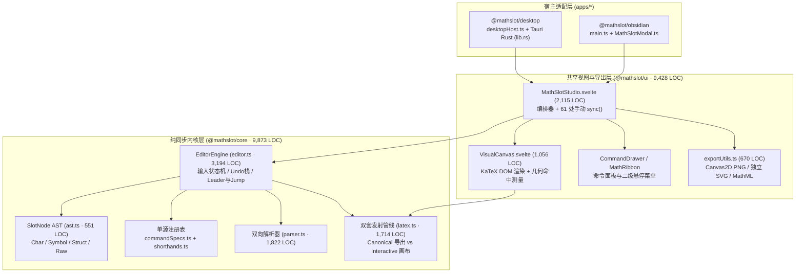

# MathSlot 全栈源码深度审计报告

- **审计基准版本**：`v2.3.0`（Git 提交 `e4e2636`）
- **审计方法论**：**零文档假设（Zero-Doc-Assumption）**——完全忽略仓库既有说明文档与历史审查记录，直接对全仓 4 个 npm 工作区、Tauri v2 Rust 后端及 GitHub Actions 构建流水线共 **23,922 行**源码与配置文件进行逐模块静态走查、调用链追踪与边界复现推演。
- **关联演进规划**：本报告识别出的全部 **13 项存量缺陷与结构债（`P1-1` ～ `P3-1`）** 已在 [ROADMAP.md](ROADMAP.md) 中建立 100% 闭环治理时间表。

---

## 1. 量化代码基线与资产规模

### 1.1 工作区体量与测试分布（实测）

| 工作区 / 目录 | 核心职责 | 源码规模 | 自动化测试与类型门禁现状 | 复杂度热点文件 |
| :--- | :--- | :--- | :--- | :--- |
| `@mathslot/core` (`packages/core`) | 树状槽位 AST、编辑状态机、LaTeX 双向解析与双管线发射、单源简写与命令能力表、Obsidian 公式识别 | `9,873` LOC （13 个 TS 文件） | **87 个单测用例**（`2,310` LOC / 7 个测试文件），覆盖命令渲染、双向往返、编辑动作、Obsidian 扫描与安全净化 | [editor.ts](../packages/core/src/editor.ts) (`3,194` 行) [parser.ts](../packages/core/src/parser.ts) (`1,822` 行) [latex.ts](../packages/core/src/latex.ts) (`1,714` 行) [commandSpecs.ts](../packages/core/src/commandSpecs.ts) (`663` 行) |
| `@mathslot/ui` (`packages/ui`) | Svelte 5 主工作台、2D 交互画布、丝带栏、命令与预置库抽屉、无 `<foreignObject>` 矢量/位图导出、无障碍辅助 | `9,428` LOC （19 个 Svelte/TS/CSS 文件） | **0 个组件单测 / E2E 用例**；`packages/ui/package.json` 未定义独立 `check` 脚本（依赖 `@mathslot/desktop` 间接做 `svelte-check`） | [MathSlotStudio.svelte](../packages/ui/src/components/MathSlotStudio.svelte) (`2,115` 行) [CommandDrawer.svelte](../packages/ui/src/components/CommandDrawer.svelte) (`1,718` 行) [VisualCanvas.svelte](../packages/ui/src/components/VisualCanvas.svelte) (`1,056` 行) [exportUtils.ts](../packages/ui/src/exportUtils.ts) (`670` 行) |
| `@mathslot/desktop` (`apps/desktop`) | Web/桌面宿主桥接、Tauri v2 Rust 剪贴板持久句柄、原子配置读写、本地文件落盘与打包配置 | `251` LOC TS/Svelte + `347` LOC Rust + `60` LOC 配置 | **0 个前端/Rust 集成测试**；配置 `svelte-check` 类型检查 | [desktopHost.ts](../apps/desktop/src/desktopHost.ts) (`204` 行) [lib.rs](../apps/desktop/src-tauri/src/lib.rs) (`347` 行) |
| `@mathslot/obsidian` (`apps/obsidian`) | Obsidian 光标处公式扫描、引用块/Callout 前缀剥离回写、多端同步并发合并 | `501` LOC TS/CSS | Obsidian 公式提取核心逻辑在 `@mathslot/core` 受测；插件宿主层无 UI 自动化测试，配置 `tsc --noEmit` | [main.ts](../apps/obsidian/src/main.ts) (`224` 行) [MathSlotModal.ts](../apps/obsidian/src/MathSlotModal.ts) (`131` 行) |
| 构建与发布配置 (`.github/workflows` 等) | 跨平台构建矩阵（Linux / Windows / macOS）与 GitHub Release 产物上传 | `280` LOC YAML + 根/子包配置 | 仅有 `v*` 标签触发的 [release.yml](../.github/workflows/release.yml)，**无 `push` / `pull_request` 常态化 CI** | [release.yml](../.github/workflows/release.yml) (`280` 行) |

### 1.2 内置领域资产实测指标

- **内置命令总数**：**166 条**（定义于 [catalog.ts](../packages/core/src/catalog.ts) 与 [commandSpecs.ts](../packages/core/src/commandSpecs.ts)），其中 **163 条**绑定了 `Tab` 引导键序列（含 **9 条**一级单键直达命令与 **7 个**支持即时默认的二级子菜单，`paren` / `brack` / `brace` 3 条由键盘直接括号触发）。
- **内置预置公式**：**89 条**（定义于 [presets.ts](../packages/core/src/presets.ts)）。
- **单源自然简写规格**：**136 条** `SHORTHAND_SPECS`（定义于 [shorthands.ts](../packages/core/src/shorthands.ts)，自动派生 `AUTO_SHORTHANDS`、`SHORTHAND_BY_COMMAND_ID`、`BARE_WORD_ATOMS`、`BARE_WORD_BINOPS`、`DIFFERENTIAL_WORDS` 与 `SYMBOL_PREFIX_UPGRADES`）。

---

## 2. 架构全景与复杂度分布

> [!NOTE]
> **复杂度分布特征**：项目严格遵循了「零 WASM 纯同步内核 + `HostAdapter` 双端同源 UI」的分层设计，宿主层极度精简（Desktop 与 Obsidian 合计不足 1,200 行）；但复杂度高度集中于 **4 个超长核心文件**（`editor.ts` 3,194 行、`MathSlotStudio.svelte` 2,115 行、`parser.ts` 1,822 行、`latex.ts` 1,714 行），单文件多职责耦合已成为后续演进的首要阻力。

---

## 3. 已验证的架构优势与安全底座

在深入披露缺陷前，源码审查确认以下设计已具备扎实的工程质量与防御纵深，应在后续演进中予以保留：

1. **确定性槽位树 AST 与极速键盘交互模型**
   - [ast.ts](../packages/core/src/ast.ts) 以显式 `SlotNode` 树承载结构化公式，避免了扁平光标流在多层分式、上下标与矩阵嵌套中常见的“幽灵光标位”问题。
   - [editor.ts](../packages/core/src/editor.ts) 实现了极具辨识度的「二级菜单单字母即时默认 + 后续按键原地无缝变形（`pendingDefaultId`）」以及支持局部作用域下钻与 `Alt+←/→` 历史回溯的 `Esc` 分层跳转系统。
2. **命令能力与自然简写的静态数据单源化**
   - [commandSpecs.ts](../packages/core/src/commandSpecs.ts)（`COMMAND_CAPABILITIES`）与 [shorthands.ts](../packages/core/src/shorthands.ts)（`SHORTHAND_SPECS`）消除了早期散落在多文件中的静态映射表，并由 [catalog.test.ts](../packages/core/tests/catalog.test.ts) 提供契约单测守护。
3. **纵深防御的 XSS / 宏注入与文件系统安全边界**
   - **KaTeX 最小信任白名单**：[katexRenderer.ts](../packages/ui/src/katexRenderer.ts#L12-L20) 的 `trustInteractiveOnly` 仅对内部生成的交互画布放行 `\htmlData`、`\htmlClass`、`\htmlId` 三个宏；用于用户预览与列表卡片的 `renderLatexPreview`（第 34–78 行）强制 `trust: false`、内置 `maxDepth = 128` 花括号深度预算，并在异常分支使用 `escapeHtml` 转义。
   - **导入与自定义模板净化**：[parser.ts](../packages/core/src/parser.ts#L1673-L1696) 在解析阶段主动剥离外部粘贴的 `\htmlData`、`\htmlStyle`、`\href`、`\url`、`\includegraphics` 等不受信任宏；[commandSpecs.ts](../packages/core/src/commandSpecs.ts#L584) 的 `sanitizeLatexTemplate` 对自定义结构与外部 `commands.json` 模板执行同等级过滤。
   - **Rust 后端内存、剪贴板与路径安全**：[lib.rs](../apps/desktop/src-tauri/src/lib.rs#L107) 使用 `width.checked_mul(height).and_then(|px| px.checked_mul(4))` 防止剪贴板 RGBA 整数溢出，并通过 `Mutex<Option<Clipboard>>` 持久持有剪贴板实例以解决 Linux Wayland/X11 剪贴板随局部句柄析构失效的问题；`save_export_file`（第 151–215 行）严格拦截路径分隔符、控制字符及 Windows 保留设备名（`CON`、`PRN`、`AUX`、`NUL`、`COM1..9`、`LPT1..9`）；`write_atomic`（第 35–60 行）采用同目录 `.tmp.<pid>` 写入加 `fs::rename` 保证配置落盘原子性。
4. **零 `<foreignObject>` 的跨平台自包含导出管线**
   - [exportUtils.ts](../packages/ui/src/exportUtils.ts) 直接从离屏 KaTeX DOM 提取背景色块、四边边框、内嵌 `<svg>` 根号/括号路径与排版字形构建 `VectorScene`，再分别渲染至 Canvas2D（PNG）或内联 woff2 字体的独立 SVG，从根源绕开了 Linux WebKitGTK 对 `<foreignObject>` 污染画布（Tainted Canvas）的平台限制。
5. **Obsidian 引用块原位编辑与多端同步防覆盖保护**
   - [obsidianMath.ts](../packages/core/src/obsidianMath.ts) 支持多层嵌套引用块与 Callout（如 `> > $$`）的前缀剥离与等长还原；[MathSlotModal.ts](../apps/obsidian/src/MathSlotModal.ts#L84-L99) 在写回前校验 `expectedRangeText`，若底层文档在弹窗开启期间发生外部变更则自动降级为复制至剪贴板并告警，绝不静默破坏用户笔记；[main.ts](../apps/obsidian/src/main.ts#L19-L70) 采用基于快照的 3-Way 按 ID 增量合并避免 Obsidian Sync 多端并发覆盖。

---

## 4. P1 级核心缺陷与结构性瓶颈

以下问题直接影响用户数据保真度、预览/导出一致性或核心编辑能力上限，列为最高优先级治理对象。

### P1-1：Obsidian `\(...\)` 与 `\[...\]` 原位编辑写回时定界符被静默覆写，且长笔记扫描存在线性退化

- **问题表征**：在 Obsidian 笔记中将光标置于标准 LaTeX 行内公式 `\(a + b\)` 或块级公式 `\[E = mc^2\]` 内唤起 MathSlot，保存写回后，原笔记中的 `\(...\)` 会被强制改写为 `$...$`，`\[...\]` 会被强制改写为 `$$...$$`。
- **源码根因**：
  1. [obsidianMath.ts](../packages/core/src/obsidianMath.ts#L253-L256) 与第 345–374 行已正确识别 `\(...\)` 与 `\[...\]`，但在返回结果中将二者粗粒度折叠为 `delimiter: 'inline'` 与 `delimiter: 'block'`。
  2. [types.ts](../packages/core/src/types.ts#L153) 定义的 `DelimiterStyle = 'none' | 'inline' | 'block' | 'codeblock'` 及 [latex.ts](../packages/core/src/latex.ts#L999-L1012) 的 `formatExport()` 仅能输出 `$...$` 与 `$$\n...\n$$`，丢失了原始定界符方言信息。
  3. 此外，[main.ts](../apps/obsidian/src/main.ts#L76-L80) 为统计代码块围栏奇偶性，每次打开编辑器均从第 `0` 行逐行调用 `editor.getLine(i)` 直至 `Math.min(editor.lineCount(), cursor.line + 401)`；当光标位于万行长笔记末尾时，每次唤起仍会产生上万次跨宿主行读取。
- **影响面**：破坏使用 LaTeX 原生定界符风格用户的文档格式一致性与 Git Diff 纯净度；超长学术笔记尾部唤起存在不必要的主线程开销。
- **修复方向**：扩展定界符枚举（或新增 `sourceWrapper: 'dollar_inline' | 'paren_inline' | 'dollar_block' | 'bracket_block'` 元数据）并在 `MathSlotModal` 写回时原样还原；结合 Obsidian CodeMirror 6 语法树或有界局部窗口消除从第 0 行全量扫描。

### P1-2：双套 LaTeX 发射器分裂（`Canonical` vs `Interactive` 重复维护词法与间距状态机）

- **问题表征**：画布实时预览与底部源码/导出结果由两套完全独立的序列化管线生成，任何函数名识别、微分间距、二元算子空白或原生宏草稿规则的调整都必须在两处手写同步，极易出现“画布看着对、导出来不对”（或反之）的回归。
- **源码根因**：
  - [latex.ts](../packages/core/src/latex.ts#L321-L728) 实现了面向纯文本导出的 `tokenizeSlotForCanonical()` + `emitSlotCanonical()`；
  - 同文件第 1042–1475 行又另起炉灶实现了面向交互画布的 `analyzeInteractiveHints()` + `emitSlotInteractive()`，并在字符串拼接过程中直接混入 `\htmlData{atom-slot=...,offset=...}` 与 `\htmlClass{ms-caret-anchor}{}` 标记。
- **影响面**：核心序列化逻辑体积膨胀至 1,714 行，成为历史上空格异常、`\int f(x)dx` 间距分叉与原生宏回退问题的共同温床。
- **修复方向**：收敛为单一排版中间表示（`EmitIR`），只做一次词法切分与间距推导，再由两个超薄投影器分别输出纯 LaTeX 与带交互锚点的 KaTeX 字符串。

### P1-3：多行公式画布与导出排版语义割裂，且缺少一等 `AlignNode` 对齐模型

- **问题表征**：用户输入多行含等号的公式推导时，画布始终按**居中堆叠**显示，而复制/导出的 LaTeX 却是**按首个关系符左对齐**；若导入多列对齐环境或带 `\tag{1}` 编号的公式，则关键结构退化为不可槽位编辑的原生块。
- **源码根因**：
  1. [latex.ts](../packages/core/src/latex.ts#L1678) 的 `toInteractiveLatex()` 将多行根槽位统一包裹为 `\begin{gathered} ... \end{gathered}`（居中无对齐点）；而 [latex.ts](../packages/core/src/latex.ts#L954-L993) 的 `toLatex()` 则调用 `findFirstRelationIndex()` 在首个关系符前插入 `&`，输出 `\begin{aligned} lhs &= rhs \\ ... \end{aligned}`。
  2. [parser.ts](../packages/core/src/parser.ts#L1080-L1090) 在遇到单行超过 1 个 `&`（多列 `align` / `alignat`）或 `&` 后非关系符时直接整段退化为 `RawNode`；`\tag{...}`（第 1697–1709 行）同样退化为 `RawNode`，且在交互画布行内模式下触发警告而无法原生编辑。
- **影响面**：违反“所见即所得”核心承诺，限制了多步推导、方程组对齐注释及带编号公式的结构化编辑体验。
- **修复方向**：在 AST 中引入一等 `AlignNode`（显式建模行、对齐列槽位与可选 `tag` 槽位），使画布与导出共享真实的 `aligned` 几何布局。

### P1-4：单槽选区模型（`Selection` 绑定单一 `slotId`）阻断跨槽编辑与矩阵子块操作

- **问题表征**：用户无法用鼠标或 `Shift + ←/→` 同时选中“分子与分母”、“底数与上标”或“矩阵的 2×2 子区域”，也无法将跨越子结构的连续表达式一次性剪切、复制或包裹进外层括号/根号。
- **源码根因**：
  - [types.ts](../packages/core/src/types.ts#L114-L118) 将选区严格定义为 `{ slotId: string; start: number; end: number }`；
  - [VisualCanvas.svelte](../packages/ui/src/components/VisualCanvas.svelte#L469) 在拖拽选区时显式判断 `hit.slotId !== dragAnchor.slotId` 并直接忽略跨槽命中点；[editor.ts](../packages/core/src/editor.ts) 的选区包裹、删除与复制均假设选区位于同一 `SlotNode.children` 数组内。
- **影响面**：复杂公式重构（如提取公因式、跨矩阵单元格批量拷贝）被迫退回到底部 LaTeX 源码栏手工改字符串。
- **修复方向**：升级为基于最小公共祖先（LCA）的 `{ anchor: TreePoint, focus: TreePoint }` 树路径选区与矩阵矩形子块选区模型。

### P1-5：自然简写执行语义“三轨并存”且缺少跨源冲突检测器

- **问题表征**：不同类别简写在按下 `Backspace` 或 `Ctrl+Z` 时的回退行为不一致；同时用户在自定义命令或外部 `commands.json` 中配置简写时，若与内置简写/数学函数重名，系统无任何冲突提示，直接导致静默遮蔽。
- **源码根因**：
  1. 虽然 [shorthands.ts](../packages/core/src/shorthands.ts) 统一了内置静态表，但运行时仍分三条轨道执行：
     - **轨道 A（内置标点简写，如 `<=`、`->`）**：在 [editor.ts](../packages/core/src/editor.ts#L1430) 键入瞬间立即替换 AST 为 `SymbolNode`；且 [shorthands.ts](../packages/core/src/shorthands.ts#L242) 的 `SYMBOL_PREFIX_UPGRADES` 仅支持 `len - 1 -> len` 的逐字符阶梯升级（若未来新增 3 字符标点简写但缺少对应 2 字符中间符号即会断链）。
     - **轨道 B（内置单词简写，如 `pi`、`oo`、`dx`）**：AST 内始终保留普通 `CharNode` 序列，仅在 [latex.ts](../packages/core/src/latex.ts) 发射期按独立词边界折叠为 `\pi`、`\infty`、`\,\mathrm{d}x`（按一次 `Backspace` 只删末尾字母，剩余字母恢复斜体变量）。
     - **轨道 C（自定义结构与外部 `commands.json` 字母简写）**：在 [editor.ts](../packages/core/src/editor.ts#L1303) 与第 1457 行等待用户输入右边界字符（空格或运算符）时将 `CharNode` 序列突变为 `StructNode` / `SymbolNode`。
  2. [userLibraries.ts](../packages/core/src/userLibraries.ts) 与 `CommandEditorModal` 未校验用户配置的 `shorthand` 是否与内置 136 条 `SHORTHAND_SPECS` 或 `MATH_FUNCTIONS`（如 `sin`、`lim`）冲突。
- **影响面**：用户对“简写究竟是真实符号节点还是渲染语法糖”产生心智割裂；外部扩展库规模增大后易引发不可预期的输入抢占。
- **修复方向**：增设跨源简写冲突检测器（UI 实时徽标告警 + 导入诊断），并统一简写展开的撤销事务点（使 `Ctrl+Z` 可退回原始字面量）。

---

## 5. P2 级模块耦合、性能、导出与无障碍问题

### P2-1：原生 LaTeX 参数闭合栈未纳入 Undo/Redo 历史与非连续跳槽清理

- **源码定位**：[editor.ts](../packages/core/src/editor.ts#L107-L109)（`latexArgCloseBySlot: Map<string, '}' | ']'>`、`expectLatexOpenBraceSlotId: string | null`）。
- **机制分析**：为支持原生键入 `\frac{1}{2}` 时按 `}` 自动跳到下一参数槽，引擎维护了上述两个实例级可变状态，但它们**未被保存在 `HistoryEntry` 快照中**，且在用户通过鼠标点击、`Esc` 跳转或方向键手动离开该槽位时未同步清理。若用户输入 `\frac{1` 后按 `Ctrl+Z` 撤销或点击其他槽位再返回输入字面量 `}`，残留映射存在误吞 `}` 并触发异常跳槽的风险。

### P2-2：50 处 `commandId ===` 硬编码特判散落与未注册 `inline_*` 临时伪命令

- **源码定位**：遍布 [editor.ts](../packages/core/src/editor.ts)（如第 1780 行 `braceNextSlotMap`、第 1906 行 `inline_${name}`）、[latex.ts](../packages/core/src/latex.ts)（`resolveAdaptiveStructTemplate` 等）与 [ast.ts](../packages/core/src/ast.ts)，全仓实测仍有 **50 处** `commandId === '...'` 条件分支。
- **机制分析**：当用户直接键入 `\mathrm{`、`\mathfrak{`、`\mathsf{`、`\mathtt{`、`\boldsymbol{` 时，[editor.ts](../packages/core/src/editor.ts#L1906-L1918) 会临时拼装一个 `id: 'inline_mathrm'` 的匿名 `CommandDef` 创建 `StructNode`。这类伪命令既不在 `COMMANDS_BY_ID` 目录中，也不受 `COMMAND_CAPABILITIES` 约束，破坏了命令体系的闭合性。

### P2-3：解析器长尾 TeX 语法覆盖缺口

- **源码定位**：[parser.ts](../packages/core/src/parser.ts#L1563-L1665)。
- **机制分析**：
  1. **花括号微分变量回退**：第 1654 行解析 `\mathrm{d}` 时检查 `/[A-Za-z\\]/.test(nextCh)`，若外部公式写作 `\mathrm{d}{x}` 或 `\mathrm{d}{\theta}`，`nextCh` 为 `'{'` 导致匹配失败，退化为不可编辑的 `RawNode('\\mathrm{d}')` 与孤立变量。
  2. **3 行及以上 `\substack` 退化**：第 1566 行仅在 `rows.length === 2` 时构建 `substack_2`，3 行及以上的求和下标条件直接退化为 `RawNode` 并弹出警告。
  3. **传统 TeX 原语缺口**：经典中缀分式/组合数 `{a \over b}`、`{n \choose k}` 以及前缀否定修饰 `\not=`、`\not\subset`、`\not\equiv` 尚未映射至结构化 `frac` / `binom` / 否定关系符节点。

### P2-4：视图层 61 处手动 `sync()` 耦合与每次移动光标的全链路 DOM 重排

- **源码定位**：[MathSlotStudio.svelte](../packages/ui/src/components/MathSlotStudio.svelte)（全文件 **61 处**显式 `sync()` 调用，未接入 `engine.subscribe()`）、[VisualCanvas.svelte](../packages/ui/src/components/VisualCanvas.svelte#L118-L210)（`buildVisualRectMap`）。
- **机制分析**：
  1. 任何新增交互入口只要漏写一行 `sync()` 就会导致界面静默失步。
  2. 更关键的是，光标位置以 `\htmlClass{ms-caret-anchor}{}` 硬编码在 `interactiveLatex` 字符串内部。即使用户只是长按 `←` / `→` 纯移动光标而未修改任何公式内容，每一步都会触发：`toLatex()` 全树序列化 + `toInteractiveLatex()` 全树序列化 + `katex.renderToString()` 生成整棵 HTML + Svelte `{@html}` 全量替换 DOM + `buildVisualRectMap()` 遍历全部 `[data-atom-slot]` / `[data-slot-id]` 重新测量 `getBoundingClientRect()`。在大型分块矩阵或多行推导下会产生不必要的布局抖动开销。

### P2-5：外部 JSON 库双轨合并“删而复生”缺陷与纯字符串草稿脆弱性

- **源码定位**：[MathSlotStudio.svelte](../packages/ui/src/components/MathSlotStudio.svelte#L113)（800ms 防抖草稿 `lastDraftLatex`）与第 207–223 行（`loadExternalLibraries(true)`）。
- **机制分析**：
  1. **外部删除失效（删而复生）**：应用启动时以 `silent = true` 调用 `loadExternalLibraries(true)`，内部执行 `mergeLibraryById(userPresets, pRes.entries)` 将 `store.json` 中的缓存条目与外部 `presets.json` 合并后再次写回。这意味着用户在软件关闭期间手动打开 `presets.json` 或 `commands.json` 删除某条记录后，下次启动软件时该记录会从 `store.json` 中被静默“复活”（唯有进设置面板手动点击「重载」才会走替换分支）。
  2. **纯字符串草稿丢失编辑态**：草稿仅保存序列化后的 `lastDraftLatex: string` 且采用 800ms 异步防抖，既丢失了光标位置、空可选槽展开态与撤销栈，又在用户最后一次按键后 `<800ms` 内立即关闭窗口时丢失最新输入。

### P2-6：导出引擎忽略 CSS `transform`、Obsidian 字体重复扫描与 Tauri IPC 数组膨胀

- **源码定位**：[exportUtils.ts](../packages/ui/src/exportUtils.ts#L189-L330) 及第 548 行、[desktopHost.ts](../apps/desktop/src/desktopHost.ts#L47) 及第 67 行。
- **机制分析**：
  1. **CSS `transform` 几何盲区**：`extractVectorScene()` 精确采集了背景、四边边框、内嵌 `<svg>` 与水平文本节点，但未读取 `getComputedStyle(el).transform` 矩阵。对于依赖 CSS 旋转/缩放排布的元素（如 KaTeX 中通过 `transform: rotate(...)` 合成的斜向构件或扩展宏），导出的 PNG/SVG 会退回未旋转角度。
  2. **Obsidian 样式表重复提取**：`collectEmbeddedKaTeXFontCss()` 每次导出独立 SVG 均遍历全局 `document.styleSheets` 提取内联 base64 woff2 规则（Obsidian 插件 `styles.css` 体积达 `1.52 MB`），缺少模块级缓存与按实际使用字族裁剪。
  3. **Tauri IPC 序列化膨胀**：`desktopHost.ts` 在调用 `copy_png_rgba_to_clipboard` 与 `save_export_file` 时执行 `Array.from(rgba)` / `Array.from(bytes)`，将 `Uint8Array` 转为普通 JS 数字数组再做 JSON 序列化。一张 3× 高清大图（如 `1600×1000` RGBA 约 `6.4 MB`）在跨进程传输时会膨胀为约 `25 MB+` 的十进制文本 JSON。

### P2-7：弹窗焦点陷阱覆盖不全、读屏高频复读与移动端触控缺口

- **源码定位**：[SaveSnippetModal.svelte](../packages/ui/src/components/SaveSnippetModal.svelte)、[CustomStructureModal.svelte](../packages/ui/src/components/CustomStructureModal.svelte)、[PresetEditorModal.svelte](../packages/ui/src/components/PresetEditorModal.svelte)、[CommandEditorModal.svelte](../packages/ui/src/components/CommandEditorModal.svelte)、[VisualCanvas.svelte](../packages/ui/src/components/VisualCanvas.svelte#L529) 及第 594 行、[apps/obsidian/manifest.json](../apps/obsidian/manifest.json)。
- **机制分析**：
  1. **焦点陷阱遗漏**：虽然 5 个一级弹窗已接入 [focusTrap.ts](../packages/ui/src/focusTrap.ts)，但上述 **4 个二级编辑/新建弹窗**仍未挂载 `use:focusTrap`，按 `Tab` 键焦点会穿透回底层画布或背景按钮。
  2. **无障碍播报过载与键盘陷阱**：`VisualCanvas.svelte:594` 将 `{snapshot.latex}` 直接绑定到整条公式源码，导致屏幕阅读器在每次按键乃至微调时从头朗读整串原始 LaTeX 代码；同时当 `leaderKey === 'Tab'` 时，画布拦截 `Tab` 键且缺少标准辅助逃逸热键（如 `Ctrl+M` 或 `F6`）供纯键盘用户将焦点移至顶部工具栏。
  3. **移动端声明与实现错位**：`apps/obsidian/manifest.json` 声明 `"isDesktopOnly": false`（允许在 iOS / Android 端启用），但 `VisualCanvas.svelte` 仅监听鼠标事件（`onmousedown` / `onmousemove`），缺少 Pointer/Touch 拖选、长按呼出菜单与移动端软键盘弹起时的视口防遮挡适配。

---

## 6. P3 级工程化护栏、测试体系与跨平台发布缺口

### P3-1：CI 门禁缺失、UI 零自动化测试与跨平台发布链路待闭环

1. **常态化 CI 空白**：[.github/workflows/](../.github/workflows) 下仅有 `on: push: tags: ['v*']` 的 `release.yml`，日常向 `main` 推送或提交 Pull Request 时**没有任何自动化测试、类型检查或 Rust 编译校验运行**。
2. **UI 与宿主层自动化测试为零**：`@mathslot/ui`（`9,428` 行）承载了焦点仲裁、鼠标几何命中、弹窗交互与矢量导出等大量浏览器 DOM 强相关逻辑，但目前无任何 Vitest Browser / Playwright 回归套件；`packages/ui/package.json` 亦缺少独立的 `npm run check` 脚本。
3. **打包配置与平台签名更新缺口**：
   - [tauri.conf.json](../apps/desktop/src-tauri/tauri.conf.json#L29) 默认硬编码 `"targets": ["rpm"]`，非 RPM 系 Linux 开发者本地直接执行 `tauri build` 需额外覆盖参数；
   - [release.yml](../.github/workflows/release.yml) 中 macOS 仅构建 `aarch64-apple-darwin`（未产出 Intel / Universal Binary），且缺少 Apple Developer ID 公证（Notarization）与 Windows Authenticode 代码签名（用户首次安装会触发系统拦截弹窗）；
   - 未集成 `tauri-plugin-updater` 应用内增量更新；
   - 桌面独立应用尚缺「系统托盘常驻 + 全局热键唤起 + 编辑完成自动回填原活跃窗口」的高频桌面生产力闭环。

---

## 7. 审计问题汇总与优先级追踪表

| 编号 | 级别 | 所属层级 | 问题摘要 | 核心源码定位 | 对应路线图阶段 |
| :--- | :---: | :--- | :--- | :--- | :--- |
| **P1-1** | P1 | Obsidian / Core | `\(...\)` 与 `\[...\]` 原位编辑保存被改写为 `$` / `$$`；长笔记从第 0 行扫描 | `obsidianMath.ts:253`、`types.ts:153`、`latex.ts:999`、`main.ts:76` | Phase 1 (`v2.3.x`) |
| **P1-2** | P1 | Core 发射器 | `Canonical` 与 `Interactive` 两套词法/间距状态机分裂维护 | `latex.ts:321-728`、`latex.ts:1042-1475` | Phase 2 (`v2.4`) |
| **P1-3** | P1 | Core / UI | 多行画布 `gathered` 居中 vs 导出 `aligned` 对齐割裂；多列对齐与 `\tag` 退化 | `latex.ts:954,1678`、`parser.ts:1080,1697` | Phase 2 (`v2.4`) |
| **P1-4** | P1 | Core / UI | `Selection` 绑定单一 `slotId`，不支持跨槽选区、包裹与矩阵子块操作 | `types.ts:114`、`VisualCanvas.svelte:469` | Phase 3 (`v2.5`) |
| **P1-5** | P1 | Core 简写 | 标点/内置词/自定义词三套执行与撤销粒度不一；缺少跨源简写冲突检测器 | `shorthands.ts:242`、`editor.ts:1303,1430,1457` | Phase 2 (`v2.4`) |
| **P2-1** | P2 | Core 编辑器 | `latexArgCloseBySlot` 未纳入 `undoStack` 且手动跳槽不清理 | `editor.ts:107-109` | Phase 1 (`v2.3.x`) |
| **P2-2** | P2 | Core 规格 | 50 处 `commandId ===` 硬编码散落；`\mathrm{` 等生成未注册 `inline_*` 伪命令 | `editor.ts:1780,1906`、`latex.ts`、`ast.ts` | Phase 2 (`v2.4`) |
| **P2-3** | P2 | Core 解析器 | `\mathrm{d}{x}` 回退、3+ 行 `\substack` 退化、`{a \over b}` 与 `\not` 未结构化 | `parser.ts:1563-1665` | Phase 1 (`v2.3.x`) & Phase 2 (`v2.4`) |
| **P2-4** | P2 | UI / 性能 | 61 处手动 `sync()` 易漏调；纯光标移动触发双发射 + KaTeX + 全树 DOM 重测 | `MathSlotStudio.svelte`、`VisualCanvas.svelte:118` | Phase 3 (`v2.5`) |
| **P2-5** | P2 | UI / 持久化 | 外部 JSON 条目删除在下次启动被 `store.json` 静默复活；草稿仅存防抖字符串 | `MathSlotStudio.svelte:113,207-223` | Phase 1 (`v2.3.x`) & Phase 3 (`v2.5`) |
| **P2-6** | P2 | UI / Desktop | 导出忽略 CSS `transform`；SVG 重复扫样式表；Tauri IPC `Array.from` 膨胀 4× | `exportUtils.ts:189,548`、`desktopHost.ts:47,67` | Phase 1 (`v2.3.x`) |
| **P2-7** | P2 | UI / 无障碍 | 4 个编辑弹窗漏 `focusTrap`；读屏逐键重读整串源码；缺键盘逃逸与触控手势 | `SaveSnippetModal` 等、`VisualCanvas.svelte:529,594` | Phase 1 (`v2.3.x`) & Phase 4 (`v3.0`) |
| **P3-1** | P3 | CI / 平台工程 | 无 PR CI、0 个 UI 自动化测试、无代码签名/公证/自动更新、缺桌面全局热键流 | `.github/workflows/`、`tauri.conf.json:29` | Phase 1 (`v2.3.x`) & Phase 4 (`v3.0`) |
