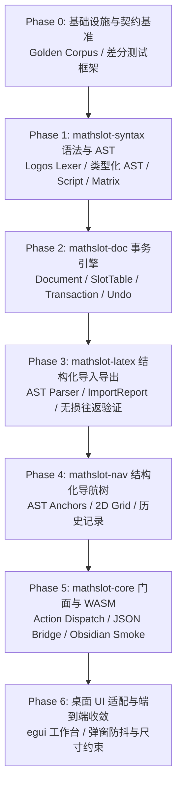

# MathSlot 重构基线审计报告 (Round 0: Baseline Audit)

- **审计人员**：Auditor Agent
- **审计日期**：2026-11-10 / 2026-11-11
- **审计基线**：原项目 `/home/mat/Projects/mathslot` (Commit `3cde263` / `5921326`)
- **目标工程**：新项目 `/home/mat/Projects/mathslot-next`
- **关联文档**：
  - [原项目审计报告 docs/AUDIT_2026-11-10.md](file:///home/mat/Projects/mathslot/docs/AUDIT_2026-11-10.md)
  - [重构蓝图设计 docs/REWRITE_DESIGN.md](file:///home/mat/Projects/mathslot/docs/REWRITE_DESIGN.md)

---

## 1. 执行摘要与审计结论 (Executive Summary)

### 1.1 审计背景
原项目 `mathslot` 定位为面向数学公式的超轻量流式键盘输入器与双端（桌面 Native egui + Obsidian WASM 插件）协作套件。经过快速迭代，已建立起单字母高频直达结构、二级分类指令、分层 Vimium 风格导航树以及括号自动配对等创新交互。

然而，在最新的深度使用场景（尤其是复杂高数公式导入、多层嵌套微积分与矩阵编辑）中，系统暴露出一系列**破坏数学语义正确性**的致命缺陷。

### 1.2 核心审计裁定 (Feature Approval Status)
- **总体结论**：**全面批准重构（FULL REFACTOR APPROVED）**。
- **重构必要性评估**：**必须重构，不可在旧架构上继续打补丁**。原项目当前核心矛盾在于“以扁平字符串承载语义、以字符串重写器充当编译器、控制指令污染公式文本”。若继续以单点修补模式应对，技术债务将呈指数级放大，且无法从根本上解决上下标分组破坏与括号/矩阵嵌套有损的问题。
- **重构实施策略**：**批准采纳绞杀者模式（Strangler Pattern）**。优先构建健壮的微型内核（`mathslot-syntax`、`mathslot-doc`、`mathslot-latex`），通过高密度的确定性差分测试矩阵（Differential Testing）锁死数学等价性，坚决反对不切实际的“大爆炸式一刀切切换”。

---

## 2. 原项目核心缺陷与技术债务深层剖析 (Legacy Deep-Dive Audit)

经对 `/home/mat/Projects/mathslot/crates/mathslot-core/src/` 及桌面端实现的逐行代码审计，查明以下九大系统性缺陷与技术债务：

### 2.1 文本与语义“双轨制”矛盾（核心架构根因）
- **代码位置**：[`crates/mathslot-core/src/editor.rs:116-159`](file:///home/mat/Projects/mathslot/crates/mathslot-core/src/editor.rs#L116-L159), [`crates/mathslot-core/src/parser.rs:327-386`](file:///home/mat/Projects/mathslot/crates/mathslot-core/src/parser.rs#L327-L386)
- **缺陷剖析**：
  - `StreamEditor` 同时维护着 `source: String`（用户视角的扁平文本）与 `parsed: ParsedDoc`（派生的语义树）。每次字符变动均必须调用 `reparse()`，通过粗糙的字符流重新推导语义。
  - 在 `parser.rs:357-374` 中，除引导前缀 `▸` 和槽位闭合符 `;` 外的所有字符，一律被当成无结构的原始字面量打包进 `Expr::Text { raw }`。
  - 这种将“控制指令”与“公式文本”混淆混存的设计，导致语法解析器、导航锚点推导器、LaTeX 导出器、Obsidian 插件必须各自重复解析和猜测文本中的边界约定。

### 2.2 P0 级严重缺陷：上下标分组彻底丢失（`e^{-x^2}` 蜕变为 `e^{-x}^2`）
- **代码位置**：
  - 导入剥离：[`crates/mathslot-core/src/latex.rs:1220-1234`](file:///home/mat/Projects/mathslot/crates/mathslot-core/src/latex.rs#L1220-L1234)
  - 文本推导：[`crates/mathslot-core/src/latex.rs:229-237`](file:///home/mat/Projects/mathslot/crates/mathslot-core/src/latex.rs#L229-L237)
  - 贪婪操作数截断：[`crates/mathslot-core/src/latex.rs:374-430`](file:///home/mat/Projects/mathslot/crates/mathslot-core/src/latex.rs#L374-L430)
- **根因链剖析**：
  1. **输入阶段有损**：用户导入标准 LaTeX `\int_{-\infty}^{\infty} {e}^{-x^{2}} \mathrm{d}x`。导入函数 `convert_latex_chars` 遇到 `{...}` 时，直接递归提取内部文本并**彻底丢弃花括号**（`latex.rs:1222`）。
  2. **双轨表示冲突**：系统虽然内置了 `▸u`（上标）、`▸d`（下标）、`▸b`（上下标）结构化指令，但导入器在遇到 `^` 与 `_` 时未将其提升为结构节点，而是直接原样输出字面字符 `^` 和 `_`，生成简码流：`▸i-oo;oo;e^-x^2 dx;`。
  3. **AST 盲区**：`parser.rs` 将 `e^-x^2 dx` 作为普通 `Expr::Text` 存储，AST 完全丢失了指数层级关系。
  4. **导出时猜词失败**：导出阶段调用 `latex_range` 扫描到 `^`，调用启发式函数 `latex_operand`。该函数对带符号项 `'-'` 仅贪婪捕获后续单个单词 `x`，返回 `-x`；随后未消费的 `^2` 在下一次循环中被当作同级的独立上标！
  5. **最终恶果**：导出的 LaTeX 成为 `\int_{-\infty}^{\infty} e^{-x}^{2} \,\mathrm{d}x`！**高斯积分被篡改成非线性复合幂，数学含义彻底颠覆！**

### 2.3 P0 级严重缺陷：`\left` 前缀贪婪误判导致求和/积分后出现空槽
- **代码位置**：[`crates/mathslot-core/src/latex.rs:1237-1260`](file:///home/mat/Projects/mathslot/crates/mathslot-core/src/latex.rs#L1237-L1260) (`extract_term_body`)
- **根因代码片段**：
  ```rust
  if c == '\\' {
      let rest: String = chars[i..].iter().take(8).collect();
      if rest.starts_with("\\le")
          || rest.starts_with("\\ge")
          || rest.starts_with("\\ne")
      // ... 提前跳出主体提取！
  ```
- **缺陷剖析**：
  - `extract_term_body` 试图在遇到不等号（如 `\le` $\le$）时切断求和/积分的被积主体。
  - 由于采用了原始的字符串前缀匹配 `rest.starts_with("\\le")`，而定界符宏 `\left` 的前缀正是 `\le`！
  - 导致：`\sum_{i=1}^{n} \left( a_i \right)` 或 `\int_a^b \left( f(x) \right) dx` 在读到 `\left` 时立即误触发关系符截断逻辑，操作数主体被判定为空，生成 `▸si=1;n;;▸p a_i ;`。
  - 主体槽位沦为空槽，而本应属于内部表达式的 `\left(...\right)` 被强行抛掷到结构体外部，严重破坏公式结构。

### 2.4 P1 级缺陷：矩阵环境完全缺失与 `&` 字符转义破坏
- **代码位置**：
  - 硬编码结构：[`crates/mathslot-core/src/command.rs:42-72`](file:///home/mat/Projects/mathslot/crates/mathslot-core/src/command.rs#L42-L72)
  - 字符转义：[`crates/mathslot-core/src/latex.rs:294`](file:///home/mat/Projects/mathslot/crates/mathslot-core/src/latex.rs#L294)
- **缺陷剖析**：
  - `StructKind` 中仅静态硬编码了 `Matrix2`、`Matrix3`、`BMatrix2`、`BMatrix3`、`Det2`、`Det3`、`Cases2`、`Cases3` 等极少数固定维度的结构，缺少统一的任意行列 `Matrix` 节点。
  - 导入器 `latex_to_mathslot` 完全没有解析 `\begin{pmatrix}` / `\begin{bmatrix}` 环境的逻辑，直接将其降级为未识别文本。
  - 更严重的是，在 `latex.rs:294` 中，普通文本中的 `&` 字符被无差别转义为 `\&`，导致即使试图通过手写 LaTeX 嵌入矩阵，也会产生无效的 `\&` 语法错误。

### 2.5 P1 级缺陷：括号定界符不是 AST 节点（字符扫描驱动的脆弱配对）
- **代码位置**：[`crates/mathslot-core/src/ast.rs:158-192`](file:///home/mat/Projects/mathslot/crates/mathslot-core/src/ast.rs#L158-L192), [`crates/mathslot-core/src/editor.rs:600-750`](file:///home/mat/Projects/mathslot/crates/mathslot-core/src/editor.rs)
- **缺陷剖析**：
  - 现存 `Expr` 枚举仅有 `Text`、`Symbol`、`Struct`、`CustomStruct`、`PendingCmd`、`UnknownCmd`。
  - 普通括号 `()`、`[]`、`{}` 只是 `Expr::Text` 中的字符。
  - 自动补全配对、右括号穿透跳过（Type-over）、空括号 Backspace 成对删除、导航跳至括号内/外侧等功能，全靠 `editor.rs` 中繁琐的字符串线性扫描实现。
  - 这使得括号无法享受 AST 的作用域保护，极易在嵌套、剪切、粘贴或删除时产生语法孤立，无法进行精确的结构化选择与替换。

### 2.6 P1 级缺陷：缺乏事务系统与粗粒度快照风险
- **代码位置**：[`crates/mathslot-core/src/editor.rs:14-17, 242-290`](file:///home/mat/Projects/mathslot/crates/mathslot-core/src/editor.rs#L14-L17)
- **缺陷剖析**：
  - 撤销栈仅保存全量字符串快照：`Snapshot { source: String, cursor_char: usize }`。
  - 缺乏基于 `Edit` 意图与相对偏移映射（Offset Delta Mapping）的事务模型。
  - UI 层（如 `src/modals.rs:385`、`src/app.rs`）可越过领域保护直接篡改 `editor.source` 或 `editor.library`。
  - 核心领域库方法（如 `undo()`）居然直接返回硬编码的中文提示字符串（如 `"已撤销上一步..."`），污染了底层纯逻辑库的通用性与国际化能力。

### 2.7 P2 级技术债务：视觉高亮与公式 LaTeX 强耦合侵入
- **代码位置**：[`crates/mathslot-core/src/visual.rs:1-120`](file:///home/mat/Projects/mathslot/crates/mathslot-core/src/visual.rs#L1-L120)
- **缺陷剖析**：
  - 为了在桌面端渲染导航徽章与当前活动槽位，`visual.rs` 构造了注入 `\fcolorbox` 的特异化 LaTeX；而在 Obsidian 端则注入 MathJax 数学态 `\bbox`。
  - 每次用户敲击键盘，系统都必须针对同一数学公式生成两套不同的 LaTeX，并执行两次完全独立的排版与光栅化（Preview 与 Visual 各一张图）。
  - 这不仅造成高达 100% 的渲染资源浪费，且导致排版渲染引擎与视觉标注层严重绑定。

### 2.8 P2 级技术债务：跨端键位与前缀菜单三态漂移
- 桌面端 `src/app.rs`、核心引擎 `crates/mathslot-core/src/editor.rs`、Obsidian 插件 `obsidian-mathslot/src/plugin.js` 各自维护一套按键映射与判断逻辑。
- 历史修复中出现的 `CapsLock` 误触、`h`/`t` 别名冲突以及 `Tab j` 识别差异，正是由于多端逻辑割裂、未统一采用基于 Action 的单一事实来源（Single Source of Truth）所致。

### 2.9 P0/P1 级交互缺陷：桌面端导入弹窗 UI 布局崩溃
- **代码位置**：[`src/modals.rs:365-375`](file:///home/mat/Projects/mathslot/src/modals.rs#L365-L375)
- **缺陷剖析**：
  - 反向校验 LaTeX 预览采用单行 `ui.horizontal`，Label 未启用 `.wrap()`，Window 缺少 `.max_width()` 约束。
  - 当导入包含较长展开式的 LaTeX 时，弹窗横向被无限撑爆，操作按钮被挤出屏幕视区。
  - 导入完成后无法直接一键将其转存为复用片段模板，用户链路严重受阻。

---

## 3. 重构蓝图可行性与必要性评估 (Rewrite Blueprint Feasibility & Necessity Analysis)

针对 `REWRITE_DESIGN.md` 中提出的架构演进方向，审计组进行可行性与必要性逐项论证：

| 重构方案与核心设计 | 必要性评级 | 可行性评级 | 审计评估意见 |
| :--- | :---: | :---: | :--- |
| **3.1 Lossless CST + 类型化 AST**<br>(Logos 词法分析 + 容错递归下降) | **必选 (P0)** | **高** | **完全可行且极其必要**。采用保留源码空白与精确 Span 的 CST 作为底层骨架，既能保证流式编辑的非破坏性，又能为上层提供纯粹的类型化数学节点。 |
| **3.2 统一 `Script` 节点**<br>(统一 Atom + Sub + Sup 语法) | **必选 (P0)** | **极高** | **彻底终结上下标分组破坏的唯一正解**。不再区分文本 `^/_` 与指令 `▸u/▸d`，在解析入口统一提升为 `Script { base, sub, sup }`，导出统一根据 AST 输出标准分组。 |
| **3.3 一等公民 `Delimited` 括号节点** | **必选 (P1)** | **高** | 括号成对成为 AST 节点后，自动补全、选区包裹、匹配跳跃及结构删除均降为纯节点变换，彻底移除脆弱的字符扫描。 |
| **3.4 泛型 `Matrix` 环境节点** | **必选 (P1)** | **高** | 支持任意 `rows × cols` 的网格结构，行分隔 `\\` 与列分隔 `&` 限制在环境内部生效，从根源上杜绝 `&` 被转义为 `\&`。 |
| **3.5 事务引擎与增量偏移映射**<br>(Transaction / Edit / Delta) | **必选 (P1)** | **高** | 将编辑器状态突变完全收敛在 `Editor::apply(Edit)`。支持连续打字合并、非破坏性撤销回滚、IME 组合安全。 |
| **3.6 独立 `mathslot-latex` 导入子系统**<br>(基于 AST 的轻量解析器 + `ImportReport`) | **必选 (P0)** | **极高** | 彻底废除基于字符串 `starts_with` 替换的 `convert_latex_chars`。引入完整的 LaTeX 数学子集 AST 解析器，提供精准的无损/有损诊断报告。 |
| **3.7 渲染与布局覆盖层解耦 (Overlay)** | **重要 (P2)** | **中** | 建议分步实施。Phase 1 优先解耦核心逻辑与 LaTeX 导出；Phase 2 在桌面端使用 `LayoutTree` 进行槽位框覆盖，不再生成两套拼接 LaTeX。 |
| **3.8 独立 Crate 分层架构** | **必选 (P1)** | **极高** | 严格执行单向依赖：`syntax -> doc -> nav / latex / render -> core -> wasm / desktop`。消除层级混杂。 |

---

## 4. 功能与架构首轮批准意见 (Feature Approval & Risk Assessment)

根据上述审计，Auditor Agent 正式签发 **Round 0 架构与功能批准决定**：

### 4.1 准予通过清单 (Approved)
1. **[APPROVED] 架构分层体系**：同意将系统划分为清晰的单向依赖 crates：
   - `mathslot-syntax`：词法、CST、类型化 AST、Parser 与语法诊断；
   - `mathslot-doc`：文档模型、Slot 管理、事务 `Transaction` 与 Undo 引擎；
   - `mathslot-latex`：结构化 LaTeX 导入解析、标准导出与 `ImportReport` 诊断报告；
   - `mathslot-nav`：基于 AST 的无前缀 Vimium 风格导航树与 2D 网格计算；
   - `mathslot-core`：高层门面（Facade），统一 Action 分发与跨端状态管理；
   - `mathslot-wasm`：面向 Obsidian / Web 的极简零外部依赖桥接层。
2. **[APPROVED] 核心数学节点模型**：
   - `Script { base, sub: Option<Box<Expr>>, sup: Option<Box<Expr>> }`
   - `Delimited { open: Delim, body: MathSeq, close: Delim }`
   - `Matrix { env: MatrixEnv, rows: Vec<Vec<MathSeq>> }`
   - `BigOperator { op: BigOpKind, lower: Option<MathSeq>, upper: Option<MathSeq>, body: MathSeq }`
   - `RawLatex { raw: String, warning: Option<String> }` (不支持结构的兜底安全容器)
3. **[APPROVED] 事务化编辑模型**：
   - 所有文本与结构突变统一打包为 `Edit`，输出包含 `before/after`、光标偏移与意图标签的 `Transaction`。
4. **[APPROVED] 统一命令与按键映射体系（Single Source of Truth）**：
   - 移除所有散落在 UI 与 JS 插件里的独立键位判断，统一由 core 提供声明式配置与 Action 映射。

### 4.2 条件限制批准 (Conditional Approvals with Constraints)
1. **关于 LaTeX 导入解析范围**：
   - **限制条件**：严禁试图实现一个全功能的 TeX 宏展开引擎。导入器严格限定在标准数学子集（AMS-LaTeX 核心算子、微积分、分数根号、定界符、常用矩阵环境）。
   - **降级契约**：遇到未注册的宏或复杂环境时，必须封装为 `Expr::RawLatex` 并产出 `Diagnostic` 告警，**绝对不允许静默丢失或猜测语法**。
2. **关于外部依赖与 WASM 包体积控制**：
   - **限制条件**：`mathslot-core` 与 `mathslot-syntax` 严禁引入庞大的通用解析库或正则表达式引擎。词法器推荐采用零运行时开销的 `logos`。整个 `mathslot-wasm` 的产物必须确保 gzip 后可严格控制在合理体积内（< 300KB）。
3. **关于 UI 现代化改造**：
   - **限制条件**：桌面端 UI 与渲染管线的改造必须后置，严禁在 Phase 1~3 阶段过早重构 egui 组件。必须先以无界面库形式通过所有自动化测试。

### 4.3 明确拒绝与禁令 (Rejected / Prohibited Items)
1. **[REJECTED] 拒绝保留原始文本 `^` 与 `_` 作为独立导出的逃逸通道**：导出端只允许消费结构化的 `Script` 节点，严禁在导出时使用任何猜测单个字符的 `latex_operand` 启发式函数。
2. **[REJECTED] 拒绝直接在领域层返回本地化中文字符串**：所有核心错误、警告与状态一律采用类型化枚举与 Diagnostic 代码，语言展示由适配层处理。
3. **[REJECTED] 拒绝跨层直写状态**：UI 层与 Modal 层严禁直接修改内部状态字段，必须全部通过 Action / Edit 分发。

---

## 5. 建议实施路线图 (Actionable Roadmap for Decision Maker)

为确保新项目稳步推进且质量可控，建议决策 Agent 按照以下阶段有序排期：



### 阶段详细任务清单

#### Phase 0：基础设施与测试契约固化（Immediate）
- 在 `mathslot-next` 搭建 Workspace 基础结构（`Cargo.toml` 骨架）。
- 从原项目中提取固化现存 29 个核心用例及 AUDIT 中指出的高危反例，构建 `tests/corpus/` 黄金测试集（Golden Corpus）。
- 建立端到端无损往返（Round-trip）与差分测试脚手架。

#### Phase 1：`mathslot-syntax` 核心语法与 AST
- 实现 `logos` 词法分析器，支持命令标记、操作符、定界符、空白精确 Span 捕捉。
- 实现类型化数学 AST：
  - `Expr::Script` 统一上下标；
  - `Expr::Delimited` 支持动态括号匹配；
  - `Expr::Matrix` 支持任意行列及 `&` / `\\` 分隔符；
  - `Expr::BigOperator` 严谨绑定上下限与主体。
- 实现 Pratt / 递归下降解析器，提供语法容错节点 `Expr::Error` 与未识别透明兜底 `Expr::RawLatex`。

#### Phase 2：`mathslot-doc` 文档模型与事务系统
- 实现 `Document` 容器与 `SlotTable` 槽位索引管理。
- 实现结构化 `Edit` 指令集（`InsertText`, `InsertPair`, `Wrap`, `DeletePair`, `ReplaceExpr`）。
- 实现不可变快照与细粒度 `Transaction` 事务回滚，支持打字意图合并。

#### Phase 3：`mathslot-latex` 结构化导入与导出
- 实现真正基于 AST 的 LaTeX 导入解析器，彻底废弃基于 `starts_with` 的字符串替换。
- 修复 `\left` 前缀与不等号宏冲突；
- 输出包含 `lossless: bool`、`empty_slots: usize`、`unsupported: Vec<Diagnostic>` 的 `ImportReport`。
- 实现基于 AST 优先级的无损 LaTeX 代码生成器，确保 `parse(to_latex(ast)) == ast`。

#### Phase 4：`mathslot-nav` AST 导航树与网格定位
- 从类型化 AST 直接派生导航锚点（`AnchorTable`），彻底移除在文本层面猜测坐标的逻辑。
- 严格遵循 `[a]` 行首、`[;]` 行尾、`p/n` 专属保留历史、括号专属 `(`/`)` 的无冲突标签生成机制。
- 实现矩阵、分式、极限等 2D 箭头的直觉跳转（同列保持、同行穿梭）。

#### Phase 5：`mathslot-core` 统一状态机与 WASM 桥接
- 封装顶层 Session，对外暴露统一的 `dispatch(Action)` 接口。
- 导出规范的 `Keymap` JSON 表供多端消费。
- 实现极简且无臃肿依赖的 `mathslot-wasm`，供 Obsidian 插件调用。

#### Phase 6：桌面端 UI 适配与发布验收
- 桌面端适配：修复导入弹窗 `max_width`、Label `.wrap()` 与一键存为模板功能。
- 废除侵入式 `\fcolorbox` 渲染，探索基于布局盒子的纯 Overlay 绘制。
- 运行跨端（桌面端 + Obsidian 插件）验收用例矩阵，发布正式重构版本。

---

## 6. 基线验收用例矩阵 (Baseline Acceptance Test Suite)

在进入任何后续阶段的迭代验收时，必须无条件通过以下验收用例矩阵：

| 用例 ID | 输入表达式 (LaTeX 或简码) | 预期行为与断言 | 对应旧版缺陷 |
| :---: | :--- | :--- | :---: |
| **TC-01** | `\int_{-\infty}^{\infty} {e}^{-x^{2}} \mathrm{d}x = \sqrt{\pi}` | 导入后完整保留 `e^{-x^2}` 分组，往返 LaTeX 无变动，严禁出现 `e^{-x}^{2}` | P0 (A1) |
| **TC-02** | `x^{a+b}` 与 `a_{i+1}` | 往返指数/下标完整保留多项式，禁止截断为 `x^{a}+b` 或 `a_{i}+1` | P0 (A1) |
| **TC-03** | `e^{-\frac{x}{2}}` | 分数作为整体存在于指数内部，往返无损 | P0 (A1) |
| **TC-04** | `\sum_{i=1}^{n} \left( a_i \right)` | 求和主体槽完整包含 `\left( a_i \right)`，求和槽位严禁为空 | P0 (A2) |
| **TC-05** | `\int_a^b \left( f(x) \right) dx` | 积分主体槽非空，`\left(...\right)` 位于被积表达式内部 | P0 (A2) |
| **TC-06** | `\begin{pmatrix} a & b \\ c & d \end{pmatrix}` | 正确生成 2×2 Matrix 节点，`&` 绝不转义为 `\&`，往返无损 | P1 (A6/A7) |
| **TC-07** | `\begin{bmatrix} 1 & 2 & 3 \\ 4 & 5 & 6 \end{bmatrix}` | 正确支持 2×3 等任意行列非对称矩阵 | P1 (A6) |
| **TC-08** | 输入 `(` -> 自动补 `)` -> 输入文本 -> 按 Backspace | 支持括号作为整体节点删除或穿透跳出 | P1 (A8) |
| **TC-09** | 导入不支持的复杂宏（如 `\xygraph{...}`） | 不 panic，保留为 `RawLatex`，`ImportReport.lossless == false` 提示警告 | P1 (A5) |
| **TC-10** | 超长公式导入弹窗预览 | 弹窗尺寸保持稳定不被撑破，文本自动换行或横向可滚动 | P0 (A3) |
| **TC-11** | 导入弹窗一键存为模板 | 点击后自动写入片段库并在主界面立即可用 | P1 (A4) |

---

## 7. 审计签名与交付清单

- **交付物路径**：`/home/mat/Projects/mathslot-next/docs/AUDIT_ROUND_0_BASELINE.md`
- **审计状态**：基线审计已完成，架构与核心设计已正式批复。
- **下一阶段指令**：交付调度器与决策 Agent，启动 Phase 0 基础设施工程与首轮核心语法迭代。
