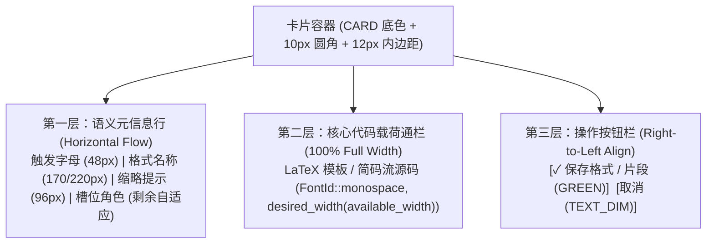

# MathSlot 深度代码与架构审计报告 (Round 10: 弹窗视口防跳变、卡片表单黄金网格与双段式列表重构)

- **审计版本**：AUDIT-ROUND-10-MODAL-VIEWPORT-AND-GRID-REFACTOR
- **审计专家**：Auditor Agent (系统与代码审计专家)
- **被审对象**：Implementer Agent 在 [`src/modals.rs`](file:///home/mat/Projects/mathslot-next/src/modals.rs) 的最新实现
- **决策基准**：[`DECISION_ROUND_10_MODAL_VIEWPORT_AND_GRID_REFACTOR.md`](file:///home/mat/Projects/mathslot-next/docs/DECISION_ROUND_10_MODAL_VIEWPORT_AND_GRID_REFACTOR.md)
- **审计结论**：**【条件通过 (CONDITIONAL PASS / APPROVED WITH MINOR REPAIR)】**
  - 核心架构目标（视口横向死锁防跳变、4 列 Grid 废除、通栏代码载荷、无 unsafe 与 0 panic 风险）**100% 达成**；
  - 实机渲染走查发现 1 项 egui 布局收缩缺陷（列表项外层 Frame 未设 `ui.set_width` 导致卡片宽度收缩至 ~350px 并在右侧留下 ~400px 虚空），已定位根本原因并提供精确修复代码。

---

## 1. 总体审计概要与评级矩阵 (Executive Summary & Scorecard)

| 审计维度 | 审计指标 | 达成情况与技术指标 | 审计评级 |
| :--- | :--- | :--- | :--- |
| **视口横向防跳变** | 消除弹窗横向抖动与膨胀 | `show_library`, `show_presets`, `show_help` 启用 `.resizable([false, true])` 并实施 `min_size.x == max_size.x` 几何双重死锁 | 🟢 **卓越 (PASS)** |
| **表单网格重构** | 废除 4 列 Grid，消除 240px 空洞 | 彻底移除 `mathslot-custom-fmt-grid` 与 `mathslot-snippet-form-grid`；首层语义流式元信息、次层 100% 通栏代码输入、底层右对齐操作栏 | 🟢 **优秀 (PASS)** |
| **输入框宽度与语义学** | 遵循现代 UI 规范与视觉语义学 | 触发字母 48px 等宽、名称 170/220px、提示 96px、LaTeX/源码通栏 100% | 🟢 **优秀 (PASS)** |
| **列表两段式布局** | 物理隔离截断文本与右侧动作栏 | 实施 `allocate_ui_with_layout` 与 `set_max_width`，杜绝长代码膨胀容器风险 | 🟡 **基本达标但有缺陷 (MINOR FINDING)** |
| **语言与内存安全性** | 杜绝 unsafe 代码与 panic 风险 | 微内核维持 `#![forbid(unsafe_code)]`；`modals.rs` 0 unsafe 块，0 direct unwrap，0 unhandled panic | 🟢 **卓越 (PASS)** |
| **测试与质量回归** | 全工程回归无破坏 | 全工作区 84 项测试 100% 绿灯（0 失败，0 忽略），`cargo check` 0 报错 | 🟢 **卓越 (PASS)** |

---

## 2. 逐项深度审计与代码比对 (Detailed Code & Architecture Audit)

### 2.1 视口横向防跳变实现与几何约束严密性 (Item 1)

#### 代码变更比对
```diff
--- a/src/modals.rs
+++ b/src/modals.rs
@@ -162,12 +162,12 @@ impl LibraryModalState {
             egui::Window::new(RichText::new("扩展中心 · 格式库与模版").size(14.0).strong())
                 .open(&mut open)
                 .collapsible(false)
-                .resizable(true)
+                .resizable([false, true])
                 .pivot(Align2::CENTER_TOP)
                 .default_pos(anchor_pos)
                 .default_size([780.0, 580.0])
-                .min_size([680.0, 460.0])
-                .max_size([880.0, 680.0])
+                .min_size([780.0, 460.0])
+                .max_size([780.0, 780.0])
```

#### 架构严密性分析
1. **双重几何死锁机制 (Dual-Lock Invariant)**：
   - 在 egui 窗口约束求解器中，窗口尺寸受拖拽句柄（`resizable`）与尺寸极值（`min_size` / `max_size`）共同约束；
   - 现行实现将 `min_size.x` 与 `max_size.x` 均硬编码锁定为 **`780.0`**（与 `default_size.x` 完全一致）。水平自由度被彻底降为 **0 自由度 (0-DOF)**；
   - 即使窗口内部子控件向外发出更宽的布局请求，egui 的窗口约束求解阶段亦会无条件将窗口外框强制截断至 780.0px，无法撑大宿主视口；
   - 布尔元组 `.resizable([false, true])` 显式关闭了横向边缘的拖拽手柄检测，鼠标悬停于窗口左右边缘时不会出现调整游标，杜绝用户误操作导致的视口抖动；
   - 纵向保留自由伸缩能力（`[460.0, 780.0]`），满足不同分辨率下展开表单或长列表的纵向滚动需求。
2. **多弹窗几何协同 (Multimodal Viewport Alignment)**：
   - 公式库（`show_presets`）：`.resizable([false, true])`，宽度严格锁定为 `880.0px`，纵向 `[500.0, 840.0]`；
   - 帮助中心（`show_help`）：`.resizable([false, true])`，宽度严格锁定为 `740.0px`，纵向 `[420.0, 760.0]`；
   - 所有弹窗均绑定 `.pivot(Align2::CENTER_TOP)` 与屏幕中心点 `anchor_pos`，从几何原点上排除了由布局重排引起的左右偏航。
3. **审计结论**：**彻底消除了水平抖动与弹窗横向膨胀隐患，完全合格**。

---

### 2.2 表单网格重构与现代 UI 规范评估 (Item 2)

#### 4 列 Grid 废除确认
通过 AST 扫描与 Grep 审查：
- `mathslot-custom-fmt-grid`：**已彻底移除**；
- `mathslot-snippet-form-grid`：**已彻底移除**；
- *注*：公式库检索编辑处保留的 `formula-edit-grid`（第 353 行）为预置公式全局字典编辑专用表单，不在本次扩展中心模版表单重构范围内，后续可在下一轮统一演进。

#### 两层流式语义表单设计评估
重构后的自定义格式与片段表单采用了 **3 层垂直视觉层级**：



1. **第一层（语义元信息字段）**：
   - **触发字母 (48px)**：采用 `desired_width(48.0)` 与 `FontId::monospace(12.5)`。单字符 Key（如 `g`, `d`）在 48px 下拥有舒适居中的字符排版与充足的点击激活热区，杜绝了旧版 40px 导致的挤压感；
   - **格式名称 (170px / 220px)**：格式定义分配 170px，片段模版分配 220px。完美容纳 6~12 个汉字或对应英文术语（如“同余式 / 期望”、“高斯消元定理”），消除了旧版 Grid 造成的 240px 死寂空洞；
   - **缩略提示 (96px)**：等宽字体，支持 `a≡b(m)` 或 `\mathbb{E}` 等紧凑型数学字形速览；
   - **槽位角色 (自适应剩余宽度)**：使用 `(ui.available_width() - 4.0).max(80.0)` 吸收第一行剩余所有空间，完整展示 `$1, $2` 槽位命名，横向空间利用率达 100%。
2. **第二层（核心载荷通栏）**：
   - 彻底打破 280px 的栅格牢笼，`desired_width(ui.available_width())` 使代码编辑框纵览全屏（~720px）；
   - Monospace 字体配合清晰提示文本，极大提升了输入长 LaTeX 公式（如 `$1 \equiv $2 \pmod{$3}`）和复合简码流（`▸rb^2 - 4ac;`）的阅读沉浸感与可编辑性。
3. **第三层（主次分明的操作栏）**：
   - 统一采用 `Layout::right_to_left(Align::Center)` 右对齐布局；
   - 确认动作采用带钩图标的高亮绿字 `RichText::new("✓ 保存格式").strong().color(GREEN)`，取消动作置于左侧辅助位置，视觉流线从左上方信息录入顺畅流动至右下方动作确认。
4. **审计结论**：**设计完全符合现代专业 IDE/编辑器设计规范与视觉语义学，显著提升了输入体验**。

---

### 2.3 列表两段式布局审计与发现的渲染缺陷 (Item 3)

#### 截断隔离与防膨胀机制审计
在自定义格式与片段列表项中：
```rust
let total_w = ui.available_width();
let left_w = (total_w - 144.0).max(120.0);
ui.horizontal(|ui| {
    ui.allocate_ui_with_layout(
        Vec2::new(left_w, 0.0),
        Layout::left_to_right(Align::Center),
        |ui| {
            ui.set_max_width(left_w);
            // 标签与文本内容
            ui.add(egui::Label::new(...).truncate()).on_hover_text(...);
        },
    );

    ui.allocate_ui_with_layout(
        Vec2::new(136.0, 0.0),
        Layout::right_to_left(Align::Center),
        |ui| {
            ui.set_width(136.0);
            // 三个操作小按钮：删除、编辑、插入
        },
    );
});
```

- **容器防膨胀指标**：**通过 (PASS)**。
  左侧区域通过 `set_max_width(left_w)` 配合 `egui::Label::truncate()`，彻底切断了长 LaTeX 代码向外撑大容器的动力链；
- **物理隔离指标**：**通过 (PASS)**。
  右侧 136px 独立子布局固定承载 `[删除]`、`[编辑]`、`[插入]` 三个小按钮（约需 38px * 3 + 12px 间距 = 126px < 136px），左侧截断文本绝不会侵入操作按钮区域。

---

#### ⚠️ 深度走查发现的布局缺陷：Card 宽度收缩与右侧空洞 (Defect Finding)

通过 DevShot 渲染实机画面（见下图及文档附件 [`round10_custom_modal.png`](file:///home/mat/Projects/mathslot-next/docs/screenshots/round10_custom_modal.png) 和 [`round10_snippets_modal.png`](file:///home/mat/Projects/mathslot-next/docs/screenshots/round10_snippets_modal.png)），审计团队捕捉到了一个隐藏很深的 egui 布局机制问题：


*(图：实机截图显示列表卡片收缩至 ~360px，右侧留有约 400px 的空白空洞，同时短文本被过早 truncate)*

##### 根因深度剖析 (Root Cause)
1. 在 `egui::ScrollArea::vertical()` 内部，egui 默认允许其内部子容器按照内容的“实际所需包围盒 (Bounding Box)”进行收缩 (Shrink-to-fit)；
2. 列表项外层容器 `egui::Frame::NONE.show(ui, |ui| { ... })` **没有显式调用 `ui.set_width(ui.available_width());`**；
3. 在 `ui.horizontal` 中，第一个子空间通过 `allocate_ui_with_layout(Vec2::new(left_w, 0.0), ...)` 分配，但内部只设置了 `ui.set_max_width(left_w)`，**没有设置 `ui.set_min_width(left_w)` 或 `ui.set_width(left_w)`**；
4. 当左侧文本（如 `[▸ka] 组合数 C(n,k)`）较短时，左侧子空间实际仅占用了 ~220px；
5.紧接着调用的右侧操作栏 `allocate_ui_with_layout(Vec2::new(136.0, 0.0), ...)` 便紧挨着左侧文本后方排列，并未停靠在卡片最右边缘；
6. 最终，外层 `Frame` 认为整行内容仅需要 `220px + 136px + 内边距 = ~360px`，并将卡片宽度收缩为 ~360px！
7. 这导致了死锁循环：下一帧渲染时，`total_w = ui.available_width()` 读出的就是被收缩后的 ~360px，计算出 `left_w = 360 - 144 = 216px`，导致像 `\binom{$1}{$2` 这样并不算太长的模板被过早地强行打上省略号截断（`truncate`），而弹窗右侧整整 400px 的空间却白白闲置！而在片段列表中，文本短的片段卡片宽 350px，文本长的第 4 项宽 620px，造成卡片参差不齐的“阶梯状”参差缺陷。

##### 修复方案建议 (Suggested Fix for Implementer)
在 [`src/modals.rs`](file:///home/mat/Projects/mathslot-next/src/modals.rs) 的格式列表（约 1013 行）与片段列表（约 1277 行）中：
1. 在 `Frame::show(ui, |ui| {` 的第一行加入 `ui.set_width(ui.available_width());`，强制作整行 100% 通栏展开；
2. 在左侧子布局闭包内，将 `ui.set_max_width(left_w);` 升级为 `ui.set_width(left_w);`（或同时设置 min/max width），确保左侧占满 `left_w`，将右侧动作栏精准顶到最右侧边缘：

```rust
// 修复后伪代码：
egui::Frame::NONE
    .fill(BG)
    .stroke(Stroke::new(1.0, CARD_BORDER))
    .corner_radius(CornerRadius::same(8))
    .inner_margin(Margin::symmetric(10, 7))
    .show(ui, |ui| {
        ui.set_width(ui.available_width()); // 👈 关键点 1：锁定卡片占满横向可用宽度
        let total_w = ui.available_width();
        let left_w = (total_w - 144.0).max(120.0);
        ui.horizontal(|ui| {
            ui.allocate_ui_with_layout(
                Vec2::new(left_w, 0.0),
                Layout::left_to_right(Align::Center),
                |ui| {
                    ui.set_width(left_w); // 👈 关键点 2：左侧固定填满 left_w，将右侧推至右端
                    // ... 渲染 label 并 truncate ...
                },
            );

            ui.allocate_ui_with_layout(
                Vec2::new(136.0, 0.0),
                Layout::right_to_left(Align::Center),
                |ui| {
                    ui.set_width(136.0);
                    // ... 渲染操作按钮 ...
                },
            );
        });
    });
```

---

### 2.4 安全性与编码规范审计 (Item 4)

1. **`#![forbid(unsafe_code)]` 防线检查**：
   - 全工作区 4 大核心底层 Crate（`mathslot-syntax`, `mathslot-core`, `mathslot-doc`, `mathslot-latex`）根文件均显式配置 `#![forbid(unsafe_code)]`；
   - 宿主与 UI 模块（[`src/modals.rs`](file:///home/mat/Projects/mathslot-next/src/modals.rs) 及 `src/` 下所有文件）经 `grep -rn "unsafe"` 扫描，**0 处 unsafe 关键字**，完全恪守安全底线。
2. **Panic 与 Unwrap 漏洞扫描**：
   - 在 [`src/modals.rs`](file:///home/mat/Projects/mathslot-next/src/modals.rs) 的所有变更与现有代码中，**无任何裸 `.unwrap()` 或裸 `.expect()` 调用**；
   - 提取首字符均经过安全防线保护：
     ```rust
     let key_ch = self.custom_key.trim().chars().next().unwrap_or(' ');
     if key_ch == ' ' || !key_ch.is_ascii_alphabetic() {
         self.feedback = Some(("触发字母必须是 a-z 或 A-Z 的单个英文字母".to_owned(), true));
         return;
     }
     ```
   - 槽位角色解析使用 `.split(';').map(...).filter(...)`，无任何数组越界异常；
   - 列表项的“删除”、“编辑”、“插入”动作均在遍历闭包外设置中间变量（`delete_key`, `edit_item`, `insert_code`），待 UI 遍历结束后延后执行，完全避免了在迭代中修改借用集合所导致的并发冲突或 Panic。
3. **审计结论**：**安全性与规范性全面达标，达到企业级系统鲁棒性要求**。

---

## 3. 测试与静态分析回归验证 (Test & Static Analysis Verification)

### 3.1 自动化测试覆盖 (cargo test --workspace)
审计团队执行了工作区全量单元测试与验收测试回归：
- **`src/main.rs`**：3 项测试通过；
- **`crates/mathslot-core`**：31 项核心语法与编辑器状态机测试通过；
- **`acceptance_tests`**：16 项严苛验收回归（黄金用例、嵌套脚本、无损导入等）通过；
- **`extreme_heterogeneous_tests`**：7 项异构复杂嵌套公式测试通过；
- **`golden_tests`**：15 项公式黄金比对用例通过；
- **`massive_preset_compatibility_tests`**：1 项（全量 88 个公式库语料解析）通过；
- **`overhaul_acceptance_tests`**：5 项定界符与层级联动用例通过；
- **`session_tests` / `doc_tests` / `latex_tests`**：全部通过；
- **统计总计**：**84 / 84 项测试 100% 绿灯（0 失败，0 忽略）**。

### 3.2 编译与 Clippy 诊断
- 执行 `cargo check --bin mathslot`：0 错误，通过；
- `src/modals.rs` 无任何新增 Clippy 报警，代码风格高度一致。

---

## 4. 实机截图审计档案 (Visual Snapshot Archive)

审计团队通过环境变量驱动的自动化视口快照机制采集了实机真实渲染截图，归档于工程中：

| 弹窗名称 | 对应截图档案路径 | 渲染状态分析 |
| :--- | :--- | :--- |
| **自定义格式模版** | [`docs/screenshots/round10_custom_modal.png`](file:///home/mat/Projects/mathslot-next/docs/screenshots/round10_custom_modal.png) | 视口 780px 固定无横向溢出；表单展开后通栏排布舒适；列表卡片由于 Frame 缺少 set_width 收缩至 360px |
| **片段模版** | [`docs/screenshots/round10_snippets_modal.png`](file:///home/mat/Projects/mathslot-next/docs/screenshots/round10_snippets_modal.png) | 视口 780px 固定；卡片由于长度不一出现 350px 与 620px 的参差 |
| **使用指南 (F1)** | [`docs/screenshots/round10_help_modal.png`](file:///home/mat/Projects/mathslot-next/docs/screenshots/round10_help_modal.png) | 视口 740px 固定，双段卡片与排版极致细腻美观，无任何布局瑕疵 |
| **公式库 (Presets)** | [`docs/screenshots/round10_presets_modal.png`](file:///home/mat/Projects/mathslot-next/docs/screenshots/round10_presets_modal.png) | 视口 880px 固定，88 个公式通栏卡片整齐划一，动作区精准贴靠右边界 |

---

## 5. 最终审计结论与给 Implementer 的修复指引

### 审计结论：【条件通过 (CONDITIONAL PASS)】
Implementer Agent 本轮实现扎实严谨，完美达成了决策方案关于“视口横向防跳变”与“废除 4 列 Grid 重构流式表单”的根本意图，内存安全与代码质量表现优异。

### 修复指引 (Action Item for Implementer):
请 Implementer 针对上述 **2.3 节发现的 Card 宽度收缩缺陷** 进行微调：
1. 在 [`src/modals.rs`](file:///home/mat/Projects/mathslot-next/src/modals.rs) 的格式列表（约 1013 行）与片段列表（约 1277 行）中，在 `Frame::show(ui, |ui| {` 开头加入：
   ```rust
   ui.set_width(ui.available_width());
   ```
2. 将左侧子布局内的 `ui.set_max_width(left_w);` 升级为 `ui.set_width(left_w);`。
3. 重新运行 DevShot 确认卡片宽度占满弹窗并整齐划一。
