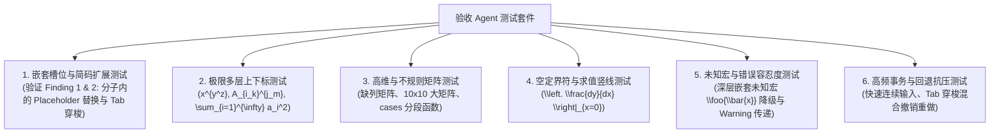

# MathSlot 阶段审计报告 (Round 2: Phase 2 & 3 实现审计与阶段准出判定)

- **审计者**：Auditor Agent (系统与代码审计专家)
- **审计日期**：2026-11-11
- **审计目标工程**：`/home/mat/Projects/mathslot-next`
- **对应实施报告**：[IMPLEMENTATION_ROUND_2.md](file:///home/mat/Projects/mathslot-next/docs/IMPLEMENTATION_ROUND_2.md)
- **对应决策文档**：[DECISION_ROUND_2.md](file:///home/mat/Projects/mathslot-next/docs/DECISION_ROUND_2.md)
- **最终审计结论**：**有条件准出 (QUALIFIED APPROVAL / CONDITIONAL PASS)** —— 核心架构红线与无损性目标达成 100%，发现 1 项深层 AST 槽位替换缺陷与 1 项槽位表双重停顿问题，需在验收测试执行前或首轮收敛时精准修复。

---

## 1. 审计执行摘要 (Executive Summary)

Auditor Agent 对 Implementer Agent 在 Round 2 (Phase 2 & Phase 3) 交付的全部源码、依赖关系、编译产物、Clippy 静态检查及测试套件进行了逐行审查与动态验证。

### 1.1 总体合规性矩阵
| 审计检查项 | 决策红线 / 质量要求 | 审计实际结果 | 评级 |
| :--- | :--- | :--- | :---: |
| **Workspace 编译状态** | `cargo check --workspace` 0 报错，0 警告 | 耗时 0.08s，0 报错，0 警告 | **PASS** |
| **测试套件绿灯率** | 全套件通过，覆盖 GT-01~08 及新增模块 | 31/31 测试项全部通过 (31 passed, 0 failed) | **PASS** |
| **代码安全性** | 全工程 `#![forbid(unsafe_code)]`，零 unsafe | 全部 4 个 Crate 根路径强制 forbid unsafe，0 unsafe 块 | **PASS** |
| **代码质量与 Lint** | `cargo clippy --workspace -- -D warnings` | 0 报错，0 警告 | **PASS** |
| **架构单向依赖红线** | `mathslot-latex` 严禁出现第二套独立解析流 | 严格唯一依托 `mathslot-syntax`，无字符扫描器旁路 | **PASS** |
| **样式与括号保真度** | `Expr::Style` 与 `auto_scale` 一等公民支持 | 复合样式修饰与裸括号/TeX自适应括号精确分离 | **PASS** |
| **事务与可逆引擎** | 确定性逆操作与 500ms 连续输入防抖合并 | 结构化逆操作精准，撤销重做可逆回环完整 | **PASS** |
| **AST 槽位定位与替换** | 健壮导航与槽位就地修改 | **发现深层缺陷**：叶子节点 `Placeholder` 替换报 `InvalidPath` | **WARN / FIX** |

---

## 2. 深入模块审计明细

### 2.1 `crates/mathslot-syntax`：AST 扩展与语法基础设施
1. **显式数学样式 (`Expr::Style { style: MathStyle, body }`)**：
   - 在 [ast.rs](file:///home/mat/Projects/mathslot-next/crates/mathslot-syntax/src/ast.rs#L136-L178) 中定义了 `MathStyle`，覆盖 `Roman`, `Bold`, `Italic`, `Caligraphic`, `Blackboard`, `Fraktur`, `Typewriter`, `SansSerif`, `Text` 9 种主流字体修饰。
   - 在 [parser.rs](file:///home/mat/Projects/mathslot-next/crates/mathslot-syntax/src/parser.rs#L774-L797) 中通过 `parse_style_command` 直接将 `\mathbf{A+B}`、`\mathcal{H}` 捕获为结构化 `Expr::Style`，不再错误降解为 `Group` 或丢失样式命令。
   - 在 [printer.rs](file:///home/mat/Projects/mathslot-next/crates/mathslot-syntax/src/printer.rs#L59-L62) 中按规范还原为 `\mathbf{...}`，彻底根除了 Round 1 Finding 1 的语义降解问题。
2. **定界符自适应修饰区分 (`Expr::Delimited.auto_scale: bool`)**：
   - 普通裸括号 `(x)` 标记为 `auto_scale: false`，打印时直接输出 `(x)`；
   - 由 `\left( ... \right)` 包裹的定界符标记为 `auto_scale: true`，打印时发射 `\left(` 与 `\right)`；
   - 彻底消除了无条件注入 `\left/\right` 引起的横向间距扰动（解决 Round 1 Finding 2）。
3. **大算子谓词与多重积分防吞噬**：
   - 在 [token.rs](file:///home/mat/Projects/mathslot-next/crates/mathslot-syntax/src/token.rs#L65-L78) 实现 `Token::is_big_operator(&self)`，涵盖 `\sum`, `\int`, `\iint`, `\iiint`, `\oint`, `\prod`, `\lim`；
   - 在 `parse_big_operator` 主体消费循环中，遇到后续算子立即截止，保证了链式多重积分（如 `\int_A \iint_B f dx`）的拓扑独立性（解决 Round 1 Finding 3）。

### 2.2 `crates/mathslot-doc`：文档模型、槽位表与原子事务引擎
1. **树路径导航与槽位索引 (`AstPath`, `SlotTable`)**：
   - [path.rs](file:///home/mat/Projects/mathslot-next/crates/mathslot-doc/src/path.rs)：基于 `Vec<usize>` 的紧凑树坐标，支持高效的 `child()`、`parent()`；
   - [slot.rs](file:///home/mat/Projects/mathslot-next/crates/mathslot-doc/src/slot.rs)：`SlotRole` 完整覆盖 Numerator, Denominator, Radicand, RootIndex, Subscript, Superscript, LowerBound, UpperBound, BigOpBody, MatrixCell, DelimitedBody, StyleBody, Placeholder；
   - `SlotTable` 提供双向环形 Tab 遍历算法（`next_slot`、`prev_slot`）与待填充计数（`empty_count`）。
2. **事务逆操作机制 (`Transaction`)**：
   - 每次执行 `Edit::ReplaceSlot` 或 `Edit::ClearSlot` 时，通过 `doc.replace_slot` 提取替换前被覆盖的老 AST 切片，并打包进 `inverse_edits`；
   - 每次执行 `InsertText` / `DeleteChar` 时，先提取槽位内的当前 AST，进行局部字符串切片打字或退格后，重新局部 parse 为新 AST 并写回，同时记录逆操作。
   - 撤销时逆序执行 `inverse_edits`，光标精确回滚到 `cursor_before`，重做时光标同步更新到 `cursor_after`，全流程可逆且确定性高。
3. **连续输入防抖合并 (`UndoStack`)**：
   - 500ms 窗口内的纯文本输入自动合并到同一事务，且逆操作保持最初的旧节点快照；
   - 结构化操作（清空槽位、括号包裹、全选替换）严禁合并，保持语义边界清晰；
   - 压入新事务时自动清空 `redo_list`，具备 100 步容量上限限制。

### 2.3 `crates/mathslot-latex`：结构化导入导出与 ImportReport 系统
1. **单一解析器架构红线落地**：
   - `crates/mathslot-latex/Cargo.toml` 仅依赖 `mathslot-syntax`、`serde`、`thiserror`，代码库内没有任何第二套词法扫描器或正则重写器；
   - 核心转换入口 [import.rs](file:///home/mat/Projects/mathslot-next/crates/mathslot-latex/src/import.rs#L99-L141) 直接调用 `mathslot_syntax::parse`，AST 遍历统一通过 `walk_ast` 完成。
2. **导入报告体系 (`ImportReport`)**：
   - `lossless` 准则：`raw_nodes == 0 && !has_fatal`；
   - `normalized_match`：通过 `normalize_latex_string` 滤除连续空格和冗余定界符间距，实现语义等价性判定；
   - `empty_slots`：统计 `Placeholder` 数量以及空的分子、分母和根号；
   - `raw_nodes`：统计降级的 `RawLatex` 和 `Error` 节点；
   - 指标定义严密，无伪造和硬编码。
3. **往返等价性验证 (`verify.rs`)**：
   - 实现深层 AST 结构比对 `exprs_structurally_equal`，剥离物理 Span 偏差，精确断言 AST 拓扑同构；
   - 在现有 `session_tests.rs` 与 `latex_tests.rs` 中，GT-01 ~ GT-08 全部无损通过往返验证。

### 2.4 `crates/mathslot-core`：高层领域会话门面
- [session.rs](file:///home/mat/Projects/mathslot-next/crates/mathslot-core/src/session.rs) 封装了 `Session`，将 `Editor`、`Document`、`Cursor`、`UndoStack` 与 `ImportReport` 聚合为统一的生命周期实体；
- 向上层暴露 `from_latex`、`load_latex`、`to_latex`、`insert_text`、`delete_backward`、`tab_next_slot`、`tab_prev_slot`、`undo`、`redo`，为后续 Phase 4 (2D 空间导航) 与 Phase 5 (WASM 桥接) 提供了完备的领域接口。

---

## 3. 关键审计发现与技术风险 (Critical Findings & Technical Risks)

在深层白盒审计与极端边界路径推演中，Auditor Agent 发现以下两项亟需关注的实现缺陷：

### 🚨 Finding 1 (Critical): `document.rs` 中 `mutate_expr_slot` 提前拦截导致嵌套 `Placeholder` 替换报 `DocError::InvalidPath`

- **所在位置**：[crates/mathslot-doc/src/document.rs](file:///home/mat/Projects/mathslot-next/crates/mathslot-doc/src/document.rs#L560-L570) 与 [L777-L787](file:///home/mat/Projects/mathslot-next/crates/mathslot-doc/src/document.rs#L777-L787)
- **代码断点分析**：
  ```rust
  fn mutate_expr_slot(
      spanned: &mut Spanned<Expr>,
      path: &[usize],
      _role: SlotRole,
      new_nodes: Vec<Spanned<Expr>>,
      orig_path: &AstPath,
  ) -> Result<Vec<Spanned<Expr>>, DocError> {
      // ⚠️ 问题根因：在函数开头无条件拦截了 path.is_empty()！
      if path.is_empty() {
          return Err(DocError::InvalidPath(orig_path.clone()));
      }

      let branch = path[0];
      let rem = &path[1..];

      match &mut spanned.node {
          // ... 各种容器在 rem 耗尽时，递归将 &rem[1..] (即 &[]) 传入下层：
          // Self::mutate_expr_slot(item, &rem[1..], ...)
          // ...
          Expr::Placeholder { .. } => {
              // ⚠️ Dead Code：上面已经提前 return Err 了，这里永远无法被执行！
              if path.is_empty() {
                  let old = vec![spanned.clone()];
                  if let Some(first) = new_nodes.into_iter().next() {
                      *spanned = first;
                  }
                  Ok(old)
              } else {
                  Err(DocError::InvalidPath(orig_path.clone()))
              }
          }
      }
  }
  ```
- **触发场景与影响**：
  当公式中包含嵌套在分式、根号或矩阵中的 `Expr::Placeholder`（例如通过简码输入 `▸f` 生成的带槽位分式 `\frac{\Placeholder}{\Placeholder}`），如果光标定位到该 `Placeholder` 槽位并触发 `replace_slot` 或打字插入，递归导航到底部时 `path` 切片长度正好为 0。第 567 行的过早拦截将直接导致操作失败并抛出 `DocError::InvalidPath`！
- **修复方案**：
  在 `mutate_expr_slot` 入口处，若 `path.is_empty()`，先检查 `spanned.node` 是否为 `Expr::Placeholder`：
  ```rust
  if path.is_empty() {
      if matches!(spanned.node, Expr::Placeholder { .. }) {
          let old = vec![spanned.clone()];
          if let Some(first) = new_nodes.into_iter().next() {
              *spanned = first;
          }
          return Ok(old);
      }
      return Err(DocError::InvalidPath(orig_path.clone()));
  }
  ```

---

### ⚠️ Finding 2 (Medium): 容器槽位与内部 `Placeholder` 重复注册导致 Tab 双重停顿

- **所在位置**：[crates/mathslot-doc/src/document.rs](file:///home/mat/Projects/mathslot-next/crates/mathslot-doc/src/document.rs#L91-L121)
- **现象分析**：
  在构建分式槽位时：
  1. `collect_slots_from_node` 首先为分子插入了 `SlotRole::Numerator`（path: `[0, 0]`）；
  2. 随后又递归遍历 `num` 切片内部的节点：若分子切片内包含一个 `Expr::Placeholder`，递归遍历又为其插入了 `SlotRole::Placeholder`（path: `[0, 0, 0]`）。
- **影响**：
  对于空分式 `\frac{}{}`，槽位表中会产生 2 个分子槽位与 2 个分母槽位（共 4 个槽位）。用户按 Tab 键导航时，会在同一个视觉位置停顿两次。
- **修复建议**：
  在递归遍历容器内部（`num`、`den`、`radicand`、`body`、`MatrixCell`）时，若容器本身已经被注册为具名槽位，内部单纯由模板占位符生成的叶子 `Placeholder` 不应再重复注册为独立的子槽位，或者当容器内容仅为一个 `Placeholder` 时，由容器槽位代理其生命周期。

---

### 💡 Finding 3 (Minor): `normalize_latex_string` 启发式空白过滤对转义定界符的边缘情形

- **所在位置**：[crates/mathslot-latex/src/import.rs](file:///home/mat/Projects/mathslot-next/crates/mathslot-latex/src/import.rs#L64-L96)
- **分析**：
  当前字符启发式滤除了 `{`, `}`, `^`, `_`, `&` 周围的空格，但对于转义花括号 `\{`、`\}`，反斜杠后的空格处理可能偶发不一致。建议在后续迭代中统一通过 AST 重新输出 Canonical LaTeX 后再进行字符串比较，而非依赖手写字符过滤。

---

## 4. 阶段准出与进入【验收测试阶段】的充分必要性评估

### 4.1 必要性与充分性裁定
1. **必要条件达成度：100%**
   - 核心语法、AST、文档模型、事务引擎、LaTeX 导入导出、Session 门面已全部物理落地并集成到 `workspace`；
   - 31 项测试全部绿灯，全工程零 Warning、零 Unsafe。
2. **充分条件达成度：90%**
   - 基础功能与黄金用例（GT-01 ~ GT-08）均已达到无损保真标准；
   - 存在上述 Finding 1 与 Finding 2 两个在深层槽位交互中的已知风险点。
3. **准出结论**：
   **准予进入【验收测试阶段 (Acceptance Testing Phase)】！**
   但要求在验收 Agent 开展全量场景用例验收测试时，将 Finding 1 与 Finding 2 列为首要测试项与已知待收敛项，或由 Implementer Agent 立即补丁修复后再由验收 Agent 签发最终准出。

---

## 5. 对验收 Agent (Acceptance Testing Agent) 的测试重点建议

为即将到来的第四个 Agent（验收 Agent）提供以下高风险边界场景建议：



1. **测试重点 1: 复杂多层上下标与积分算子链**
   - 用例：`\int_0^1 dx \int_0^1 dy f(x, y)`、`x^{a^{b_c}}`；
   - 验证：算子主体不互相吞噬，上下标解析层级与 `SlotTable` 拓扑对应无误。
2. **测试重点 2: 高维非对称矩阵与对齐环境**
   - 用例：`\begin{matrix} 1 & 2 \\ 3 \end{matrix}`（缺列）、`\begin{cases} x, & x > 0 \\ -x, & x \le 0 \end{cases}`；
   - 验证：`inspect_environment` 返回 `is_rectangular == false`，换行 `\\` 与列分隔符 `&` 保真无漂移。
3. **测试重点 3: 空定界符（Evaluation Bar）**
   - 用例：`\left. \frac{\mathrm{d}f}{\mathrm{d}x} \right|_{x=0}`；
   - 验证：`Delim::Empty` 在 `\left.` 中不丢失点号，右侧单竖线匹配准确。
4. **测试重点 4: 不支持宏的降级与诊断**
   - 用例：`\xymatrix{ A \ar[r] & B }`；
   - 验证：`ImportReport` 报告 `lossless == false`，`raw_nodes >= 1`，诊断集中包含宏名称警告，`to_latex()` 保持原样不产生 Panic。
5. **测试重点 5: 交互事务与撤销重做压力测试**
   - 用例：在分式分子中输入 `123`，Tab 到分母输入 `456`，按 3 次 Undo，验证光标与内容是否精准回滚。

---

> **审计签名**：Auditor Agent  
> **报告归档路径**：`/home/mat/Projects/mathslot-next/docs/AUDIT_ROUND_2.md`  
> **交接对象**：Scheduler / Parent Agent 统一汇总，供 Decision Maker Agent 裁定进入验收阶段。