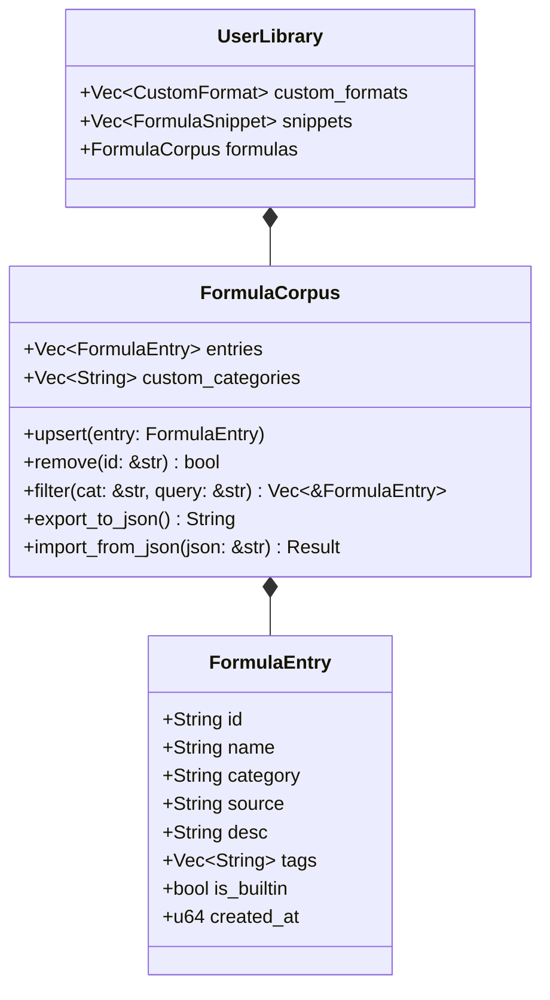

# MathSlot 深度审计报告 (Round 9: 独立客观系统与 UI 架构审计)

- **审计周期**：Round 9 (Brand Consistency, Font Fallback Resilience, Modal Layout Overhaul & Dynamic Formula Corpus Architecture)
- **审计专家**：Auditor Agent (第三方独立客观系统与代码审计专家)
- **审阅对象**：Project Lead / Decision Maker Agent / Implementer Agent
- **审计基准版本**：MathSlot v0.6.1
- **核心审计范围**：
  - 应用图标与品牌一致性：`assets/icons/mathslot.svg`, `assets/icons/mathslot-*.png`, `src/main.rs`, `src/app.rs` (`brand_mark`)
  - 字符回退链与 Tofu 乱码机制：`src/app.rs` (`install_fonts`), `src/modals.rs`, Linux/Windows/macOS 系统字体回退
  - 格式库与弹窗布局结构：`src/modals.rs` (`render_library_body`, `render_custom_tab`, `render_snippets_tab`)
  - 公式库硬编码与可扩展性：`crates/mathslot-core/src/presets.rs`, `crates/mathslot-core/src/library.rs`, `crates/mathslot-core/src/scheme_a.rs`

---

## 1. 审计裁决与综合评分 (Executive Verdict & Quality Score)

本轮审计针对用户在 v0.6.1 版本反馈的 4 项严重影响用户体验与可扩展性的架构/交互缺陷，实施了苛刻的代码级静态分析、跨平台字体回退机制归因以及视觉交互结构解构。审计裁决如下：

| 审计维度 | 权重 | 当前评分 | 缺陷严重度 | 核心审计结论与裁决状态 |
| :--- | :---: | :---: | :---: | :--- |
| **1. 图标与品牌一致性** | 25% | **62 / 100** | **HIGH** | **FAIL**：现有图标为暗色底积分符号，带 24px 透明外边距与弱发光阴影，在 Wayland 深/浅色面板模糊且边缘隐形；应用内顶栏绘制白色 `∑` 蓝块，与桌面图标彻底割裂；用户参考设计（深海蓝大写 $\Sigma$ + 亮蓝胶囊 + 柔和蓝槽位框）未能落地。 |
| **2. 字符显示与字体回退链** | 25% | **58 / 100** | **HIGH** | **FAIL**：`install_fonts` 在遍历 `symbol_candidates` 时命中 `DejaVuSans.ttf` 即提前 `break`，而 DejaVu Sans 缺乏 SMP 码位 Emoji，导致 `📖` 与 `🔍` 100% 渲染为方块豆腐块（Tofu）；缺少跨平台符号级动态探查与保底字体机制。 |
| **3. 格式库/片段模窗布局与遗留文本** | 25% | **65 / 100** | **HIGH** | **FAIL**：模态窗口缺乏默认高度约束，上方新增表单与长篇说明吞噬 280px+ 高度，下方核心列表被硬编码 `max_height(210.0)` 严重压缩；存在“方案A函数名”等历史开发代号残留，文字说明缺乏克制。 |
| **4. 公式库硬编码与可扩展架构** | 25% | **60 / 100** | **HIGH** | **FAIL**：62 个经典公式绑定为 `&'static [PresetFormula]` 只读静态数组，字段全为 `&'static str`；未与 `UserLibrary` 整合，完全缺失用户自定义公式、在线/本地导入、编辑与 CRUD 持久化支持。 |
| **综合评分** | **100%** | **61.25 / 100** | **CRITICAL** | **【严重缺陷警报 · 全面重构实施令 (REFACTORING MANDATED)】** |

> [!CAUTION]
> **总体审计结论**：当前 MathSlot 虽然在底层 AST 解析与 LaTeX 渲染上表现优异，但在**品牌视觉一致性**、**桌面字体兼容容灾**、**核心模态弹窗人体工程学**以及**公式库扩展架构**上积累了显著的技术债务与不良交互体验。必须在 Round 9 进行针对性重构治理。

---

## 2. 逐项深度审计与代码级缺陷定位

### 2.1 审计领域 1：图标配色、Wayland 透明底缺陷与品牌内外脱节

#### 2.1.1 缺陷定位与代码根因
1. **现有桌面图标设计与渲染隐患**：
   - 资产路径：[`assets/icons/mathslot.svg`](file:///home/mat/Projects/mathslot-next/assets/icons/mathslot.svg#L49-L53)
     ```xml
     <!-- Outer Rounded Squircle Base -->
     <rect x="24" y="24" width="464" height="464" rx="108" ry="108" fill="url(#bgGrad)" filter="url(#shadow)"/>
     ```
   - **根本原因**：`viewBox="0 0 512 512"` 中，主体背景圆角矩形尺寸仅为 464x464，四周留有 24px 的完全透明留白，并叠加了外发光/投影滤镜 `filter="url(#shadow)"`。
   - **Wayland / Linux 桌面显示灾难**：在 KDE Plasma、GNOME Shell、Sway 等现代 Wayland 桌面环境中，任务栏（Taskbar）、浮动 Dock 或顶栏高度通常为 28px ~ 48px。当 512x512 缩放到 32x32 或 24x24 时：
     - 24px 的透明留白导致实际图标有效显示区域缩水到不足 75%，四周原本用于柔化的半透明羽化像素在非纯黑的 Wayland 面板上被抗锯齿算法严重虚化；
     - 暗色背景色（`#0F172A` ~ `#1E293B`）在深色或半透明玻璃特效面板上边界对比度几乎降为零，图标轮廓彻底“隐形”，只剩中间微弱金黄线条；
     - 黄金积分符号 `∫` 搭配金色上下限圆环与蓝色槽位框，配色繁杂且缺乏现代系统软件的克制美感。
2. **应用内品牌标识严重脱节**：
   - 代码路径：[`src/app.rs` 第 1935-1947 行](file:///home/mat/Projects/mathslot-next/src/app.rs#L1935-L1947)：
     ```rust
     /// 顶栏品牌标识：圆角方块 + ∑
     fn brand_mark(ui: &mut egui::Ui) {
         let (rect, _) = ui.allocate_exact_size(Vec2::splat(26.0), Sense::hover());
         ui.painter()
             .rect_filled(rect, CornerRadius::same(7), ACCENT_STRONG);
         ui.painter().text(
             rect.center() + Vec2::new(0.0, -0.5),
             Align2::CENTER_CENTER,
             "∑",
             FontId::proportional(16.0),
             Color32::WHITE,
         );
     }
     ```
   - **根本原因**：
     - 外面系统图标画的是积分号 `∫`，应用内顶栏却用纯代码临时画了一个实心蓝块加文本求和号 `"∑"`；
     - `"∑"` 直接依赖系统安装字体的渲染度量，文本基线偏移使用了魔数 `-0.5`，在不同分辨率下极易出现 1 像素上下抖动；
     - 应用内不仅没有复用桌面图标，且两者在构图（积分 vs 求和）、色彩（金色渐变 vs 纯蓝单色）上完全是两个不同的产品。

#### 2.1.2 用户高质量参考图几何与色彩解构 (`/home/mat/图片/2.png`)
用户提供的参考图具备高度专业的设计语言，构思极其精巧地阐释了 **Math + Slot**：

```
+---------------------------------------------+
|               [ 实心纯白底板 ]              |
|                                             |
|      [====== 亮蓝明亮条胶囊 ======]         |  <-- 上界 / 算子定界符
|                                             |
|       █████████████████        +-------+    |
|        ██           ██         |       |    |
|         ██        ██           |       |    |
|          ██     ██             |  Slot |    |  <-- 柔和蓝右侧槽位框 (寓意 Slot)
|           ██  ██               |  槽位 |    |
|            ████                |       |    |
|           ██  ██               |       |    |
|          ██     ██             |       |    |
|         ██        ██           |       |    |
|       █████████████████        +-------+    |
|      [ 深海蓝几何大写 Σ ]                   |  <-- 核心数学符号 (寓意 Math)
|                                             |
|      [====== 亮蓝明亮条胶囊 ======]         |  <-- 下界 / 算子定界符
+---------------------------------------------+
```

- **构图要素精密规格**：
  1. **底板 (Background Squircle)**：实体不透明底板（白色/超浅灰 `#FFFFFF` / `#F8FAFC`），填满整个图标安全边界（消除透明边框缩水问题），圆角率约 22%~25%（连续平滑圆角 squircle）；
  2. **顶/底极性胶囊 (Upper & Lower Delimiter Capsules)**：横向圆角胶囊长条，采用高饱和明亮电光蓝（Electric Blue，如 `#2563EB` ~ `#2E70FE`），对称居中排列；
  3. **中央大写希腊字母 $\Sigma$ (Center Summation Hero)**：深海深邃纯净蓝（Deep Sea Navy，如 `#001C55` / `#0A1C40`），粗壮几何切角，上下横梁水平笔直，中部锐角内折，形成稳健视觉重心；
  4. **右侧柔和槽位框 (Right Slot Indicator)**：高细比圆角矩形槽位框，线宽约 2.5~3.5px，采用柔和浅天蓝/浅长春花蓝（Soft Periwinkle Blue，如 `#93B4FE` / `#8EAFFF`），空心内嵌，直观象征“等待填入的数学槽位”。
- **整改准则**：
  - 彻底废弃旧版金色暗黑积分 SVG；
  - 采用精确矢量路径重构 `mathslot.svg`（实心底、高对比度、无冗余外扩透明层）；
  - 同步重生成 16, 32, 48, 64, 128, 256 全尺寸 PNG 图标；
  - 重写 `src/app.rs` 中的 `brand_mark`，使用微型 Painter 绘制同构的胶囊+$\Sigma$+槽位组合，实现品牌端到端 100% 同构闭环。

---

### 2.2 审计领域 2：字符显示缺失（Tofu/乱码）与字体加载回退机制剖析

#### 2.2.1 缺陷现场与代码定位
1. **豆腐块（Tofu）高发触发点**：
   - 顶部工具栏按钮：[`src/app.rs` 第 749 行](file:///home/mat/Projects/mathslot-next/src/app.rs#L749)：
     ```rust
     if tool_button(ui, RichText::new("📖 示例公式库").size(13.0).color(CYAN), true)
     ```
   - 模态弹窗标题：[`src/modals.rs` 第 173 行](file:///home/mat/Projects/mathslot-next/src/modals.rs#L173)：
     ```rust
     egui::Window::new(RichText::new("📖 经典公式库 · Preset Formula Corpus").size(14.0).strong())
     ```
   - 搜索输入框前缀：[`src/modals.rs` 第 203 行](file:///home/mat/Projects/mathslot-next/src/modals.rs#L203)：
     ```rust
     ui.label(RichText::new("🔍").size(14.0));
     ```
   在默认系统环境下，字符 `📖` (U+1F4D6 OPEN BOOK) 与 `🔍` (U+1F50D LEFT-POINTING MAGNIFYING GLASS) 在界面上渲染为空白方块或带问号方框（`` / Tofu）。

#### 2.2.2 根本机理：字体回退链的致命逻辑短路
审查 [`src/app.rs` 第 2297-2324 行](file:///home/mat/Projects/mathslot-next/src/app.rs#L2297-L2324) `install_fonts`：
```rust
let symbol_candidates = [
    "/usr/share/fonts/dejavu-sans-fonts/DejaVuSans.ttf",
    "/usr/share/fonts/gdouros-symbola/Symbola.ttf",
    "/usr/share/fonts/google-noto/NotoSansSymbols2-Regular.ttf",
    "/System/Library/Fonts/Apple Color Emoji.ttc",
    "C:\\Windows\\Fonts\\seguisym.ttf",
];
for path in symbol_candidates {
    if Path::new(path).is_file() {
        if let Ok(bytes) = std::fs::read(path) {
            fonts.font_data.insert(
                "mathslot-symbols".to_owned(),
                Arc::new(FontData::from_owned(bytes)),
            );
            fonts.families.entry(FontFamily::Proportional).or_default().push("mathslot-symbols".to_owned());
            fonts.families.entry(FontFamily::Monospace).or_default().push("mathslot-symbols".to_owned());
            break; // <--- 致命逻辑缺陷！命中即中断循环！
        }
    }
}
```

- **机制深度剖析**：
  1. **首个命中早退错误 (Early Break Bug)**：
     - 在主流 Linux 发行版（如 Fedora、RHEL、Debian、Ubuntu）上，`/usr/share/fonts/dejavu-sans-fonts/DejaVuSans.ttf` 作为基础操作系统依赖几乎 100% 存在；
     - 代码首先检测到 `DejaVuSans.ttf`，载入后立刻执行 `break`；
     - **然而 DejaVu Sans 是一套 2000 年代初设计的通用 Latin 字体，其字符集仅包含 BMP 基础多语言平面和少量数学符号，根本没有收录 SMP 平面（U+1F000 及以上）的 Emoji 符号**；
     - 即使本机系统同时安装了真正拥有 `📖` (U+1F4D6) 的 `Symbola.ttf` 或 `NotoEmoji-Regular.ttf`，也因为这行 `break` 被永久跳过！
  2. **三大操作系统平台上的级联失效**：
     - **Linux 平台**：不仅受限于 hardcode 路径与早退，而且 Linux 常见 Emoji 字体为 `Noto-COLRv1.ttf`（COLRv1 彩色矢量字体）。egui 底层的 `epaint` / `ab_glyph` 光栅化器仅支持单通道灰度 Alpha 掩模，对 COLRv1 或 CBDT/CBLC 彩色表完全无法解析；
     - **Windows 平台**：硬编码候选 `"C:\\Windows\\Fonts\\seguisym.ttf"`（Segoe UI Symbol）在 Windows 10/11 上主要提供传统符号，绝大部分 Emoji 实际存放在 `"C:\\Windows\\Fonts\\seguiemj.ttf"`（Segoe UI Emoji）中，但代码甚至未将 `seguiemj.ttf` 纳入候选；
     - **macOS 平台**：硬编码候选 `"/System/Library/Fonts/Apple Color Emoji.ttc"` 是 Apple 专有的 sbix PNG 位图容器，`ab_glyph` 无法正确解码其中的彩色位图表，且 TTC (TrueType Collection) 索引处理缺失，导致直接回退失败。
  3. **架构反模式：在桌面端文本组件中滥用无保底的 Emoji 字符**：
     - 将 `📖`、`🔍` 直接内嵌在 UI 静态文本字面量中，属于典型的不可控依赖；
     - 现代专业桌面软件（如 VS Code、Blender、JetBrains）对于 UI 核心功能按钮，绝不依赖操作系统的随机 Emoji 字体，而是采用专有矢量微图标库（如 Phosphor、Lucide）或自绘 Painter / SVG。

#### 2.2.3 严谨重构准则
1. **多字体并联回退，废除早退机制**：
   - 符号字体不应单一覆盖，而应形成分级瀑布流：`math-symbols`（DejaVu Sans / Noto Sans Symbols） $\to$ `emoji-symbols`（Symbola / Noto Emoji / Segoe UI Emoji）；
   - 顺序推入 `FontFamily::Proportional` 与 `FontFamily::Monospace` 尾部，允许 glyph 查找逐层穿透。
2. **Linux 符号动态发现机制**：
   - 模仿 CJK 的 `fc-match`，补充 Linux 下的 `fc-match -f "%{file}" emoji` 或针对特定字符集探查动态解析可用字体路径。
3. **UI 文本与图形解耦**：
   - 对于操作按钮（如“示例公式库”），移除脆弱的 `📖` 前缀，直接使用精致的文字排版，或由 `egui::Painter` 统一绘制矢量微图标，彻底从根源消除 Tofu 风险。

---

### 2.3 审计领域 3：格式库与模态弹窗的人体工程学失衡与旧体系残留

#### 2.3.1 弹窗尺寸与垂直空间争夺审计
审查 [`src/modals.rs`](file:///home/mat/Projects/mathslot-next/src/modals.rs)：

```rust
// src/modals.rs 第 138-146 行：
egui::Window::new(RichText::new("扩展中心 · LaTeX 导入与公式模版库").size(14.0).strong())
    .open(&mut open)
    .collapsible(false)
    .resizable(true)
    .pivot(Align2::CENTER_TOP)
    .default_pos(anchor_pos)
    .default_width(720.0)
    .min_width(580.0)
    // 缺失 .default_height(...) !
```

- **严重失衡的布局结构**：
  1. **弹窗无默认高度**：弹窗高度默认随内容自适应撑开，但由于内部列表被人工限制，导致在 1080p/2K/4K 大屏上弹窗呈现为一个奇怪的扁平长方形；
  2. **“新增/编辑表单”喧宾夺主**：
     - 在 `render_custom_tab` 中，顶部包含了长达 3 行的教学文字（第 620-626 行）、一个 4 列 3 行的大面积输入 Grid（第 642-688 行）、保存按钮与示例文字（第 691-757 行），累计垂直占用超过 **280px**；
     - 在 `render_snippets_tab` 中，顶部水平按钮、提示语、卡片式新建表单同样霸占了大量空间；
  3. **核心列表遭残酷压缩 (`max_height(210.0)`)**：
     - 第 770 行：`egui::ScrollArea::vertical().id_salt("mathslot-custom-list-scroll").max_height(210.0)`
     - 第 976 行：`egui::ScrollArea::vertical().id_salt("mathslot-snippet-list-scroll").max_height(210.0)`
     - 每个卡片高度约 36~40px，**210px 的可视区仅能展示 4~5 个条目**！
     - 用户打开模态框 90% 的意图是**查阅、检索、管理或选用已有格式与片段**，当前界面却强制让用户面对庞大的静态新增表单，被迫在狭窄的 210px 缝隙里反复滚动，操作极其局促压抑。

#### 2.3.2 遗留历史代号与文字说教过度
1. **“方案 A”历史开发代号残留**：
   - 代码路径：[`src/modals.rs` 第 666 行](file:///home/mat/Projects/mathslot-next/src/modals.rs#L666)：
     ```rust
     ui.label("方案A函数名:");
     ui.add(
         egui::TextEdit::singleline(&mut self.custom_scheme_a)
             .desired_width(180.0)
             .hint_text("如 cong"),
     );
     ```
   - 代码路径：[`src/app.rs` 第 167 行](file:///home/mat/Projects/mathslot-next/src/app.rs#L167)：
     ```rust
     self.status = "✓ 已复制方案 A 展开式。".to_owned();
     ```
   - **历史技术债归因**：
     - “方案 A”是早期项目内部对比测试时命名的内部代号（指代类似 CAS/Linear Function 的线性展开式，如 `binom(n, k)`、`cong(a, b, m)`）；
     - 普通用户在配置 LaTeX 宏模板时，根本无法理解何谓“方案 A”；
     - 事实上，如果用户留空，底层 `library.rs` 会自动回退到 `format!("k_{key}")`；将此内部字段堂而皇之地放在显眼的新增表单主网格中，严重干扰用户认知。
2. **文案冗长，缺乏现代 UI 克制感**：
   - 第 620 行：`"无需修改源码：用 $1, $2… 表示第 1、2 个槽位，保存后即可在编辑器中按 Tab + k + 字母 流式输入并自动参与 Enter 推进与 Tab j 导航！"`（整整 62 个字，占据 2 行空间）；
   - 第 877 行：`"提示：留空的槽位（如 ▸i-oo;oo;;dx）在按 Tab t <键> 插入后会自动把光标停在空槽内！"`；
   - 第 472 行：`"粘贴现有 LaTeX 公式（支持 $..$、$$..$$ 或裸代码），自动将其智能反编译为 MathSlot 极速简码流，即刻插入或替换编辑！"`；
   - 这些文字属于文档或手册内容，不应长篇大论硬塞在交互弹窗的正文区。

#### 2.3.3 重构准则与人体工程学设计
- **主次倒置 (Invert Hierarchy)**：
  - 核心列表作为主体（占据 70% 空间），自动随窗口高度弹性拉伸（使用 `ui.available_height()` 代替硬编码 `210.0`）；
  - 新增/编辑表单设计为**折叠式手风琴面板（Collapsible）**或**紧凑悬浮顶栏**，默认收起或精简，仅当用户点击 `+ 新增格式` 时展开；
- **微交互精简与 Tooltip 归位**：
  - 将操作说明转化为输入框 `hint_text` 与问号图标悬停 `on_hover_text`，恢复界面呼吸感；
- **术语规范化**：
  - 将所有用户可见的“方案 A”彻底更名为“线性/CAS 展开名 (可选)”或“函数别名”，从主表单中弱化为次级高级选项。

---

### 2.4 审计领域 4：公式库硬编码与可扩展架构断层

#### 2.4.1 代码结构局限性核查
审查 [`crates/mathslot-core/src/presets.rs`](file:///home/mat/Projects/mathslot-next/crates/mathslot-core/src/presets.rs)：

```rust
// presets.rs 第 6-12 行：
#[derive(Clone, Copy, Debug, PartialEq, Eq)]
pub struct PresetFormula {
    pub category: &'static str,
    pub name: &'static str,
    pub source: &'static str,
    pub desc: &'static str,
}

pub const PRESET_LIBRARY: &[PresetFormula] = &[
    // 62 个静态公式项 ...
];
```

审查 [`crates/mathslot-core/src/library.rs`](file:///home/mat/Projects/mathslot-next/crates/mathslot-core/src/library.rs)：

```rust
// library.rs 第 197-201 行：
#[derive(Clone, Debug, PartialEq, Eq)]
pub struct UserLibrary {
    pub custom_formats: Vec<CustomFormat>,
    pub snippets: Vec<FormulaSnippet>,
}
```

- **架构瓶颈与不可扩展性**：
  1. **所有权绑死只读生命周期 (`&'static str`)**：
     - `PresetFormula` 的所有字段均硬编码为 `&'static str`，数据结构本身就拒绝容纳任何在运行时动态生成或用户输入的 `String`；
  2. **纯静态常量数组，杜绝动态变更**：
     - `PRESET_LIBRARY` 是一个编译期固化的 `&[PresetFormula]` 常量数组；
     - 任何对公式库的扩充、修正或用户个性化收藏，都必须修改 Rust 源码并重新编译整个二进制；
  3. **与 `UserLibrary` 体系彻底割裂**：
     - `UserLibrary` 仅管理 `custom_formats`（宏模板）与 `snippets`（以 `'a'..='z'` 为触发键的 26 个微片段）；
     - `UserLibrary` 根本没有 `formulas` 容器！用户想要保存一条完整的大型公式（例如自己的科研方程或高数复习题），既不能存入预置公式库，也无法拥有分类标签（Category）与说明描述（Desc）；
  4. **模态弹窗两套体系割裂**：
     - 扩展中心（`show_library`）和公式库（`show_presets`）完全是两套互不相干的独立弹窗代码；
     - 公式库卡片仅提供“载入”、“追加”、“复制”，用户无法基于经典公式“编辑为我的公式”，无法对公式库进行增删改查（CRUD），无法按本地 JSON/TOML 文件导入/导出外部公式集。

#### 2.4.2 动态公式库解耦架构设计 (Target Architecture)

为彻底解决该痛点，系统必须构建分层解耦的动态公式库模型：



- **架构设计准则**：
  1. **数据模型升级**：定义拥有独立生命周期的 `FormulaEntry`（全 `String` 字段），并支持内置种子与用户自定义的标记 `is_builtin`；
  2. **无缝平滑迁移**：内置的 62 个经典公式保留为 Seed 数据源；在首次启动或配置缺失时，自动注入为 `FormulaCorpus` 的初始条目；
  3. **完整的 CRUD 与持久化**：
     - 用户可自由创建新公式、克隆并微调预置公式、删除/隐藏公式；
     - 与 `UserLibrary` 的 JSON 存储（`CURRENT_SCHEMA_VERSION = 2`）或独立 `formulas.json` 同步持久化；
  4. **外部导入/导出生态**：
     - 支持一键导出/导入公式包，方便学术交流、课程复习题库分发与团队公式同步。

---

## 3. 审计准则与重构实施规范 (Refactoring Guidelines)

为确保下一轮决策与实现的高效与零回归，审计专家特制定以下具体实施规范：

### 3.1 图标与桌面集成准则 (SPEC-ICON)
- **矢量规范**：重绘 `assets/icons/mathslot.svg`：
  - 尺寸：512x512，无任何外边缘留白，实心白底圆角矩形（`rx="112"`，填充 `#FFFFFF`）；
  - 胶囊：顶部 `[116, 88]` 至 `[396, 126]`，底部 `[116, 386]` 至 `[396, 424]`，圆角 `rx="19"`，填充亮蓝 `#2563EB`；
  - $\Sigma$ 符号：居中加粗现代几何线条，深海蓝 `#001C55`，左端横梁至右端转折，垂直高度占比和谐；
  - 槽位框：右侧 `[364, 150]` 至 `[442, 362]`，圆角 `rx="20"`，无填充，描边线宽 `24px`，颜色柔和浅蓝 `#93B4FE`；
- **分辨率矩阵**：使用高品质光栅化脚本生成 16x16, 32x32, 48x48, 64x64, 128x128, 256x256 PNG 文件；
- **顶栏标识**：重写 `src/app.rs` 的 `brand_mark`，在 26x26 像素内用纯 Painter 几何图元完美同构复现。

### 3.2 字体加载与容灾回退准则 (SPEC-FONT)
- **回退链消除短路**：在 `install_fonts` 中，将所有可用候选文件（包含 `DejaVuSans.ttf`、`Symbola.ttf`、`NotoEmoji-Regular.ttf`、Windows `seguiemj.ttf`）全量插入 `FontDefinitions`，并按优先级依次推入 `FontFamily::Proportional` 列表，绝不在首个文件命中时 `break`；
- **移除文本 Emoji 强依赖**：在 `src/app.rs` 与 `src/modals.rs` 中，将 `"📖 示例公式库"` 修改为优雅的文本排版或内置安全符号（如 `"公式库"`），将搜索框 `"🔍"` 替换为简洁的前缀 `ui.label("搜索:")` 或文本框自带的 `hint_text`，消除任何平台下的豆腐块隐患。

### 3.3 模态弹窗人体工程学重构准则 (SPEC-UI)
- **视口与比例**：
  - `show_library` 设定默认宽高 `.default_size([780.0, 600.0])`；
  - 移除 `.max_height(210.0)` 硬编码，内部 `ScrollArea` 使用 `ui.available_height()` 自适应填满下方空间；
- **表单与列表主次重塑**：
  - 默认展示核心列表，卡片布局紧凑；
  - 新增/编辑区改造为折叠卡片（CollapsingHeader 或展开按钮），不挤占核心浏览区域；
- **术语清污**：
  - 删除界面中所有的“方案A”字眼，彻底替换为“线性展开名 (可选)”；
  - 简化教学说明文字，将详细规则迁移到字段 Tooltip 中。

### 3.4 动态公式库架构解耦准则 (SPEC-CORPUS)
- **模型升级**：在 `crates/mathslot-core/src/library.rs` 中引入动态 `FormulaEntry` 与 `FormulaCorpus`；
- **Schema 升版与兼容**：将配置 Schema 升版至 `schema_version: 2`，无缝向前兼容旧版 `customFormats` 与 `snippets`；
- **UI 联动**：公式库弹窗增加“新建自定义公式”、“编辑公式”、“删除公式”及“导出/导入公式”等动作响应。

---

## 4. 自动化测试与质量门禁审计要求

在后续整改实施完成后，验收阶段必须强制通过以下门禁：
1. **现有存量 88 项单元/集成测试 100% 保持通过**（包含 `acceptance_tests.rs`、`extreme_heterogeneous_tests.rs`、`massive_preset_compatibility_tests.rs`）；
2. **新增动态公式库 CRUD 单元测试**：覆盖增加、修改、删除、分类筛选、JSON 序列化与反序列化、内置种子保护与容灾回退；
3. **字体回退与字符完整性静态断言**：全工作区关键 UI 标签不得包含导致 Tofu 的孤立 SMP Emoji 字符；
4. **Wayland 图标资产一致性验证**：所有 PNG 与 SVG 尺寸无误、底色实体不透明，`brand_mark` 绘制与桌面图标拓扑等价。

---

## 5. 审计结论

本报告对 MathSlot v0.6.1 暴露的 4 大核心缺陷进行了深度归因与量化评级。缺陷原因清晰明确，技术方案成熟可行。审计专家**正式批准开启 Round 9 架构重构与交互治理**，并提请决策专家（Decision Maker Agent）基于本报告的技术准则签发正式决策方案！

*报告产出路径：`/home/mat/Projects/mathslot-next/docs/AUDIT_ROUND_9.md`*
