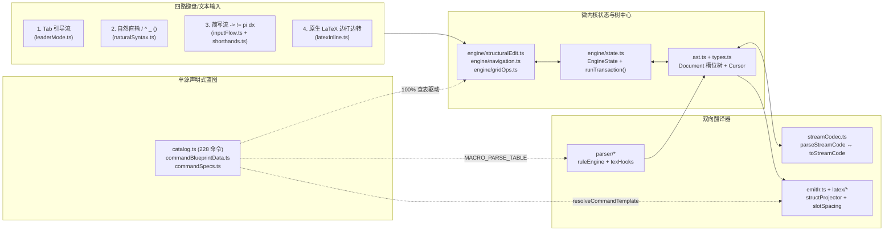

# MathSlot 核心引擎架构详解与扩展指南（`@mathslot/core`）

> **本文读者与边界**：本文专为项目作者编写，彻底讲透 MathSlot 最核心的“公式输入、槽位树与 LaTeX/流代码双向翻译引擎”（即 `packages/core`）。**完全不涉及前端如何画图渲染、也不涉及桌面端/插件端如何加壳打包**，只聚焦最纯粹的内核：**每一部分在干什么、核心数据结构如何定义、六大核心功能如何运转、以及模块化升级后如何用“纯填表、零逻辑代码”无限扩充新命令与新结构。**

---

## 一、体量全景：模块化升级后的目录与代码分布

升级前，`packages/core/src` 的 7,562 行代码集中在三个巨石文件（`editor.ts` 3,694 行、`parser.ts` 2,227 行、`latex.ts` 1,641 行），且每加一批命令都要在多处手写 `if-else`。

完成**声明式蓝图 + 微内核拆分升级**后，`packages/core/src` 共 **34 个高内聚文件（合计 12,854 行，内置 229 条命令 + 114 条预置公式）**，**全目录没有任何单个文件超过 747 行**：

### 1. 五大分层职责总览

| 分层 | 目录 / 代表文件 | 行数小计 | 核心职责 |
| :--- | :--- | ---: | :--- |
| **1. 数据模型与声明式字典层** | `types.ts`, `ast.ts`, `catalog.ts`, `commandBlueprintData.ts`, `commandSpecs.ts`, `shorthands.ts`, `slotOrder.ts`, `presets.ts` | 2,929 行 | 4 种树节点定义、228 条命令词典与声明式语法蓝图、简写单源表、槽位填空顺序 |
| **2. 流代码双向编解码层** | `streamCodec.ts` | 512 行 | `▸f1;2;` 一维流代码与内存槽位树的**双向无损互转**（`parseStreamCode` ↔ `toStreamCode`） |
| **3. 正向 LaTeX 投影层** | `emitIr.ts`, `latex.ts`, `latex/*` | 1,753 行 | 非破坏性词法识别、**单一结构投影器**、规范间距状态机与画布交互定位发射 |
| **4. 规则驱动反向解析层** | `parser.ts`, `parser/*` | 1,990 行 | 85% 结构宏查表自动拆解（`ruleEngine.ts`）+ 定界环境拆解 + 6 个上下文专用钩子 |
| **5. 微内核状态与编辑层** | `editor.ts`, `engine/*` | 3,994 行 | `EngineState` 统一事务状态、全表驱动上下导航与包裹插入、自然语法糖、网格操作、分层跳转 |
| **6. 外围工具与门面** | `index.ts`, `gridSpec.ts`, `sanitize.ts`, `userLibraries.ts`, `obsidianMath.ts` | 1,214 行 | 公开 API 门面、列格式工具、安全净化、外部 JSON 热合并、Markdown 公式扫描 |

### 2. 逐文件精确行数与职责表

| 文件 | 行数 | 一句话职责 |
| :--- | ---: | :--- |
| **一、核心骨架与声明式蓝图** | | |
| [index.ts](file:///home/mat/Projects/mathslot-next/packages/core/src/index.ts) | 14 | `@mathslot/core` 唯一对外导出门面（100% 向后兼容） |
| [types.ts](file:///home/mat/Projects/mathslot-next/packages/core/src/types.ts) | 299 | 4 种树节点、槽位、光标、三态模式、设置等核心接口定义 |
| [ast.ts](file:///home/mat/Projects/mathslot-next/packages/core/src/ast.ts) | 619 | 槽位树创建、深拷贝、`findSlotPath` 祖先路径寻址、面包屑与跳转目标生成 |
| [catalog.ts](file:///home/mat/Projects/mathslot-next/packages/core/src/catalog.ts) | 295 | **228 条内置命令**基础词典（ID、快捷键、槽位名、默认 LaTeX 模板） |
| [commandBlueprintData.ts](file:///home/mat/Projects/mathslot-next/packages/core/src/commandBlueprintData.ts) | 719 | **单源声明式命令蓝图表**：可选槽自适应模板、反向解析签名 `parseRule`、垂直导航图 `verticalNav`、初始预填符号 |
| [commandSpecs.ts](file:///home/mat/Projects/mathslot-next/packages/core/src/commandSpecs.ts) | 292 | 蓝图派生索引与通用解释器（`resolveCommandTemplate`、`getVerticalNavTarget`、`MACRO_PARSE_TABLE`、`INLINE_OPEN_SPEC_MAP`） |
| [shorthands.ts](file:///home/mat/Projects/mathslot-next/packages/core/src/shorthands.ts) | 443 | 符号简写（`->`, `!=`）与独立词简写（`pi`, `oo`, `dx`）单源注册表及冲突检测 |
| [slotOrder.ts](file:///home/mat/Projects/mathslot-next/packages/core/src/slotOrder.ts) | 154 | 槽位填空顺序推导（大算子自动从 `PREFIX_BIGOPS` 派生，首槽可选二元结构自动优先填主槽 `[1, 0]`） |
| [presets.ts](file:///home/mat/Projects/mathslot-next/packages/core/src/presets.ts) | 133 | **114 条预置公式**纯数据表 |
| [gridSpec.ts](file:///home/mat/Projects/mathslot-next/packages/core/src/gridSpec.ts) | 177 | 矩阵/增广矩阵 `array {cc|c}` 列格式解析、插删列与分隔竖线切换纯函数 |
| [sanitize.ts](file:///home/mat/Projects/mathslot-next/packages/core/src/sanitize.ts) | 103 | 用户设置归一化与不受信任 LaTeX 宏（`\href`, `\htmlData` 等）安全过滤 |
| **二、流代码双向编解码** | | |
| [streamCodec.ts](file:///home/mat/Projects/mathslot-next/packages/core/src/streamCodec.ts) | 512 | `parseStreamCode("▸f1;2;")` 与逆函数 `toStreamCode(doc)`，含动态网格/修饰符无损扩展头 `▸[...]` |
| **三、正向 LaTeX 投影层（`latex/*`）** | | |
| [emitIr.ts](file:///home/mat/Projects/mathslot-next/packages/core/src/emitIr.ts) | 258 | 槽内字母序列非破坏性词法分析（识别函数 `sin`、独立词 `pi`、微分 `dx`、草稿宏 `\al`） |
| [latex/structProjector.ts](file:///home/mat/Projects/mathslot-next/packages/core/src/latex/structProjector.ts) | 252 | **唯一共享结构投影器**：统一驱动规范导出与画布交互的模板择优、网格拼接、自适应括号与多行对齐切分 |
| [latex/slotSpacing.ts](file:///home/mat/Projects/mathslot-next/packages/core/src/latex/slotSpacing.ts) | 730 | 出版级标准 LaTeX 间距状态机（`toLatex`、`emitSlotCanonical`、预览公式生成） |
| [latex/interactiveEmit.ts](file:///home/mat/Projects/mathslot-next/packages/core/src/latex/interactiveEmit.ts) | 483 | 画布交互定位包裹发射器（`toInteractiveLatex`，注入 `slot-id` / `atom-slot` / 光标锚点） |
| [latex.ts](file:///home/mat/Projects/mathslot-next/packages/core/src/latex.ts) | 30 | LaTeX 发射层聚合导出门面 |
| **四、反向解析层（`parser/*`）** | | |
| [parser/ruleEngine.ts](file:///home/mat/Projects/mathslot-next/packages/core/src/parser/ruleEngine.ts) | 65 | **声明式宏规则引擎**：按 `MACRO_PARSE_TABLE` 自动拆解 30+ 种规则结构宏（零手写分支） |
| [parser/delimitersAndEnvs.ts](file:///home/mat/Projects/mathslot-next/packages/core/src/parser/delimitersAndEnvs.ts) | 739 | 外层定界符剥离、`\left...\right`（含狄拉克态矢/集合构造式）与 `\begin...\end` 矩阵/分段/对齐环境解析 |
| [parser/texHooks.ts](file:///home/mat/Projects/mathslot-next/packages/core/src/parser/texHooks.ts) | 564 | 6 个上下文敏感 TeX 专用语法钩子（`\frac` 高阶导数识别、`\lim` 箭头切分、`\mathrm{d}x`、`\substack`、`\text`、`\not`） |
| [parser/parseLatex.ts](file:///home/mat/Projects/mathslot-next/packages/core/src/parser/parseLatex.ts) | 605 | LaTeX 递归下降主扫描器（优先分发给 `ruleEngine`，再落入 `texHooks`） |
| [parser.ts](file:///home/mat/Projects/mathslot-next/packages/core/src/parser.ts) | 17 | 解析器统一入口 `importFormula`（自动分流 `▸` 流代码与标准 LaTeX） |
| **五、微内核编辑引擎（`engine/*`）** | | |
| [editor.ts](file:///home/mat/Projects/mathslot-next/packages/core/src/editor.ts) | 346 | `MathSlotEngine` 轻量公开类门面（62 个公开方法委托转发） |
| [engine/state.ts](file:///home/mat/Projects/mathslot-next/packages/core/src/engine/state.ts) | 557 | `EngineState` 纯状态容器、`runTransaction()` 统一事务、撤销重做栈、快照缓存与 `PersistedDraftV1` |
| [engine/navigation.ts](file:///home/mat/Projects/mathslot-next/packages/core/src/engine/navigation.ts) | 509 | `;`/`Enter` 跳槽、左右漫游、**查表式 `moveUp`/`moveDown`（零命令硬编码）**、跨槽 LCA 选区 |
| [engine/structuralEdit.ts](file:///home/mat/Projects/mathslot-next/packages/core/src/engine/structuralEdit.ts) | 500 | **全表驱动 `insertCommand`**（自动预填符号与网格固化）、片段插入、渐进退格拆壳、智能粘贴 |
| [engine/inputFlow.ts](file:///home/mat/Projects/mathslot-next/packages/core/src/engine/inputFlow.ts) | 488 | 单字符按键主分发管线（转义序列、词边界简写、符号简写升级） |
| [engine/naturalSyntax.ts](file:///home/mat/Projects/mathslot-next/packages/core/src/engine/naturalSyntax.ts) | 350 | 自然直输语法糖（`/` 自动抓分子、`^`/`_` 跨槽升级 `subsup`、`()` 自动配对与空格出脚本槽） |
| [engine/latexInline.ts](file:///home/mat/Projects/mathslot-next/packages/core/src/engine/latexInline.ts) | 376 | 边打边转原生 LaTeX（按 `INLINE_OPEN_SPEC_MAP` 通用支持 `\macro[opt]{req}` 与 `\left...\right`） |
| [engine/gridOps.ts](file:///home/mat/Projects/mathslot-next/packages/core/src/engine/gridOps.ts) | 395 | 动态网格四向增删行列、增广竖线切换、子块导出与 TSV/Excel 表格扩阵粘贴 |
| [engine/jumpMode.ts](file:///home/mat/Projects/mathslot-next/packages/core/src/engine/jumpMode.ts) | 264 | `Esc` 分层字母路标生成、复合槽下钻与跳转历史回溯 |
| [engine/leaderMode.ts](file:///home/mat/Projects/mathslot-next/packages/core/src/engine/leaderMode.ts) | 209 | `Tab` 引导态、二级分类即时默认渲染与 `leaderMorphBackup` 原地无缝变形 |
| **六、宿主与外部库工具** | | |
| [userLibraries.ts](file:///home/mat/Projects/mathslot-next/packages/core/src/userLibraries.ts) | 331 | 用户自定义 `presets.json` / `commands.json` 校验序列化与热合并 |
| [obsidianMath.ts](file:///home/mat/Projects/mathslot-next/packages/core/src/obsidianMath.ts) | 662 | Markdown 行内/块级公式及 Callout 引用块有界扫描、严格边界检测与无损写回 |

---

## 二、初心对照：从“字符串流 (`▸f分子;分母;`)”到“双向槽位树”

你最初的设想是：

> 用一套与键盘强绑定的**一维前缀字符串流**表达公式：`Tab + 字母` 开启结构，`;` 分隔各个部分并最终跳出结构，最后把它翻译成 LaTeX。

比如极限 $\lim_{x \to 0} \frac{\sin x}{x} = 1$，对应的流代码（用 `▸` 代表按下 `Tab` 引导键）就是：

```text
▸lx;0;▸fsin x;x;;=1
│ │ │ │  │    │ │└─ 第 2 个分号：结束极限的第 3 个槽（极限主体），跳回根层
│ │ │ │  │    │ └── 第 1 个分号：结束分数的第 2 个槽（分母），跳回极限主体
│ │ │ │  └────┴──── 分数的两个槽：分子 `sin x` ; 分母 `x`
│ │ │ └──────────── 嵌套开启分数 `▸f`
└─┴─┴────────────── 开启极限 `▸l`：槽1 `x` ; 槽2 `0` ; 槽3（主体）
```

### 1. 槽位树与流代码的严格双向同构

现在的内存槽位树与这串流代码在数学上 **1:1 同构**，并且通过 [streamCodec.ts](file:///home/mat/Projects/mathslot-next/packages/core/src/streamCodec.ts) 实现了完整的双向闭环：
- **`parseStreamCode(code)`**：把一维 `▸...;...;` 字符串还原成内存里的 `Document` 槽位树；
- **`toStreamCode(doc)`**：把任意复杂的内存 `Document` 槽位树反向压缩回一维 `▸...;...;` 字符串（对动态增删过行列的矩阵或无快捷键节点自动使用 `▸[grid:...]` / `▸[cmd:...]` 无损扩展标签，字面分号转义为 `▸;`）。
- 全量黄金门禁测试（[golden-refactor-gate.test.ts](file:///home/mat/Projects/mathslot-next/packages/core/tests/golden-refactor-gate.test.ts)）对全部 **228 条命令** 与 **114 条预置公式** 强制校验：`toLatex(parseStreamCode(toStreamCode(doc)).doc) === toLatex(doc)`。

### 2. 为什么运行时在内存里展开成树，而不是直接切字符串？

如果只做“从左往右一次性盲打输出”，纯字符串就够了；但要支持**任意位置回头修改**，内存树解决了纯字符串的 4 个硬骨头：
1. **退格拆壳不乱序**：在 `\sqrt{x+1}` 开头按退格去掉根号保留 `x+1`，树里只需把父数组的 `StructNode(sqrt)` 替换为其子槽 `children`，无需跨层数分号。
2. **后置包裹（`1/2`、`x^2`、`0` + `Tab a R` → `|0⟩`）**：直接把光标前节点剪进新 `StructNode` 的目标槽位。
3. **二维矩阵增删列**：矩阵 `slots` 是长度为 $R \times C$ 的扁平数组，第 $(r,c)$ 格即 `slots[r * cols + c]`，增删列只需按行偏移 `splice`。
4. **外部野生 LaTeX 导入**：论文或网页粘进来的 `\int_0^\infty e^{-x^2}\,\mathrm{d}x` 经 `parseLatex` 拆成同一棵槽位树后，立刻获得一模一样的 `;` 跳槽和结构编辑体验。

---

## 三、核心模块全景数据流



---

## 四、核心数据结构详解

理解整个内核，只需要记住 **[types.ts](file:///home/mat/Projects/mathslot-next/packages/core/src/types.ts) 里的 4 种树节点 + 1 个槽位容器 + 1 个光标 + 3 种模式**。

### 1. 公式树：槽位与四种节点交替嵌套

```ts
export interface SlotNode {
  id: string;           // 全局唯一编号，如 "s1", "s2"
  label: string;        // 语义名称，如 "分子", "分母", "(1,2)"
  children: MathNode[]; // 槽位内部从左到右排列的节点序列
}

export interface Document {
  root: SlotNode;       // 整条公式的根槽位
}

export type MathNode = CharNode | SymbolNode | StructNode | RawNode;
```

| 节点类型 | 核心字段 | 代表什么 | 举例 |
| :--- | :--- | :--- | :--- |
| **`CharNode`** | `value: string`<br/>`verbatim?: boolean` | 单个普通字符。`verbatim: true` 表示字面原文（如导入外部公式或 `\text` 内），不触发字母简写。 | `'x'`, `'2'`, `'+'` |
| **`SymbolNode`** | `commandId: string`<br/>`latex: string` | **0 槽位原子符号**（一次退格整颗删除）。 | `\alpha`, `\infty`, `\neq` |
| **`StructNode`** | `commandId: string`<br/>`slots: SlotNode[]`<br/>`grid?: GridMeta`<br/>`autoSized?: boolean`<br/>`limitsMode?: 'limits' \| 'nolimits'` | **带 1~N 个子槽位的复合结构**（即流代码里的 `▸` 结构）。 | `frac`（2 槽）、`integral`（3 槽）、`ket`（1 槽） |
| **`RawNode`** | `latex: string` | **保真逃生舱**：未内置的生僻 LaTeX 宏或顶层换行符 `\\`，原样保留绝不丢内容。 | `\genfrac{...}`, `\\`, `\quad` |

### 2. 光标寻址与三态模式

- **光标 `Cursor = { slotId, offset }`**：直接指向目标槽位 ID 及插入下标；通过 `findSlotPath(root, slotId)` 一步拿到从根到当前槽的完整父子链。
- **三种编辑模式 `EditorMode`**：
  1. `edit`：常规输入与导航；
  2. `leader`（[leaderMode.ts](file:///home/mat/Projects/mathslot-next/packages/core/src/engine/leaderMode.ts)）：按 `Tab` 进入引导态；按二级菜单键（如 `Tab m`）时先备份 `leaderMorphBackup` 并**立即上屏默认命令**，下一键若为子菜单键则原地无缝替换，若为普通字符则直接透传录入；
  3. `jump`（[jumpMode.ts](file:///home/mat/Projects/mathslot-next/packages/core/src/engine/jumpMode.ts)）：按 `Esc` 生成当前层字母角标，按键瞬移或逐层下钻。

---

## 五、六大核心机制是如何运转的？

1. **全表驱动的命令插入与 `;` 跳槽**（[structuralEdit.ts](file:///home/mat/Projects/mathslot-next/packages/core/src/engine/structuralEdit.ts) + [navigation.ts](file:///home/mat/Projects/mathslot-next/packages/core/src/engine/navigation.ts)）：
   - `insertCommand` 根据 `wrapSlot` 与 `backwardWrap` 自动包裹选区或前序原子，按 `initialSlotSymbols` 自动预填省略号符号，按 `instantiateGrid` 自动挂载动态网格元数据，再按 [slotOrder.ts](file:///home/mat/Projects/mathslot-next/packages/core/src/slotOrder.ts) 落入首个必填槽。
   - `nextSlot`（绑定 `Enter` 与嵌套槽内的 `;`）沿填空顺序推进；到达末尾槽后再按一次即落到父槽中该 `StructNode` 的正后方（`nodeIndexInParent + 1`）。
2. **查表式二维上下键空间导航**（[navigation.ts](file:///home/mat/Projects/mathslot-next/packages/core/src/engine/navigation.ts)）：
   - `moveUp` / `moveDown` 直接调用 `getVerticalNavTarget(cmdId, sIdx, direction, slotCount)` 查询命令蓝图中的 `verticalNav` 邻接表（如分式/上下叠 `TWO_SLOT_VERTICAL`、带可选下标长箭头 `REVERSE_TWO_SLOT_VERTICAL`、三槽大算子 `BIGOP_VERTICAL`），若为矩阵/分段网格则按 `sIdx ± cols` 跨行移动，否则平滑跳出当前层。
3. **原生 LaTeX 边打边转**（[latexInline.ts](file:///home/mat/Projects/mathslot-next/packages/core/src/engine/latexInline.ts)）：
   - `INLINE_OPEN_SPEC_MAP` 自动从每条命令的 `parseRule.signature` 派生 `[` 与 `{` 各自打开第几个槽位：因此无论是 `\frac{1}{2}`、`\sqrt[3]{8}`、`\xrightarrow[n\to\infty]{L^2}` 还是新增的 `\xRightarrow[下]{上}`、`\braket{\phi}{\psi}`，手打原生 LaTeX 花括号/方括号都能实时转为交互槽位树！
4. **双轨零误伤简写**（[shorthands.ts](file:///home/mat/Projects/mathslot-next/packages/core/src/shorthands.ts) + [emitIr.ts](file:///home/mat/Projects/mathslot-next/packages/core/src/emitIr.ts)）：
   - 标点简写（`->`, `<=`, `<=>`）即时替换为 `SymbolNode` 并支持前缀升级；
   - 字母词简写（`pi`, `oo`, `dx`, `sin`）在树里保留普通 `CharNode`，仅在发射阶段由 `analyzeSlotSemantics` 按完整单词边界识别——打 `pi` 渲染 $\pi$，继续打 `n` 自然恢复 `pin`，零误伤。
5. **单一结构投影器**（[structProjector.ts](file:///home/mat/Projects/mathslot-next/packages/core/src/latex/structProjector.ts)）：
   - 标准导出（`toLatex`）与画布交互（`toInteractiveLatex`）共用同一个 `projectStructByTemplate`、`projectGridEnvironment` 与 `projectMultilineRanges`，仅注入不同的子槽渲染回调，彻底根绝“画布显示与导出不一致”。
6. **规则引擎 + 专用钩子双层反向解析**（[ruleEngine.ts](file:///home/mat/Projects/mathslot-next/packages/core/src/parser/ruleEngine.ts) + [texHooks.ts](file:///home/mat/Projects/mathslot-next/packages/core/src/parser/texHooks.ts)）：
   - 85%+ 常规结构宏由 `tryParseMacroByRule` 读取 `MACRO_PARSE_TABLE` 自动拆解（支持 `brace`、`bracket_opt`、`sub`、`sup`、`bigop` 五种参数原语）；
   - 仅 `\frac`（高阶偏导/全导升级）、`\lim`（`\to` 拆槽）、`\mathrm{d}x`、`\substack`、`\text`、`\not` 等强上下文语法保留在 `texHooks.ts`。

---

## 六、实战指南：如何“零逻辑代码”新增一个数学命令或结构？

升级后的架构实现了**纯声明式扩展**：新增绝大多数结构（单参修饰、双参括号、带可选方括号参数结构、甚至三槽大算子），**只需在两个纯数据文件各加一段配置，`engine/*`、`parser/*`、`latex/*`、`slotOrder.ts` 一行逻辑代码都不用改！**

以实战接入的 **双线推导长箭头 `\xRightarrow[$1]{$2}`** 与 **外代数大外积 `\bigwedge_{$1}^{$2} $3`** 为例：

### 第 1 步：在 [catalog.ts](file:///home/mat/Projects/mathslot-next/packages/core/src/catalog.ts) 登记基础词条

```ts
{"id": "xRightarrow", "keys": ["o", "H"], "label": "双线长右推", "category": "symbol", "glyph": "══⇒", "slots": ["下标", "上标"], "optionalSlots": [0], "latex": "\\xRightarrow[$1]{$2}", "doc": "带上下标注的双线推导长箭头", "examples": ["▸oH;L^2;"], "wrapSlot": 1},
{"id": "bigwedge", "keys": ["c", "o"], "label": "大外积/合取", "category": "calculus", "glyph": "⋀", "slots": ["下限", "上限", "主体"], "optionalSlots": [0, 1], "latex": "\\bigwedge_{$1}^{$2} $3", "doc": "外代数楔积大算子", "examples": ["▸coi=1;n;V_i;"], "wrapSlot": 2},
```

### 第 2 步：在 [commandBlueprintData.ts](file:///home/mat/Projects/mathslot-next/packages/core/src/commandBlueprintData.ts) 声明语法能力

```ts
// 情况 A：带可选 [下标] 与必填 {上标} 的二元关系结构
xRightarrow: {
  tightSlots: [0],
  isBinaryRelation: true,               // 自动在导出时两侧留二元关系空格
  nextBraceSlot: 1,                     // 闭合 [下标] 后自动跳往 {上标}
  inlineMacros: ['xRightarrow'],        // 支持画布手打 \xRightarrow[...]{...}
  verticalNav: REVERSE_TWO_SLOT_VERTICAL, // ↑/↓ 在上标(1)与下标(0)之间互跳
  adaptiveTemplates: [                  // 槽 0 留空时自动坍缩为 \xRightarrow{$2}
    { slotCount: 2, filled: [0], latex: '\\xRightarrow[$1]{$2}' },
    { slotCount: 2, filled: [], latex: '\\xRightarrow{$2}' },
  ],
  parseRule: {                          // 自动反向解析 \xRightarrow{上} 与 \xRightarrow[下]{上}
    macros: ['\\xRightarrow'],
    signature: [{ kind: 'bracket_opt', slot: 0 }, { kind: 'brace', slot: 1 }],
  },
},

// 情况 B：3 槽大算子族（仅需声明 bigopMacro，自动获得上下限坍缩、\limits 保真、_/^ 直输、三向 ↑/↓ 导航与反向解析！）
bigwedge: {
  tightSlots: [0, 1],
  bottomSlots: [0],
  isTall: true,
  isPrefixBigOp: true,
  inlineMacros: ['bigwedge'],
  bigopMacro: '\\bigwedge',
},
```

保存后，以下 **7 项能力全部自动生效**（见验收测试 [declarative-extensibility.test.ts](file:///home/mat/Projects/mathslot-next/packages/core/tests/declarative-extensibility.test.ts)）：
1. `Tab o H` / `Tab c o` 快捷键唤出与二级菜单搜索；
2. 默认落入主槽（`xRightarrow` 自动按 `[1, 0]` 先填上标），按 `;` 或 `Enter` 逐槽推进并跳出；
3. `↑` / `↓` 二维空间跳槽；
4. 手打原生 `\xRightarrow[n\to\infty]{L^2}`、`\xRightarrow{P}`、`\bigwedge_{i=1}^{n} V_i` 边打边转；
5. 外部 LaTeX 公式导入自动还原为可编辑 `StructNode`；
6. `toStreamCode` ↔ `parseStreamCode` 流代码双向无损序列化；
7. 两侧二元关系间距与可选空槽自动坍缩排版。

---

## 七、一页速查：想改某块核心逻辑该去哪个文件？

| 你想了解或修改的事 | 直接看哪个文件 |
| :--- | :--- |
| 树节点、槽位、光标长什么样 | [types.ts](file:///home/mat/Projects/mathslot-next/packages/core/src/types.ts) |
| **新增/修改内置命令与语法行为（最常用）** | [catalog.ts](file:///home/mat/Projects/mathslot-next/packages/core/src/catalog.ts) + [commandBlueprintData.ts](file:///home/mat/Projects/mathslot-next/packages/core/src/commandBlueprintData.ts) |
| 新增/修改 `->`、`!=`、`pi`、`therefore` 等简写 | [shorthands.ts](file:///home/mat/Projects/mathslot-next/packages/core/src/shorthands.ts)（`SHORTHAND_SPECS` 单源数组） |
| 修改槽位默认填空先后顺序 | [slotOrder.ts](file:///home/mat/Projects/mathslot-next/packages/core/src/slotOrder.ts) |
| `▸f1;2;` 流代码与槽位树怎么互相转换 | [streamCodec.ts](file:///home/mat/Projects/mathslot-next/packages/core/src/streamCodec.ts)（`parseStreamCode` / `toStreamCode`） |
| 按 `;` / `Enter` 跳槽与 `↑` / `↓` 空间导航 | [engine/navigation.ts](file:///home/mat/Projects/mathslot-next/packages/core/src/engine/navigation.ts) |
| 打 `/`、`^`、`_`、`()` 怎么自动变成数学结构 | [engine/naturalSyntax.ts](file:///home/mat/Projects/mathslot-next/packages/core/src/engine/naturalSyntax.ts) |
| 边打 `\frac{1}{2}` / `\sqrt[3]{8}` 怎么实时转结构 | [engine/latexInline.ts](file:///home/mat/Projects/mathslot-next/packages/core/src/engine/latexInline.ts) |
| 插入命令包裹、退格渐进拆壳、智能粘贴 | [engine/structuralEdit.ts](file:///home/mat/Projects/mathslot-next/packages/core/src/engine/structuralEdit.ts) |
| 矩阵增删行列、增广竖线与粘贴 Excel 表格 | [engine/gridOps.ts](file:///home/mat/Projects/mathslot-next/packages/core/src/engine/gridOps.ts) |
| 槽位树怎么选模板、拼矩阵、排间距导出标准 LaTeX | [latex/structProjector.ts](file:///home/mat/Projects/mathslot-next/packages/core/src/latex/structProjector.ts) + [latex/slotSpacing.ts](file:///home/mat/Projects/mathslot-next/packages/core/src/latex/slotSpacing.ts) |
| 外部 LaTeX 怎么按规则表和专用钩子拆回槽位树 | [parser/ruleEngine.ts](file:///home/mat/Projects/mathslot-next/packages/core/src/parser/ruleEngine.ts) + [parser/parseLatex.ts](file:///home/mat/Projects/mathslot-next/packages/core/src/parser/parseLatex.ts) + [parser/texHooks.ts](file:///home/mat/Projects/mathslot-next/packages/core/src/parser/texHooks.ts) |
