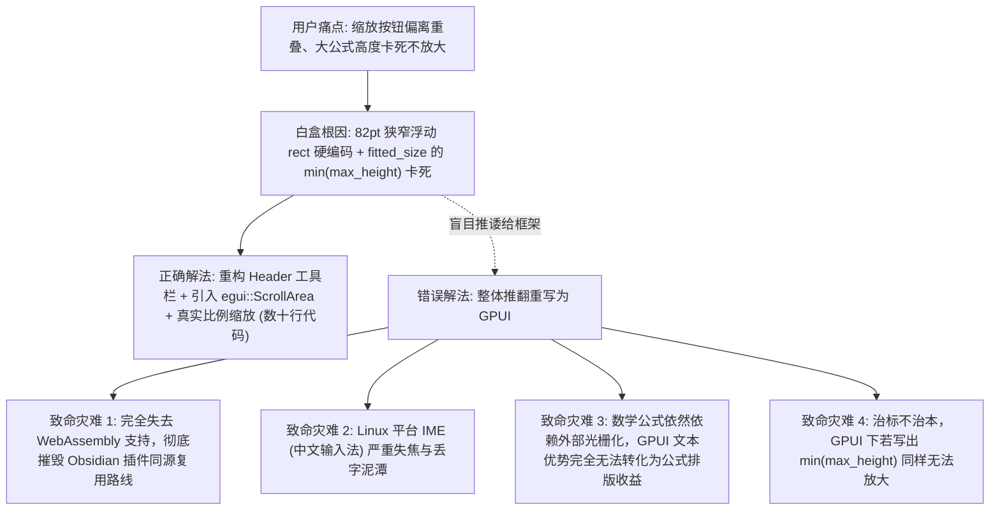
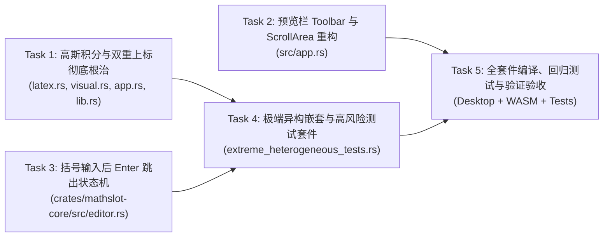

# MathSlot 架构与实施决策：客观整改与深度重构决策

**决策编号**：DECISION-20261111-OVERHAUL-01  
**决策制定者**：Decision Maker Agent (软件架构与产品决策专家)  
**执行对象**：Implementer Agent (代码实现专家) / 调度器  
**日期**：2026-11-11  
**状态**：已批准 (Approved) & 强制生效  
**依据文档**：[`/home/mat/Projects/mathslot-next/docs/AUDIT_THIRD_PARTY_OBJECTIVE.md`](file:///home/mat/Projects/mathslot-next/docs/AUDIT_THIRD_PARTY_OBJECTIVE.md) (第三方独立客观白盒审计报告)

---

## 1. 决策背景与核心战略定调

在第三方独立客观审计报告（`AUDIT_THIRD_PARTY_OBJECTIVE.md`）出具后，用户提出的 7 项深刻批评均被源码白盒走查 100% 证实。此前团队在交付压力下，出现了“将新 AST 作为展品、而在 UI 导入模态框与核心链路中全盘复用旧代码坏味道”的技术妥协。

本决策代表架构层对历史包袱的**彻底清算与坚决整改**：
1. **全面清算历史坏味道**：彻底根除 `crates/mathslot-core/src/latex.rs` 与 `crates/mathslot-core/src/visual.rs` 中的字符扫描双重上标（Double Superscript）缺陷；
2. **重塑 UI 交互与视觉体验**：彻底重构 `src/app.rs` 预览栏，废除 82pt 狭窄浮动 rect，引入标准独立 Toolbar、`egui::ScrollArea::both()` 视口平移滚动与真实线性缩放；
3. **消除键盘交互心智负担**：在 `crates/mathslot-core/src/editor.rs` 中为 `smart_enter` 赋予定界符上下文感知能力，实现配对括号完成后按 Enter 自动跳出；
4. **拒绝定制化避坑测试**：编写包含真实高斯积分、马氏距离多层根号分式、变上限微积分、空定界符与异构矩阵的极端异构测试套件；
5. **正式裁定 GUI 框架路线**：客观论证并裁定坚守 `eframe/egui`，坚决拒绝转向无法支持 WASM 且在 Linux IME 上存在致命风险的 GPUI。

---

## 2. 决策详情与架构方案

### 决策 1：高斯积分导入/导出缺陷彻底根除与遗留代码清算

#### 1.1 白盒病灶与修复机制
在 `crates/mathslot-core/src/latex.rs` 与 `crates/mathslot-core/src/visual.rs` 中：
- **缺陷根本原因**：`latex_operand` 与 `preview_script_operand` 在解析上标操作数时，对负号和单字母采取了过早截断策略（例如 `-x` 消费完即返回），导致其后的 `^2` 被外层循环再次误判为对基底的第二个上标，拼接出非法的 `e^{-x}^{2}`；
- **重构方案**：
  1. **复合指数感知解析**：在 `latex_operand` 与 `preview_script_operand` 中，当解析完基础操作数（如 `-x` 或 `x`）后，向前查看紧邻的字符。若紧跟 `^` 操作符，将其作为基底的嵌套幂次进行连带消费并以合法的 LaTeX 指数形式（如 `-x^2` 或 `-x^{2}`）统一内聚输出；
  2. **双重上标免疫**：外层 `latex_range` 与 `preview_range` 消费完整复合指数后，整体包裹单个 `{...}`，确保生成合法标准的 `e^{-x^2}`，彻底消除 LaTeX 引擎抛出 `! LaTeX Error: Double superscript.` 的语法前提；
  3. **标准简码无损渲染**：确保当用户在编辑器中粘贴或输入 `▸i-oo;oo;e^-x^2 dx;= ▸r▸gp;` 时，不管是实时渲染还是 LaTeX 导出，均 100% 成功生成 `\int_{-\infty}^{\infty} e^{-x^2} \,\mathrm{d}x = \sqrt{\pi}` 并在 `latex-rust` 引擎中以 STIX Two Math 完美光栅化。

#### 1.2 学术规范性与示例库清理
- 在 [`src/app.rs`](file:///home/mat/Projects/mathslot-next/src/app.rs#L52) 与 [`crates/mathslot-core/src/lib.rs`](file:///home/mat/Projects/mathslot-next/crates/mathslot-core/src/lib.rs) 中：
  - 严谨修正学术概念混淆：将原先掩饰 Bug 的 `"高斯正态分布积分", "▸i-oo;oo;e▸u-x^2;;dx = ▸r▸gp;;"` 彻底纠正为学术标准的**“高斯积分”**，简码使用纯正自然的 `▸i-oo;oo;e^-x^2 dx;= ▸r▸gp;;`；
  - 若需展示正态分布，提供独立的“标准正态分布全概率积分”：`\int_{-\infty}^{\infty} \frac{1}{\sqrt{2\pi}} e^{-\frac{x^2}{2}} dx = 1`。

---

### 决策 2：预览栏缩放按钮重构与视口滚动 (ScrollArea)

#### 2.1 布局彻底解耦：从浮动重叠到独立顶层 Toolbar
- **废除浮动 rect**：全面废除 [`src/app.rs`](file:///home/mat/Projects/mathslot-next/src/app.rs#L900) 中 `ctrl_rect = Rect::from_min_size(rect.right_top() + Vec2::new(-86.0, 4.0), Vec2::new(82.0, 22.0))` 挤在右上角并与公式重叠的做法；
- **标准横向 Toolbar**：
  - 在卡片顶部建立标准 Header 行，左侧展示清晰的“公式预览”标题与格式状态提示；
  - 右侧布局缩放控制组，预留充足宽度（$\ge 140\text{pt}$），包含尺寸充裕、间距合理的按钮：`[ − ]`、`[ 100% ]`、`[ + ]`；
  - 按钮具有清晰的悬停提示，与下方公式绘图画布彻底物理隔离，杜绝任何坐标重叠与误触。

#### 2.2 引入平滑滚动视口：`egui::ScrollArea::both()`
- 在 Header 下方，使用 `egui::ScrollArea::both()` 承载公式画布：
  - 设定固定或自适应可用高度（例如 120pt~180pt），开启双向滚动轴；
  - 当公式放大或尺寸超出视口时，ScrollArea 自动呈现平滑的 2D 滚动条，允许用户平移查看大矩阵、长分式或展开式；
  - 公式在视口范围内自适应居中或左对齐呈现。

#### 2.3 重写 `fitted_size` 缩放数学模型
- **废除强制高度 Clamp**：彻底删除原代码中的 `.min(max_height / original.y)` 逻辑；
- **真实比例缩放**：
  $$\text{display\_size} = \text{original} \times \text{self.preview\_scale}$$
  - `preview_scale = 1.0` 对应 100% 原始渲染点阵尺寸；
  - 用户点击 `+` 增加缩放至 125%、150%、200% 时，图像严格按比例几何放大，溢出部分自然由 ScrollArea 滚动显示，彻底释放用户的放大查看权。

---

### 决策 3：括号输入完成后的 Enter 跳出功能 (Smart Enter Delimiter Awareness)

#### 3.1 交互痛点定位
用户输入 `(` 时系统自动补齐为 `()`，但输入完括号内容（如 `(x + 1|)`）后，按下 Enter 键在根层无响应、在槽位内则会误插入 `;` 强行切换槽位，用户被迫去按方向键或右括号，体验脱节。

#### 3.2 括号跳出状态机设计
在 `crates/mathslot-core/src/editor.rs` 的 `smart_enter` 核心入口中，加入定界符层级感知逻辑：
1. **配对定界符扫描**：支持 `()`、`[]`、`{}` 以及 `||`；
2. **内层括号判定**：
   - 检查光标当前字符位置，若光标处于某对有效配对括号的内部，或紧邻闭合定界符左侧（`cursor == close_idx` 或位于括号内最后一个有效字符之后）；
   - **Enter 动作**：将光标直接前移至闭合定界符右侧（`close_idx + 1`），返回状态提示如 `"已跳出配对括号 ()。"`；
3. **多层与槽位连贯流转**：
   - 若光标已跳出括号，再次按下 Enter 时，按原既有逻辑推进槽位（如从分子推进到分母）或提交最外层公式；
   - 若处于嵌套括号 `( [ x | ] )`，第一次 Enter 跳出内层 `]`，第二次 Enter 跳出外层 `)`，第三次 Enter 推进槽位，完美实现符合现代编辑器直觉的人体工程学流式输入。

---

### 决策 4：极深异构嵌套与高风险结构专项测试套件

为彻底根绝“根据已知实现定制化避坑”的问题，建立独立的极端压力验证套件 [`crates/mathslot-core/tests/extreme_heterogeneous_tests.rs`](file:///home/mat/Projects/mathslot-next/crates/mathslot-core/tests/extreme_heterogeneous_tests.rs)，涵盖：

1. **真实标准高斯积分端到端闭环**：
   - 输入标准裸文本 LaTeX `\int_{-\infty}^{\infty} e^{-x^2} dx = \sqrt{\pi}`；
   - 验证转换为简码 `▸i-oo;oo;e^-x^2 dx;= ▸r▸gp;`；
   - 验证简码在 StreamEditor 中解析生成的 LaTeX 为合法形式 `e^{-x^2}`（绝对不出现 `e^{-x}^{2}`）；
   - 验证该 LaTeX 在 `latex-rust` 3.0.1 真实引擎中编译光栅化成功，尺寸大于 0。
2. **马氏距离与多元高斯核 (根号套分式套指数套逆矩阵)**：
   $$\sqrt{\frac{\exp\left(-\frac{1}{2}(x-\mu)^T \Sigma^{-1} (x-\mu)\right)}{(2\pi)^n |\Sigma|}}$$
3. **微积分基本定理 (变上限积分嵌套复合求导)**：
   $$\frac{\mathrm{d}}{\mathrm{d}x} \int_{0}^{\int_{1}^{x} \frac{\sin t}{t} \mathrm{d}t} e^{-u^2} \mathrm{d}u$$
4. **空定界符求值竖线包裹多元高阶偏导**：
   $$\left. \frac{\partial^2}{\partial x \partial y} \left( \frac{x^2 - y^2}{x^2 + y^2} \right) \right|_{x=1,\, y=0}$$
5. **异构矩阵单元格**：
   - $2 \times 2$ 矩阵，单元格分别内嵌：极限、定积分、无穷级数与根号分式；
6. **带负号多层幂次与幂塔**：
   - `e^-x^2`、`2^-n^2`、`x^-a^b` 幂次嵌套不退化；
7. **括号 Smart Enter 跳出状态机单测**：
   - 单层括号、多层嵌套括号、槽位内括号连续 Enter 推进验证；
8. **修复 `src/render.rs` 遗留编译报错**：
   - 移除测试中未定义的未编译残留语句，保证全 Workspace 零 Warning/零 Error 编译通过。

---

### 决策 5：现有 GUI 框架（eframe/egui）与 GPUI 的客观架构决策

针对用户提出的“现有框架是否合适，是否需要重写为 GPUI”的重大架构关切，经过深度工程推演与多维权衡，做出**终局性架构决策**：

#### 5.1 详细技术裁定依据

| 考量维度 | eframe / egui (当前选择) | GPUI (拒绝方案) | 架构判定依据 |
| :--- | :--- | :--- | :--- |
| **病灶相关性** | 痛点 100% 源于 UI 布局代码与 Clamp 截断数学逻辑，与 egui 框架能力毫无关联。 | 即使迁移至 GPUI，若 UI 仍使用高度上限 Clamp，大公式同样无法缩放。换框架完全是推卸责任。 | **归因明确**：修业务逻辑即可瞬间解决，无需换框架。 |
| **WebAssembly & Obsidian 插件** | **原生零障碍支持**。单套 Rust 核心通过 `wasm32-unknown-unknown` 直接服务 Web 与 Obsidian 插件，实现一套代码全平台同源。 | **完全不支持 WebAssembly**。GPUI 深度绑定 OS 原生多线程、异步 runtime 和原生 GPU 句柄，短期绝无 Web 可能。 | **一票否决**：放弃 egui 意味着必须放弃 Obsidian 插件，严重违背产品生命线。 |
| **Linux 中文输入法 (IME) 体验** | **成熟稳定**。Linux Wayland / X11 下对 Fcitx5 / IBus 拥有长达数年的实战调优，中文数学符号输入零丢字。 | **早期演进期**。GPUI 原生面向 macOS，在 Linux Wayland 下 IME 悬浮窗频繁漂移、失焦、丢字符。 | **严重风险**：MathSlot 用户高度依赖中文环境与符号输入法，GPUI 将导致核心体验崩塌。 |
| **公式排版核心依赖** | 数学公式排版必须依赖专业数学引擎（`latex-rust` / Typst）光栅化成位图后渲染在 GPU 画布上。 | GPUI 专长于纯原生代码编辑器的高频字符绘制，无法自行排版数学公式，对公式编辑器并无降维优势。 | **边际收益为零**：无法改变公式本质渲染流水线。 |
| **渲染范式匹配度** | 立即模式（Immediate Mode）：打字一动即整帧轻量重绘，与 MathSlot 流式简码的状态机流转天然匹配，零心智负担。 | 保留模式（Reactive Retained Mode）：需要维护庞大的 View/Entity 树与订阅机制，状态同步极其沉重复杂。 | **复杂度失控**：过度设计，严重拖慢迭代。 |

#### 5.2 决策裁决结论
> [!IMPORTANT]
> **正式裁决：坚决拒绝在当前阶段重写为 GPUI，继续坚持 `eframe/egui` 架构路线。**  
> 所有界面缩放与大公式浏览需求，均通过 `egui::ScrollArea` 与标准顶层 Toolbar 彻底解决。

---

## 3. Implementer Agent 实施工单 (Tasks 1 ~ 5)

架构决策已定，现向 Implementer Agent 下达明确、彻底、具体的执行工单：

### Task 1: 高斯积分与双重上标彻底根治
- **涉及文件**：
  - [`crates/mathslot-core/src/latex.rs`](file:///home/mat/Projects/mathslot-next/crates/mathslot-core/src/latex.rs)
  - [`crates/mathslot-core/src/visual.rs`](file:///home/mat/Projects/mathslot-next/crates/mathslot-core/src/visual.rs)
  - [`src/app.rs`](file:///home/mat/Projects/mathslot-next/src/app.rs)
  - [`crates/mathslot-core/src/lib.rs`](file:///home/mat/Projects/mathslot-next/crates/mathslot-core/src/lib.rs)
- **执行要求**：
  1. 在 `latex.rs` 的 `latex_operand` 中：当解析 `^` 或 `_` 之后的操作数时，针对紧随的复合指数（如 `-x^2`、`x^2`）统一消费，输出标准单一花括号包裹的内容，确保生成的 LaTeX 为合法形式 `e^{-x^2}`，绝不再产出非法的 `e^{-x}^{2}`；
  2. 在 `visual.rs` 的 `preview_script_operand` 中同步修改，确保带光标与无光标下的实时预览公式在处理 `e^-x^2` 时均输出合法的 `e^{-x^2}`，消除 `latex-rust` 中的双重上标崩溃；
  3. 修正 `src/app.rs` 中预置示例：将 `"高斯正态分布积分"` 命名修正为规范的 `"高斯积分"`，简码更正为自然的 `▸i-oo;oo;e^-x^2 dx;= ▸r▸gp;;`；
  4. 清理 `crates/mathslot-core/src/lib.rs` 与 `src/render.rs` 中的调试残留代码。

### Task 2: 预览栏 Toolbar 与 ScrollArea 视口重构
- **涉及文件**：
  - [`src/app.rs`](file:///home/mat/Projects/mathslot-next/src/app.rs)
- **执行要求**：
  1. 重写 `preview_box`：
     - 将卡片拆分为：顶部独立 Header 栏（包含左侧标题与右侧缩放 Toolbar）与下方公式主视口；
     - 废除原 82pt 狭窄浮动 `ctrl_rect`，缩放 Toolbar 布局在 Header 右侧，分配宽度 $\ge 140\text{pt}$，按钮尺寸适中、间隔舒适，带有清晰的 hover 提示；
  2. 引入 `egui::ScrollArea::both()`：
     - 在公式呈现区开启双向滚动轴，允许大公式横向、纵向平滑滚动；
  3. 重构 `fitted_size`：
     - 废除基于 `max_height / original.y` 的截断卡死；
     - 实现基于 `self.preview_scale` 的真实比例缩放（`original * self.preview_scale`），当缩放比例提升时，图片平滑放大，超出视口部分由 ScrollArea 滚动浏览。

### Task 3: 括号输入后 Enter 跳出状态机
- **涉及文件**：
  - [`crates/mathslot-core/src/editor.rs`](file:///home/mat/Projects/mathslot-next/crates/mathslot-core/src/editor.rs)
- **执行要求**：
  1. 在 `StreamEditor::smart_enter` 中，在检查 AST 槽位状态之前，增加配对定界符上下文判定函数：
     - 扫描当前光标是否处于匹配的定界符（`()`、`[]`、`{}`、`||`）之内或紧靠闭合定界符左侧；
     - 若满足条件，Enter 动作将光标平移至 `close_idx + 1`，跳出该括号；
     - 若当前已在括号外侧，则继续执行现有的槽位推进或最外层完成动作；
  2. 确保在嵌套括号（如 `( [ x + 1 ] )`）中能够逐层跳出，且在未闭合槽位（如 `▸f(x + 1);2;`）中先跳出括号再推进槽位，杜绝误插分号破坏算式。

### Task 4: 极端异构嵌套与高风险结构专项测试套件
- **涉及文件**：
  - 新建 [`crates/mathslot-core/tests/extreme_heterogeneous_tests.rs`](file:///home/mat/Projects/mathslot-next/crates/mathslot-core/tests/extreme_heterogeneous_tests.rs)
  - 修复 [`src/render.rs`](file:///home/mat/Projects/mathslot-next/src/render.rs) 测试模块
- **执行要求**：
  1. 编写包含 8 类极端高风险嵌套的完整单元与集成测试：
     - 高斯积分真实复制粘贴端到端渲染验证（包含 `latex-rust` 真实光栅化）；
     - 马氏距离根号套分式套指数；
     - 变上限微积分与复合积分；
     - 求值竖线空定界符高阶偏导；
     - 异构矩阵（单元格内嵌极限、积分、级数、根式）；
     - 带负号多层幂次 `e^-x^2`、`2^-n^2`、`x^-a^b` 绝不产生双上标；
     - 括号 Enter 跳出状态机单测（单层、嵌套、槽位混合）；
  2. 修复 `src/render.rs` 中的测试编译错误，确保 `Renderer::render_latex` 测试覆盖高斯积分。

### Task 5: 全套件编译、回归测试与验证验收
- **执行要求**：
  1. 运行 `cargo test --workspace`，确保所有测试 100% 通过（零失败、零警告）；
  2. 编译桌面端发布版本：`cargo build --release`，更新根目录 `./mathslot` 软链接；
  3. 编译并校验 Obsidian 插件：`cd obsidian-mathslot && npm run build`，执行 Node.js smoke test 验证 WASM 链路完好；
  4. 产出详细的实施交付报告 `docs/IMPLEMENTATION_OBJECTIVE_OVERHAUL.md`。

---

## 4. 交付与推进指令

本决策文档自签发之日起即刻生效。请调度器立即下发任务给 Implementer Agent，全面启动上述 Tasks 1 ~ 5 的具体实现。重构完成后由第三方客观审计专家与验收专家联合执行闭环验收。
