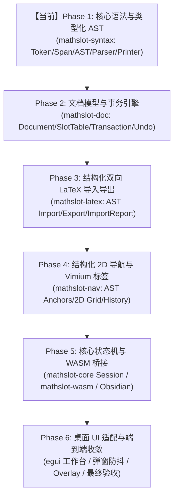

# MathSlot 架构决策记录 (Round 1: 核心语法与类型化 AST 架构落地)

- **决策者**：Decision Maker Agent (主要决策 Agent)
- **决策日期**：2026-11-11
- **关联基线**：
  - [原项目审计报告 docs/AUDIT_2026-11-10.md](file:///home/mat/Projects/mathslot-next/docs/AUDIT_2026-11-10.md)
  - [Round 0 基线审计报告 docs/AUDIT_ROUND_0_BASELINE.md](file:///home/mat/Projects/mathslot-next/docs/AUDIT_ROUND_0_BASELINE.md)
  - [重构蓝图 docs/REWRITE_DESIGN.md](file:///home/mat/Projects/mathslot-next/docs/REWRITE_DESIGN.md)
- **目标工程**：`/home/mat/Projects/mathslot-next`
- **当前状态**：**已批准并签发 Phase 1 实施令 (APPROVED FOR PHASE 1 IMPLEMENTATION)**

---

## 1. 执行摘要与战略裁定 (Strategic Direction & Executive Ruling)

根据 Auditor Agent 在 `AUDIT_ROUND_0_BASELINE.md` 中揭示的系统性缺陷（尤其是 P0 级上下标分组颠覆、`\left` 误判导致空槽、矩阵 `&` 转义破坏以及文本/语义双轨制矛盾），Decision Maker 正式确立以下重构战略原则：

1. **坚决否定“大爆炸式一次性重构”**：
   - 严禁在尚未稳固底层语法与类型模型之前，同时重写 UI、WASM、渲染与导航层；
   - 严格采纳**绞杀者模式 (Strangler Pattern)** 与**自底向上逐层收敛**路线，分阶段落地、分阶段验证。

2. **彻底废除“文本推断语义”与“字符重写器”**：
   - 彻底终结把控制字符（如 `▸`、`;`）、普通括号、上下标与矩阵排版混合作为无类型扁平字符串的旧模式；
   - 确立**类型化数学抽象语法树 (Typed Math AST)** 为单一事实来源（Single Source of Truth）；
   - 所有上下标统一提升为 `Script` 节点，括号统一提升为 `Delimited` 节点，矩阵统一提升为泛型 `Matrix` 环境节点。

3. **正式启动【Phase 1: 核心语法与类型化 AST 架构落地】**：
   - 在新项目 `/home/mat/Projects/mathslot-next` 中构建标准的 Cargo Workspace 体系；
   - 首批交付核心 crate：`crates/mathslot-syntax` 及门面 `crates/mathslot-core`；
   - 实现无损 Span 跟踪、高性能词法分析、容错递归下降语法解析、标准 AST 格式化器，并通过 GT-01 ~ GT-08 黄金用例闭环。

---

## 2. 总体重构阶段排期路线图 (Incremental Roadmap)

为确保新项目稳健演进且每一阶段均有确定性交付物，整体重构划分为 6 个阶段：



| 阶段 | 核心任务 | 交付物/依赖 Crate | 准出判定条件 |
| :--- | :--- | :--- | :--- |
| **Phase 1 (本轮)** | 词法分析、类型化 AST、递归下降解析器、精准 Span、错误恢复、Golden 测试集 | `crates/mathslot-syntax`<br>`crates/mathslot-core` (facade) | GT-01 ~ GT-08 全部通过，无损解析与 AST 导出一致 |
| **Phase 2** | 文档模型、SlotTable 槽位索引、原子 Edit 事务引擎、合并回滚机制 | `crates/mathslot-doc` | 事务合并、原子撤销/重做测试 100% 通过，杜绝粗粒度字符串快照 |
| **Phase 3** | 基于 AST 的 LaTeX 导入解析器、双向无损验证器、`ImportReport` 诊断报告 | `crates/mathslot-latex` | 彻底移除 `starts_with` 字符串重写；TC-01 ~ TC-06 往返等价测试通过 |
| **Phase 4** | AST 导航锚点提取、无冲突标签分配器、2D 矩阵与分式网格穿梭 | `crates/mathslot-nav` | 导航模式与文本状态彻底解耦，2D 方向键跳转符合数学直觉 |
| **Phase 5** | 统一 Action 分发门面 Session、跨端声明式 Keymap、极简无依赖 WASM 导出 | `crates/mathslot-core`<br>`crates/mathslot-wasm` | Node.js 端 WASM 烟雾测试通过，包体严格控制在预算内（< 300KB） |
| **Phase 6** | egui 桌面端工作台改造、导入弹窗约束修复、无侵入 Overlay 覆盖层渲染 | `src/` (Desktop App) | 桌面端与 Obsidian 插件端到端联动验收完成，发布 v0.6 正式版 |

---

## 3. Phase 1 核心架构设计规范 (Phase 1 Architectural Specification)

### 3.1 Workspace 目录规划与首批 Crate 划分

目标工程根目录 `/home/mat/Projects/mathslot-next` 将规划如下结构：

```text
mathslot-next/
├── Cargo.toml                    # Workspace 根清单配置
├── crates/
│   ├── mathslot-syntax/          # 核心语法解析与 AST 定义
│   │   ├── Cargo.toml
│   │   ├── src/
│   │   │   ├── lib.rs            # 模块重导出与顶层解析入口
│   │   │   ├── span.rs           # 精准字节偏移定位
│   │   │   ├── token.rs          # 词法单元定义
│   │   │   ├── lexer.rs          # 零拷贝/高性能词法扫描器
│   │   │   ├── ast.rs            # 类型化 AST 节点枚举与数据结构
│   │   │   ├── parser.rs         # 容错递归下降语法解析器
│   │   │   ├── printer.rs        # AST -> LaTeX & 简码 Pretty-Printer
│   │   │   └── diagnostics.rs    # 结构化语法错误与告警
│   │   └── tests/
│   │       ├── golden_tests.rs   # 基准用例与回归测试
│   │       └── test_corpus/      # 黄金测试用例集
│   └── mathslot-core/            # 领域核心 Facade 门面（首轮桥接 syntax）
│       ├── Cargo.toml
│       └── src/
│           └── lib.rs
└── docs/                         # 项目文档、审计与决策记录
```

#### Cargo 根配置规范 (`/Cargo.toml`)
```toml
[workspace]
members = [
    "crates/mathslot-syntax",
    "crates/mathslot-core",
]
resolver = "2"

[workspace.package]
version = "0.6.0"
edition = "2024"
authors = ["MathSlot Authors"]
license = "MIT OR Apache-2.0"

[profile.dev]
opt-level = 1

[profile.release]
lto = "thin"
strip = "symbols"
```

#### 依赖控制原则
- `mathslot-syntax` 坚持零外部重型依赖，仅允许引入：
  - `logos = "0.14"` (或 `"0.15"`) 作为词法分析器；
  - `serde = { version = "1.0", features = ["derive"] }` 作为 AST 序列化载体；
  - `thiserror = "2.0"` (或 `"1.0"`) 用于轻量错误定义。
- 严禁在 syntax crate 中引入任何正则引擎 (`regex`) 或大型第三方解析组合子，以严控后续编译速度与 WASM 体积。

---

### 3.2 源码 Span 与精准定位系统 (`span.rs`)

每个语法节点必须保留无损的源码范围，为编辑器的光标定位、高亮诊断及后续增量更新提供物理支撑。

```rust
#[derive(Debug, Clone, Copy, PartialEq, Eq, PartialOrd, Ord, Hash, Serialize, Deserialize)]
pub struct Span {
    pub start: usize, // 源码起始字节偏移 (0-indexed)
    pub end: usize,   // 源码结束字节偏移 (exclusive)
}

impl Span {
    pub const EMPTY: Self = Self { start: 0, end: 0 };

    pub fn new(start: usize, end: usize) -> Self {
        debug_assert!(start <= end, "Span start must be <= end");
        Self { start, end }
    }

    pub fn len(&self) -> usize {
        self.end.saturating_sub(self.start)
    }

    pub fn is_empty(&self) -> bool {
        self.start >= self.end
    }

    pub fn merge(&self, other: Span) -> Self {
        Self {
            start: self.start.min(other.start),
            end: self.end.max(other.end),
        }
    }

    pub fn contains(&self, offset: usize) -> bool {
        offset >= self.start && offset < self.end
    }
}

/// 携带源码 Span 的包装容器
#[derive(Debug, Clone, PartialEq, Eq, Serialize, Deserialize)]
pub struct Spanned<T> {
    pub node: T,
    pub span: Span,
}

impl<T> Spanned<T> {
    pub fn new(node: T, span: Span) -> Self {
        Self { node, span }
    }
}
```

---

### 3.3 类型化 AST 核心契约 (`ast.rs`)

彻底废弃旧版中粗糙的 `Expr::Text { raw }` 滥用。以下为 Phase 1 确立的完整数学 AST 规范：

```rust
use crate::span::{Span, Spanned};
use serde::{Deserialize, Serialize};

/// 唯一槽位标识符
#[derive(Debug, Clone, Copy, PartialEq, Eq, PartialOrd, Ord, Hash, Serialize, Deserialize)]
pub struct SlotId(pub u32);

/// 定界符枚举
#[derive(Debug, Clone, Copy, PartialEq, Eq, Serialize, Deserialize)]
pub enum Delim {
    Paren,       // ( ... )
    Bracket,     // [ ... ]
    Brace,       // \{ ... \}
    Pipe,        // | ... |
    DoublePipe,  // \| ... \|
    Angle,       // \langle ... \rangle
}

/// 大算子类型枚举
#[derive(Debug, Clone, Copy, PartialEq, Eq, Serialize, Deserialize)]
pub enum BigOpKind {
    Sum,             // \sum
    Integral,        // \int
    DoubleIntegral,  // \iint
    TripleIntegral,  // \iiint
    ContourIntegral, // \oint
    Product,         // \prod
    Limit,           // \lim
}

/// 泛型矩阵与多维环境枚举
#[derive(Debug, Clone, Copy, PartialEq, Eq, Serialize, Deserialize)]
pub enum MatrixEnv {
    Matrix,    // matrix (无外框)
    Pmatrix,   // pmatrix (圆括号)
    Bmatrix,   // bmatrix (方括号)
    Vmatrix,   // vmatrix (单竖线行列式)
    Cases,     // cases (分段函数左大括号)
    Aligned,   // aligned (对齐环境)
}

/// 常用数学符号或标识符分类
#[derive(Debug, Clone, PartialEq, Eq, Serialize, Deserialize)]
pub enum SymbolKind {
    Greek(String),     // \alpha, \beta, \pi, \theta, \Omega 等
    Relation(String),  // \le, \ge, \ne, \approx, \sim, \in 等
    Operator(String),  // \pm, \times, \div, \cdot, \circ 等
    Arrow(String),     // \to, \rightarrow, \implies 等
    Misc(String),      // \infty, \partial, \nabla 等
}

/// 核心表达式树节点
#[derive(Debug, Clone, PartialEq, Eq, Serialize, Deserialize)]
pub enum Expr {
    /// 纯文本字面量、常数或变量名 (如 "x", "123", "dx")
    Text(String),

    /// 类型化数学符号
    Symbol(SymbolKind),

    /// 花括号分组 { ... }，代表原子级计算整体
    Group(Vec<Spanned<Expr>>),

    /// 上下标节点 (彻底统一 ^/_ 与 ▸u/▸d/▸b)
    Script {
        base: Box<Spanned<Expr>>,
        sub: Option<Box<Spanned<Expr>>>,
        sup: Option<Box<Spanned<Expr>>>,
    },

    /// 一等公民定界符节点 (自动配对、嵌套保护、范围操作)
    Delimited {
        open: Delim,
        close: Delim,
        body: Vec<Spanned<Expr>>,
    },

    /// 分数节点 \frac{num}{den}
    Fraction {
        num: Vec<Spanned<Expr>>,
        den: Vec<Spanned<Expr>>,
    },

    /// 根号节点 \sqrt{radicand} 或 \sqrt[index]{radicand}
    Root {
        index: Option<Vec<Spanned<Expr>>>,
        radicand: Vec<Spanned<Expr>>,
    },

    /// 大算子节点 (求和、积分、极限等)
    BigOperator {
        kind: BigOpKind,
        lower: Option<Vec<Spanned<Expr>>>,
        upper: Option<Vec<Spanned<Expr>>>,
        body: Vec<Spanned<Expr>>,
    },

    /// 泛型矩阵节点 (支持任意 m × n 网格，行分隔 \\ 与列分隔 & 仅在此生效)
    Matrix {
        env: MatrixEnv,
        rows: Vec<Vec<Vec<Spanned<Expr>>>>,
    },

    /// 待填充槽位 (供模板展开与流式输入器使用)
    Placeholder {
        slot_id: SlotId,
        label: Option<String>,
    },

    /// 不支持结构或未知宏的安全兜底节点 (透明保留原文，附带 warning)
    RawLatex {
        latex: String,
        warning: Option<String>,
    },

    /// 语法错误恢复节点 (包含未消费的破损碎片，保证解析不中断)
    Error {
        message: String,
        raw: String,
    },
}
```

---

### 3.4 词法分析器与 Token 体系 (`token.rs` & `lexer.rs`)

为避免旧版按子串 `starts_with` 匹配造成的灾难性语义混淆，词法分析器必须在字符流入口将歧义切断：

```rust
#[derive(Debug, Clone, PartialEq, Eq)]
pub enum Token<'a> {
    // MathSlot 简码引导符与定界符
    LeadTriangle,      // ▸
    Semicolon,         // ;

    // LaTeX 控制符与定界符
    Backslash,         // \
    LBrace,            // {
    RBrace,            // }
    LParen,            // (
    RParen,            // )
    LBracket,          // [
    RBracket,          // ]
    Pipe,              // |
    Caret,             // ^
    Underscore,        // _
    Ampersand,         // &
    DoubleBackslash,   // \\

    // 核心命令标记
    CmdFrac,           // \frac 或 ▸f
    CmdSqrt,           // \sqrt 或 ▸r
    CmdSum,            // \sum 或 ▸s
    CmdInt,            // \int 或 ▸i
    CmdLim,            // \lim 或 ▸l
    CmdLeft,           // \left
    CmdRight,          // \right
    CmdBegin,          // \begin
    CmdEnd,            // \end

    // 符号与标识符
    Ident(&'a str),    // 变量名或多字符标识符
    Number(&'a str),   // 数字
    Symbol(SymbolKind),// \alpha, \le, \infty 等明确符号
    Whitespace(&'a str),// 空白保留
    UnknownChar(char), // 未知单字符
}
```

#### 词法层关键防错约束
1. `\left` 与 `\le` 的分流规则：
   - 当扫描到 `\` 时，消费后续字母序列；
   - `"left"` 严格发射 `Token::CmdLeft`；
   - `"le"` 严格发射 `Token::Symbol(SymbolKind::Relation(r"\le".into()))`；
   - 彻底切断子串歧义，**从根源解决 TC-04 / TC-05 的空槽根因**！
2. 矩阵符号 `&` 与 `\\`：
   - 独立词法发射，绝不被文本预处理模块无脑转义为 `\&`，**从根源解决 TC-06 的转义错误根因**。

---

### 3.5 递归下降解析器与核心算法 (`parser.rs`)

解析器采用手写递归下降（带 Pratt 结合律处理），负责将 Token 流转化为 `Spanned<Expr>` 树。

#### 核心算法 1：脚本参数解析与结合律 (`parse_script_arg`)
```rust
impl Parser {
    /// 消费一个前导 Atom 后，循环探测 ^ 和 _
    fn parse_postfix_scripts(&mut self, mut base: Spanned<Expr>) -> Spanned<Expr> {
        let mut sub: Option<Box<Spanned<Expr>>> = None;
        let mut sup: Option<Box<Spanned<Expr>>> = None;

        while self.at_token(Token::Caret) || self.at_token(Token::Underscore) {
            if self.eat(Token::Caret) {
                let arg = self.parse_script_arg();
                sup = Some(Box::new(arg));
            } else if self.eat(Token::Underscore) {
                let arg = self.parse_script_arg();
                sub = Some(Box::new(arg));
            }
        }

        if sub.is_some() || sup.is_some() {
            let start = base.span.start;
            let end = sup.as_ref().map(|s| s.span.end)
                .or_else(|| sub.as_ref().map(|s| s.span.end))
                .unwrap_or(base.span.end);
            Spanned::new(
                Expr::Script {
                    base: Box::new(base),
                    sub,
                    sup,
                },
                Span::new(start, end),
            )
        } else {
            base
        }
    }

    /// 解析脚本参数：支持 {...} 完整分组、单字符、符号、一元负号复合项或嵌套脚本
    fn parse_script_arg(&mut self) -> Spanned<Expr> {
        if self.at_token(Token::LBrace) {
            self.parse_group()
        } else if self.at_unary_minus() {
            // 支持 -x^2 中的负号前缀复合项
            let minus_span = self.bump_span();
            let operand = self.parse_atom_with_scripts();
            let span = minus_span.merge(operand.span);
            Spanned::new(
                Expr::Group(vec![
                    Spanned::new(Expr::Text("-".to_string()), minus_span),
                    operand,
                ]),
                span,
            )
        } else {
            self.parse_atom()
        }
    }
}
```
**数学等价性保障**：
- 对于 `e^{-x^{2}}`：
  - 外层 base 为 `e`；
  - 遇到 `^`，解析 `parse_script_arg`；
  - 遇到 `{`，进入分组；内部解析 `-` 与 `x^{2}`；
  - `x^{2}` 产生内部 `Expr::Script { base: x, sup: 2 }`；
  - 构造出的 AST 为：`Script { base: e, sup: Group([- , Script { base: x, sup: 2 }]) }`；
  - **彻底消灭 TC-01 蜕变为 `e^{-x}^{2}` 的风险**！

#### 核心算法 2：一等公民定界符解析 (`parse_delimited`)
```rust
impl Parser {
    fn parse_delimited(&mut self, open: Delim) -> Spanned<Expr> {
        let open_span = self.bump_span(); // 消费左括号
        let close_target = open.matching_close();
        let mut body = Vec::new();

        while !self.is_eof() && !self.at_delim_close(close_target) {
            match self.parse_expr() {
                Ok(expr) => body.push(expr),
                Err(err) => {
                    self.diagnostics.push(err);
                    self.recover_until_delim_or_eof(close_target);
                    break;
                }
            }
        }

        let end_span = if self.eat_delim_close(close_target) {
            self.last_span()
        } else {
            self.diagnostics.push(Diagnostic::unclosed_delimiter(open, open_span));
            open_span
        };

        Spanned::new(
            Expr::Delimited {
                open,
                close: close_target,
                body,
            },
            open_span.merge(end_span),
        )
    }
}
```

#### 核心算法 3：大算子主体捕获 (`parse_big_operator`)
- 严格将 `\sum_{i=1}^n` / `\int_a^b` 的上下限绑定在 `lower` 与 `upper` 中；
- 主体 `body` 直接消费紧随其后的完整数学表达式序列（直至遇到下一个同级低优先级算子或定界符外部）；
- 当紧随其后是 `\left( a_i \right)` 时，直接完整捕获为 `Expr::Delimited` 放入 `body`，**绝不因为前缀字符匹配提前截断！**

---

### 3.6 基础 AST Pretty-Printer (`printer.rs`)

Phase 1 必须提供标准的 Pretty-Printer，实现：
1. `to_canonical_latex(expr: &Expr) -> String`: 输出规范且严格分组的 LaTeX 字符串；
2. `to_mathslot_source(expr: &Expr) -> String`: 输出标准规范的简码流。

#### LaTeX 导出关键规则
- 对于 `Expr::Script { base, sub, sup }`：
  - 永远输出标准分组：`{base}_{sub}^{sup}`；
  - 若 `sup` 为 `Group`，自动输出 `{...}`；
  - **严禁使用任何局部字符扫描 `latex_operand` 猜测！**
- 对于 `Expr::Matrix { env, rows }`：
  - 格式化输出 `\begin{env} row1_c1 & row1_c2 \\ row2_c1 & row2_c2 \end{env}`；
  - 绝不转义 `&`。
- 对于 `Expr::Delimited { open, close, body }`：
  - 输出 `\left( body \right)` 或标准外包定界符。

---

## 4. 黄金用例套件与基准测试矩阵 (Golden Test Suite)

在 `crates/mathslot-syntax/tests/golden_tests.rs` 中必须严格固化以下用例断言：

| 用例 ID | 测试输入 | 核心 AST 断言结构 | 预期导出 LaTeX | 对应缺陷防线 |
| :---: | :--- | :--- | :--- | :---: |
| **GT-01** | `\int_{-\infty}^{\infty} {e}^{-x^{2}} \mathrm{d}x = \sqrt{\pi}` | `BigOperator(Integral)` 的 `body` 包含 `Script { base: "e", sup: Group/Seq["-", Script { base: "x", sup: "2" }] }` | 完整保持 `e^{-x^{2}}` 或 `e^{-x^2}`，绝不可出现 `e^{-x}^{2}` | TC-01 (P0) |
| **GT-02** | `x^{a+b}` 与 `a_{i+1}` | `Script { base: "x", sup: Group(...) }`，多项式保持在分组内 | 严禁截断为 `x^{a}+b` 或 `a_{i}+1` | TC-02 (P0) |
| **GT-03** | `e^{-\frac{x}{2}}` | `Script { base: "e", sup: Group[-, Fraction { num: x, den: 2 }] }` | 保持 `e^{-\frac{x}{2}}` | TC-03 (P0) |
| **GT-04** | `\sum_{i=1}^{n} \left( a_i \right)` | `BigOperator(Sum)` 的 `body` 为包含 `[Delimited { open: Paren, body: [Script { a, i }] }]`，**body 绝不为空** | `\sum_{i=1}^{n} \left( a_{i} \right)` | TC-04 (P0) |
| **GT-05** | `\int_a^b \left( f(x) \right) dx` | `BigOperator(Integral)` 的 `body` 包含 `Delimited` 与 `dx`，**body 绝不为空** | `\int_{a}^{b} \left( f(x) \right) \mathrm{d}x` | TC-05 (P0) |
| **GT-06** | `\begin{pmatrix} a & b \\ c & d \end{pmatrix}` | `Matrix { env: Pmatrix, rows: 2×2 }` | `\begin{pmatrix} a & b \\ c & d \end{pmatrix}`，**严禁转义为 `\&`** | TC-06 (P1) |
| **GT-07** | `\begin{bmatrix} 1 & 2 & 3 \\ 4 & 5 & 6 \end{bmatrix}` | `Matrix { env: Bmatrix, rows: 2×3 }` 非对称行列支持 | `\begin{bmatrix} 1 & 2 & 3 \\ 4 & 5 & 6 \end{bmatrix}` | TC-07 (P1) |
| **GT-08** | `\xygraph{a -> b}` (未知宏) | `Expr::RawLatex { latex: r"\xygraph{a -> b}", warning: Some(...) }`，保留原文且不 panic | 原样保留，附带 Diagnostic 告警 | TC-09 (P1) |

---

## 5. Implementer Agent 实施任务分解与执行指令 (Task Directives)

请 Implementer Agent 严格按照下列 6 个子任务依次执行实施：

### Task 1: 初始化工程 Workspace 与根清单
- 在 `/home/mat/Projects/mathslot-next/` 创建根 `Cargo.toml`，配置 `workspace`（包含 `crates/mathslot-syntax` 和 `crates/mathslot-core`）；
- 确立编译优化配置文件与 2024 edition 标准。

### Task 2: 搭建 `mathslot-syntax` 基础模块与 Span/Token 系统
- 创建 `crates/mathslot-syntax/Cargo.toml`；
- 在 `crates/mathslot-syntax/src/span.rs` 中实现 `Span` 和 `Spanned<T>`；
- 在 `crates/mathslot-syntax/src/token.rs` 中定义 `Token` 枚举及所有符号/定界符标记；
- 在 `crates/mathslot-syntax/src/lexer.rs` 中实现词法扫描器（通过 logos 或高效零拷贝扫描器），确保 `\left` 与 `\le`、`&` 与字符、`_`/`^` 精准分词并记录 Span。

### Task 3: 落实类型化数学 AST 定义
- 在 `crates/mathslot-syntax/src/ast.rs` 中实现本文第 3.3 节规定的完整 `Expr` 枚举；
- 派生 `Debug`, `Clone`, `PartialEq`, `Eq`, `Serialize`, `Deserialize`；
- 编写辅助构造器（如 `Expr::text()`, `Expr::fraction()`, `Expr::script()`, `Expr::delimited()` 等）。

### Task 4: 实现递归下降语法解析器与错误恢复
- 在 `crates/mathslot-syntax/src/parser.rs` 中实现手写递归下降解析；
- 严密实现第 3.5 节的算法：
  - `parse_postfix_scripts` 与 `parse_script_arg`（支持复合负号、分组与嵌套幂）；
  - `parse_delimited`（成对匹配与未闭合错误恢复）；
  - `parse_big_operator`（主体整体贪婪捕获与 `\left` 防错）；
  - `parse_matrix`（行列结构提取与 `&` / `\\` 隔离）；
  - 遇到未知宏回退为 `Expr::RawLatex` 并注入警告。

### Task 5: 实现 AST Pretty-Printer
- 在 `crates/mathslot-syntax/src/printer.rs` 中实现 `to_canonical_latex` 与 `to_mathslot_source`；
- 严格遵循 AST 结构输出 LaTeX 分组花括号 `{}`，确保不使用任何猜测性单字符截断逻辑。

### Task 6: 门面封装与黄金用例验证 (GT-01 ~ GT-08)
- 在 `crates/mathslot-core/` 中重导出 `mathslot-syntax` 核心类型，确立 Phase 1 对外暴露的标准 API；
- 在 `crates/mathslot-syntax/tests/golden_tests.rs` 中编写第 4 节规划的 GT-01 ~ GT-08 全套测试；
- 运行 `cargo test --workspace`，确保全部测试 100% 绿色通过，且无任何 warning。

---

## 6. 成熟度判定与准出检查清单 (Phase 1 Sign-Off Checklist)

在宣告 Phase 1 完成并进入 Phase 2 之前，必须满足以下硬性准出条件：
- [ ] `cargo check --workspace` 与 `cargo test --workspace` 编译通过、无 warning、测试 100% 通过；
- [ ] 彻底移除旧版“文本字符启发式推断 `latex_operand`”；
- [ ] GT-01 高斯积分幂次嵌套测试通过，往返绝无 `e^{-x}^{2}`；
- [ ] GT-04 / GT-05 `\left( ... \right)` 在求和/积分中作为完整主体，主体槽位非空；
- [ ] GT-06 矩阵中的 `&` 完整保留，绝无 `\&` 错误转义；
- [ ] 词法与语法解析器具有精准的源码 `Span`，且错误情况下输出结构化 `Diagnostic` 而非 panic；
- [ ] 产出相应的 Phase 1 实现汇报文档。

---

> **决策签发**：Decision Maker Agent  
> **指令状态**：已正式签发，立即交接 Implementer Agent 执行！
