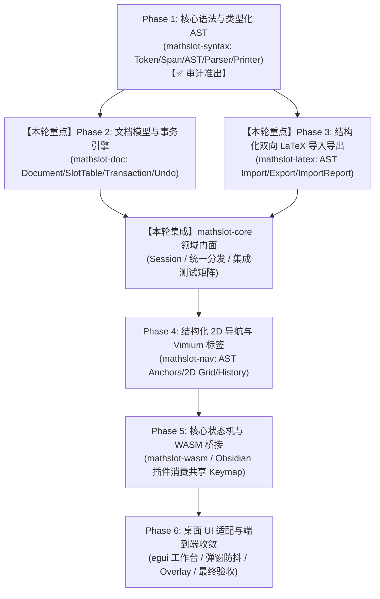

# MathSlot 架构决策记录 (Round 2: Phase 2 文档事务引擎 & Phase 3 LaTeX 导入报告系统)

- **决策者**：Decision Maker Agent (主要决策 Agent)
- **决策日期**：2026-11-11
- **关联基线与依据**：
  - [重构蓝图 docs/REWRITE_DESIGN.md](file:///home/mat/Projects/mathslot-next/docs/REWRITE_DESIGN.md)
  - [Round 1 审计报告 docs/AUDIT_ROUND_1.md](file:///home/mat/Projects/mathslot-next/docs/AUDIT_ROUND_1.md)
  - [Round 1 实施报告 docs/IMPLEMENTATION_ROUND_1.md](file:///home/mat/Projects/mathslot-next/docs/IMPLEMENTATION_ROUND_1.md)
  - [Round 1 决策记录 docs/DECISION_ROUND_1.md](file:///home/mat/Projects/mathslot-next/docs/DECISION_ROUND_1.md)
- **目标工程**：`/home/mat/Projects/mathslot-next`
- **当前状态**：**已批准并签发 Round 2 实施令 (APPROVED FOR ROUND 2: PHASE 2 & PHASE 3 IMPLEMENTATION)**

---

## 1. 执行摘要与战略裁定 (Strategic Direction & Executive Ruling)

在 Round 1 阶段，Implementer Agent 成功落地了 `crates/mathslot-syntax` 与 `crates/mathslot-core` 基础门面，14 项黄金测试 100% 绿色通过，零 Warning、零 Unsafe，彻底消除了导致旧版崩溃与语义降解的 TC-01 ~ TC-06 根因。Auditor Agent 在 `AUDIT_ROUND_1.md` 中给出了准出签发，并对后续演进给出了明确且极具价值的优化建议与架构红线。

本轮决策（Round 2）正式推进 **Phase 2（文档模型、槽位索引与原子事务引擎）** 与 **Phase 3（结构化双向 LaTeX 导入与 ImportReport 报告系统）**。

### 1.1 核心战略原则与架构红线
1. **全面采纳审计反馈，消除技术债务**：
   - 扩充 AST 支持显式样式节点 `Expr::Style { style: MathStyle, body }`，根治 `\mathbf`、`\mathrm`、`\mathcal` 复合表达式降解问题（Addressing Finding 1）；
   - 在 `Expr::Delimited` 中引入 `auto_scale: bool`，严格区分普通裸括号 `(x)` 与 TeX 自适应定界符 `\left( x \right)`，消除不必要的水平间距扰动（Addressing Finding 2）；
   - 补齐 `BigOpKind` 多重积分算子谓词（`\iint`、`\iiint`、`\oint`）截止逻辑（Addressing Finding 3）；
   - 在所有新老 Crate 根路径强制锁定 `#![forbid(unsafe_code)]`（Addressing Finding 5）。
2. **严守单向依赖与单一解析器红线 (Strict Architectural Red Line)**：
   - **严禁解析逻辑分化！** `mathslot-latex` 必须严格基于 `mathslot-syntax` 提供的 Token / Lexer / Parser / Printer 语法基础设施，**严禁另起炉灶重新手写独立的字符扫描器或基于 `starts_with` 的字符串重写器**；
   - `mathslot-latex` 聚焦于输入预规范化、调用 `syntax` 解析、计算无损度与差异指标、生成结构化 `ImportReport`，并完成等价性往返校验。
3. **彻底终结字符串快照式撤销**：
   - 在 `mathslot-doc` 中构建以类型化 AST 为主体的 `Document` 与 `SlotTable`；
   - 确立基于意图的原子 `Edit` 操作，实现具备确定性逆操作（`inverse_edits`）的高效 `Transaction` 事务引擎，杜绝内存暴涨与光标跳变。

---

## 2. 总体重构演进路线与当前位置



---

## 3. 详细架构设计规范 (Round 2 Architectural Specifications)

### 3.1 Task 1: AST 微调与多环境扩展 (`crates/mathslot-syntax`)

#### 3.1.1 显式数学样式枚举 `MathStyle` 与 `Expr::Style`
在 `crates/mathslot-syntax/src/ast.rs` 中增加一等公民数学样式支持：

```rust
/// 常用数学字体与样式修饰枚举
#[derive(Debug, Clone, Copy, PartialEq, Eq, Hash, Serialize, Deserialize)]
pub enum MathStyle {
    Roman,       // \mathrm
    Bold,        // \mathbf
    Italic,      // \mathit
    Caligraphic, // \mathcal
    Blackboard,  // \mathbb
    Fraktur,     // \mathfrak
    Typewriter,  // \mathtt
    SansSerif,   // \mathsf
    Text,        // \text
}

impl MathStyle {
    pub fn from_cmd(cmd: &str) -> Option<Self> {
        match cmd {
            "mathrm" => Some(Self::Roman),
            "mathbf" => Some(Self::Bold),
            "mathit" => Some(Self::Italic),
            "mathcal" => Some(Self::Caligraphic),
            "mathbb" => Some(Self::Blackboard),
            "mathfrak" => Some(Self::Fraktur),
            "mathtt" => Some(Self::Typewriter),
            "mathsf" => Some(Self::SansSerif),
            "text" => Some(Self::Text),
            _ => None,
        }
    }

    pub fn latex_cmd(&self) -> &'static str {
        match self {
            Self::Roman => r"\mathrm",
            Self::Bold => r"\mathbf",
            Self::Italic => r"\mathit",
            Self::Caligraphic => r"\mathcal",
            Self::Blackboard => r"\mathbb",
            Self::Fraktur => r"\mathfrak",
            Self::Typewriter => r"\mathtt",
            Self::SansSerif => r"\mathsf",
            Self::Text => r"\text",
        }
    }
}
```

在 `Expr` 枚举中补充：
```rust
pub enum Expr {
    // ...
    /// 样式修饰节点 (例如 \mathbf{A + B}, \mathrm{d}x, \mathcal{H})
    Style {
        style: MathStyle,
        body: Vec<Spanned<Expr>>,
    },
    // ...
}
```

#### 3.1.2 自适应定界符标记 `auto_scale`
更新 `Expr::Delimited`：
```rust
pub enum Expr {
    // ...
    /// 一等公民定界符节点 (auto_scale 区分裸括号 ( ... ) 与自适应 \left( ... \right))
    Delimited {
        open: Delim,
        close: Delim,
        body: Vec<Spanned<Expr>>,
        auto_scale: bool,
    },
    // ...
}
```
- **解析契约**：
  - 遇到 `Token::CmdLeft` 解析的定界符标记 `auto_scale = true`；
  - 遇到裸标点 `(`, `[`, `|` 时构建的定界符标记 `auto_scale = false`。
- **导出契约 (`printer.rs`)**：
  - `auto_scale == true` 时输出 `\left<open> ... \right<close>`；
  - `auto_scale == false` 时输出 `<open> ... <close>`。

#### 3.1.3 大算子谓词完善与截止条件
在 `crates/mathslot-syntax/src/token.rs` 中提供：
```rust
impl<'a> Token<'a> {
    #[inline]
    pub fn is_big_operator(&self) -> bool {
        matches!(
            self,
            Token::CmdSum
                | Token::CmdInt
                | Token::CmdIint
                | Token::CmdIiint
                | Token::CmdOint
                | Token::CmdProd
                | Token::CmdLim
        )
    }
}
```
在 `parser.rs` 的 `parse_big_operator` 主体消费循环中，统一使用 `if tok.is_big_operator() { break; }`，彻底杜绝连续多元积分（如 `\int_A \iint_B f dx`）中前算子错误吞噬后算子。

---

### 3.2 Task 2: 文档模型、槽位表与原子事务引擎 (`crates/mathslot-doc`)

在 `crates/mathslot-doc` 中落实纯粹基于 AST 的文档状态模型，解耦视图与字符串约定。

#### 3.2.1 依赖与架构边界
```toml
# crates/mathslot-doc/Cargo.toml
[package]
name = "mathslot-doc"
version.workspace = true
edition.workspace = true
authors.workspace = true
license.workspace = true
description = "Mathematical document model, slot table, atomic transaction engine, and undo stack for MathSlot"

[dependencies]
mathslot-syntax = { path = "../mathslot-syntax" }
serde = { version = "1.0", features = ["derive"] }
thiserror = "2.0"
```

#### 3.2.2 AST 路径索引 `AstPath` 与槽位表 `SlotTable`
定义层次树定位器与槽位角色：
```rust
/// 描述在 AST 树中从根节点向下导航的路径坐标
#[derive(Debug, Clone, PartialEq, Eq, Hash, Serialize, Deserialize)]
pub struct AstPath(pub Vec<usize>);

/// 槽位语义角色
#[derive(Debug, Clone, Copy, PartialEq, Eq, Hash, Serialize, Deserialize)]
pub enum SlotRole {
    Numerator,
    Denominator,
    Radicand,
    RootIndex,
    Subscript,
    Superscript,
    LowerBound,
    UpperBound,
    BigOpBody,
    MatrixCell { row: usize, col: usize },
    DelimitedBody,
    StyleBody,
    Placeholder,
}

/// 槽位描述符
#[derive(Debug, Clone, PartialEq, Eq, Serialize, Deserialize)]
pub struct Slot {
    pub id: SlotId,
    pub role: SlotRole,
    pub path: AstPath,
    pub span: Span,
    pub is_empty: bool,
    pub label: Option<String>,
}

/// 文档级槽位索引表，支持高效双向光标穿梭
#[derive(Debug, Clone, Default, PartialEq, Eq, Serialize, Deserialize)]
pub struct SlotTable {
    slots: Vec<Slot>,
}

impl SlotTable {
    pub fn new() -> Self;
    pub fn insert(&mut self, slot: Slot);
    pub fn slots(&self) -> &[Slot];
    pub fn get(&self, id: SlotId) -> Option<&Slot>;
    pub fn first_empty(&self) -> Option<SlotId>;
    pub fn next_slot(&self, current: SlotId) -> Option<SlotId>;
    pub fn prev_slot(&self, current: SlotId) -> Option<SlotId>;
    pub fn empty_count(&self) -> usize;
}
```

#### 3.2.3 文档容器 `Document`
```rust
#[derive(Debug, Clone, PartialEq, Eq, Serialize, Deserialize)]
pub struct Document {
    pub nodes: Vec<Spanned<Expr>>,
    pub slots: SlotTable,
    pub version: u64,
}

impl Document {
    pub fn new() -> Self;
    pub fn from_nodes(nodes: Vec<Spanned<Expr>>) -> Self;
    pub fn from_latex(latex: &str) -> (Self, Vec<Diagnostic>);
    pub fn to_latex(&self) -> String;
    pub fn rebuild_slots(&mut self);
    pub fn get_slot_nodes(&self, slot_id: SlotId) -> Option<&[Spanned<Expr>]>;
}
```
- **不变量约定**：
  1. 任何对 `nodes` 的变更必须触发 `rebuild_slots()`，确保 `SlotTable` 始终与当前 AST 拓扑 100% 同步；
  2. 每个分配的 `SlotId` 在同一文档版本内全局唯一。

#### 3.2.4 原子编辑 `Edit`、光标 `Cursor` 与事务引擎 `Transaction`
```rust
/// 光标定位：支持槽位聚焦与树节点定位
#[derive(Debug, Clone, PartialEq, Eq, Serialize, Deserialize)]
pub enum Cursor {
    AtStart,
    AtEnd,
    InSlot {
        slot_id: SlotId,
        offset: usize, // 槽位内部字符偏移
    },
    AtNode(AstPath),
}

/// 原子编辑意图
#[derive(Debug, Clone, PartialEq, Eq, Serialize, Deserialize)]
pub enum Edit {
    InsertText { at: Cursor, text: String },
    DeleteChar { at: Cursor, backward: bool },
    ReplaceSlot { slot_id: SlotId, new_nodes: Vec<Spanned<Expr>> },
    ClearSlot { slot_id: SlotId },
    WrapDelimited { path: AstPath, open: Delim, close: Delim, auto_scale: bool },
    ReplaceAll { new_nodes: Vec<Spanned<Expr>> },
}

/// 可逆原子事务
#[derive(Debug, Clone, PartialEq, Eq, Serialize, Deserialize)]
pub struct Transaction {
    pub id: u64,
    pub label: String,
    pub edits: Vec<Edit>,
    pub inverse_edits: Vec<Edit>,
    pub cursor_before: Cursor,
    pub cursor_after: Cursor,
    pub version_before: u64,
    pub version_after: u64,
    pub timestamp_ms: u64,
}
```

#### 3.2.5 撤销重做栈 `UndoStack` 与连续输入防抖合并 (Coalescing)
```rust
pub struct UndoStack {
    undo_list: Vec<Transaction>,
    redo_list: Vec<Transaction>,
    max_capacity: usize,         // 默认 100 步
    coalesce_window_ms: u64,     // 默认 500ms
}
```
- **智能合并规则**：
  - 若前一事务与当前事务均为 `InsertText`，且时间差 `<= coalesce_window_ms`，且未跨越换行符或结构边界，则将当前输入合并到前一事务中；
  - 结构化操作（如插入公式、清空槽位、括号包裹、模板替换）为显式语义边界，**严禁合并**；
  - 任何新编辑发生时，清空 `redo_list`。

#### 3.2.6 文档编辑器 `Editor`
高层协调控制器，统一暴露给上层会话：
```rust
pub struct Editor {
    doc: Document,
    cursor: Cursor,
    history: UndoStack,
}

impl Editor {
    pub fn new(doc: Document) -> Self;
    pub fn doc(&self) -> &Document;
    pub fn cursor(&self) -> &Cursor;
    pub fn set_cursor(&mut self, cursor: Cursor);
    pub fn apply(&mut self, edit: Edit, label: impl Into<String>) -> Result<Transaction, DocError>;
    pub fn undo(&mut self) -> bool;
    pub fn redo(&mut self) -> bool;
    pub fn tab_next_slot(&mut self) -> bool;
    pub fn tab_prev_slot(&mut self) -> bool;
}
```

---

### 3.3 Task 3: 结构化 LaTeX 导入/导出与报告系统 (`crates/mathslot-latex`)

构建专用的导入导出与诊断报告系统，彻底废除旧版文本重写逻辑。

#### 3.3.1 依赖关系规范
```toml
# crates/mathslot-latex/Cargo.toml
[package]
name = "mathslot-latex"
version.workspace = true
edition.workspace = true
authors.workspace = true
license.workspace = true
description = "Structured LaTeX import/export pipeline, environment canonicalizer, and ImportReport diagnostics"

[dependencies]
mathslot-syntax = { path = "../mathslot-syntax" }
serde = { version = "1.0", features = ["derive"] }
thiserror = "2.0"
```

#### 3.3.2 诊断报告契约 `ImportReport`
```rust
#[derive(Debug, Clone, PartialEq, Eq, Serialize, Deserialize)]
pub struct ImportReport {
    /// 是否 100% 无损导入（无致命语法错误、无 RawLatex 降级节点）
    pub lossless: bool,
    /// 诊断信息集（警告与语法错误）
    pub diagnostics: Vec<Diagnostic>,
    /// 待填充槽位计数（Expr::Placeholder 数量）
    pub empty_slots: usize,
    /// 未识别或降级的 RawLatex / Error 节点计数
    pub raw_nodes: usize,
    /// 重新格式化生成的标准规范 LaTeX 字符串
    pub roundtrip_latex: String,
    /// 归一化等价性匹配（去除冗余空白后，输入与输出是否一致）
    pub normalized_match: bool,
}
```

#### 3.3.3 统一导入入口 `convert_latex_with_report`
```rust
/// 核心管线：接收任意 LaTeX 文本，调用 syntax 基础设施解析，返回类型化 AST 与完整诊断报告
pub fn convert_latex_with_report(input: &str) -> (Vec<Spanned<Expr>>, ImportReport) {
    // 1. 调用 mathslot-syntax 唯一递归下降解析器构建 AST
    let (ast, diagnostics) = mathslot_syntax::parse(input);

    // 2. 深度遍历 AST 计算指标
    let mut empty_slots = 0;
    let mut raw_nodes = 0;
    walk_ast(&ast, &mut |node| {
        match node {
            Expr::Placeholder { .. } => empty_slots += 1,
            Expr::RawLatex { .. } | Expr::Error { .. } => raw_nodes += 1,
            _ => {}
        }
    });

    // 3. 规范化导出 Canonical LaTeX
    let roundtrip_latex = mathslot_syntax::to_latex(&ast);

    // 4. 计算归一化匹配度 (normalized match)
    let norm_in = normalize_latex_string(input);
    let norm_out = normalize_latex_string(&roundtrip_latex);
    let normalized_match = norm_in == norm_out;

    // 5. 判定无损准则
    let has_fatal = diagnostics.iter().any(|d| d.is_error());
    let lossless = (raw_nodes == 0) && !has_fatal;

    let report = ImportReport {
        lossless,
        diagnostics,
        empty_slots,
        raw_nodes,
        roundtrip_latex,
        normalized_match,
    };

    (ast, report)
}
```

#### 3.3.4 多行与复杂环境规范化 (`environments.rs`)
- 支持 `matrix`, `pmatrix`, `bmatrix`, `vmatrix`, `aligned`, `cases` 等标准环境；
- 在网格中严格维持单元格 `&` 与换行 `\\` 的拓扑结构，严禁全局字符串替换；
- 提供等价性验证工具 `verify_roundtrip(latex: &str) -> Result<(), String>`，用于自动化回归测试。

---

### 3.4 Task 4: Core Facade 门面整合与端到端测试 (`crates/mathslot-core`)

#### 3.4.1 Crate 依赖更新
```toml
# crates/mathslot-core/Cargo.toml
[package]
name = "mathslot-core"
version.workspace = true
edition.workspace = true
authors.workspace = true
license.workspace = true
description = "Core domain facade, high-level Session manager, and unified action dispatcher for MathSlot"

[dependencies]
mathslot-syntax = { path = "../mathslot-syntax" }
mathslot-doc = { path = "../mathslot-doc" }
mathslot-latex = { path = "../mathslot-latex" }
serde = { version = "1.0", features = ["derive"] }
```

#### 3.4.2 统一领域会话 `Session`
为后续 Phase 5 (WASM) 与 Phase 6 (Desktop egui) 提供单一高层入口：
```rust
pub struct Session {
    editor: Editor,
    last_report: Option<ImportReport>,
}

impl Session {
    pub fn new() -> Self;
    pub fn from_latex(latex: &str) -> (Self, ImportReport);
    pub fn load_latex(&mut self, latex: &str) -> ImportReport;
    pub fn to_latex(&self) -> String;
    pub fn doc(&self) -> &Document;
    pub fn cursor(&self) -> &Cursor;
    pub fn apply_edit(&mut self, edit: Edit, label: &str) -> Result<Transaction, DocError>;
    pub fn undo(&mut self) -> bool;
    pub fn redo(&mut self) -> bool;
    pub fn tab_next_slot(&mut self) -> bool;
    pub fn tab_prev_slot(&mut self) -> bool;
    pub fn insert_text(&mut self, s: &str) -> Result<(), DocError>;
    pub fn delete_backward(&mut self) -> Result<(), DocError>;
    pub fn last_report(&self) -> Option<&ImportReport>;
}
```

---

## 4. Implementer Agent 实施任务分解与执行指令 (Task Directives)

请 Implementer Agent 按照以下顺序严密落地 Round 2 实施任务：

### 任务 1: AST 微调与多环境扩展 (`crates/mathslot-syntax`)
1. 在 `ast.rs` 中定义 `MathStyle` 枚举并在 `Expr` 中加入 `Style { style: MathStyle, body: Vec<Spanned<Expr>> }`；
2. 在 `Expr::Delimited` 中增加 `auto_scale: bool`，更新构造器并在 `printer.rs` 中区分裸定界符与 `\left/\right`；
3. 更新 `Token` 增加 `is_big_operator(&self)`，修改 `parse_big_operator` 截止条件，支持 `\iint`, `\iiint`, `\oint`；
4. 更新 `parse_style_command` 直接返回 `Expr::Style`；
5. 在 `crates/mathslot-syntax/src/lib.rs` 顶部添加 `#![forbid(unsafe_code)]`；
6. 补充针对 `\mathbf{A+B}`、`\mathcal{H}`、`\iint_D` 与裸括号的单元测试，确保现有 14 个测试持续全部绿灯。

### 任务 2: 文档模型、槽位表与原子事务引擎 (`crates/mathslot-doc`)
1. 创建 `crates/mathslot-doc` 目录及 `Cargo.toml`，并注册至根 `/Cargo.toml` 的 `members`；
2. 实现 `path.rs` (`AstPath`) 与 `slot.rs` (`Slot`, `SlotRole`, `SlotTable`)；
3. 实现 `document.rs` (`Document`)，提供 AST 槽位自动提取与双向索引重构；
4. 实现 `cursor.rs` (`Cursor`) 与 `transaction.rs` (`Edit`, `Transaction`, 逆操作计算)；
5. 实现 `undo.rs` (`UndoStack`)，落地 500ms 连续输入防抖合并逻辑；
6. 实现 `editor.rs` (`Editor`)，封装 `apply`, `undo`, `redo`, `tab_next_slot`, `tab_prev_slot`；
7. 编写单元测试，覆盖槽位提取、Tab 切换、原子撤销/重做、输入合并。

### 任务 3: 结构化 LaTeX 导入/导出与报告系统 (`crates/mathslot-latex`)
1. 创建 `crates/mathslot-latex` 目录及 `Cargo.toml`，并注册至根 `/Cargo.toml` 的 `members`；
2. 实现 `report.rs` (`ImportReport`)；
3. 实现 `import.rs` (`convert_latex_with_report`)，严格通过 `mathslot-syntax` 进行 AST 解析与统计分析，坚决杜绝字符重写；
4. 实现 `environments.rs`，处理矩阵与对齐环境的规范化；
5. 实现 `verify.rs`，提供 `verify_roundtrip` 等价性校验；
6. 编写单元测试，针对无损公式（断言 `lossless == true`）、未知宏降级（断言 `lossless == false, raw_nodes > 0`）与空槽公式进行完整测试。

### 任务 4: Core Facade 门面整合与端到端测试 (`crates/mathslot-core`)
1. 更新 `crates/mathslot-core/Cargo.toml` 依赖；
2. 在 `crates/mathslot-core/src/session.rs` 中实现 `Session` 会话管理器；
3. 在 `crates/mathslot-core/src/lib.rs` 中重导出 `mathslot-syntax`, `mathslot-doc`, `mathslot-latex` 核心类型与 `Session`；
4. 在 `crates/mathslot-core/tests/` 编写端到端集成测试集：
   - `test_session_transaction_undo_redo`: 验证输入、回退、重做及光标状态；
   - `test_session_slot_navigation`: 验证分式、上下标等复杂结构的槽位跳转；
   - `test_session_import_report`: 验证导入报告与往返等价性；
   - `test_session_golden_roundtrip`: 运行全量 GT-01 ~ GT-08 用例，端到端验证格式化与无损性。

---

## 5. 成熟度判定与准出检查矩阵 (Round 2 Sign-Off Checklist)

在宣告 Round 2 完成并提交 Auditor Agent 进行阶段审计前，必须满足以下硬性准出条件：

| 检查项 | 判定标准 | 验收方式 |
| :--- | :--- | :--- |
| **Workspace 编译** | 零编译报错，零 warning (`cargo check --workspace`) | `cargo check --workspace` |
| **测试套件绿灯率** | 100% 绿灯 (包含新增 doc, latex, session 测试及原有 golden 测试) | `cargo test --workspace` |
| **安全与代码质量** | 零 unsafe (`#![forbid(unsafe_code)]` 全 crate 生效)，零 clippy 警告 | `cargo clippy --workspace -- -D warnings` |
| **架构红线遵守** | `mathslot-latex` 严禁出现独立的字符重写器与 `starts_with` 语法判断 | 代码审查，确认唯一依赖 `mathslot-syntax` |
| **样式与括号保真** | `\mathbf{A+B}` 保持 Style 节点不降级；`(x)` 与 `\left( x \right)` 严格区分 | AST 节点与 LaTeX 导出断言 |
| **事务与撤销健全** | 原子编辑生成合法逆操作，Undo 栈可完整回滚，连续打字防抖合并生效 | `mathslot-doc` 单元与集成测试 |
| **导入报告完备性** | `ImportReport` 包含 `lossless`、`diagnostics`、`empty_slots`、`raw_nodes`、`roundtrip_latex`、`normalized_match` | 测试断言验证 |

---

> **决策签发**：Decision Maker Agent  
> **归档路径**：`/home/mat/Projects/mathslot-next/docs/DECISION_ROUND_2.md`  
> **指令状态**：已正式签发，立即交接 Implementer Agent 执行！
