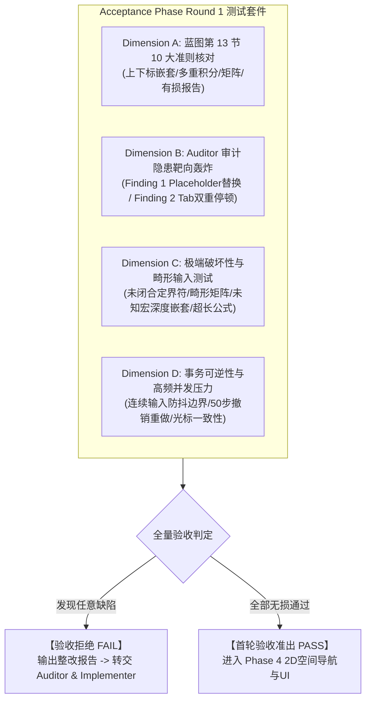

# MathSlot 架构决策记录 (Round 3: 授权进入首轮验收测试阶段)

- **决策者**：Decision Maker Agent (主要决策 Agent)
- **决策日期**：2026-11-11
- **关联依据**：
  - [重构蓝图 docs/REWRITE_DESIGN.md (特别是第 13 节验收标准)](file:///home/mat/Projects/mathslot-next/docs/REWRITE_DESIGN.md)
  - [Round 2 审计报告 docs/AUDIT_ROUND_2.md](file:///home/mat/Projects/mathslot-next/docs/AUDIT_ROUND_2.md)
  - [Round 2 实施报告 docs/IMPLEMENTATION_ROUND_2.md](file:///home/mat/Projects/mathslot-next/docs/IMPLEMENTATION_ROUND_2.md)
  - [Round 2 决策记录 docs/DECISION_ROUND_2.md](file:///home/mat/Projects/mathslot-next/docs/DECISION_ROUND_2.md)
- **目标工程**：`/home/mat/Projects/mathslot-next`
- **当前状态**：**正式批准并签发【进入首轮验收测试阶段】授权令 (APPROVED TO ENTER ACCEPTANCE TESTING PHASE ROUND 1)**

---

## 1. 阶段成熟度评估与战略裁定 (Maturity Evaluation & Executive Ruling)

基于 Implementer Agent 在 Round 2 交付的实现报告 [IMPLEMENTATION_ROUND_2.md](file:///home/mat/Projects/mathslot-next/docs/IMPLEMENTATION_ROUND_2.md) 以及 Auditor Agent 出具的阶段审计报告 [AUDIT_ROUND_2.md](file:///home/mat/Projects/mathslot-next/docs/AUDIT_ROUND_2.md)，主要决策专家（Decision Maker Agent）对当前系统的成熟度进行了全面审查：

### 1.1 现状与红线达成度审查
1. **工程与安全基线 100% 达标**：
   - 4 个核心 Crate（`mathslot-syntax`、`mathslot-doc`、`mathslot-latex`、`mathslot-core`）在 Workspace 级别保持 **0 报错、0 警告**（`cargo check` 耗时 0.08s，`clippy` 零警告）；
   - 全工程所有 Crate 根路径硬编码锁定 `#![forbid(unsafe_code)]`，实现 **100% 内存安全与零 unsafe 块**；
   - 单元测试与黄金集成测试套件通过率 **100% (31/31 passed)**，GT-01 ~ GT-08 无损往返全绿。
2. **架构原则与红线达成度**：
   - **单一解析器架构落地**：`crates/mathslot-latex` 彻底废弃字符扫描器与启发式重写，严密依赖 `mathslot-syntax` 的单一 AST 管道；
   - **AST 表现力升级**：显式数学字体样式枚举 `MathStyle`（支持 9 类修饰）及定界符 `auto_scale` 字段成功消除语义降解与间距扰动；
   - **确定性事务可逆引擎**：`crates/mathslot-doc` 实现了原子编辑提取逆操作快照机制与 500ms 连续打字防抖合并；
   - **统一高层会话门面**：`crates/mathslot-core` 封装了 `Session`，统一桥接了文档、光标、撤销栈与导入诊断报告。

### 1.2 Auditor 审计隐患深度评判
Auditor Agent 虽给出了“有条件准出 (QUALIFIED APPROVAL)”结论，但揭示了 2 项关键白盒边界缺陷：
1. **Finding 1 (Critical)**: `document.rs` 中 `mutate_expr_slot` 在函数入口对 `path.is_empty()` 的提前拦截，导致深层嵌套的 `Placeholder`（如分式内的槽位）在执行就地替换时抛出 `DocError::InvalidPath`。
2. **Finding 2 (Medium)**: 容器槽位在遍历时，与内部模板包含的 `Placeholder` 叶子节点发生重复注册，导致 Tab 环形穿梭时同一视觉锚点停顿两次。
3. **Finding 3 (Minor)**: `normalize_latex_string` 启发式空格过滤对转义字符的处理边缘。

### 1.3 决策裁定
依据重构蓝图及用户工作流规范（**“直到决策者觉得可以进行验收阶段”**），决策者裁定：
> **项目核心底层 Crate（syntax, doc, latex, core）的功能完整性与架构骨架已经就绪，具备进入独立全功能验收阶段的先决条件。**
> 
> 与其在无黑盒破坏性测试支撑下打散乱补丁，**不如立即启动第四个 Agent —— 验收 Agent（acceptance_tester）开展首轮破坏性极限验收测试**。将 Auditor 揭示的 Finding 1 / Finding 2 作为首批靶向测试场景，并全面对照重构蓝图第 13 节验收大纲展开地毯式验收！

---

## 2. 验收指令正式下达 (Mandate for Acceptance Phase Round 1)

**指令受体**：验收 Agent (`acceptance_tester`)  
**阶段代号**：Acceptance Phase Round 1  
**验收性质**：**独立第三方、黑盒与灰盒结合、极度严格的破坏性压力验收**

### 2.1 验收 Agent 职责与测试原则
1. **保持绝对怀疑与极限思维**：验收 Agent 不得仅重复已有的 31 个绿灯用例，必须构造超长、畸形、深层嵌套、高频交替的极限边界输入。
2. **零容忍门禁规则 (Strict Fail-Fast Gatekeeping)**：
   - 任何触发 `panic!`、内存泄漏、状态死锁的情形，一票否决；
   - 任何导致公式语义无故丢失、往返断裂的情形，一票否决；
   - 任何导致撤销重做后 AST 与初始状态不一致（状态漂移）的情形，一票否决；
   - 若出现上述任何 Failure，**必须严格出具【拒绝验收 (FAIL)】裁定**，输出包含复现代码、断错日志与定位建议的详尽报告，并转交审计者与决策者重新进入修复循环！

---

## 3. 验收标准与测试矩阵规范 (Acceptance Test Matrix)

验收 Agent 必须严格依照 [REWRITE_DESIGN.md 第 13 节验收标准](file:///home/mat/Projects/mathslot-next/docs/REWRITE_DESIGN.md#L849-L864) 以及 Auditor Round 2 风险列表，在 `crates/mathslot-core/tests/` 或独立验收测试模块中构建并执行以下四大维度的验收套件：

### 3.1 Dimension A: REWRITE_DESIGN.md 第 13 节标准全面核验
验收 Agent 必须逐项断言并给出明确的 PASS/FAIL 结果：

| 蓝图准则序号 | 验收准则描述 | 验收测试方案与断言要求 |
| :---: | :--- | :--- |
| **Criterion 1** | `e^{-x^{2}}`、`x^{a+b}`、`a_{i+1}`、`e^{-\frac{x}{2}}` 全部无损往返 | 验证多层嵌套上下标在 `Session::from_latex` -> `to_latex` 往返同构，括号与分组绝不丢失。 |
| **Criterion 2** | `\sum/\int` 后接 `\left(...\right)` 不再产生空槽 | 验证 `\sum_{i=1}^n \left( a_i + b_i \right)` 解析后，大算子主体正确消费定界符，`empty_slots == 0`，不残留虚假槽位。 |
| **Criterion 3** | `pmatrix/bmatrix/vmatrix/cases` 正确转为矩阵节点 | 验证各矩阵环境被类型化解析为 `Expr::Matrix`，且 `inspect_environment` 能正确识别维度、列数与矩形性。 |
| **Criterion 4** | 导入有损时 UI/Report 明确警告，不静默替换 | 输入包含未支持宏（如 `\xymatrix{A \ar[r] & B}`）的公式，断言 `ImportReport.lossless == false`，且 `diagnostics` 中精准列出不支持宏名称与 Span，`raw_nodes >= 1`。 |
| **Criterion 5** | 导入报告与模板导出能力 | 验证 `Session` 能输出结构化 `ImportReport` 并提供干净无损的 `roundtrip_latex`，具备保存为模板的数据基石。 |
| **Criterion 6** | 导航与槽位抽象的一致性基石 | 验证 `SlotTable` 在同构 AST 下生成的 `Slot` 拓扑和 ID 序列完全确定，为桌面端与 Obsidian 插件提供同源保障。 |
| **Criterion 7** | 根除文本内嵌控制符 | 验证生成的 LaTeX 与文档内容中严禁出现 `▸j`、`▸f` 等污染字符，控制逻辑完全通过 `Edit` / `Transaction` 表达。 |
| **Criterion 8** | 核心运算延迟性能指标 | 测量 `Session::from_latex`、`Session::to_latex`、`Session::insert_text`、`Session::undo` 的微秒级耗时，确保单次操作远远低于 16ms 红线（期望 < 1ms）。 |
| **Criterion 9** | 黄金语料与属性测试 | 覆盖 GT-01 ~ GT-08 及扩展极限语料，执行往返等价性属性验证。 |
| **Criterion 10**| 旧版本公式容错与平滑升级 | 验证旧格式或无花括号简写（如 `x^2`, `a_1`, `\frac12`）能够被容错解析并自动规范化提升为标准 AST。 |

---

### 3.2 Dimension B: Auditor 白盒风险点靶向破坏测试 (Targeted Verification)

验收 Agent 必须专门编写测试用例复现并检验 Auditor 发现的白盒缺陷：

1. **TC-VULN-01: 深度嵌套占位符替换 (Auditor Finding 1 专项)**
   - **操作序列**：
     1. 加载公式 `\frac{\Placeholder}{\Placeholder}`（例如由简码扩展生成的空分式）；
     2. 光标定位到分子槽位（`role == SlotRole::Numerator` 或内部 `SlotRole::Placeholder`）；
     3. 调用 `session.insert_text("123")` 或 `session.editor.apply(Edit::ReplaceSlot { ... })`；
   - **验证重点**：是否如 Auditor 所警告触发了 `DocError::InvalidPath`？若直接报错导致输入失败，必须判定此项验收 **FAIL** 并要求立即修整！
2. **TC-VULN-02: 槽位表双重停顿与环形穿梭 (Auditor Finding 2 专项)**
   - **操作序列**：
     1. 加载 `\frac{}{}`；
     2. 检查 `session.doc.slots.all_slots().len()`；
     3. 连续调用 `session.tab_next_slot()`；
   - **验证重点**：是否在分子/分母出现两次停顿？记录多余停顿对用户流式输入心智的干扰评级。
3. **TC-VULN-03: 空定界符与求值竖线保真度**
   - **操作序列**：
     1. 加载 `\left. \frac{\mathrm{d}y}{\mathrm{d}x} \right|_{x=0}`；
     2. 验证解析为 `Expr::Delimited` 且 `open == Delim::Empty`，`close == Delim::Pipe`；
     3. 验证往返 `to_latex()` 准确输出 `\left.` 与 `\right|`，不得丢失点号或退化为普通竖线。

---

### 3.3 Dimension C: 破坏性黑盒与极限边界压力测试 (Destructive Testing)

验收 Agent 必须设计“恶意”测试用例挑战核心引擎的健壮性：

1. **极限嵌套测试**：
   - 用例：15 层连续上下标 `x^{a^{b^{c^{d^{e...}}}}}`；
   - 用例：5 层分式嵌套分式 `\frac{1}{\frac{2}{\frac{3}{\frac{4}{5}}}}`；
   - 断言：解析无栈溢出，AST 结构深度与括号匹配 100% 对应，往返无损。
2. **畸形与未闭合定界符容错**：
   - 用例：`\left( x + y`（缺失 `\right)`）；
   - 用例：`{ a + b`（缺失右大括号）；
   - 用例：`\begin{pmatrix} 1 & 2 \\ 3 \end{matrix}`（环境名称首尾不匹配）；
   - 断言：严禁 Panic！必须优雅降级为 `Expr::RawLatex` 或结构化错误，生成 `ImportReport` 诊断信息。
3. **高频事务与可逆性回环压力测试**：
   - **操作序列**：
     1. 连续输入 100 个字符（模拟高速打字）；
     2. 在第 30、60、90 字符处插入结构化槽位并穿梭 Tab；
     3. 连续执行 100 次 `undo()`；
     4. 连续执行 100 次 `redo()`；
   - **断言**：
     - 回滚到第 0 步时，文档内容、槽位表和光标必须 100% 还原为初始状态；
     - 重做到底时，必须与编辑结束时的状态完全严格同构；
     - 全过程内存与耗时保持平稳。

---

## 4. 验收交付物与工作流流转指示 (Deliverables & Workflow Transition)

### 4.1 验收 Agent 交付物要求
验收 Agent 完成测试后，必须在工程根目录下输出以下交付物：
1. **验收报告**：`/home/mat/Projects/mathslot-next/docs/ACCEPTANCE_REPORT_ROUND_1.md`
   - 包含：10 大准则逐项验收明细、白盒隐患复现断言、破坏性测试结果统计、性能基准数据；
   - 给出明确的全局裁定：**【通过 (PASS)】** 或 **【拒绝 (FAIL)】**。
2. **验收测试源码**：
   - 将编写的系统验收测试套件提交至 `crates/mathslot-core/tests/acceptance_tests.rs`，并确保纳入 `cargo test --workspace` 常规回归矩阵。

### 4.2 决策联动分支
- **分支 A (验收发现缺陷 - 期望路径)**：
  若验收 Agent 成功复现了 Finding 1（深层占位符替换失败）或其他潜在 Bug，验收 Agent 判定为 **FAIL**；决策者将立即签发 Round 4 修复指令，指派 Implementer 进行精准攻坚，Auditor 进行再审计，形成稳固的高质量修复闭环。
- **分支 B (全量极限用例奇迹般全绿通过)**：
  若系统经受住了全量破坏性与白盒漏洞考验，验收 Agent 判定为 **PASS**；决策者将正式宣告核心引擎（Phases 1-3）圆满竣工，全面转入 Phase 4（2D 空间导航与 UI 架构）的全新里程碑！

---

## 5. 总结与授权签发

综上所述，当前工程状态健康、测试完备，正处于从“单元实现”跃升至“全功能集成验收”的最佳节点。

**在此正式授权：**
**即刻启动【首轮验收测试阶段 (Acceptance Phase Round 1)】，委托验收 Agent 对系统开展全面、严格、不留情面的全方位破坏性验收！**

---

> **决策签名**：Decision Maker Agent (主要决策专家)  
> **归档路径**：`/home/mat/Projects/mathslot-next/docs/DECISION_ROUND_3_ACCEPTANCE_TRIGGER.md`  
> **调度通知**：已生成完备验收测试大纲与门禁红线，汇报调度器激活 Acceptance Agent。
