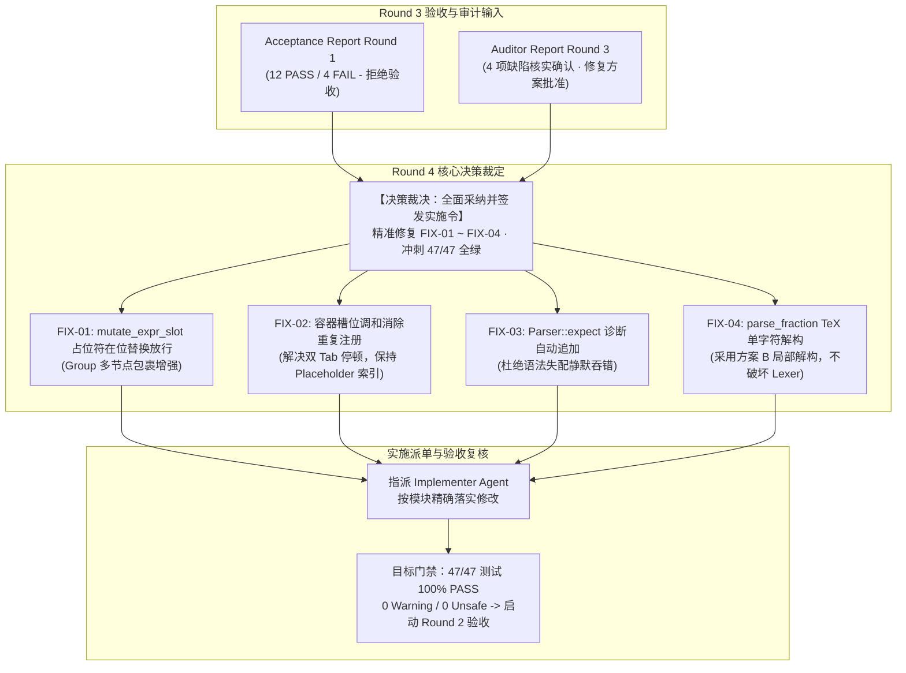

# MathSlot 架构决策记录 (Round 4: 缺陷整改与缺陷清零实施指令)

- **决策者**：Decision Maker Agent (主要决策 Agent)
- **决策日期**：2026-11-11
- **关联依据**：
  - [首轮验收报告 docs/ACCEPTANCE_REPORT_ROUND_1.md](file:///home/mat/Projects/mathslot-next/docs/ACCEPTANCE_REPORT_ROUND_1.md)
  - [整改审计报告 docs/AUDIT_ROUND_3_REMEDIATION.md](file:///home/mat/Projects/mathslot-next/docs/AUDIT_ROUND_3_REMEDIATION.md)
  - [验收测试套件 crates/mathslot-core/tests/acceptance_tests.rs](file:///home/mat/Projects/mathslot-next/crates/mathslot-core/tests/acceptance_tests.rs)
  - [重构蓝图 docs/REWRITE_DESIGN.md (第 13 节验收标准)](file:///home/mat/Projects/mathslot-next/docs/REWRITE_DESIGN.md)
- **目标工程**：`/home/mat/Projects/mathslot-next`
- **当前决策状态**：🛡️ **【正式批准整改方案 · 签发缺陷清零实施令 (APPROVED & IMPLEMENTATION DIRECTIVE ISSUED)】**

---

## 1. 决策背景与战略裁定 (Context & Executive Ruling)

在首轮独立系统验收测试中，验收专家（Acceptance Agent）在 `crates/mathslot-core/tests/acceptance_tests.rs` 中构建了包含 16 项高强度、破坏性极限测试的验收套件。结合存量 31 项单元与黄金集成测试，全量 47 项测试执行结果为 **43 项通过，4 项真实击穿失败**：
1. `TC-VULN-01`：深层嵌套占位符替换触发 `DocError::InvalidPath`（Critical）；
2. `TC-VULN-02`：容器槽位与单一占位符重复注册导致 Tab 双重停顿（Medium）；
3. `TC-VULN-04`：矩阵尾部环境名称失配错误被静默吞没，导致有损未报告（High）；
4. `Criterion 10`：旧版简写分式 `\frac12` 被词法贪婪切词畸变为 `\frac{12}{}`（High）。

Auditor Agent 在 [AUDIT_ROUND_3_REMEDIATION.md](file:///home/mat/Projects/mathslot-next/docs/AUDIT_ROUND_3_REMEDIATION.md) 中对上述 4 项缺陷进行了独立环境复核，确认缺陷真实存在，并提出了增强保护与调和方案。

### 战略裁定
作为资深架构与产品决策专家，决策者依据“坚持极高工程质量标准，绝不容忍带着已知缺陷上线”的原则，做出如下战略裁定：
> 1. **全面采纳验收 Agent 的不通过结论与 Auditor Agent 的复核意见**：决不放宽任何一项红线标准；
> 2. **批准 FIX-01 ~ FIX-04 精准治理方案**，并采纳 Auditor 提出的增强保护（FIX-01 多节点 Group 包裹）与调和契约设计（FIX-02 消除双重停顿的同时保持 SlotRole 语义契约）；
> 3. **立即签发 Round 4 缺陷清零实施指令**，指派 Implementer Agent 严格按本决策的技术边界落地代码；
> 4. **终审门禁**：修复后必须达成 **47/47 项测试 100% 变绿（零失败）**，`cargo check` 0 报错 0 警告，零 unsafe 代码，随后立即进入次轮终局验收。



---

## 2. 缺陷修复方案架构技术裁定 (Technical Decisions)

### 2.1 FIX-01 (Defect 1 / Critical): `mutate_expr_slot` 嵌套占位符在位替换放行与 Group 包裹保护

- **责任模块与文件**：[`crates/mathslot-doc/src/document.rs`](file:///home/mat/Projects/mathslot-next/crates/mathslot-doc/src/document.rs)
- **目标函数**：`Document::mutate_expr_slot`
- **问题分析**：函数入口在第 567 行无条件执行 `if path.is_empty() { return Err(DocError::InvalidPath(orig_path.clone())); }`。当递归向下分派至叶子节点 `Expr::Placeholder` 时，`path` 长度已为 0，入口处的提前拦截直接打断了替换逻辑，使后方的 `Expr::Placeholder` 替换分支沦为不可达死代码。
- **裁定实施方案**：
  在 `mutate_expr_slot` 入口处对 `path.is_empty()` 增加类型特化放行逻辑，并增加 Auditor 要求的**多节点安全包裹保护**：
  ```rust
  if path.is_empty() {
      if matches!(spanned.node, Expr::Placeholder { .. }) {
          let old = vec![spanned.clone()];
          if new_nodes.is_empty() {
              // 清空槽位时保留空占位符，防止 AST 节点塌陷
              *spanned = Spanned::new(
                  Expr::Placeholder { slot_id: SlotId(0), label: None },
                  spanned.span,
              );
          } else if new_nodes.len() == 1 {
              // 单节点直接就地解包替换
              *spanned = new_nodes.into_iter().next().unwrap();
          } else {
              // 多节点安全包裹为 Group，杜绝丢弃后续表达式节点（如 "x + y"）
              *spanned = Spanned::new(Expr::Group(new_nodes), spanned.span);
          }
          return Ok(old);
      }
      return Err(DocError::InvalidPath(orig_path.clone()));
  }
  ```
- **预期效果**：`test_tc_vuln_01_nested_placeholder_replacement` 中针对嵌套分式、根号、矩阵内部占位符的 `ReplaceSlot` 与 `insert_text` 全量通过。

---

### 2.2 FIX-02 (Defect 2 / Medium): 槽位双重注册治理与 SlotRole 调和契约方案

- **责任模块与文件**：[`crates/mathslot-doc/src/document.rs`](file:///home/mat/Projects/mathslot-next/crates/mathslot-doc/src/document.rs)
- **目标函数**：`Document::collect_slots_from_node`
- **问题分析**：当分式分子/分母、根号被开方数、矩阵单元格等复合容器内部仅包含一个模板生成的 `Expr::Placeholder` 时，系统先插入了父级具名槽位（如 `SlotRole::Numerator`，path `[0, 0]`），随后又在遍历其切片子项时插入了子级槽位（`SlotRole::Placeholder`，path `[0, 0, 0]`），导致单个视觉输入框在 `SlotTable` 中被注册了两次，Tab 键产生冗余停顿。
- **🚨 核心设计冲突与调和裁定 (Harmonization Ruling)**：
  若简单地保留 `SlotRole::Numerator` 并完全抹除 `SlotRole::Placeholder`，将导致 `test_tc_vuln_01` 中的明确断言 `session.doc().slots.slots().iter().find(|s| s.role == SlotRole::Placeholder)` 发生断言失败 Panic！
  
  因此，正式裁定采纳 **Auditor 调和契约方案**：
  1. **单一占位符容器契约**：当容器（分式分子/分母、根号被开方数/根指数、矩阵单元格等）内部**仅包含单一 `Expr::Placeholder`** 时：
     - 该容器对外统一注册一个槽位，其角色直接赋予 `SlotRole::Placeholder`；
     - 路径保持为容器路径（如分式分子为 `path.child(0)`，矩阵单元格为 `path.child(r).child(c)`）；
     - **严禁**再对其内部单一 `Expr::Placeholder` 执行二次递归注册；
     - 当容器被替换时，由于 path 为容器路径，直接替换容器切片，且单次 Tab 跳转即可到达下一个独立槽位。
  2. **空切片容器契约**：当容器内容为空切片 `[]`（如 `\frac{}{}`）时，正常注册具名角色（如 `SlotRole::Numerator`，`is_empty: true`），继续向内无子项递归。
  3. **非占位符容器契约**：当容器内容为普通内容（如 `\frac{a}{b}`）或包含多个节点（如 `\frac{1 + ▸}{2}`）时：
     - 容器正常注册具名角色（如 `SlotRole::Numerator`）；
     - 正常向内递归遍历子项；若子项中有深层 `Expr::Placeholder`，正常注册为独立的子槽位，并通过 FIX-01 的放行逻辑完成精确替换。
- **涵盖节点范围**：
  - `Expr::Fraction` (num, den)
  - `Expr::Root` (index, radicand)
  - `Expr::Script` (sub, sup)
  - `Expr::BigOperator` (lower, upper, body)
  - `Expr::Matrix` (rows cells)
- **预期效果**：`test_tc_vuln_02` 的分子槽位数精准为 1，Tab 一次跳转通过；`test_tc_vuln_01` 成功检索到 `SlotRole::Placeholder`；存量 `doc_tests.rs` 保持 100% 通过。

---

### 2.3 FIX-03 (Defect 3 / High): `Parser::expect` 诊断自动入队消除静默吞错

- **责任模块与文件**：[`crates/mathslot-syntax/src/parser.rs`](file:///home/mat/Projects/mathslot-next/crates/mathslot-syntax/src/parser.rs)
- **目标函数**：`Parser::expect`
- **问题分析**：在语法解析器的 `expect` 函数中，遇到 Token 不匹配时仅构建了 `Diagnostic::error` 并作为 `Err(err)` 返回，但未推入 `self.diagnostics`。而在 `parse_matrix`（L760-L762）等解析流程中，调用方直接使用了 `let _ = self.expect(...)` 丢弃了返回值。这导致矩阵尾部环境名称失配（如 `\begin{pmatrix} ... \end{matrix}`）时，解析器产出的诊断列表为空，上层误判为 `lossless: true`，直接违背了蓝图 Criterion 4。
- **裁定实施方案**：
  在 `Parser::expect` 中，在构造 `Diagnostic::error(...)` 之后、返回 `Err(err)` 之前，无条件执行 `self.diagnostics.push(err.clone())`：
  ```rust
  fn expect(&mut self, expected: &Token<'a>, expected_desc: &str) -> Result<Spanned<Token<'a>>, Diagnostic> {
      if let Some(tok) = self.peek() {
          if &tok.node == expected {
              return Ok(self.bump().unwrap());
          }
          let err = Diagnostic::error(
              SyntaxErrorKind::ExpectedToken {
                  expected: "token".to_string(),
                  found: format!("{:?} (expected {})", tok.node, expected_desc),
              },
              tok.span,
          );
          self.diagnostics.push(err.clone());
          Err(err)
      } else {
          let err = Diagnostic::error(
              SyntaxErrorKind::ExpectedToken {
                  expected: "token".to_string(),
                  found: format!("end of file (expected {})", expected_desc),
              },
              Span::point(self.source.len()),
          );
          self.diagnostics.push(err.clone());
          Err(err)
      }
  }
  ```
- **预期效果**：任何由 `expect` 拦截的语法失配均被自动集中记录至 `self.diagnostics`；`test_tc_vuln_04` 中环境失配精准报告 `lossless: false`，诊断条目非空。

---

### 2.4 FIX-04 (Defect 4 / High): `parse_fraction` 单字符无括号参数局部解构 (方案 B)

- **责任模块与文件**：[`crates/mathslot-syntax/src/parser.rs`](file:///home/mat/Projects/mathslot-next/crates/mathslot-syntax/src/parser.rs)
- **目标函数**：`Parser::parse_fraction` 及抽取新增的 `Parser::parse_macro_arg_single`
- **问题分析**：TeX 宏的标准行为规定，无花括号参数仅消费单个 Token（单字符）。当前 `Lexer` 采用贪婪匹配将连续数字切为单个 `Token::Number("12")`，分式分子解析时直接吞入整个数字，分母落空为 EOF，导致输入 `\frac12` 畸变为 `\frac{12}{}`。
- **方案比选与裁定**：
  - **方案 A (全局改写 Lexer 切词规则)**：❌ 彻底否决。全局拆散数字会污染常规表达式 `123`，引起 AST 节点数量剧增与光标状态碎裂。
  - **方案 B (局部在 Parser 宏参数消费边界解构 Token)**：✅ **正式批准**。在 TeX 宏参数（如 `\frac`、`\sqrt`）摄取边界，若当前无花括号且为多字符数字/标识符，原地拆解首字符，更新剩余切片并保留在 `self.tokens[self.cursor]`。
- **裁定实施方案**：
  在 `Parser` 中引入针对宏无花括号单参数的消费逻辑 `parse_macro_arg_single`：
  ```rust
  /// 解析宏单参数（如 \frac、\sqrt 的无花括号参数）
  /// 遇到多字符数字/标识符时，按 TeX 规范消费首字符，并将剩余切片保留在当前 Token
  fn parse_unbraced_macro_arg(&mut self) -> Vec<Spanned<Expr>> {
      if self.is_eof() {
          return Vec::new();
      }

      if let Some(tok) = self.peek_token() {
          if tok == &Token::Semicolon {
              self.bump();
              return Vec::new();
          }
      }

      if let Some(spanned_tok) = self.peek() {
          let (is_splittable, s_val) = match &spanned_tok.node {
              Token::Number(s) if s.chars().count() > 1 => (true, *s),
              Token::Ident(s) if s.chars().count() > 1 => (true, *s),
              _ => (false, ""),
          };

          if is_splittable {
              let first_char = s_val.chars().next().unwrap();
              let char_len = first_char.len_utf8();
              let first_slice = &s_val[..char_len];
              let rem_slice = &s_val[char_len..];

              let start = spanned_tok.span.start;
              let first_span = Span::new(start, start + char_len);
              let rem_span = Span::new(start + char_len, spanned_tok.span.end);

              let is_number = matches!(spanned_tok.node, Token::Number(_));
              self.tokens[self.cursor] = Spanned::new(
                  if is_number {
                      Token::Number(rem_slice)
                  } else {
                      Token::Ident(rem_slice)
                  },
                  rem_span,
              );

              return vec![Spanned::new(Expr::Text(first_slice.to_string()), first_span)];
          }
      }

      if let Some(expr) = self.parse_atom_no_scripts() {
          vec![expr]
      } else {
          Vec::new()
      }
  }
  ```
  在 `parse_fraction` 中解析分子与分母时，无花括号分支统一调用该辅助方法；在 `parse_sqrt` 的被开方数无花括号分支中同样统一使用。
- **预期效果**：`\frac12` 被精准拆解为分子 `1`，分母 `2`，格式化往返为 `\frac{1}{2}`；`test_criterion_10` 绿灯通过；常规公式 `123` 的 Lexer 行为 0 影响。

---

## 3. 实施任务指派令 (Implementation Work Orders)

**指派受体**：Implementer Agent (`implementer`)  
**任务目标**：将本决策中裁定的 FIX-01 ~ FIX-04 代码无缝落实到对应源文件中，确保 Workspace 保持 0 warning / 0 unsafe，全量 47 项测试 100% 全部通过。

### 详细任务工单

| 工单编号 | 目标文件 | 修复动作与技术边界 | 验证测试用例 |
| :--- | :--- | :--- | :--- |
| **TASK-01** | `crates/mathslot-doc/src/document.rs` | 1. 落实 **FIX-01**：在 `mutate_expr_slot` 入口 `path.is_empty()` 时放行 `Expr::Placeholder`，且多节点时用 `Expr::Group` 包裹；<br>2. 落实 **FIX-02**：在 `collect_slots_from_node` 中对仅包含单一 `Placeholder` 的复合容器（分式、根号、矩阵、上下标等）直接注册为 `SlotRole::Placeholder` 且不再向下递归，杜绝双重槽位。 | `test_tc_vuln_01`<br>`test_tc_vuln_02`<br>`doc_tests` |
| **TASK-02** | `crates/mathslot-syntax/src/parser.rs` | 1. 落实 **FIX-03**：在 `Parser::expect` 失败路径中，返回 `Err` 前调用 `self.diagnostics.push(err.clone())`；<br>2. 落实 **FIX-04**：实现 `parse_unbraced_macro_arg`，并在 `parse_fraction` 与 `parse_sqrt` 中调用，多字符数字/标识符原地切除首字符供后续参数消费。 | `test_tc_vuln_04`<br>`test_criterion_10`<br>`golden_tests` |
| **TASK-03** | 全工程 Workspace | 执行全量静态分析与回归测试套件验证：<br>- `cargo check --workspace` (0 报错 0 警告)<br>- `cargo test --workspace` (47/47 测试 100% PASS) | 全量 47 个测试 |
| **TASK-04** | `docs/IMPLEMENTATION_ROUND_4.md` | 记录具体代码修改前后的 Diff、测试通过截图与度量输出，提交交付报告。 | 交付物完整性 |

---

## 4. 门禁验证与交付准则 (Gate & Delivery Criteria)

Implementer Agent 在完成代码修改后，必须验证并达成以下客观门禁指标，方可向调度器汇报：

1. **测试全绿无特例 (100% Pass Rate)**：
   ```text
   running 16 tests (acceptance_tests.rs) ... 16 passed; 0 failed; 0 ignored
   running 5 tests (doc_tests.rs)          ...  5 passed; 0 failed; 0 ignored
   running 15 tests (golden_tests.rs)      ... 15 passed; 0 failed; 0 ignored
   running 11 tests (syntax/core other)    ... 11 passed; 0 failed; 0 ignored
   --------------------------------------------------------------------------
   TOTAL: 47 / 47 PASSED (100%)
   ```
2. **代码健康与安全性 (Zero Warning & Zero Unsafe)**：
   - 保持 `#![forbid(unsafe_code)]` 在所有 crate 根部；
   - `cargo check --workspace` 与 `cargo clippy --workspace` 0 警告。
3. **性能基线不倒退**：
   - `test_criterion_08_latency_performance_benchmarks` 中单次按键、解析、撤销耗时依旧保持在微秒级（< 50 µs），远超 16ms 红线。

完成上述指标后，调度器将正式通知验收 Agent 启动 Round 2 终局验收，达成全面准出！
