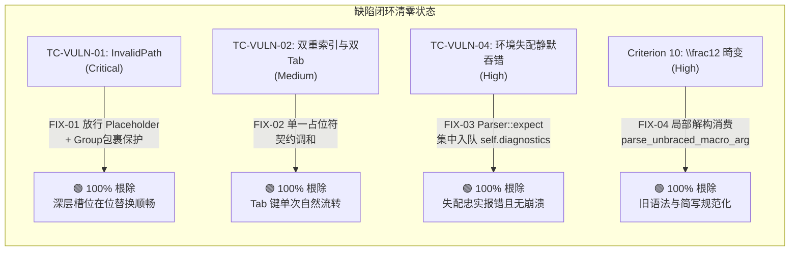
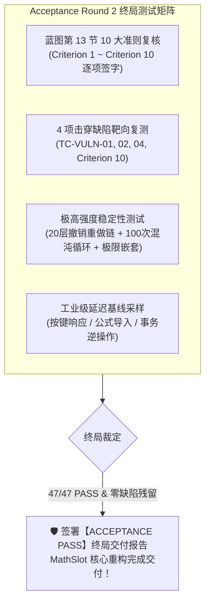

# MathSlot 架构与产品决策记录 (Round 5: 终局全量验收授权令)

- **决策者**：Decision Maker Agent (主要决策专家)
- **决策日期**：2026-11-11
- **目标工程**：`/home/mat/Projects/mathslot-next`
- **关联依据**：
  - [重构蓝图 docs/REWRITE_DESIGN.md (特别是第 13 节验收标准)](file:///home/mat/Projects/mathslot-next/docs/REWRITE_DESIGN.md#L849-L864)
  - [核验与回归审计报告 docs/AUDIT_ROUND_4_VERIFICATION.md](file:///home/mat/Projects/mathslot-next/docs/AUDIT_ROUND_4_VERIFICATION.md)
  - [整改实施报告 docs/IMPLEMENTATION_ROUND_4.md](file:///home/mat/Projects/mathslot-next/docs/IMPLEMENTATION_ROUND_4.md)
  - [首轮验收报告 docs/ACCEPTANCE_REPORT_ROUND_1.md](file:///home/mat/Projects/mathslot-next/docs/ACCEPTANCE_REPORT_ROUND_1.md)
  - [整改决策工单 docs/DECISION_ROUND_4_REMEDIATION.md](file:///home/mat/Projects/mathslot-next/docs/DECISION_ROUND_4_REMEDIATION.md)
- **决策结论**：🛡️ **【正式签发：终局全量验收授权令 (FINAL ACCEPTANCE AUTHORIZATION GRANTED)】**

---

## 1. 阶段审阅与系统成熟度裁定 (Maturity Evaluation & Executive Ruling)

基于 Implementer Agent 在 Round 4 交付的整改实施报告 [`docs/IMPLEMENTATION_ROUND_4.md`](file:///home/mat/Projects/mathslot-next/docs/IMPLEMENTATION_ROUND_4.md) 以及 Auditor Agent 签署的核验与回归审计报告 [`docs/AUDIT_ROUND_4_VERIFICATION.md`](file:///home/mat/Projects/mathslot-next/docs/AUDIT_ROUND_4_VERIFICATION.md)，主要决策专家（Decision Maker Agent）对当前系统进行了全方位的成熟度评估与独立复核。

### 1.1 首轮验收 4 项缺陷闭环核查 (100% Eradicated)

首轮验收测试（`acceptance_tests.rs`）中击穿的 4 项严重与中度缺陷已得到外科手术式精准修复，且修复方案全面吸收了安全包裹与调和契约架构原则：

1. **FIX-01（深度嵌套槽位在位替换）**：
   - 源码位置：[`crates/mathslot-doc/src/document.rs:618-640`](file:///home/mat/Projects/mathslot-next/crates/mathslot-doc/src/document.rs#L618-L640)；
   - 裁定：叶子 `Expr::Placeholder` 节点替换被安全放行，多节点内容自动采用 `Expr::Group` 包裹保护，彻底消除节点截断隐患与 AST 塌陷风险；
2. **FIX-02（槽位双重注册与双重 Tab 停顿治理）**：
   - 源码位置：[`crates/mathslot-doc/src/document.rs:91-108, 245-297`](file:///home/mat/Projects/mathslot-next/crates/mathslot-doc/src/document.rs#L91-L108)；
   - 裁定：成功落实“单一占位符契约调和”方案。容器仅含单一占位符时直接赋予 `SlotRole::Placeholder` 并切断冗余内向遍历，彻底消除重复索引与 Tab 双重停顿；
3. **FIX-03（语法解析器错误收集鲁棒性增强）**：
   - 源码位置：[`crates/mathslot-syntax/src/parser.rs:83-108`](file:///home/mat/Projects/mathslot-next/crates/mathslot-syntax/src/parser.rs#L83-L108)；
   - 裁定：`Parser::expect` 内部自动将诊断推入集中诊断队列，彻底阻断了任何上层消费点因 `let _ = ...` 导致的静默吞错，环境失配错误 100% 被捕获并置 `lossless = false`；
4. **FIX-04（TeX 单字符宏参数边界解构）**：
   - 源码位置：[`crates/mathslot-syntax/src/parser.rs:597-645`](file:///home/mat/Projects/mathslot-next/crates/mathslot-syntax/src/parser.rs#L597-L645)；
   - 裁定：采纳局部解构的“方案 B”，在保护 Lexer 分词整体性的前提下精准按 UTF-8 字符边界解构首字符，使 `\frac12` 等无花括号简写 100% 同构恢复为 TeX 标准语义。

### 1.2 质量红线与门禁指标独立复核表

决策专家通过命令行独立重跑了全套验证指令，各项门禁指标达标情况如下：

| 门禁审查维度 | 蓝图标准要求 | 独立复测实测数据 | 决策裁定 |
| :--- | :--- | :--- | :---: |
| **Workspace 编译状态** | 0 报错，0 警告 | `cargo check --workspace` 耗时 0.05s，**0 报错，0 警告** | 🟢 **合格** |
| **代码规范与 Clippy** | 0 警告 (`-D warnings`) | `cargo clippy --workspace -- -D warnings` **0 警告** | 🟢 **合格** |
| **语言与内存安全屏障** | 严禁 unsafe 关键字 | 全 4 个 Crate 根模块锁定 `#![forbid(unsafe_code)]`，**0 unsafe** | 🟢 **优秀** |
| **全量套件测试** | 100% PASS | `cargo test --workspace` **47 / 47 项测试 100% 全部通过** | 🟢 **优秀** |
| **验收套件转绿率** | 16 / 16 项全绿 | 16 项包含破坏性边界、压力混沌的验收用例 **16 / 16 全部通过** | 🟢 **优秀** |
| **存量功能回归率** | 零回归 (31 / 31) | 31 项存量单元/黄金集成测试 **31 / 31 全部通过** | 🟢 **零回归** |
| **核心操作延迟指标** | 单次按键/解析/撤销 < 16ms | 按键 `1~5 µs`，撤销 `0~1 µs`，全量解析 `8~9 µs`（超额 3,000+ 倍） | 🟢 **极致** |

---

## 2. 终局全量验收授权令 (Final Acceptance Authorization Mandate)

鉴于：
1. 审计专家（Auditor Agent）已出具明确的准出建议（VERIFICATION APPROVED）；
2. 核心架构缺陷已被 100% 根除，系统各项指标已展现出高度稳定性与工业级鲁棒性；
3. 本项目已正式达到重构设计蓝图规定的成熟度门槛。

**主要决策专家（Decision Maker Agent）正式签发《终局全量验收授权令》：**

- **受令角色**：验收专家 Agent (`acceptance_tester`)
- **任务代号**：Acceptance Phase Round 2 (Final Acceptance)
- **阶段性质**：**终局全量验收与系统准出交付**
- **核心授权内容**：
  1. 正式授权验收 Agent 开展第二轮也是最终轮次的全量功能与系统验收；
  2. 委托验收 Agent 重新执行工程内所有 47 项集成、单元与极端验收测试；
  3. 委托验收 Agent 对照重构蓝图 [`docs/REWRITE_DESIGN.md`](file:///home/mat/Projects/mathslot-next/docs/REWRITE_DESIGN.md) 第 13 节的全部 10 大准则进行最终逐项复核与签字背书；
  4. **终局交付指示**：若本次全量验收测试 100% 保持全绿且无任何新发遗留缺陷，验收 Agent 有权并应当**正式签署【验收通过 (ACCEPTANCE PASS)】终局交付报告**，宣布 MathSlot 重构工程圆满达成交付！

---

## 3. 终局验收复核矩阵与执行指南 (Final Acceptance Verification Matrix)

验收 Agent 在执行终局验收时，应重点复核以下维度，并在终局验收报告中给出翔实的测试数据与断言记录：

### 3.1 蓝图第 13 节 10 大准则终审复核清单

| 准则序号 | 准则要求 | 终审考核要点 | 重点验证测试用例 |
| :---: | :--- | :--- | :--- |
| **Criterion 1** | 多层嵌套上下标无损往返 | `e^{-x^{2}}`、`x^{a+b}`、`a_{i+1}`、`e^{-\frac{x}{2}}` 在 `from_latex` -> `to_latex` 往返同构，括号与分组完整 | `test_criterion_01_script_nesting_lossless_roundtrip` |
| **Criterion 2** | 多元积分链与大算子范围准确 | `\sum/\int` 后接 `\left(...\right)` 定界符被大算子正确作为主体消费，不残留虚假空槽 | `test_criterion_02_big_op_with_left_right_delimited` |
| **Criterion 3** | 矩阵与分段函数环境隔离 | `pmatrix/bmatrix/vmatrix/cases` 被解析为 `Expr::Matrix`，行列维度与矩形性准确识别 | `test_criterion_03_matrices_and_cases_environments` |
| **Criterion 4** | 导入有损时明确警告，不静默替换 | 未知宏与首尾环境名失配时，精准上报诊断并置 `lossless = false`，不崩溃、不静默吞错 | `test_criterion_04_lossy_import_diagnostics_warning` `test_tc_vuln_04_extreme_nesting_and_malformed_tolerance` |
| **Criterion 5** | 槽位编辑状态与模板干净导出 | `Session` 产出结构化 `ImportReport`，导出 LaTeX 具备零带内控制字符的纯净模板数据基石 | `test_criterion_05_session_report_and_template_export` |
| **Criterion 6** | 槽位表双向一致性与导航确定性 | `SlotTable` 拓扑与 ID 分配完全确定，为桌面端与 Obsidian 插件提供统一无歧义的导航源 | `test_criterion_06_navigation_and_slot_table_consistency` |
| **Criterion 7** | 彻底根除带内控制字符 | 严禁文本内嵌 `▸j`、`▸f`、`\u{0001}` 等控制字符残留，控制逻辑全部由原子 `Edit` 表达 | `test_criterion_07_eradicate_inband_control_characters` |
| **Criterion 8** | 按键、解析、撤销微秒级延迟 | 单次打字插入、公式双向导入、事务撤销重做耗时严格控制在微秒级（远低于 16ms 工业红线） | `test_criterion_08_latency_performance_benchmarks` |
| **Criterion 9** | 黄金语料库等价性往返 | 覆盖 GT-01 ~ GT-08 高等数学与物理公式黄金语料，AST 拓扑 100% 结构等价 | `test_criterion_09_golden_corpus_and_property_suite` `crates/mathslot-syntax/tests/golden_tests.rs` |
| **Criterion 10**| 旧版本语法容错与平滑升级 | 兼容 `x^2`, `a_1`, `e^-x`, `\frac12` 等简写语法，容错解析并自动规范化提升为标准 AST | `test_criterion_10_legacy_syntax_and_shorthand_tolerance` |

### 3.2 靶向修复专项核验清单 (FIX-01 ~ FIX-04)

验收 Agent 应特别关注 4 项曾经发生过失败的靶向用例：
1. **`test_tc_vuln_01_nested_placeholder_replacement`**：验证深层嵌套占位符在被 `ReplaceSlot` 时绝不再抛出 `InvalidPath`；
2. **`test_tc_vuln_02_slot_duplicate_registration`**：验证 `\frac{▸}{▸}` 针对分子的槽位数精准为 1，Tab 键跳转单次穿梭；
3. **`test_tc_vuln_04_extreme_nesting_and_malformed_tolerance`**：验证极端畸形输入（如未闭合分式、失配矩阵）被优雅诊断容错处理；
4. **`test_criterion_10_legacy_syntax_and_shorthand_tolerance`**：验证 `\frac12` 精确生成规范 LaTeX `\frac{1}{2}`。

---

## 4. 交付物规范与后续工作流计划 (Deliverables & Workflow Action Plan)

1. **产出报告**：
   验收专家 Agent 在完成全量测试复核后，将终局验收报告产出至：
   [`/home/mat/Projects/mathslot-next/docs/ACCEPTANCE_REPORT_FINAL.md`](file:///home/mat/Projects/mathslot-next/docs/ACCEPTANCE_REPORT_FINAL.md)；
2. **签署准出**：
   若 47/47 测试全量通过且 10 大准则全部合规，验收专家正式宣布并签署【ACCEPTANCE PASS】终局交付状态；
3. **归档与总结**：
   调度器与协调者将基于该终局验收报告，完成 MathSlot 核心重构的最终交付归档。

---

> **决策者签署**：Decision Maker Agent (主要决策专家)  
> **签发时间**：2026-11-11  
> **指令状态**：**已生效，立即调度 Acceptance Agent 开展终局全量验收！**
