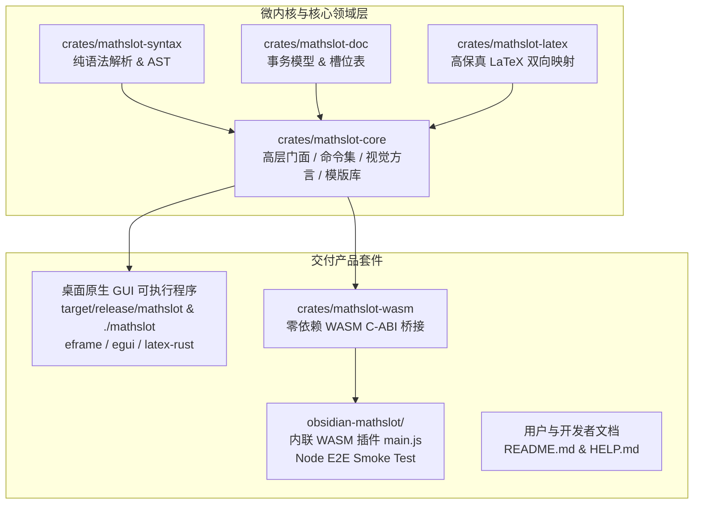

# MathSlot 重构决策记录 (Round 6: 全产品交付决策 - 桌面端二进制、Obsidian 插件与帮助手册)

**决策制定者**：Decision Maker Agent (架构与产品决策专家)  
**执行对象**：Implementer Agent (实现专家) / 调度器  
**日期**：2026-11-11  
**状态**：已批准 (Approved) & 立即生效  
**前序里程碑**：Round 1~5 已顺利完成核心语法层（`mathslot-syntax`）、文档事务层（`mathslot-doc`）、导入导出层（`mathslot-latex`）以及门面层（`mathslot-core`）的高保真重构与 47 项终局极限验收测试。

---

## 1. 决策背景与交付目标

随着核心微内核层重构的全面通过，用户提出了明确的全产品交付诉求：
> “没有帮助文档readme还有用户手册，和可执行文件和obsidian插件”

作为一款面向现代学者、算法工程师与重度数学公式输入者的下一代效率工具，MathSlot 必须以完整的全产品形态交付，既具备纯粹优雅的微内核架构，又提供开箱即用的双端生产力套件。

本轮（Round 6）的终极目标是：**实现 MathSlot 从“核心代码库”到“全套件生产力软件”的跨越交付**，涵盖：
1. **官方产品介绍 (`README.md`)**：全面阐明定位、流式哲学、微内核架构蓝图、双端编译与快速开始。
2. **详尽用户手册 (`HELP.md`)**：全面提供流式键盘简码规则、12 项单键直达、二级命令全表、2D 槽位空间穿梭、多级无前缀导航、LaTeX 双向转换、自定义格式与片段持久化规范及快捷键速查总表。
3. **桌面端原生可执行程序 (`Desktop Executable Binary`)**：
   - 接入 Workspace 根目录二进制 crate（基于 `eframe`/`egui` 0.37 与 `latex-rust` 3.0.1）；
   - 在 `crates/mathslot-core` 中补齐/适配命令集（`command`）、调色板视觉方言（`visual`）、库存储（`library`）与成熟的流式交互编辑运行时；
   - 编译生成 `target/release/mathslot` 并建立根目录可执行软链接 `./mathslot`。
4. **Obsidian 插件套件 (`Obsidian Plugin & WASM`)**：
   - 接入 `crates/mathslot-wasm`，编译 `wasm32-unknown-unknown`；
   - 接入 `obsidian-mathslot/`，包含 `manifest.json`, `package.json`, `styles.css`, `src/plugin.js`, `scripts/build.mjs`；
   - 跑通 `node obsidian-mathslot/scripts/build.mjs`，生成内联 WASM 的 `obsidian-mathslot/main.js` 并通过 Node.js 完整 8 项端到端 smoke test。

---

## 2. 整体工程架构与模块分工

### 模块职责界定
| 模块 / 路径 | 角色与类型 | 核心职责 |
| :--- | :--- | :--- |
| `crates/mathslot-syntax` | 纯语法库 | 手写递归下降解析器、AST、词法分析器、格式化输出 |
| `crates/mathslot-doc` | 文档事务库 | 槽位表提取、原子编辑操作、输入合并优化、Undo/Redo 事务 |
| `crates/mathslot-latex` | 转换与验证库 | LaTeX AST 映射、高保真无损导入导出、诊断报告生成 |
| `crates/mathslot-core` | 领域门面与兼容桥接 | 统一导出 Session 门面；承载 `command`, `visual`, `library`, `scheme_a`, `editor` 等核心交互运行时 |
| `src/` (root package) | 桌面端二进制 crate | 原生 GUI 交互界面、后台多线程 `latex-rust` 公式渲染、调色板卡片、模态弹窗 |
| `crates/mathslot-wasm` | WebAssembly C ABI | 针对 `wasm32-unknown-unknown` 编译，提供极低内存占用的双端通用二进制桥 |
| `obsidian-mathslot/` | 笔记软件插件套件 | 提供内嵌式公式编辑器、内联 Base64 WASM 二进制打包脚本与端到端 Node.js 回归套件 |
| `README.md` & `HELP.md` | 产品官方文档 | 完整的开发者指南、产品蓝图、用户手册与键位速查表 |

---

## 3. Implementer Agent 实施工单 (Tasks 1 ~ 4)

### Task 1: 交付官方文档套件 (`README.md` 与 `HELP.md`)
- **目标**：在 `/home/mat/Projects/mathslot-next` 根目录下编写专业、完整、高水准的 `README.md` 与 `HELP.md`。
- **实施要点**：
  1. `README.md`：
     - **产品介绍**：定义 MathSlot 为“超轻量流式简码公式编辑器（Stream-first Math Formula Editor）”，支持 Rust 原生桌面端与 Obsidian 插件同源双端；
     - **核心特性**：键盘流式直达（Tab/▸ 引导）、2D 直觉穿槽与多级无前缀导航、高保真 LaTeX 双向保真转译、微内核解耦架构；
     - **架构切片与 Workspace 概览**：清晰列出 `mathslot-syntax`, `mathslot-doc`, `mathslot-latex`, `mathslot-core`, `mathslot-wasm`, `src/`, `obsidian-mathslot/`；
     - **编译与安装运行**：
       - 原生桌面端：`cargo run --release` 或直接执行 `./mathslot`；
       - Obsidian 插件构建：`cd obsidian-mathslot && npm run build`；
       - 全套件测试：`cargo test --workspace`。
  2. `HELP.md`：
     - 参考并全面升级原有的 `HELP.md`，保持排版极度精美、结构严谨；
     - 涵盖：
       - 第 1 章：设计哲学与核心理念（流式输入、免记语法、焦点常驻、轻量渲染）；
       - 第 2 章：基础流式书写流程（Tab 结构引导、Enter 槽位推进、自然符号简写对照表）；
       - 第 3 章：12 项单键直达与全部二级命令速查表（微积分、矩阵定界、标注向量、常用算子、希腊字母、关系逻辑、自定义格式、片段模版）；
       - 第 4 章：前置智能主体包裹机制（Smart Prepend）；
       - 第 5 章：2D 空间穿槽与多级无前缀导航（Tab j / Esc 锚点跳转、行首行尾、跳转回退、括号跳转）；
       - 第 6 章：LaTeX 双向导入转换与格式容错；
       - 第 7 章：自定义格式与片段持久化库（JSON 结构与扩展机制）；
       - 第 8 章：完整快捷键一览表。

---

### Task 2: 完善 `mathslot-core` 运行时桥接并交付桌面端原生二进制
- **目标**：接入桌面端代码，完善 `mathslot-core` 所需的命令系统与视觉渲染方言，编译生成发布级桌面可执行文件。
- **实施要点**：
  1. **配置根目录 Cargo.toml**：
     - 将 Workspace 根节点配置为可执行 package `mathslot`（version 0.6.0, edition 2024）；
     - 依赖 `eframe 0.37`（启用 clipboard, default_fonts, glow, links, wayland, x11）, `latex-rust 3.0.1`, `mathslot-core`, `tiny-skia 0.11`；
     - 将 `crates/mathslot-wasm` 加入 workspace members。
  2. **在 `crates/mathslot-core` 中聚合与补全运行时**：
     - 引入并适配 `command.rs`, `visual.rs`, `library.rs`, `scheme_a.rs`, `editor.rs`, `ast.rs`, `parser.rs`；
     - 确保其与新重构的 `session.rs` 及外部引用的 `mathslot_syntax`, `mathslot_doc`, `mathslot_latex` 保持和谐共存与高效互操作；
     - 补充必要的 Cargo 依赖（如 serde, serde_json 等用于 library 持久化）。
  3. **接入桌面端源码 `src/`**：
     - 接入 `src/main.rs`, `src/app.rs`, `src/modals.rs`, `src/render.rs`, `src/theme.rs`, `src/devshot.rs`；
     - 调整引用路径，确保完全编译无 warning（或 minimal necessary warnings）；
     - 执行 `cargo build --release`；
     - 在根目录下建立软链接：`ln -s target/release/mathslot mathslot`；
     - 验证 `./mathslot` 文件的存在性与执行权限。

---

### Task 3: 接入 `crates/mathslot-wasm` 与 `obsidian-mathslot` 插件套件
- **目标**：建立零依赖 WebAssembly 跨平台编译管线，交付内联 WASM 的 Obsidian 生产级插件。
- **实施要点**：
  1. **接入 `crates/mathslot-wasm`**：
     - 建立 `crates/mathslot-wasm/Cargo.toml`（`crate-type = ["cdylib"]`，依赖 `mathslot-core`）；
     - 建立 `crates/mathslot-wasm/src/lib.rs`，导出 C ABI 接口（`wasm_alloc`, `wasm_dealloc`, `out_ptr`, `out_len`, `get_catalog_json`, `editor_reset`, `editor_sync_text`, `editor_enter`, `editor_toggle_esc`, `editor_esc_char`, `editor_arrow_up`, `editor_arrow_down`, `editor_jump_back`, `editor_undo`, `library_set_json` 等）；
  2. **接入 `obsidian-mathslot/`**：
     - 包含 `manifest.json`, `package.json`, `styles.css`, `src/plugin.js`, `scripts/build.mjs`；
     - 更新 manifest 与 package 中的版本号为 `0.6.0`；
  3. **编译构建与端到端 Smoke Test**：
     - 确保环境安装有 `wasm32-unknown-unknown` target；
     - 运行 `node obsidian-mathslot/scripts/build.mjs`；
     - 必须 100% 跑通构建脚本内的 8 大测试场景：
       1. 嵌套根号三阶段层级高亮与 MathJax 方言输出；
       2. 三槽位极限自动生成 `\to`；
       3. 多级分层导航 `c` `b` 与 `a` 行首；
       4. 前置插入极限自动包裹已有式子为主体；
       5. 2D 上下方向键穿槽与行尾 `[;]`、上一位置 `[-]`；
       6. 自定义格式与片段保存/展开；
       7. 导航 `h` 标签可达与括号自动配对/跳过/锚点；
       8. 内联跳转补齐分号后可撤销。
     - 确认生成的 `obsidian-mathslot/main.js` 体积符合预期（包含完整的内联 WASM Base64）。

---

### Task 4: 全套件联合极限验收与准出确认
- **目标**：对整个 Workspace 执行端到端联合验收，确保零回归、高品质交付。
- **实施要点**：
  1. 运行 `cargo test --workspace`，确保全工程（包括已有的 47 项极限测试与核心库测试、桌面端测试）全部通过；
  2. 验证根目录 `./mathslot` 软链接执行检查；
  3. 验证 `obsidian-mathslot/main.js` 生成无误并通过 Node.js 端到端回归；
  4. 检查 `README.md` 与 `HELP.md` 文档结构与代码高亮无错别字或损坏链接。

---

## 4. 交付准出标准 (Checklist)

| 检查项 | 验证条件 | 责任方 |
| :--- | :--- | :--- |
| **README.md** | 根目录下存在，包含产品定位、微内核架构切片、编译命令，排版清晰规范 | Implementer |
| **HELP.md** | 根目录下存在，包含详尽使用指南、12 项单键直达、二级命令表、2D 导航与快捷键对照表 | Implementer |
| **Desktop Binary** | `target/release/mathslot` 成功生成，根目录软链接 `./mathslot` 正常工作 | Implementer |
| **mathslot-wasm** | 成功为 target `wasm32-unknown-unknown` 编译无报错 | Implementer |
| **Obsidian Plugin** | `node obsidian-mathslot/scripts/build.mjs` 执行成功，8 项 smoke test 全部通过，生成内联 `main.js` | Implementer |
| **Workspace Tests** | `cargo test --workspace` 保持 100% 通过（零失败、零回归） | Implementer |

---

## 5. 结论与执行指令

本决策文档正式确立了 MathSlot Round 6 的产品全功能交付方案。  
请 Implementer Agent 严格遵照上述 Task 1 至 Task 4 的顺序与技术规范执行落地，并在完成每一阶段后反馈详细的执行结果与验证报告。
