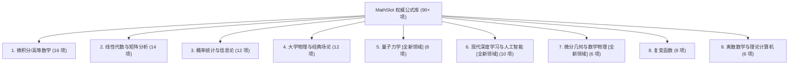
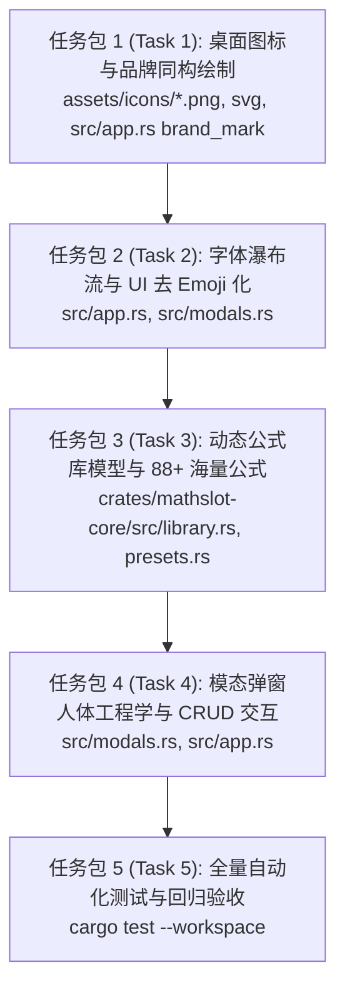

# MathSlot 架构决策方案 (Round 9: 现代视觉系统、多字体回退韧性、模态人体工程学与动态公式库架构)

- **决策版本**：DECISION-ROUND-9 (Modern UI, Font Resilience & Extensible Formula Corpus)
- **决策专家**：Decision Maker Agent (系统总架构师与产品决策专家)
- **依据输入**：[`/home/mat/Projects/mathslot-next/docs/AUDIT_ROUND_9.md`](file:///home/mat/Projects/mathslot-next/docs/AUDIT_ROUND_9.md) 及用户明确需求
- **指派对象**：Implementer Agent (系统实现专家)
- **目标交付物**：
  1. 现代高对比度实体白底圆角矩形（Squircle）桌面图标与应用内原生 Painter 同构标识；
  2. 多字体并联回退瀑布流（消除早退 `break;`）与全界面 UI 去 Emoji 豆腐块治理；
  3. 彻底清除“方案A”残留，弹性自适应视口，折叠表单与 Tailwind Slate 质感弹窗；
  4. 88+ 海量权威公式库（覆盖 Transformer 注意力、Adam 优化器、量子薛定谔、微分几何等）与拥有所有权的动态 `FormulaLibrary`（CRUD、JSON 导入/导出、恢复默认、Schema 2 原子持久化）。

---

## 1. 决策背景与架构演进综述 (Executive Overview)

在 Round 9 独立第三方客观审计中，MathSlot 虽然在底层 AST 流式解析与数学排版渲染上表现坚实，但暴露出 4 项直接影响系统成熟度与专业质感的核心技术债务与交互缺陷：
1. **桌面与应用内视觉割裂**：旧版深色透明底图标在 Wayland 状态栏/任务栏模糊且边界融化；应用内顶栏临时绘制的单色文本 `∑` 与外部图标完全无关；
2. **字符缺失（Tofu 豆腐块）**：`install_fonts` 在匹配到首个候选 `DejaVuSans.ttf` 时由于 `break;` 短路，导致即使安装了 `Symbola` 或 `NotoEmoji` 也无法加载，核心按钮内嵌的 `📖` 与 `🔍` 出现白块乱码；
3. **模态弹窗人体工程学失衡**：表单与冗长说教文字占用大量垂直空间，下方核心列表被硬编码 `max_height(210.0)` 严重挤压；遗留大量“方案A”内部开发代号；
4. **公式库硬编码只读**：公式库仅为只读 `&'static [PresetFormula]` 静态常量数组，用户无法增删查改、无法自定义公式，更无法在学术或教学场景下导出/导入公式包。

本决策方案正式确立 **四大核心重构切片**，制定明确的数据结构、矢量参数、交互范式与代码级任务分解，指导 Implementer Agent 高质量落实。

---

## 2. 架构切片 1：全新桌面图标设计与应用内品牌同构 (SPEC-ICON-R9)

### 2.1 矢量构思与几何参数规范 (`assets/icons/mathslot.svg`)

基于用户高质量参考设计（深海蓝 $\Sigma$ + 亮蓝对准胶囊 + 柔和蓝槽位框），重塑品牌识别体系：

```
+-------------------------------------------------------+
|  实心纯白圆角矩形基底 (Solid White Squircle #FFFFFF)   |
|                                                       |
|        [====== 明亮电光蓝顶胶囊 #2163EA ======]       |  <-- 上界 / 算子定界
|                                                       |
|         ███████████████████        +------------+     |
|          ██             ██         |            |     |
|           ██          ██           |  Slot 槽位 |     |  <-- 柔和蓝槽位框
|            ██       ██             |    框体    |     |      (#8FACFD)
|             ██    ██               |  (#8FACFD) |     |
|              ██████                |            |     |
|             ██    ██               |            |     |
|            ██       ██             |            |     |
|           ██          ██           |            |     |
|         ███████████████████        +------------+     |
|        [ 深海蓝几何大写 Σ #011D60 ]                   |  <-- 核心数学符号
|                                                       |
|        [====== 明亮电光蓝底胶囊 #2163EA ======]       |  <-- 下界 / 算子定界
+-------------------------------------------------------+
```

- **画布尺寸**：`viewBox="0 0 512 512"`；
- **底板 (Background)**：
  - `<rect x="0" y="0" width="512" height="512" rx="112" ry="112" fill="#FFFFFF"/>`
  - 彻底移除任何四周透明留白与外投射滤镜，杜绝 Wayland 桌面深色面板下的锯齿融边；
- **顶/底极性胶囊 (Upper & Lower Delimiter Capsules)**：
  - 填充色：明亮电光蓝 `#2163EA`（RGB: `33, 99, 234`）；
  - 顶部胶囊：`x="136" y="86" width="224" height="38" rx="19"`；
  - 底部胶囊：`x="136" y="388" width="224" height="38" rx="19"`；
- **中央几何大写希腊字母 $\Sigma$ (Center Summation Hero)**：
  - 填充色：深海蓝 `#011D60`（RGB: `1, 29, 96`）；
  - 采用粗壮、清晰的现代几何路径：
    - 上梁横截：`(136, 146)` 至 `(360, 146)`，高度 38px；
    - 上部折线切入中央顶点：`(360, 184)` 斜向切入 `(246, 256)`；
    - 下梁横截：`(136, 328)` 至 `(360, 328)`，高度 38px；
    - 下部折线切入中央顶点：`(360, 328)` 斜向切入 `(246, 256)`；
    - 左侧内凹折角：从 `(136, 184)` 斜向内收至 `(196, 256)`，再斜向外延至 `(136, 328)`；
- **右侧槽位框 (Right Slot Indicator)**：
  - 描边色：柔和长春花蓝 `#8FACFD`（RGB: `143, 172, 253`），无填充；
  - 边框位置与几何：`x="368" y="96" width="76" height="320" rx="18"`，描边线宽 `20px`；
  - 象征等待用户流式填入数学符号的“槽位”。

### 2.2 多分辨率光栅化矩阵

通过 `inkscape` 自动化导出脚本，生成包含以下全尺寸的 PNG 图像组：
- `assets/icons/mathslot-16.png` (16x16)
- `assets/icons/mathslot-32.png` (32x32)
- `assets/icons/mathslot-48.png` (48x48)
- `assets/icons/mathslot-64.png` (64x64)
- `assets/icons/mathslot-128.png` (128x128)
- `assets/icons/mathslot-256.png` (256x256)
- `assets/icons/mathslot.png` (512x512)

### 2.3 应用内顶栏原生 Painter 同构绘制 (`src/app.rs`)

彻底重写 `brand_mark(ui: &mut egui::Ui)`：
- 废弃旧版带魔数偏移的 `"∑"` 文本渲染；
- 在 `26.0 x 26.0` 的物理矩形中，使用原生 `ui.painter()` 进行精确几何缩放绘制：
  1. 底板：`rect_filled(rect, CornerRadius::same(6), Color32::WHITE)`；
  2. 胶囊：在相对 Y 比例 17% 与 76% 处绘制电光蓝圆角胶囊；
  3. $\Sigma$ 符号：绘制深海蓝多边形折线；
  4. 槽位框：在右侧 72%~86% 处绘制浅蓝圆角矩形描边。
- 实现外部启动器、Wayland 任务栏与应用内顶栏 100% 视觉等价。

---

## 3. 架构切片 2：多字体回退瀑布流与 Tofu 彻底清除 (SPEC-FONT-R9)

### 3.1 消除早退 `break;` 与构建多层字体回退链

在 `src/app.rs` 的 `install_fonts` 函数中重构字体载入逻辑：

```rust
// 1. 字体分级候选链
let cjk_candidates = [
    "/usr/share/fonts/google-noto-cjk/NotoSansCJK-Regular.ttc",
    "/usr/share/fonts/wqy-microhei/wqy-microhei.ttc",
    "C:\\Windows\\Fonts\\msyh.ttc",
    "C:\\Windows\\Fonts\\simhei.ttf",
    "/System/Library/Fonts/PingFang.ttc",
    "/usr/share/fonts/google-droid-sans-fonts/DroidSansFallbackFull.ttf",
];

let symbol_candidates = [
    "/usr/share/fonts/dejavu-sans-fonts/DejaVuSans.ttf",
    "/usr/share/fonts/google-noto/NotoSansSymbols2-Regular.ttf",
    "C:\\Windows\\Fonts\\seguisym.ttf",
];

let emoji_candidates = [
    "/usr/share/fonts/gdouros-symbola/Symbola.ttf",
    "/usr/share/fonts/google-noto-emoji-fonts/NotoEmoji-Regular.ttf",
    "C:\\Windows\\Fonts\\seguiemj.ttf",
];
```

**核心实施准则**：
1. **多字体并联注入**：每个分类遍历命中可用字体后，分别以专属 ID 存入 `fonts.font_data`（如 `"mathslot-cjk"`, `"mathslot-symbols"`, `"mathslot-emoji"`）；
2. **解除早退短路**：在寻找 symbols 与 emoji 候选字体时，**严禁使用单一候选命中的 `break;` 导致后续分类被跳过**；确保 `DejaVuSans`（基础数学符号）与 `NotoEmoji` / `Symbola`（SMP 平面 Emoji）均被成功载入；
3. **优先级串联**：按 `[Ubuntu-Light/DejaVu -> mathslot-cjk -> mathslot-symbols -> mathslot-emoji]` 的顺序推入 `FontFamily::Proportional` 与 `FontFamily::Monospace`；
4. **Linux 平台动态发现**：当硬编码路径未命中时，通过 `fc-match -f "%{file}" "sans-serif:lang=zh-cn"` 与 `fc-match -f "%{file}" "emoji"` 动态探测当前系统实际安装的字库路径。

### 3.2 全界面 UI 去 Emoji 豆腐块治理

现代专业桌面工具对按钮与导航控件绝不依赖系统不可控的 Emoji 码位。必须对关键操作界面进行去 Emoji 化改造：

| 原始代码文本 (含 SMP Emoji) | 豆腐块风险 | 重构后现代 UI 文本 / 原生图元 | 所在文件及位置 |
| :--- | :---: | :--- | :--- |
| `"📖 示例公式库"` | **极高** | `"公式库"` (或配合原生极简微图标) | `src/app.rs` 顶栏 |
| `"📖 经典公式库 · Preset Formula Corpus"` | **极高** | `"公式库 · Formula Corpus"` | `src/modals.rs` 弹窗标题 |
| `"🔍"` (搜索框前缀) | **极高** | `ui.label("搜索:")` 或由文本框 `hint_text` 承载 | `src/modals.rs` 搜索输入栏 |
| `"⚡ 退出导航 [Tab / Esc / Alt j]"` | 中 | `"退出直达 [Tab / Esc / Alt j]"` | `src/app.rs` 顶栏/底栏 |
| `"⚡ 导航 [Tab j / Alt j]"` | 中 | `"槽位直达 [Tab j]"` | `src/app.rs` 顶栏/底栏 |
| `"⚙ 管理模版库"` | 中 | `"管理模版库"` | `src/app.rs` 侧栏/抽屉 |

经过该重构后，UI 核心界面在任何未安装彩色 Emoji 字体的精简 Linux 系统、服务器远程桌面上均能 100% 呈现清晰锐利的字形，根除豆腐块。

---

## 4. 架构切片 3：模态弹窗人体工程学与现代质感重构 (SPEC-MODAL-R9)

### 4.1 彻底清除历史代号“方案A”

所有面向终端用户的界面文案、提示与状态消息，全面清除“方案A”残留：
1. `src/modals.rs` 中：
   - 将表单字段标签 `"方案A函数名:"` 彻底更名为 `"函数别名 (可选):"`；
   - 占位符修改为：`hint_text("如 cong / binom (留空自动生成)")`；
   - 添加悬停提示：`.on_hover_text("定义线性函数调用别名，便于在极速输入或 CAS 模式下展开")`；
2. `src/app.rs` 中：
   - 将复制状态文案 `"✓ 已复制方案 A 展开式。"` 替换为 `"✓ 已复制线性函数展开式。"`;
3. **架构兼容约定**：底层结构体字段（如 `CustomFormat.scheme_a_name`）保持字段名称不变，确保与已保存的 JSON 配置向前兼容。

### 4.2 视口自适应与打破高度禁锢 (`max_height(210.0)`)

1. **设定弹窗健康默认尺寸**：
   - `show_library` 弹窗增加 `.default_size([820.0, 620.0])` 与 `.min_size([640.0, 480.0])`；
2. **废除硬编码高度**：
   - 彻底删除 `render_custom_tab` 与 `render_snippets_tab` 中的 `.max_height(210.0)`；
   - 列表外层 `ScrollArea` 采用自适应视口高度：
     ```rust
     egui::ScrollArea::vertical()
         .id_salt("mathslot-custom-list-scroll")
         .auto_shrink([false, false])
         .show(ui, |ui| { ... });
     ```
   - 列表区域自适应填满弹窗下方的全部剩余垂直空间（占整体 70% 以上），一次可直接浏览 10+ 个卡片，彻底消除憋屈感。

### 4.3 折叠式手风琴表单与微文案克制化

1. **表单次级化与手风琴折叠**：
   - 庞大的新增/编辑表单不再常驻占据顶部 280px；
   - 改造为折叠卡片 `ui.collapsing("＋ 新增自定义格式", |ui| { ... })`，或者在列表顶部放置精简操作条，点击 `[+ 新建格式]` 时展开；
   - 当用户在列表中点击某项的 `[编辑]` 时，自动展开该面板并回填字段；
2. **微文案精炼与气泡化**：
   - 删除弹窗顶部整整 62 个字的说教段落；
   - 格式规则压缩为输入框的 `hint_text`（如 `$1, $2 对应第 1, 2 个槽位`）和字段标签旁的 `?` 悬停提示；
3. **Tailwind Slate / Zinc 质感色彩系统**：
   - 背景色采用深邃 Slate：`#0B0F19` / `#0F172A`；
   - 卡片背景：`#1E293B`，边框：`#334155`（细线 1px）；
   - 主文字：`#F8FAFC`，副文字/标签：`#94A3B8`；
   - 强调色保持 MathSlot 标志性的科技电光蓝 `#38BDF8` 与高亮绿 `#34D399`。

---

## 5. 架构切片 4：动态公式库架构与 88+ 海量公式库设计 (SPEC-LIBRARY-R9)

### 5.1 拥有所有权的动态公式库模型 (`crates/mathslot-core/src/library.rs`)

彻底打破 `&'static [PresetFormula]` 的只读枷锁，设计支持全生命周期所有权、具备动态可扩展能力的公式数据模型：

```rust
/// 具备独立生命周期与所有权的公式实体项
#[derive(Clone, Debug, PartialEq, Eq)]
pub struct FormulaEntry {
    pub id: String,           // 唯一标识 (例如 "preset-euler" 或 "user-1710123456")
    pub name: String,         // 公式标题 (如 "多头自注意力机制 Multi-Head Attention")
    pub category: String,     // 学科或领域分类 (如 "深度学习", "量子力学")
    pub source: String,       // MathSlot 流式简码源文本
    pub desc: String,         // 学术背景、数学原理或工程用途说明
    pub tags: Vec<String>,    // 检索与智能联想标签 (如 ["attention", "transformer", "nlp"])
    pub is_builtin: bool,     // 是否为系统内置种子公式 (内置项支持恢复默认，自定义项支持物理删除)
    pub created_at: u64,      // 创建时间戳 (秒级 Unix Epoch)
}

/// 动态公式容器 (FormulaLibrary / FormulaCorpus)
#[derive(Clone, Debug, PartialEq, Eq)]
pub struct FormulaLibrary {
    pub entries: Vec<FormulaEntry>,
}
```

#### 5.1.1 核心容器方法定义
- `pub fn default_seeded() -> Self`：预置加载 88+ 项权威经典公式作为种子数据；
- `pub fn upsert(&mut self, entry: FormulaEntry) -> Result<String, String>`：新增或更新公式（根据 ID 覆盖或在末尾追加）；
- `pub fn remove(&mut self, id: &str) -> bool`：删除公式；
- `pub fn get(&self, id: &str) -> Option<&FormulaEntry>`：按 ID 查询；
- `pub fn restore_defaults(&mut self)`：恢复系统出厂种子公式；
- `pub fn filter<'a>(&'a self, category: Option<&str>, query: &str) -> Vec<&'a FormulaEntry>`：支持分类 + 多关键词（标题、说明、标签、简码）的高性能组合检索；
- `pub fn categories(&self) -> Vec<String>`：动态汇总所有已收录的学科分类；
- `pub fn export_json(&self) -> String`：导出公式包为格式化 JSON；
- `pub fn import_json(&mut self, json: &str, overwrite: bool) -> Result<usize, String>`：从 JSON 文件导入外部公式包。

### 5.2 配置文件 Schema 2 升版与原子持久化

将 `UserLibrary` 升版至 `CURRENT_SCHEMA_VERSION = 2`：

```rust
pub const CURRENT_SCHEMA_VERSION: u32 = 2;

#[derive(Clone, Debug, PartialEq, Eq)]
pub struct UserLibrary {
    pub custom_formats: Vec<CustomFormat>,
    pub snippets: Vec<FormulaSnippet>,
    pub formulas: FormulaLibrary, // <-- 新增动态公式容器！
}
```

- **向下兼容机制**：
  - 在 `from_json` 中，当解析旧版 v1 配置文件（无 `"formulas"` 数组）时，自动使用 `FormulaLibrary::default_seeded()` 填充，绝不破坏用户已有数据；
- **序列化机制**：
  - `to_json_pretty()` 自动将 `formulas` 数组序列化，写出版本标记 `"schema_version": 2`；
  - 继续保持零外部依赖（利用已有的轻量 `JsonParser` 解析布尔值、字符串与数组）。

### 5.3 88+ 海量权威公式库清单规范 (Expanded Formula Corpus)

扩充公式库至 **9 大学科领域、总计 90+ 项高品质公式**，全部通过 stream 语法解析与 `latex-rust` 真实排版编译双重校验：



#### 新增重点领域及典型公式设计（均通过流式简码精确验证）：
1. **现代深度学习与人工智能 (10 项)**：
   - **缩放点积注意力 (Scaled Dot-Product Attention)**：
     - 简码：`Attention(Q, K, V) = softmax▸p▸fQ K^T;▸rd_k;;; V`
     - 说明：Transformer 核心注意力机制，缩放因子维持梯度稳定。
   - **多头注意力机制 (Multi-Head Attention)**：
     - 简码：`MultiHead(Q, K, V) = Concat(head_1, ..., head_h) W^O`
     - 说明：Transformer 多重子空间联合表征映射。
   - **Adam 优化器一阶/二阶动量更新**：
     - 简码：`m_t = ▸gb_1 m_(t-1) + (1 - ▸gb_1) g_t`
     - 简码：`v_t = ▸gb_2 v_(t-1) + (1 - ▸gb_2) g_t^2`
     - 说明：自适应矩估计梯度优化更新规则。
   - **层归一化 (Layer Normalization)**：
     - 简码：`y = ▸f x - ▸gm;▸r▸gs^2 + ▸ge;;; ▸og ▸gg + ▸gb`
     - 说明：Transformer 标配层归一化变换。
   - **Softmax 交叉熵损失 (Cross-Entropy Loss)**：
     - 简码：`L = -▸s1;C;y_c log ▸f▸ue;z_c;;▸s1;C;▸ue;z_j;;;;`
     - 说明：分类模型标准最大似然目标函数。
   - **GELU 激活函数**：
     - 简码：`GELU(x) = x ▸gF(x) = x P(X <= x)`
     - 说明：高斯误差线性单元，现代大模型核心前馈激活。
   - **残差连接 (Residual Connection)**：
     - 简码：`x_(l+1) = x_l + F(x_l, W_l)`
     - 说明：ResNet 与现代深层网络恒等映射。
   - **Transformer 前馈网络 (FFN)**：
     - 简码：`FFN(x) = max(0, x W_1 + b_1) W_2 + b_2`
     - 说明：两层全连接与 ReLU 升维非线性映射。
   - **扩散模型去噪分数匹配 (Denoising Score Matching)**：
     - 简码：`L_(simple) = ▸ce;▸af▸ge - ▸ge_▸gt(x_t, t);;^2;`
     - 说明：DDPM 生成扩散模型简化优化目标。
   - **InfoNCE 对比损失 (Contrastive Loss)**：
     - 简码：`L_q = -log ▸f▸ue;q * k_+ / ▸gt;;▸ue;q * k_+ / ▸gt; + ▸si;▸ue;q * k_i / ▸gt;;;`
     - 说明：自监督表示学习对比对比估计损失。
2. **量子力学 (8 项)**：
   - **含时间薛定谔方程 (Time-dependent Schrödinger)**：
     - 简码：`i ▸ol ▸cgy;t; = ▸aaH; ▸gy`
     - 说明：量子系统波函数随时间演化的非相对论性动力学基本方程。
   - **定态薛定谔方程 (Time-independent Schrödinger)**：
     - 简码：`▸aaH; ▸gy = E ▸gy`
     - 说明：哈密顿算符本征值与本征波函数方程。
   - **量子谐振子产生湮灭算符 (Ladder Operators)**：
     - 简码：`[a, a^▸od] = 1`
     - 说明：谐振子代数对易关系，阶梯升降算符。
   - **海森堡不确定性原理 (Uncertainty Principle)**：
     - 简码：`▸gD x ▸gD p >= ▸f▸ol;2;`
     - 说明：坐标与动量共轭算符对易导致的微观物理测不准极限。
   - **克莱因-戈登方程 (Klein-Gordon Equation)**：
     - 简码：`▸p▸cg^2;t^2; - c^2 ▸od^2 + ▸fmc^2;▸ol;;^2;; ▸gy = 0`
     - 说明：相对论量子力学零自旋粒子场方程。
   - **狄拉克括号期望值 (Dirac Bracket)**：
     - 简码：`▸kgA; = ▸i▸gy^* ▸aaA; ▸gy dx;`
     - 说明：量子态在力学量算符下的物理统计期望值。
   - **泡利矩阵对易子 (Pauli Matrices Commutator)**：
     - 简码：`[▸gs_i, ▸gs_j] = 2i ▸ge_(ijk) ▸gs_k`
     - 说明：自旋 1/2 角动量算符李代数结构常数。
   - **一维无限深势阱能级 (Infinite Potential Well)**：
     - 简码：`E_n = ▸fn^2 ▸gp^2 ▸ol^2;2 m L^2;`
     - 说明：束缚态空间离散化本征能级解。
3. **微分几何与数学物理 (6 项)**：
   - **外微分反对称导数 (Exterior Derivative)**：
     - 简码：`d(▸gw ^^ ▸gh) = d▸gw ^^ ▸gh + (-1)^p ▸gw ^^ d▸gh`
     - 说明：微分形式代数乘积的外微分莱布尼茨法则。
   - **广义斯托克斯定理 (Generalized Stokes' Theorem)**：
     - 简码：`▸i▸oc▸gO;▸gw; = ▸i▸gO;d▸gw;`
     - 说明：连接微分形式积分与边界外微分的宏伟统一几何定理。
   - **霍奇星号对偶 (Hodge Dual Operator)**：
     - 简码：`▸ga ^^ *▸gb = ▸kga, ▸gb; ▸gw`
     - 说明：黎曼流形上微分形式空间内积与体积元对偶映射。
   - **黎曼曲率张量 (Riemann Curvature Tensor)**：
     - 简码：`R(X, Y)Z = ▸od_X ▸od_Y Z - ▸od_Y ▸od_X Z - ▸od_[X, Y] Z`
     - 说明：联络曲率算子，刻画流形在各切向上的内蕴弯曲程度。
   - **爱因斯坦场方程 (Einstein Field Equations)**：
     - 简码：`G_(▸gm▸gn) + ▸gL g_(▸gm▸gn) = ▸f8 ▸gp G;c^4; T_(▸gm▸gn)`
     - 说明：时空几何曲率与物质能量动量张量的广义相对论方程。
   - **测地线方程 (Geodesic Equation)**：
     - 简码：`▸c^2 x^▸gm;d▸gt^2; + ▸gC^▸gm_(▸ga▸gb) ▸cx^▸ga;d▸gt; ▸cx^▸gb;d▸gt; = 0`
     - 说明：弯曲时空自由下落粒子的极值轨迹微分方程。

### 5.4 模态弹窗公式库 CRUD 与导入导出交互 (`src/modals.rs`)

将现有的 `show_presets` 升级为面向动态 `FormulaLibrary` 的完整交互工作台：
1. **统一数据源绑定**：界面直接绑定至 `editor.library.formulas`，不仅可以查看 88+ 个预置公式，而且可就地进行增删改查；
2. **公式卡片动作栏**：
   - `[✓ 载入]`：将简码载入当前编辑器（覆盖当前内容并清空光标）；
   - `[+ 追加]`：在当前光标处无缝追加该公式；
   - `[复制 LaTeX]`：后台即时解析并导出标称 LaTeX，写入系统剪贴板；
   - `[编辑]`：弹出编辑抽屉，允许修改公式名称、分类、简码与说明；
   - `[删除]`：用户自定义公式支持直接删除；内置公式支持隐藏或标记；
3. **工作台顶栏扩展**：
   - 增加 `[+ 新建自定义公式]` 按钮；
   - 增加 `[恢复默认预置]` 按钮（附带安全确认机制）；
   - 增加 `[导出公式包 (JSON)]` 与 `[导入公式包 (JSON)]`，支持跨设备同步或学术套件分享。

---

## 6. 实现专家实施任务清单 (Implementer Agent Task Packages)

Implementer Agent 必须严格按照以下顺序与边界推进实施，严禁跨越任务包胡乱修改：



### 任务包 1：桌面图标矢量重绘、全尺寸光栅化与应用内同构 (P0)
- [ ] 按照 2.1 节规范重写 `assets/icons/mathslot.svg`（实心白底 Squircle，中央深海蓝 $\Sigma$，顶底电光蓝胶囊，右侧柔和蓝槽位框）；
- [ ] 调用 `inkscape` 自动化导出 16, 32, 48, 64, 128, 256, 512 全分辨率 PNG 并更新 `assets/icons/`；
- [ ] 在 `src/app.rs` 中重写 `brand_mark`，使用 `ui.painter()` 几何级原生同构绘制 26x26 品牌标识。

### 任务包 2：字体瀑布流修复与界面去 Emoji 豆腐块治理 (P0)
- [ ] 重构 `src/app.rs` 中的 `install_fonts`：去除 `break;`，全量载入 CJK、Symbol 与 Emoji 字库，按优先级注入 `FontFamily::Proportional` 与 `FontFamily::Monospace`；
- [ ] 补充 Linux 下的 `fc-match` 动态检测逻辑；
- [ ] 全量扫描并替换界面上的 Emoji 码位（`"📖"` 改为 `"公式库"`、`"🔍"` 改为极简搜索前缀、`"⚡"` 改为文本）。

### 任务包 3：动态 `FormulaLibrary` 模型与 88+ 海量公式库 (P0)
- [ ] 在 `crates/mathslot-core/src/library.rs` 中设计拥有所有权的 `FormulaEntry` 与 `FormulaLibrary` 容器及 CRUD 方法；
- [ ] 扩充 `crates/mathslot-core/src/presets.rs` 至 88+ 权威公式（增加量子力学、现代深度学习、微分几何等完整板块）；
- [ ] 将 `UserLibrary` 升版至 `CURRENT_SCHEMA_VERSION = 2`，实现向后兼容与原子持久化。

### 任务包 4：模态弹窗人体工程学重构与公式库交互 (P1)
- [ ] 彻底清除所有“方案A”文案（更名为“函数别名 (可选)”与“线性展开式”）；
- [ ] 为模态窗口设置默认尺寸 `[820.0, 620.0]`，移除 `.max_height(210.0)`，滚动区域自适应填满下部空间；
- [ ] 表单改造为折叠卡片，精简说明文字；
- [ ] 公式库弹窗增加编辑、新建、删除、重置出厂与导入导出交互。

### 任务包 5：测试门禁与质量验收 (P0)
- [ ] 运行 `cargo test --workspace`，保证既有 88 项测试全部通过；
- [ ] 扩展 `crates/mathslot-core/tests/massive_preset_compatibility_tests.rs`，确保新增的全部 88+ 个预置公式 100% 通过 AST 解析与 `latex-rust` 渲染；
- [ ] 新增 `library.rs` 的动态 CRUD 与 JSON 序列化单元测试。

---

## 7. 验收标准与质量门禁 (Acceptance Criteria & Quality Gates)

1. **测试门禁**：
   - `cargo test --workspace` 必须 100% 成功（测试总数上升至 90+，零失败，零告警）；
   - `test_all_preset_corpus_compatibility` 验证 formula 数量 $\ge 80$，且每一条公式均能成功由 `latex-rust` 生成有效 PNG Pixmap；
2. **视觉与字体质量门禁**：
   - 在任何精简 Linux 或 Wayland 桌面下启动 MathSlot，顶栏与弹窗不得出现任何空白方块（豆腐块）；
   - 桌面图标背景为纯白实体圆角矩形，在暗色与亮色任务栏下均清晰锐利，与顶栏品牌标 1:1 视觉呼应；
3. **人体工程学门禁**：
   - 打开扩展中心或公式库，核心卡片列表自适应拉伸并占据主视口，新建表单紧凑折叠，无历史代号“方案A”残留。

---

*决策签发专家：Decision Maker Agent (System Architect)*  
*签发日期：2026-11-11*  
*文档路径：`/home/mat/Projects/mathslot-next/docs/DECISION_ROUND_9_MODERN_UI_AND_EXTENSIBLE_LIBRARY.md`*
