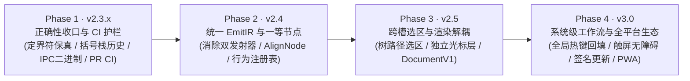

# MathSlot 产品与架构演进路线图（v2.3.x → v3.0）

本路线图基于 [AUDIT.md](AUDIT.md) 的全量源码实证结论制定，采用**「渐进式内核收敛 + 持续可交付」**策略，在不破坏既有快捷键肌肉记忆与双端轻量架构的前提下，分四个阶段系统性清偿全部 13 项技术债并兑现下一代数学公式工作台体验。

---

## 1. 产品愿景、核心信条与非目标边界

### 1.1 核心架构信条（Design Tenets）

1. **槽位树确定性优先（Deterministic Slot Tree）**：任何光标移动、跳转、包裹与撤销都必须具有唯一、可预测的结构语义，绝不退化为不可控的富文本黑盒。
2. **零毫秒键盘流（Zero-Latency Keyboard Flow）**：高频输入路径保持纯同步内存计算，单键响应预算严格控制在 `< 4ms`（大公式移动光标目标 `< 1ms`）。
3. **预览与导出单一事实源（Single Source of Truth）**：画布所见的排版间距、多行对齐与括号伸缩必须与导出的标准 LaTeX 保持 100% 语义同构。
4. **零 WASM 双端同源（Zero-WASM Shared Core & UI）**：`@mathslot/core` 与 `@mathslot/ui` 保持纯 TypeScript + Svelte 5 实现，确保 Tauri 桌面端、Obsidian 插件（含移动端）与未来 Web/PWA 端共享同一套代码底座。

### 1.2 明确非目标（Non-Goals）

- **不做图灵完备的 TeX 宏展开引擎**：不支持 `\def` / `\newcommand` 递归展开、`\catcode` 修改或 TikZ 绘图脚本编译；未知复杂宏以安全诊断 + 无损 `RawNode` 兜底。
- **不做重型长文档排版器**：MathSlot 专注于**单公式与多行推导工作台**，长文档组织交由 Obsidian、Typst/LaTeX 编辑器、Word 或 Markdown 宿主承担。
- **不引入云端强绑定账号体系**：配置、预置公式库、自定义命令与历史记录始终以本地开放 JSON 文件为一等公民，天然兼容 Git 与各类网盘同步。

---

## 2. 四阶段演进全景图



---

## 3. Phase 1 · `v2.3.x`：正确性收口、定界符保真与 CI 护栏（短期高优）

> **阶段目标**：在不改动公开数据结构兼容性的前提下，快速修复所有可感知的数据改写、状态失步、导出盲区与自动化门禁缺口。

### 3.1 Obsidian 原位编辑定界符保真与局部窗口扫描（解决 `P1-1`）
- **改造方案**：
  1. 在 `@mathslot/core` 中将原位提取的包装方言显式建模为 `MathWrapperKind = 'dollar_inline' | 'paren_inline' | 'dollar_block' | 'bracket_block' | 'codeblock' | 'none'`，使 `obsidianMath.ts` 在识别 `\(...\)` 与 `\[...\]` 时完整保留方言类型。
  2. `MathSlotModal.ts` 写回文档时默认沿用原公式自身的 `MathWrapperKind`（除非用户在顶栏主动切换了定界符模式），确保编辑 `\(x^2\)` 保存后仍为 `\(x^2\)`。
  3. 优化 `apps/obsidian/src/main.ts` 的上下文读取：优先通过 Obsidian Editor / CodeMirror 6 语法节点判断是否处于代码块内，将文本扫描严格收敛在 `[Math.max(0, cursor.line - 400), Math.min(lineCount, cursor.line + 401)]` 常数窗口内。

### 3.2 原生 LaTeX 括号闭合栈历史同步与外部库单权威源（解决 `P2-1`、`P2-5` 局部）
- **改造方案**：
  1. 将 `editor.ts` 中的 `latexArgCloseBySlot` 与 `expectLatexOpenBraceSlotId` 纳入 `HistoryEntry` 快照克隆范围，并在鼠标点击、`Esc` 跳转或方向键离开目标槽位祖先链时自动修剪失效条目。
  2. 收口外部 `presets.json` / `commands.json` 权威源语义：当宿主支持外部文件读写（`host.capabilities.externalLibraryFiles === true`）且外部 JSON 文件已存在时，启动静默加载直接以磁盘外部文件为准（仅在外部文件首次初始化不存在时由 `store.json` 迁移种子数据），彻底根除“外部删减条目重启后复活”问题。

### 3.3 解析器微调、导出几何补齐、二进制 IPC 与弹窗无障碍收口（解决 `P2-3` 局部、`P2-6`、`P2-7` 局部）
- **改造方案**：
  1. **解析增强**：`parser.ts` 支持 `\mathrm{d}{x}` 花括号微分变量识别为 `diff` 结构；将固定 2 槽的 `substack_2` 升级为支持任意 `R × 1` 动态行的 `substack` 网格（兼容旧 `substack_2` ID）。
  2. **导出与 IPC 优化**：`exportUtils.ts` 的 `extractVectorScene()` 解析 `getComputedStyle(el).transform` 仿射矩阵并应用于 Canvas2D `setTransform` 与 SVG `transform="matrix(...)"`，同时在模块级缓存已提取的 KaTeX 字体 CSS；`desktopHost.ts` 与 Rust `lib.rs` 改用 Tauri v2 原生二进制负载（`Uint8Array` / `tauri::ipc::Request`），消除 `Array.from(rgba)` 带来的 4×～5× 内存与序列化开销。
  3. **焦点陷阱全覆盖**：为 `SaveSnippetModal`、`CustomStructureModal`、`PresetEditorModal`、`CommandEditorModal` 补齐 `use:focusTrap`。

### 3.4 常态化 GitHub Actions CI 与 UI 自动化冒烟基建（解决 `P3-1` 局部）
- **改造方案**：
  1. 新增 `.github/workflows/ci.yml`，在每次 `push`（`main`）与 `pull_request` 上并行执行：`npm run test`、`packages/ui` + `apps/desktop` `svelte-check`、`apps/obsidian` `tsc --noEmit` 以及 `cargo clippy / cargo test --manifest-path apps/desktop/src-tauri/Cargo.toml`。
  2. 为 `packages/ui/package.json` 补齐独立的 `check` 与 `test:ui` 脚本，基于 Playwright 建立首批核心交互 E2E 用例（键盘输入分式/积分、二级菜单变形、弹窗焦点陷阱、SVG/PNG 导出非空校验）。

**Phase 1 验收门禁**：
- Obsidian `\(...\)` / `\[...\]` 往返保真单测 100% 通过；10,000 行模拟笔记尾部扫描调用次数 `≤ 802` 行。
- 9 个模态弹窗 100% 挂载并通过键盘 `Tab` / `Shift+Tab` 循环焦点测试；PR CI 全绿运行。

---

## 4. Phase 2 · `v2.4`：统一排版中间表示（`EmitIR`）与一等对齐节点（中期内核演进）

> **阶段目标**：消除 `@mathslot/core` 内部最大的两处架构分裂（双套发射器与多行对齐割裂），建立可扩展、零特判的现代公式内核。

### 4.1 单一排版中间表示 `EmitIR`（根治 `P1-2`）

将当前 `latex.ts` 中各自为政的 `tokenizeSlotForCanonical` 与 `analyzeInteractiveHints + emitSlotInteractive` 合并为统一的三段式管线：**`SlotNode AST` → `buildEmitIR()` → `{ projectCanonicalLatex(), projectInteractiveLatex() }`**。

```typescript
export type MathAtomClass = 'ord' | 'op' | 'bin' | 'rel' | 'open' | 'close' | 'punct' | 'diff' | 'inner';

export interface EmitTokenIR {
  readonly kind: 'glyph' | 'macro' | 'word' | 'struct' | 'placeholder' | 'macro_draft';
  readonly atomClass: MathAtomClass;
  readonly latex: string;
  /** 关联回原槽位与子节点区间，供交互投影器包裹 \htmlData，纯导出投影器直接忽略 */
  readonly sourceSpan?: { slotId: string; startOffset: number; endOffset: number };
  /** 由统一间距规则前置计算出的左间距（如 '\,' 或 ' '） */
  readonly leadingSpace: '' | ' ' | '\\,';
}
```

- **收益**：函数名直立化（`\sin x`）、积分微元窄空格（`\,\mathrm{d}x`）、原生宏输入态（`\alp`）与二元算子间距全局只计算一次，从架构上消灭“画布与导出不一致”缺陷，预计削减 `latex.ts` 约 35% 重复状态机代码。

### 4.2 一等 `AlignNode` 多行多列对齐与公式编号槽位（根治 `P1-3`）

不再用根槽位中夹杂 `RawNode('\\\\')` 加启发式关系符切分模拟多行公式，而是在 AST 中引入正式的多行对齐结构：

```typescript
export interface AlignRow {
  readonly id: string;
  /** 每个对齐单元均为标准可编辑 SlotNode（例如 [lhsSlot, rhsSlot] 对应 lhs &= rhs） */
  readonly cells: SlotNode[];
  /** 可选行尾编号槽位（对应 \tag{...} 或 \tag*{...}） */
  readonly tagSlot?: SlotNode;
  readonly starTag?: boolean;
  readonly rowGap?: string;
}

export interface AlignNode {
  readonly type: 'align';
  readonly id: string;
  readonly env: 'aligned' | 'gathered' | 'align' | 'align*';
  readonly rows: AlignRow[];
}
```

- **交互升级**：在公式中输入 `Shift+Enter` 自动升级或追加 `AlignRow`；在行内输入 `&`（或开启“等号自动分列”）实时在画布按等号对齐渲染，支持多列注释对齐（`x &= 1 && \text{(由定义)}`）与行尾 `\tag{1}` 槽位直接点击编辑。

### 4.3 声明式 `BehaviorRegistry` 与简写冲突治理（根治 `P1-5`、`P2-2`、`P2-3`）

1. **消灭 50 处 `commandId ===` 硬编码**：将自适应括号（`autoSized`）、空可选槽模板折叠规则、原生 `{...}` 连续参数流转表全部收敛进 `COMMAND_CAPABILITIES` 声明式字段；将 `\mathrm`、`\mathfrak`、`\mathsf`、`\mathtt`、`\boldsymbol` 注册为正式命令规格，彻底移除 `inline_${name}` 临时伪命令。
2. **简写冲突检测器与统一撤销点**：
   - 在 `@mathslot/core` 提供 `detectShorthandConflicts(customCommands, externalCommands)`，当自定义简写遮蔽内置 `SHORTHAND_SPECS` 或标准函数名时，在命令面板与设置页给出明确黄色冲突徽标。
   - 为所有简写展开建立两阶段撤销历史点：展开后第一次按 `Ctrl+Z`（或紧接按 `Backspace`）先退回原始字面量字符（如 `<=` 退回 `<` + `=`，`dx` 退回字面量 `dx`），不再强迫用户借道原生模式。
3. **补齐经典 TeX 原语解析**：`parser.ts` 原生支持分组内中缀 `{a \over b}` → `frac`、`{n \choose k}` → `binom`，以及 `\not=` / `\not\in` / `\not\subset` / `\not\equiv` 到对应否定符号节点的无损映射。

**Phase 2 验收门禁**：
- 全量 89 条预置公式 + 新增多列 `align` / `\tag` / `\over` 语料的 `projectCanonicalLatex` 与 `projectInteractiveLatex` 词法等价性属性测试（Property-based Testing）100% 通过。
- 全仓业务代码中散落的 `commandId ===` 特判从 `50` 处降至 `≤ 5` 处。

---

## 5. Phase 3 · `v2.5`：跨槽选区、独立光标浮层与结构化持久化（中长期体验 2.0）

> **阶段目标**：突破单槽选区天花板，将画布光标渲染与 KaTeX DOM 重排彻底解耦，升级结构化文档持久化协议。

### 5.1 树路径跨槽选区与矩阵矩形子块操作（根治 `P1-4`）

将单槽 `Selection` 升级为支持树路径最小公共祖先（LCA）与二维网格块选区的 `DocumentSelection`：

```typescript
export interface TreePoint {
  readonly slotId: string;
  readonly offset: number;
}

export type DocumentSelection =
  | { readonly kind: 'range'; readonly anchor: TreePoint; readonly focus: TreePoint }
  | {
      readonly kind: 'grid_rect';
      readonly structId: string;
      readonly r1: number;
      readonly c1: number;
      readonly r2: number;
      readonly c2: number;
    };
```

- **解锁能力**：
  - 鼠标从分子拖到分母、或按 `Shift + ←/→` 跨越子结构边界时，自动按 LCA 向上晋升选中整个外层 `StructNode`，支持跨结构一键包裹（如加括号、开根号、置入分母）、整体剪切与复制。
  - 在矩阵中拖拽或按 `Shift + 方向键` 触发 `grid_rect` 矩形块选区，支持复制为子矩阵 `\begin{pmatrix}...\end{pmatrix}` 或从 TSV / Excel / Markdown 表格直接粘贴填充矩阵单元格。

### 5.2 独立几何光标/选区 Overlay 与响应式引擎订阅（根治 `P2-4`）

1. **剥离光标与选区 DOM 标记**：`toInteractiveLatex()` 仅在 AST 实际发生变更时重新运行并渲染 KaTeX DOM；光标闪烁竖线（Caret）与选区高亮块全部改为基于缓存的 `AtomRectMap` 在独立绝对定位 `<div class="ms-overlay-layer">` 上绘制（窗口尺寸或缩放变化时通过 `ResizeObserver` 增量更新坐标）。
2. **响应式 Store 替代手动 `sync()`**：将 `MathSlotStudio.svelte` 全面切换至 `engine.subscribe()` 驱动的 Svelte 5 `$state` 派生物，彻底删除组件内 **61 处**手写 `sync()` 调用。

### 5.3 `DocumentV1` 结构化草稿与 Schema 版本迁移（根治 `P2-5` 持久化侧）

```typescript
export interface PersistedDraftV1 {
  readonly schemaVersion: 1;
  readonly updatedAt: number;
  readonly root: SlotNode;
  readonly cursor: TreePoint;
  readonly wrapper: MathWrapperKind;
}
```

- 桌面草稿与历史记录保存完整的 `PersistedDraftV1`（保留光标精确槽位、未填写的空可选槽状态），并在 `visibilitychange` / Tauri 窗口 `CloseRequested` 事件中执行同步刷盘，实现异常退出或快速关窗 **零按键丢失**。

**Phase 3 验收门禁**：
- 在 10×10 矩阵或 15 行推导公式中连续移动光标，KaTeX `renderToString` 调用次数为 **0**，单次按键帧耗时 `< 1ms`。
- `MathSlotStudio.svelte` 手动 `sync()` 调用数降为 **0**；组件行数拆分收敛至 `< 900` 行。

---

## 6. Phase 4 · `v3.0`：系统级快捷工作流、无障碍触控与全平台生态（长期愿景）

> **阶段目标**：让 MathSlot 从“打开窗口编辑公式的工具”跃升为“随叫随到的操作系统级数学输入法与全平台开放生态”。

### 6.1 桌面端「全局热键唤起 → 编辑 → 自动回填」效率闭环（解决 `P3-1` 产品侧）
- 集成 `tauri-plugin-global-shortcut` 与系统托盘常驻模式：
  1. 用户在浏览器、Word、飞书/Slack、Zotero 或 LaTeX IDE 中按下全局快捷键（如 `Alt+M`），记录原焦点窗口并弹出轻量无边框速写悬浮窗（若剪贴板或选中文本含公式可一键带入）。
  2. 编辑完毕按 `Ctrl+Enter`，自动按目标应用偏好格式（LaTeX / Word MathML / 高清 PNG）写入剪贴板、隐藏悬浮窗并将焦点切回原窗口完成粘贴。

### 6.2 触屏平板手势与深度无障碍支持（根治 `P2-7` 完整闭环）
1. **Pointer Events 统一触控管线**：重构 `VisualCanvas.svelte` 指针层以同时支持鼠标、触控笔（Apple Pencil / Surface Pen）与手指单点定位、双指缩放、拖选放大镜及移动端 Obsidian 软键盘弹起时的紧凑型工具条（避免遮挡画布）。
2. **语义化无障碍与键盘焦点逃逸**：
   - 将 `aria-live` 从“每次按键朗读整串原始 LaTeX”升级为“仅播报当前光标进出的结构语义与新键入符号”（如“进入分式分子”、“根号下”），并为完整公式提供标准 `<math>` MathML 语义节点供屏幕阅读器按需阅读。
   - 新增标准键盘逃逸快捷键 `Ctrl+M`（及 `F6` 区域切换），确保 `Tab` 作为 Leader 键时纯键盘用户仍可在顶栏、画布、底部源码栏与快捷丝带间无死角流转。

### 6.3 全平台代码签名、自动更新与零安装 Web / PWA 工作台（根治 `P3-1` 分发侧）
1. **全平台可信分发**：`release.yml` 升级构建 macOS Universal Binary（`x86_64` + `aarch64`）并接入 Apple Developer ID 签名与公证（Notarization）、Windows Authenticode 证书签名，以及 `tauri-plugin-updater` 签名校验自动更新；`tauri.conf.json` 默认启用跨发行版通用构建目标。
2. **零安装 Web / PWA 在线版**：新增轻量 `apps/web` 外壳（基于 `IndexedDB` / `File System Access API` 实现 `HostAdapter`），部署至静态托管站点，让新用户打开链接即可离线/在线完整体验 MathSlot 并与桌面端互通 `presets.json` / `commands.json`。

---

## 7. 审计问题 ↔ 路线图闭环追踪矩阵（Traceability Matrix）

| 审计编号 | 问题简述 | 目标阶段 / 版本 | 核心改造模块 | 自动化验收标准 |
| :--- | :--- | :---: | :--- | :--- |
| **P1-1** | Obsidian `\(...\)` / `\[...\]` 写回被改为 `$` / `$$` 及万行扫描 | Phase 1 (`v2.3.x`) | `obsidianMath.ts`、`MathSlotModal.ts`、`main.ts` | 原生括号定界符往返保真单测 + 长文档窗口边界单测 |
| **P1-2** | `Canonical` 与 `Interactive` 双发射器分裂 | Phase 2 (`v2.4`) | `packages/core/src/emitIr.ts`（新增）、`latex.ts` | 单一 `EmitIR` 双投影等价性测试（覆盖 166 命令 + 89 预置） |
| **P1-3** | 多行画布 `gathered` vs 导出 `aligned` 割裂；缺 `\tag` 与多列对齐 | Phase 2 (`v2.4`) | `ast.ts`、`parser.ts`、`emitIr.ts`、`editor.ts` | `AlignNode` 多列对齐与 `\tag` 双向解析及画布几何对齐测试 |
| **P1-4** | 单槽 `Selection` 禁跨槽选区与矩阵块拷贝 | Phase 3 (`v2.5`) | `types.ts`、`editor.ts`、`VisualCanvas.svelte` | 跨分式/上下标包裹单测 + 矩阵矩形块复制/TSV 粘贴 E2E 测试 |
| **P1-5** | 简写三轨执行语义不一且无跨源冲突检测 | Phase 2 (`v2.4`) | `shorthands.ts`、`userLibraries.ts`、`editor.ts` | 冲突检测单测 + 简写展开 `Ctrl+Z` 退回字面量测试 |
| **P2-1** | 原生 LaTeX 参数闭合栈脱离 `undoStack` 与跳槽清理 | Phase 1 (`v2.3.x`) | `packages/core/src/editor.ts` | 输入 `\frac{1` 后 `undo` / 跳槽再键入 `}` 行为回归单测 |
| **P2-2** | 50 处 `commandId ===` 硬编码与未注册 `inline_*` 伪命令 | Phase 2 (`v2.4`) | `commandSpecs.ts`、`catalog.ts`、`editor.ts` | 静态架构契约测试：禁止未注册命令 ID，特判分支 `≤ 5` 处 |
| **P2-3** | `\mathrm{d}{x}`、3+行 `\substack`、`{a \over b}`、`\not` 解析缺口 | Phase 1 & Phase 2 | `packages/core/src/parser.ts` | 长尾 TeX 语料库往返结构化解析单测（零非预期 `RawNode`） |
| **P2-4** | 61 处手动 `sync()` 与光标移动全树重排 | Phase 3 (`v2.5`) | `MathSlotStudio.svelte`、`VisualCanvas.svelte` | 纯光标移动 0 次 KaTeX 重渲染性能断言；0 处手写 `sync()` |
| **P2-5** | 外部 JSON 条目删除后重启复活；纯字符串防抖草稿脆弱 | Phase 1 & Phase 3 | `MathSlotStudio.svelte`、`userLibraries.ts` | 外部 JSON 删减重启不复活测试 + `PersistedDraftV1` 关窗刷盘测试 |
| **P2-6** | 导出忽略 CSS `transform`；SVG 重复扫字体；IPC JSON 膨胀 | Phase 1 (`v2.3.x`) | `exportUtils.ts`、`desktopHost.ts`、`lib.rs` | 含旋转构件公式导出像素比对测试 + 二进制 IPC 吞吐测试 |
| **P2-7** | 4 弹窗漏 `focusTrap`；读屏逐键复读；缺焦点逃逸与触控手势 | Phase 1 & Phase 4 | `packages/ui/src/components/*.svelte` | 全弹窗 `focusTrap` E2E 测试 + `Ctrl+M` 导航与触控拖选测试 |
| **P3-1** | 缺 PR CI、0 个 UI 测试、无签名公证/更新器、缺全局热键流 | Phase 1 & Phase 4 | `.github/workflows/ci.yml`、`apps/desktop`、`apps/web` | PR CI 必过门禁、Playwright E2E 套件、跨平台签名产物校验 |
